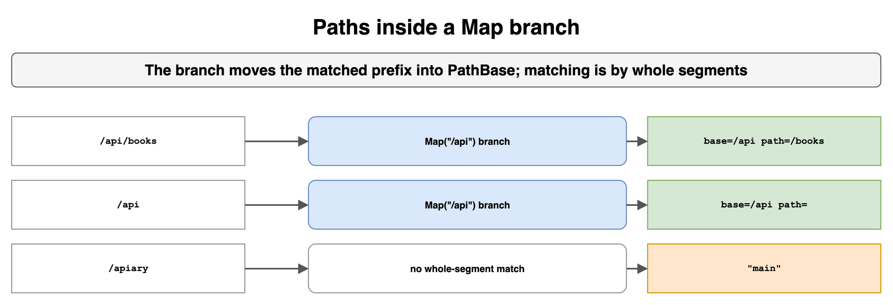
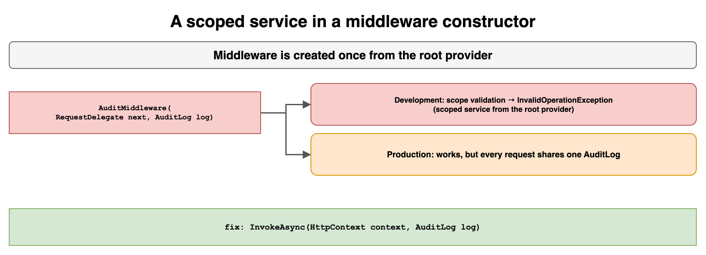

# Advanced Configuration — Drills

Predict the result before running the example.

## Paths inside a Map branch

What do `/api/books`, `/api`, and `/apiary` return?

```csharp
var builder = WebApplication.CreateBuilder(args);
var app = builder.Build();
app.Map("/api", api => api.Run(context =>
    context.Response.WriteAsync($"base={context.Request.PathBase} path={context.Request.Path}")));
app.Run(context => context.Response.WriteAsync("main"));
app.Run();
```

**Answer**

`/api/books` returns `base=/api path=/books`, and `/api` returns `base=/api path=`, because the branch moves the matched prefix into `PathBase`. `/apiary` returns `main`. `Map` matches whole path segments, so `/apiary` doesn't start with the segment `/api`.



*Source: [`diagrams/advanced-configuration-drills.drawio`](/content/12_ASP.NET_Core/31_Advanced_Configuration/diagrams/advanced-configuration-drills.drawio), page 1.*

## A scoped service in a middleware constructor

The middleware below takes a scoped service in its constructor. What happens when you run it in Development and request `/`? What changes in Production?

```csharp
var builder = WebApplication.CreateBuilder(args);
builder.Services.AddScoped<AuditLog>();
var app = builder.Build();
app.UseMiddleware<AuditMiddleware>();
app.MapGet("/", () => "catalog");
app.Run();

public class AuditMiddleware(RequestDelegate next, AuditLog log)
{
    public Task InvokeAsync(HttpContext context)
    {
        log.Entries.Add(context.Request.Path);
        return next(context);
    }
}

public class AuditLog { public List<string> Entries { get; } = []; }
```

**Answer**

In Development, scope validation is on, so creating the middleware throws an `InvalidOperationException`: a scoped service can't be resolved from the root provider. The middleware is created once, so the constructor would capture one `AuditLog` for the whole app. In Production, validation is off and the app works, but every request shares the same `AuditLog`. Move the parameter to `InvokeAsync(HttpContext context, AuditLog log)`.



*Source: [`diagrams/advanced-configuration-drills.drawio`](/content/12_ASP.NET_Core/31_Advanced_Configuration/diagrams/advanced-configuration-drills.drawio), page 2.*
