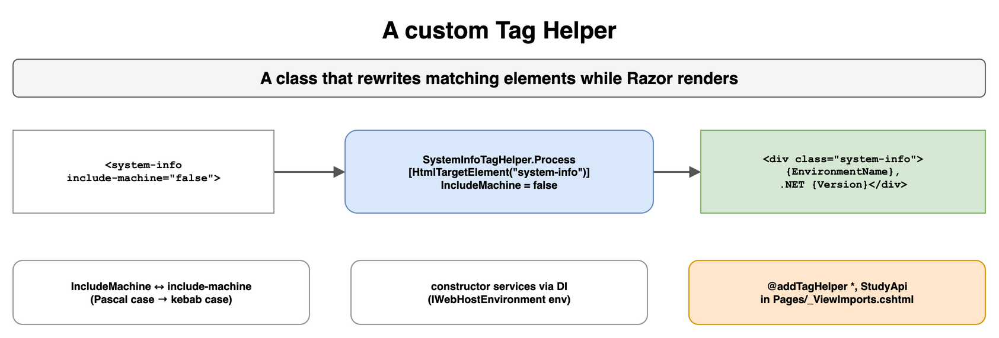
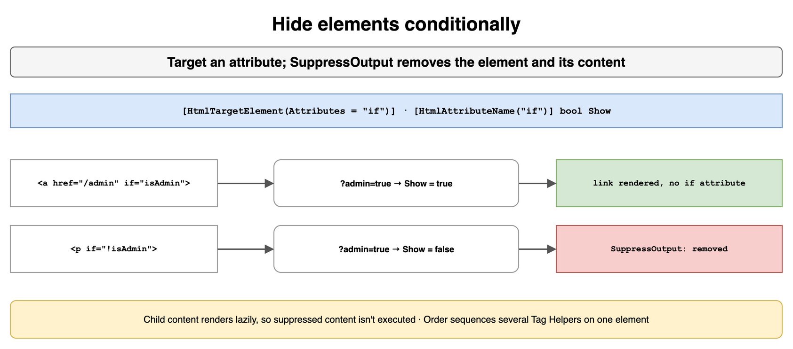
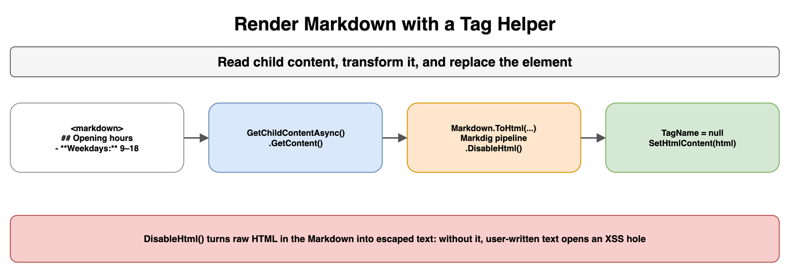
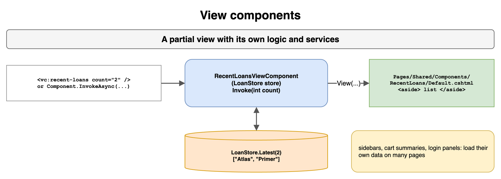
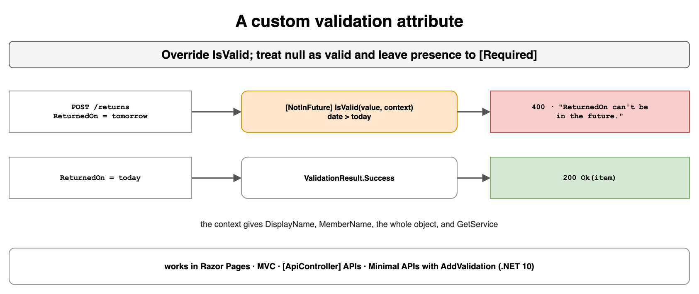
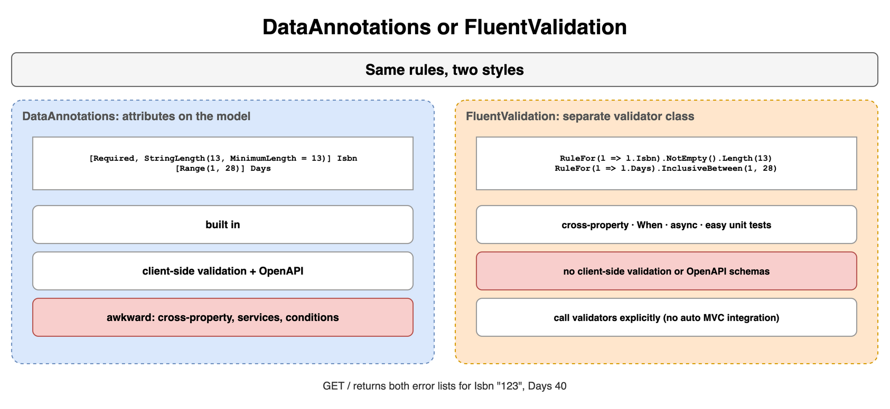
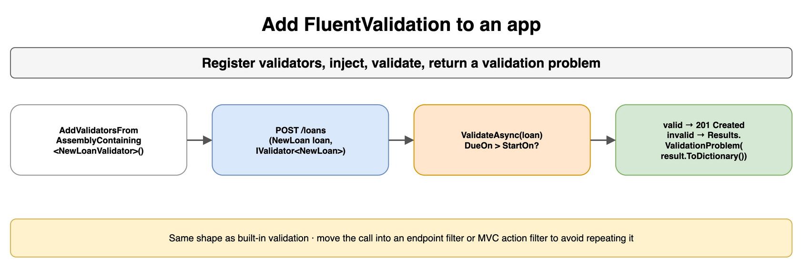

# Custom Razor Components

## A custom Tag Helper

A Tag Helper is a class that rewrites an element while Razor renders it. Derive from `TagHelper`, choose the elements it handles with `[HtmlTargetElement]`, and change the output in `Process`. Public properties bind to attributes, with Pascal case mapped to kebab case, so `IncludeMachine` binds `include-machine`. Tag Helpers are created by DI, so the constructor can take services.

Razor only applies Tag Helpers from assemblies listed in `@addTagHelper`. Add `@addTagHelper *, StudyApi` to `Pages/_ViewImports.cshtml` for helpers in your own project. The example replaces `<system-info>` with a `div` that lists environment details.

```csharp
using Microsoft.AspNetCore.Razor.TagHelpers;

var builder = WebApplication.CreateBuilder(args);
builder.Services.AddRazorPages();
var app = builder.Build();
app.MapRazorPages();
app.Run();

[HtmlTargetElement("system-info")]
public class SystemInfoTagHelper(IWebHostEnvironment env) : TagHelper
{
    public bool IncludeMachine { get; set; } = true;

    public override void Process(TagHelperContext context, TagHelperOutput output)
    {
        output.TagName = "div";
        output.TagMode = TagMode.StartTagAndEndTag;
        output.Attributes.SetAttribute("class", "system-info");
        var machine = IncludeMachine ? $" on {Environment.MachineName}" : "";
        output.Content.SetContent($"{env.EnvironmentName}{machine}, .NET {Environment.Version}");
    }
}
```

```cshtml
@* Pages/Index.cshtml *@
@page
<h1>Library</h1>
<system-info include-machine="false"></system-info>
```

[Microsoft Learn](https://learn.microsoft.com/en-us/aspnet/core/mvc/views/tag-helpers/authoring?view=aspnetcore-10.0)



*Source: [`diagrams/custom-razor-components.drawio`](/content/12_ASP.NET_Core/32_Custom_Razor_Components/diagrams/custom-razor-components.drawio), page 1.*

## Hide elements conditionally

A Tag Helper can target an attribute instead of an element. `[HtmlTargetElement(Attributes = "if")]` matches any element that has an `if` attribute. When the bound value is false, `output.SuppressOutput()` removes the element and its content from the page. Razor removes bound attributes from the output, so `if` never reaches the browser.

This replaces `@if` blocks around single elements and reads more like HTML. Child content renders lazily, so a suppressed element's content isn't even executed. Use `Order` when several Tag Helpers target the same element and the sequence matters. Add `?admin=true` to the URL to see the admin link instead of the hint.

```csharp
using Microsoft.AspNetCore.Razor.TagHelpers;

var builder = WebApplication.CreateBuilder(args);
builder.Services.AddRazorPages();
var app = builder.Build();
app.MapRazorPages();
app.Run();

[HtmlTargetElement(Attributes = "if")]
public class IfTagHelper : TagHelper
{
    [HtmlAttributeName("if")]
    public bool Show { get; set; } = true;

    public override void Process(TagHelperContext context, TagHelperOutput output)
    {
        if (!Show) output.SuppressOutput();
    }
}
```

```cshtml
@* Pages/Index.cshtml *@
@page
@{ var isAdmin = Request.Query["admin"] == "true"; }
<h1>Catalog</h1>
<a href="/admin" if="isAdmin">Manage the catalog</a>
<p if="!isAdmin">Sign in as staff to manage the catalog.</p>
```

[Microsoft Learn](https://learn.microsoft.com/en-us/aspnet/core/mvc/views/tag-helpers/authoring?view=aspnetcore-10.0#condition-tag-helper)



*Source: [`diagrams/custom-razor-components.drawio`](/content/12_ASP.NET_Core/32_Custom_Razor_Components/diagrams/custom-razor-components.drawio), page 2.*

## Render Markdown with a Tag Helper

A Tag Helper can read and transform its child content. `output.GetChildContentAsync()` renders the content between the tags, and `SetHtmlContent` replaces it with markup that Razor won't encode again. Setting `output.TagName = null` drops the wrapper element and keeps only the content.

The example converts Markdown to HTML with the Markdig package. Raw HTML inside Markdown passes through by default, which opens an [XSS hole](#12_ASP.NET_Core/29_Security_Hardening/concepts/cross-site-scripting) if users can write the text. `DisableHtml()` turns raw HTML into escaped text. Add the `Markdig` package to run it.

```csharp
using Markdig;
using Microsoft.AspNetCore.Razor.TagHelpers;

var builder = WebApplication.CreateBuilder(args);
builder.Services.AddRazorPages();
var app = builder.Build();
app.MapRazorPages();
app.Run();

[HtmlTargetElement("markdown")]
public class MarkdownTagHelper : TagHelper
{
    private static readonly MarkdownPipeline Pipeline =
        new MarkdownPipelineBuilder().UseAdvancedExtensions().DisableHtml().Build();

    public override async Task ProcessAsync(TagHelperContext context, TagHelperOutput output)
    {
        var markdown = (await output.GetChildContentAsync()).GetContent();
        output.TagName = null;
        output.Content.SetHtmlContent(Markdown.ToHtml(markdown, Pipeline));
    }
}
```

```cshtml
@* Pages/Index.cshtml *@
@page
<markdown>
## Opening hours
- **Weekdays:** 9–18
- *Weekends:* 10–14
</markdown>
```

[Microsoft Learn](https://learn.microsoft.com/en-us/aspnet/core/mvc/views/tag-helpers/authoring?view=aspnetcore-10.0#inspect-and-retrieve-child-content)



*Source: [`diagrams/custom-razor-components.drawio`](/content/12_ASP.NET_Core/32_Custom_Razor_Components/diagrams/custom-razor-components.drawio), page 3.*

## View components

A view component is a partial view with its own logic. It's a class that derives from `ViewComponent`, takes services in its constructor, and has an `Invoke` or `InvokeAsync` method that returns a view. It suits a sidebar, a cart summary, or a login panel: pieces that load their own data on many pages, where a partial would need every page model to supply that data.

Razor Pages looks for the view at `Pages/Shared/Components/{Name}/Default.cshtml`, where the name drops the `ViewComponent` suffix. Call it with `@await Component.InvokeAsync("RecentLoans", new { count = 2 })`, or as a Tag Helper, `<vc:recent-loans count="2" />`, once your assembly is registered with `@addTagHelper`.

```csharp
using Microsoft.AspNetCore.Mvc;

var builder = WebApplication.CreateBuilder(args);
builder.Services.AddRazorPages();
builder.Services.AddSingleton<LoanStore>();
var app = builder.Build();
app.MapRazorPages();
app.Run();

public class LoanStore
{
    public string[] Latest(int count) => new[] { "Atlas", "Primer", "Almanac" }.Take(count).ToArray();
}

public class RecentLoansViewComponent(LoanStore store) : ViewComponent
{
    public IViewComponentResult Invoke(int count) => View(store.Latest(count));
}
```

```cshtml
@* Pages/Shared/Components/RecentLoans/Default.cshtml *@
@model string[]
<aside><h2>Recent loans</h2><ul>@foreach (var title in Model) { <li>@title</li> }</ul></aside>
```

```cshtml
@* Pages/Index.cshtml *@
@page
<h1>Library</h1>
<vc:recent-loans count="2"></vc:recent-loans>
```

[Microsoft Learn](https://learn.microsoft.com/en-us/aspnet/core/mvc/views/view-components?view=aspnetcore-10.0)



*Source: [`diagrams/custom-razor-components.drawio`](/content/12_ASP.NET_Core/32_Custom_Razor_Components/diagrams/custom-razor-components.drawio), page 4.*

## A custom validation attribute

When the built-in attributes don't express a rule, derive from `ValidationAttribute` and override `IsValid(object? value, ValidationContext context)`. Return `ValidationResult.Success` or a `ValidationResult` with a message and the member name. The context gives the display name, the whole object being validated, and `GetService` for services the rule needs.

By convention a validation attribute treats null as valid and leaves required checks to `[Required]`, so attributes stay composable. The attribute works in Razor Pages, MVC, `[ApiController]` APIs, and, since .NET 10, Minimal APIs with `AddValidation`. Post a future date to see the 400 response.

```csharp
using System.ComponentModel.DataAnnotations;
using Microsoft.AspNetCore.Mvc;

var builder = WebApplication.CreateBuilder(args);
builder.Services.AddControllers();
var app = builder.Build();
app.MapControllers();
app.Run();

public class NotInFutureAttribute : ValidationAttribute
{
    protected override ValidationResult? IsValid(object? value, ValidationContext context)
    {
        if (value is DateOnly date && date > DateOnly.FromDateTime(DateTime.Today))
            return new ValidationResult($"{context.DisplayName} can't be in the future.", [context.MemberName!]);
        return ValidationResult.Success;
    }
}

public record Return([Required] string Isbn, [NotInFuture] DateOnly? ReturnedOn);

[ApiController, Route("returns")]
public class ReturnsController : ControllerBase
{
    [HttpPost] public IActionResult Record(Return item) => Ok(item);
}
```

[Microsoft Learn](https://learn.microsoft.com/en-us/aspnet/core/mvc/models/validation?view=aspnetcore-10.0#custom-attributes)



*Source: [`diagrams/custom-razor-components.drawio`](/content/12_ASP.NET_Core/32_Custom_Razor_Components/diagrams/custom-razor-components.drawio), page 5.*

## DataAnnotations or FluentValidation

DataAnnotations puts rules on the model as attributes. They're built in, understood by Razor client-side validation and OpenAPI, and fine for simple per-property rules. Rules that compare properties, depend on services, or change with conditions get awkward: they become custom attributes or `IValidatableObject` code mixed into the model.

FluentValidation, a popular open-source library, keeps rules in a separate validator class with a fluent API. Cross-property rules, conditions with `When`, and async checks read naturally, and validators are easy to unit test. It doesn't drive client-side validation or OpenAPI schemas. Its automatic MVC integration is no longer recommended by its authors, so you call validators explicitly. The example contrasts the two styles for the same rules.

```csharp
using System.ComponentModel.DataAnnotations;
using FluentValidation;

var builder = WebApplication.CreateBuilder(args);
var app = builder.Build();
app.MapGet("/", () =>
{
    var loan = new AnnotatedLoan { Isbn = "123", Days = 40 };
    var annotationErrors = new List<ValidationResult>();
    Validator.TryValidateObject(loan, new ValidationContext(loan), annotationErrors, validateAllProperties: true);
    var fluentErrors = new LoanValidator().Validate(new PlainLoan("123", 40)).Errors;
    return new { annotations = annotationErrors.Select(e => e.ErrorMessage), fluent = fluentErrors.Select(e => e.ErrorMessage) };
});
app.Run();

public class AnnotatedLoan
{
    [Required, StringLength(13, MinimumLength = 13)] public string Isbn { get; set; } = "";
    [Range(1, 28)] public int Days { get; set; }
}

public record PlainLoan(string Isbn, int Days);

public class LoanValidator : AbstractValidator<PlainLoan>
{
    public LoanValidator()
    {
        RuleFor(l => l.Isbn).NotEmpty().Length(13);
        RuleFor(l => l.Days).InclusiveBetween(1, 28);
    }
}
```

[Microsoft Learn](https://learn.microsoft.com/en-us/aspnet/core/mvc/models/validation?view=aspnetcore-10.0)



*Source: [`diagrams/custom-razor-components.drawio`](/content/12_ASP.NET_Core/32_Custom_Razor_Components/diagrams/custom-razor-components.drawio), page 6.*

## Add FluentValidation to an app

Register validators in DI as `IValidator<T>`, one by one or with `AddValidatorsFromAssemblyContaining<T>()` from the `FluentValidation.DependencyInjectionExtensions` package. Inject the validator into the handler, page, or controller, and call `ValidateAsync`. Return the errors as a validation problem so clients get the same shape as built-in validation.

`ToDictionary()` turns the result into the `IDictionary<string, string[]>` that `Results.ValidationProblem` expects. To avoid repeating the call in every handler, move it into an [endpoint filter](#12_ASP.NET_Core/07_Minimal_API_Binding_and_Validation) or MVC action filter. Post a loan where `DueOn` comes before `StartOn`.

```csharp
using FluentValidation;

var builder = WebApplication.CreateBuilder(args);
builder.Services.AddValidatorsFromAssemblyContaining<NewLoanValidator>();
var app = builder.Build();
app.MapPost("/loans", async (NewLoan loan, IValidator<NewLoan> validator) =>
{
    var result = await validator.ValidateAsync(loan);
    return result.IsValid ? Results.Created($"/loans/{loan.Isbn}", loan) : Results.ValidationProblem(result.ToDictionary());
});
app.Run();

public record NewLoan(string Isbn, DateOnly StartOn, DateOnly DueOn);

public class NewLoanValidator : AbstractValidator<NewLoan>
{
    public NewLoanValidator()
    {
        RuleFor(l => l.Isbn).NotEmpty().Length(13);
        RuleFor(l => l.DueOn).GreaterThan(l => l.StartOn).WithMessage("Due date must be after the start date.");
    }
}
```

[Microsoft Learn](https://learn.microsoft.com/en-us/aspnet/core/fundamentals/minimal-apis/handle-errors?view=aspnetcore-10.0)



*Source: [`diagrams/custom-razor-components.drawio`](/content/12_ASP.NET_Core/32_Custom_Razor_Components/diagrams/custom-razor-components.drawio), page 7.*
