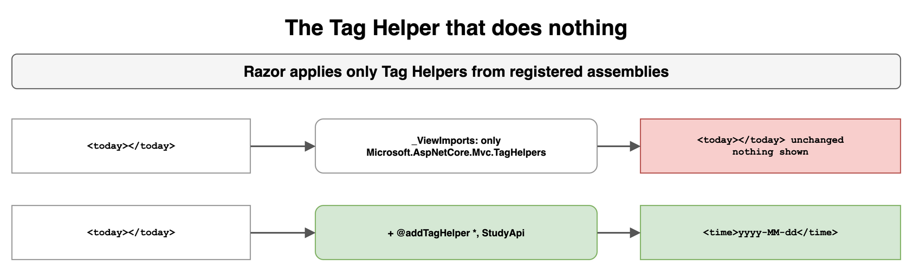
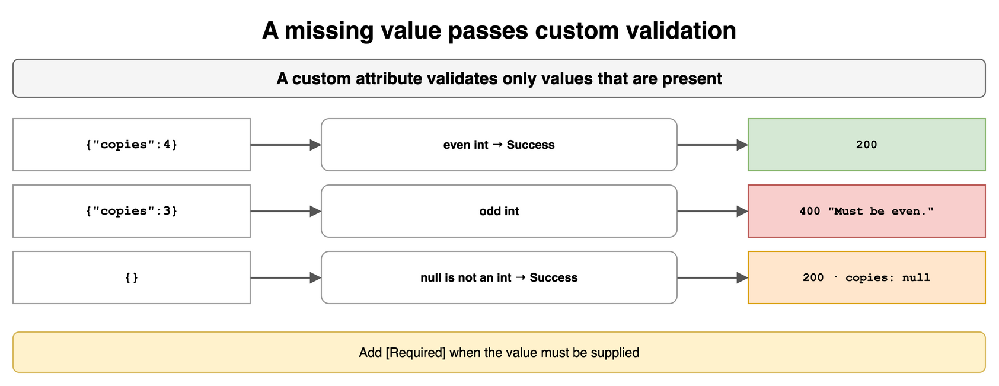

# Custom Razor Components — Drills

Predict the result before running the example.

## The Tag Helper that does nothing

The project is named `StudyApi`, and `Pages/_ViewImports.cshtml` contains only the MVC Tag Helpers line from the course setup. What does the browser receive for the page below?

```csharp
using Microsoft.AspNetCore.Razor.TagHelpers;

var builder = WebApplication.CreateBuilder(args);
builder.Services.AddRazorPages();
var app = builder.Build();
app.MapRazorPages();
app.Run();

[HtmlTargetElement("today")]
public class TodayTagHelper : TagHelper
{
    public override void Process(TagHelperContext context, TagHelperOutput output)
    {
        output.TagName = "time";
        output.Content.SetContent(DateTime.Today.ToString("yyyy-MM-dd"));
    }
}
```

```cshtml
@* Pages/Index.cshtml *@
@page
<p>Today is <today></today></p>
```

**Answer**

The browser receives `<today></today>` unchanged and shows nothing after "Today is". Razor applies only Tag Helpers from assemblies registered with `@addTagHelper`, and the setup registers only `Microsoft.AspNetCore.Mvc.TagHelpers`. Add `@addTagHelper *, StudyApi` to `_ViewImports.cshtml`, and the element becomes a `time` element with the date.



*Source: [`diagrams/custom-razor-components-drills.drawio`](/content/12_ASP.NET_Core/32_Custom_Razor_Components/diagrams/custom-razor-components-drills.drawio), page 1.*

## A missing value passes custom validation

Which of these requests return 200, and which return 400?

```csharp
using System.ComponentModel.DataAnnotations;
using Microsoft.AspNetCore.Mvc;

var builder = WebApplication.CreateBuilder(args);
builder.Services.AddControllers();
var app = builder.Build();
app.MapControllers();
app.Run();

public class EvenAttribute : ValidationAttribute
{
    protected override ValidationResult? IsValid(object? value, ValidationContext context) =>
        value is int n && n % 2 != 0 ? new ValidationResult("Must be even.") : ValidationResult.Success;
}

public record Shelf([Even] int? Copies);

[ApiController, Route("shelves")]
public class ShelvesController : ControllerBase
{
    [HttpPost] public IActionResult Add(Shelf shelf) => Ok(shelf);
}
```

```sh
curl -i -H 'Content-Type: application/json' -d '{"copies":4}' http://127.0.0.1:5080/shelves
curl -i -H 'Content-Type: application/json' -d '{"copies":3}' http://127.0.0.1:5080/shelves
curl -i -H 'Content-Type: application/json' -d '{}' http://127.0.0.1:5080/shelves
```

**Answer**

`4` returns 200 and `3` returns 400 with "Must be even." The empty object also returns 200 with `copies: null`, because the attribute treats any value that isn't an `int` as valid. That's the convention: a custom attribute validates only values that are present. Add `[Required]` when the value must be supplied.



*Source: [`diagrams/custom-razor-components-drills.drawio`](/content/12_ASP.NET_Core/32_Custom_Razor_Components/diagrams/custom-razor-components-drills.drawio), page 2.*
