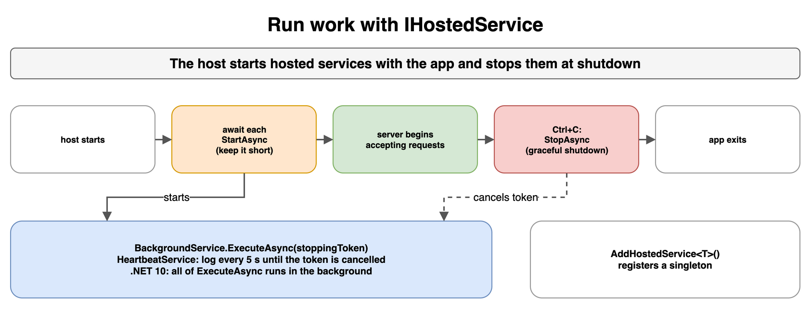
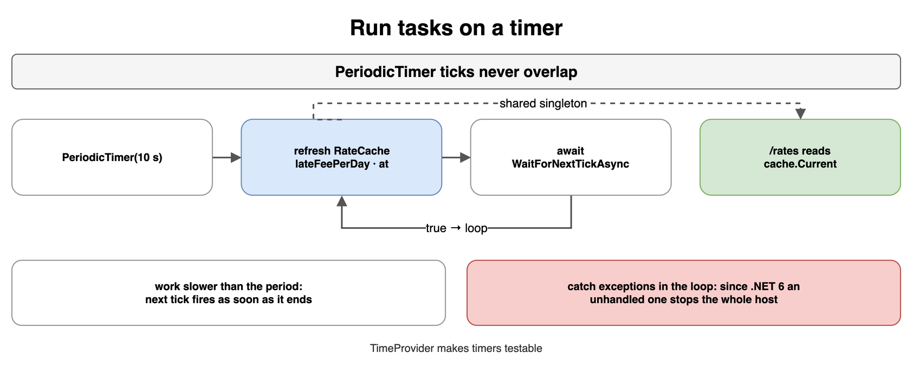
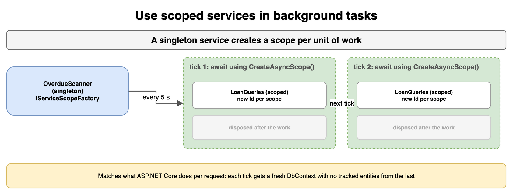
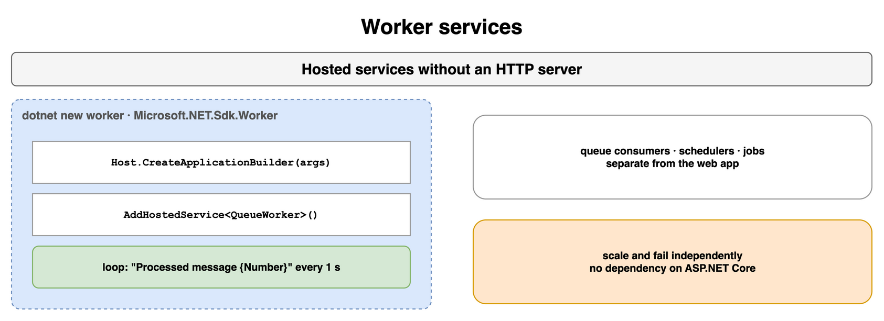
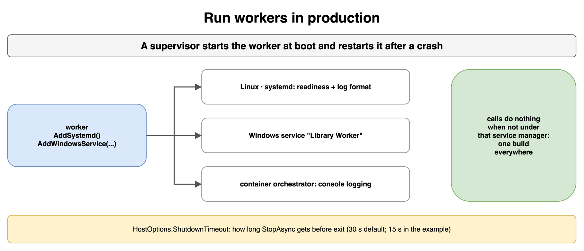
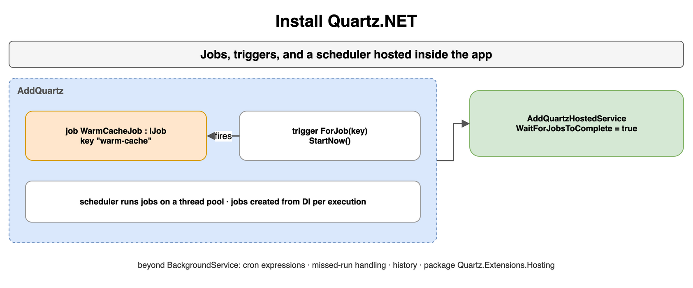
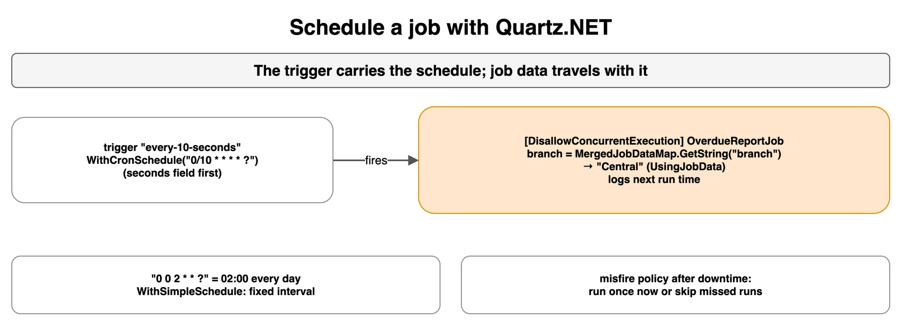
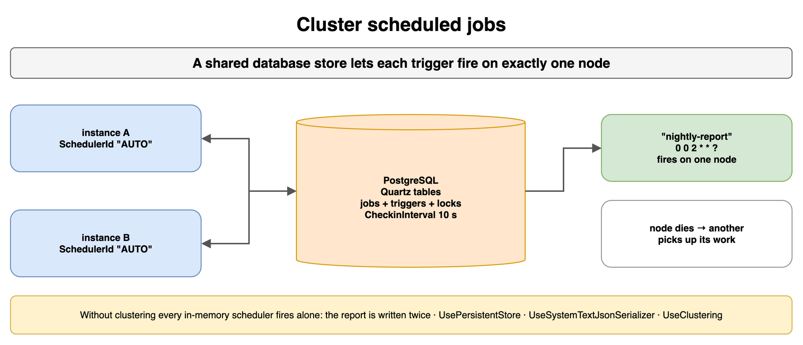

# Background Services

## Run work with IHostedService

A hosted service is a class that the host starts with the app and stops at shutdown. `IHostedService` has two methods: `StartAsync`, called before the server begins accepting requests, and `StopAsync`, called during graceful shutdown. Register one with `AddHostedService<T>()`, which registers it as a singleton.

The host awaits each `StartAsync` before the app starts listening, so keep it short. Start long-running work in the background and return. For that, derive from `BackgroundService` and put the loop in `ExecuteAsync`. In .NET 10, the host runs all of `ExecuteAsync` in the background, so even synchronous code at the start of it no longer delays startup. The stopping token is cancelled when shutdown begins. Watch the log while the app runs and press Ctrl+C.

```csharp
var builder = WebApplication.CreateBuilder(args);
builder.Services.AddHostedService<HeartbeatService>();
var app = builder.Build();
app.MapGet("/", () => "running");
app.Run();

public class HeartbeatService(ILogger<HeartbeatService> logger) : BackgroundService
{
    protected override async Task ExecuteAsync(CancellationToken stoppingToken)
    {
        logger.LogInformation("Heartbeat service started");
        try
        {
            while (!stoppingToken.IsCancellationRequested)
            {
                logger.LogInformation("Heartbeat at {Time:T}", DateTimeOffset.Now);
                await Task.Delay(TimeSpan.FromSeconds(5), stoppingToken);
            }
        }
        catch (OperationCanceledException) { }
        logger.LogInformation("Heartbeat service stopping");
    }
}
```

[Microsoft Learn](https://learn.microsoft.com/en-us/aspnet/core/fundamentals/host/hosted-services?view=aspnetcore-10.0)



*Source: [`diagrams/background-services.drawio`](/content/12_ASP.NET_Core/34_Background_Services/diagrams/background-services.drawio), page 1.*

## Run tasks on a timer

`PeriodicTimer` is the simplest timer for async loops. `await timer.WaitForNextTickAsync(token)` returns true at each tick and false once the timer is disposed. It never runs ticks in parallel: if the work takes longer than the period, the next tick fires as soon as the work ends.

Catch exceptions inside the loop. Since .NET 6, an unhandled exception in `ExecuteAsync` stops the whole host by default. That's safer than silently losing the service, but it means one bad tick takes the app down. Use `TimeProvider` to make timers testable. The example refreshes a shared cache every ten seconds, and `/rates` reads it.

```csharp
var builder = WebApplication.CreateBuilder(args);
builder.Services.AddSingleton<RateCache>();
builder.Services.AddHostedService<RateRefresher>();
var app = builder.Build();
app.MapGet("/rates", (RateCache cache) => cache.Current);
app.Run();

public class RateCache { public object Current { get; set; } = "not loaded"; }

public class RateRefresher(RateCache cache, ILogger<RateRefresher> logger) : BackgroundService
{
    protected override async Task ExecuteAsync(CancellationToken stoppingToken)
    {
        using var timer = new PeriodicTimer(TimeSpan.FromSeconds(10));
        do
        {
            try
            {
                cache.Current = new { lateFeePerDay = Random.Shared.Next(10, 30) / 100m, at = DateTimeOffset.Now };
            }
            catch (Exception ex)
            {
                logger.LogError(ex, "Refresh failed");
            }
        } while (await timer.WaitForNextTickAsync(stoppingToken));
    }
}
```

[Microsoft Learn](https://learn.microsoft.com/en-us/aspnet/core/fundamentals/host/hosted-services?view=aspnetcore-10.0#timed-background-tasks)



*Source: [`diagrams/background-services.drawio`](/content/12_ASP.NET_Core/34_Background_Services/diagrams/background-services.drawio), page 2.*

## Use scoped services in background tasks

Hosted services are singletons, so they can't take scoped services such as a `DbContext` in the constructor. Inject `IServiceScopeFactory` instead and create a scope for each unit of work, such as each tick or each message. Resolve the scoped services from `scope.ServiceProvider` and dispose the scope when the work is done.

A scope per unit of work matches what ASP.NET Core does per request: each tick gets a fresh `DbContext` with no tracked entities from the last one. `CreateAsyncScope` supports services that implement `IAsyncDisposable`. The example counts overdue loans in a scoped service every five seconds.

```csharp
var builder = WebApplication.CreateBuilder(args);
builder.Services.AddScoped<LoanQueries>();
builder.Services.AddHostedService<OverdueScanner>();
var app = builder.Build();
app.Run();

public class LoanQueries
{
    public Guid Id { get; } = Guid.NewGuid();
    public int CountOverdue() => Random.Shared.Next(0, 5);
}

public class OverdueScanner(IServiceScopeFactory scopes, ILogger<OverdueScanner> logger) : BackgroundService
{
    protected override async Task ExecuteAsync(CancellationToken stoppingToken)
    {
        using var timer = new PeriodicTimer(TimeSpan.FromSeconds(5));
        while (await timer.WaitForNextTickAsync(stoppingToken))
        {
            await using var scope = scopes.CreateAsyncScope();
            var queries = scope.ServiceProvider.GetRequiredService<LoanQueries>();
            logger.LogInformation("Scope {Id}: {Count} overdue", queries.Id, queries.CountOverdue());
        }
    }
}
```

[Microsoft Learn](https://learn.microsoft.com/en-us/aspnet/core/fundamentals/host/hosted-services?view=aspnetcore-10.0#consuming-a-scoped-service-in-a-background-task)



*Source: [`diagrams/background-services.drawio`](/content/12_ASP.NET_Core/34_Background_Services/diagrams/background-services.drawio), page 3.*

## Worker services

A worker service is an app with hosted services and no HTTP server. `dotnet new worker` creates one with `Host.CreateApplicationBuilder`, a `Worker` class that derives from `BackgroundService`, and the usual configuration and logging. Use it for queue consumers, schedulers, and other jobs that should run separately from the web app, so they can scale and fail independently.

Workers don't depend on ASP.NET Core, so the project uses the `Microsoft.NET.Sdk.Worker` SDK. The `Program.cs` of a worker looks like the example. It also runs in the `StudyApi` project.

```csharp
var builder = Host.CreateApplicationBuilder(args);
builder.Services.AddHostedService<QueueWorker>();
var host = builder.Build();
host.Run();

public class QueueWorker(ILogger<QueueWorker> logger) : BackgroundService
{
    protected override async Task ExecuteAsync(CancellationToken stoppingToken)
    {
        var processed = 0;
        while (!stoppingToken.IsCancellationRequested)
        {
            logger.LogInformation("Processed message {Number}", ++processed);
            await Task.Delay(1000, stoppingToken);
        }
    }
}
```

[Microsoft Learn](https://learn.microsoft.com/en-us/dotnet/core/extensions/workers)



*Source: [`diagrams/background-services.drawio`](/content/12_ASP.NET_Core/34_Background_Services/diagrams/background-services.drawio), page 4.*

## Run workers in production

A worker needs a supervisor that starts it at boot and restarts it after a crash. On Linux, add the `Microsoft.Extensions.Hosting.Systemd` package and call `AddSystemd()`. The worker then reports readiness to systemd and logs in its format. On Windows, `AddWindowsService()` from `Microsoft.Extensions.Hosting.WindowsServices` lets the app run as a Windows service. In containers, the orchestrator is the supervisor, and the default console logging already works.

Both calls do nothing when the app isn't running under that service manager, so one build works everywhere. `HostOptions.ShutdownTimeout` controls how long `StopAsync` gets before the process exits. It's 30 seconds by default. The example configures all of these for one worker.

```csharp
var builder = Host.CreateApplicationBuilder(args);
builder.Services.AddSystemd();
builder.Services.AddWindowsService(options => options.ServiceName = "Library Worker");
builder.Services.Configure<HostOptions>(options => options.ShutdownTimeout = TimeSpan.FromSeconds(15));
builder.Services.AddHostedService<ReportWorker>();
builder.Build().Run();

public class ReportWorker(ILogger<ReportWorker> logger) : BackgroundService
{
    protected override async Task ExecuteAsync(CancellationToken stoppingToken)
    {
        while (!stoppingToken.IsCancellationRequested)
        {
            logger.LogInformation("Report generated");
            await Task.Delay(TimeSpan.FromSeconds(30), stoppingToken);
        }
    }
}
```

[Microsoft Learn](https://learn.microsoft.com/en-us/dotnet/core/extensions/workers#deployment-considerations)



*Source: [`diagrams/background-services.drawio`](/content/12_ASP.NET_Core/34_Background_Services/diagrams/background-services.drawio), page 5.*

## Install Quartz.NET

`BackgroundService` is fine for simple loops, but real schedules need more: cron expressions, missed-run handling, and history. Quartz.NET is an open-source scheduler that adds these. A job is a class that implements `IJob`. Triggers decide when jobs run, and a scheduler runs them on a thread pool.

Add the `Quartz.Extensions.Hosting` package. `AddQuartz` configures the scheduler and its jobs, and `AddQuartzHostedService` runs it inside the host. With `WaitForJobsToComplete`, shutdown waits for running jobs. Jobs are created from DI per execution, so they can take scoped services. The example runs a job once at startup.

```csharp
using Quartz;

var builder = WebApplication.CreateBuilder(args);
builder.Services.AddQuartz(quartz =>
{
    var key = new JobKey("warm-cache");
    quartz.AddJob<WarmCacheJob>(job => job.WithIdentity(key));
    quartz.AddTrigger(trigger => trigger.ForJob(key).StartNow());
});
builder.Services.AddQuartzHostedService(options => options.WaitForJobsToComplete = true);
var app = builder.Build();
app.Run();

public class WarmCacheJob(ILogger<WarmCacheJob> logger) : IJob
{
    public Task Execute(IJobExecutionContext context)
    {
        logger.LogInformation("Cache warmed at {Time:T}", context.FireTimeUtc.ToLocalTime());
        return Task.CompletedTask;
    }
}
```

[Quartz.NET](https://www.quartz-scheduler.net/documentation/quartz-3.x/packages/hosted-services-integration.html)



*Source: [`diagrams/background-services.drawio`](/content/12_ASP.NET_Core/34_Background_Services/diagrams/background-services.drawio), page 6.*

## Schedule a job with Quartz.NET

Triggers carry the schedule. `WithCronSchedule` takes a Quartz cron expression, which has a seconds field first: `0 0 2 * * ?` means 02:00 every day. `WithSimpleSchedule` repeats at a fixed interval. Data for the job goes in `UsingJobData` and is read from `context.MergedJobDataMap`.

Mark a job `[DisallowConcurrentExecution]` when two runs must never overlap, such as a report that writes the same file. The misfire policy says what to do after downtime, such as running once now or skipping missed runs. The example writes an overdue report every ten seconds.

```csharp
using Quartz;

var builder = WebApplication.CreateBuilder(args);
builder.Services.AddQuartz(quartz =>
{
    var key = new JobKey("overdue-report");
    quartz.AddJob<OverdueReportJob>(job => job.WithIdentity(key).UsingJobData("branch", "Central"));
    quartz.AddTrigger(trigger => trigger.ForJob(key).WithIdentity("every-10-seconds")
        .WithCronSchedule("0/10 * * * * ?"));
});
builder.Services.AddQuartzHostedService(options => options.WaitForJobsToComplete = true);
var app = builder.Build();
app.Run();

[DisallowConcurrentExecution]
public class OverdueReportJob(ILogger<OverdueReportJob> logger) : IJob
{
    public async Task Execute(IJobExecutionContext context)
    {
        var branch = context.MergedJobDataMap.GetString("branch");
        logger.LogInformation("Overdue report for {Branch}, next run {Next:T}", branch, context.NextFireTimeUtc?.ToLocalTime());
        await Task.Delay(500, context.CancellationToken);
    }
}
```

[Quartz.NET](https://www.quartz-scheduler.net/documentation/quartz-3.x/tutorial/crontriggers.html)



*Source: [`diagrams/background-services.drawio`](/content/12_ASP.NET_Core/34_Background_Services/diagrams/background-services.drawio), page 7.*

## Cluster scheduled jobs

Run a scheduled job in two app instances and each instance fires it, so the report is written twice. Without coordination, every in-memory scheduler acts alone. Quartz clustering moves jobs and triggers into a shared database. The instances then take turns through database locks: each trigger fires on exactly one node, and if that node dies another one picks up its work.

Configure a persistent store with `UsePersistentStore`, a database provider, a serializer, and `UseClustering`. Create the Quartz tables with the scripts that ship with Quartz. Each instance needs a unique instance id, which `AutoGenerate` provides. The example uses PostgreSQL. It needs the `Quartz.Serialization.SystemTextJson` package and a running database.

```csharp
using Quartz;

var builder = WebApplication.CreateBuilder(args);
builder.Services.AddQuartz(quartz =>
{
    quartz.SchedulerId = "AUTO";
    quartz.UsePersistentStore(store =>
    {
        store.UseProperties = true;
        store.UsePostgres(builder.Configuration.GetConnectionString("Quartz")!);
        store.UseSystemTextJsonSerializer();
        store.UseClustering(cluster => cluster.CheckinInterval = TimeSpan.FromSeconds(10));
    });
    var key = new JobKey("nightly-report");
    quartz.AddJob<NightlyReportJob>(job => job.WithIdentity(key));
    quartz.AddTrigger(trigger => trigger.ForJob(key).WithCronSchedule("0 0 2 * * ?"));
});
builder.Services.AddQuartzHostedService();
builder.Build().Run();

public class NightlyReportJob(ILogger<NightlyReportJob> logger) : IJob
{
    public Task Execute(IJobExecutionContext context)
    {
        logger.LogInformation("Report on {Instance}", context.Scheduler.SchedulerInstanceId);
        return Task.CompletedTask;
    }
}
```

[Quartz.NET](https://www.quartz-scheduler.net/documentation/quartz-3.x/tutorial/advanced-enterprise-features.html)



*Source: [`diagrams/background-services.drawio`](/content/12_ASP.NET_Core/34_Background_Services/diagrams/background-services.drawio), page 8.*
