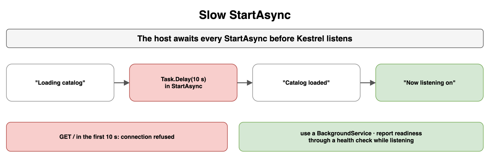
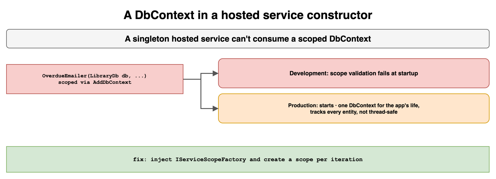

# Background Services — Drills

Predict the result before running the example.

## Slow StartAsync

The service below loads data in `StartAsync`. What happens if you request `/` during the first ten seconds after `dotnet run`?

```csharp
var builder = WebApplication.CreateBuilder(args);
builder.Services.AddHostedService<CatalogLoader>();
var app = builder.Build();
app.MapGet("/", () => "ready");
app.Run();

public class CatalogLoader(ILogger<CatalogLoader> logger) : IHostedService
{
    public async Task StartAsync(CancellationToken cancellationToken)
    {
        logger.LogInformation("Loading catalog");
        await Task.Delay(TimeSpan.FromSeconds(10), cancellationToken);
        logger.LogInformation("Catalog loaded");
    }

    public Task StopAsync(CancellationToken cancellationToken) => Task.CompletedTask;
}
```

**Answer**

The connection is refused. The host awaits every `StartAsync` before Kestrel starts listening, so "Now listening on" appears only after "Catalog loaded". Use a `BackgroundService` for long work. To block traffic until data is ready, keep the app listening and report readiness through a health check instead.



*Source: [`diagrams/background-services-drills.drawio`](/content/12_ASP.NET_Core/34_Background_Services/diagrams/background-services-drills.drawio), page 1.*

## A DbContext in a hosted service constructor

`LibraryDb` is registered with `AddDbContext`, so it's scoped. What happens when the app starts in Development, and what changes in Production?

```csharp
public class OverdueEmailer(LibraryDb db, ILogger<OverdueEmailer> logger) : BackgroundService
{
    protected override async Task ExecuteAsync(CancellationToken stoppingToken)
    {
        while (!stoppingToken.IsCancellationRequested)
        {
            logger.LogInformation("{Count} loans", await db.Loans.CountAsync(stoppingToken));
            await Task.Delay(TimeSpan.FromMinutes(1), stoppingToken);
        }
    }
}
```

**Answer**

In Development, scope validation fails at startup: a scoped service can't be consumed from the singleton `IHostedService`. In Production, validation is off, so the app starts. The single `DbContext` then lives for the whole app, tracks every entity it loads, and isn't thread-safe. Inject `IServiceScopeFactory` and create a scope per iteration.



*Source: [`diagrams/background-services-drills.drawio`](/content/12_ASP.NET_Core/34_Background_Services/diagrams/background-services-drills.drawio), page 2.*
