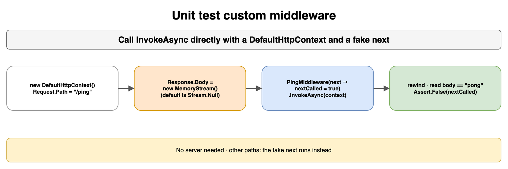
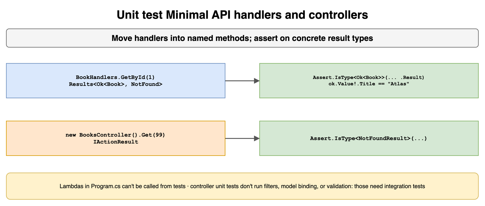
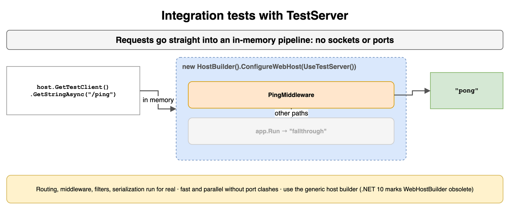
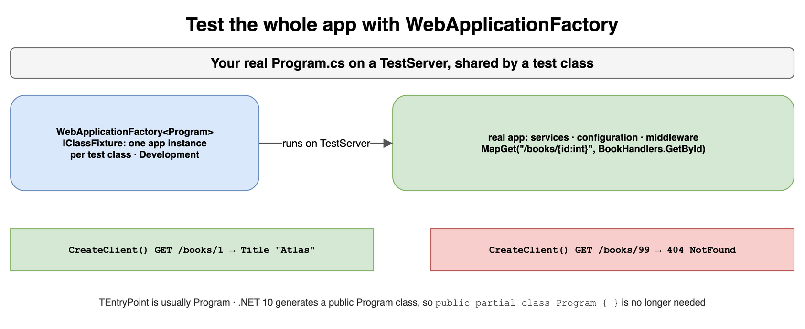
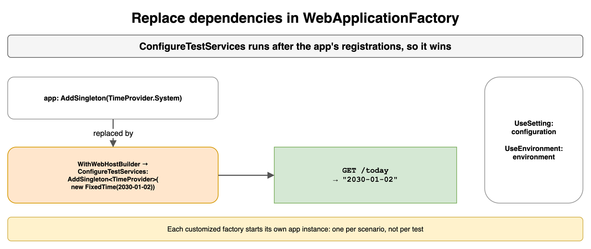
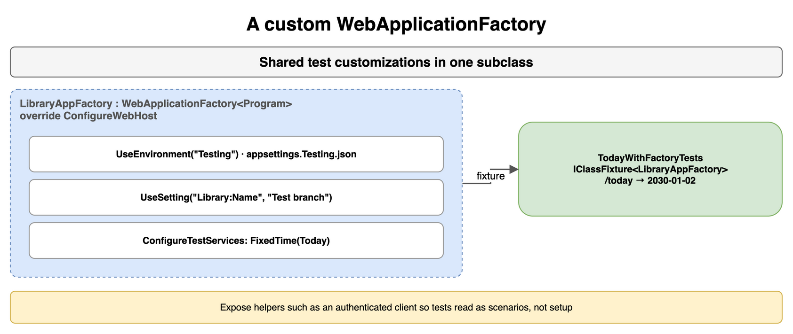
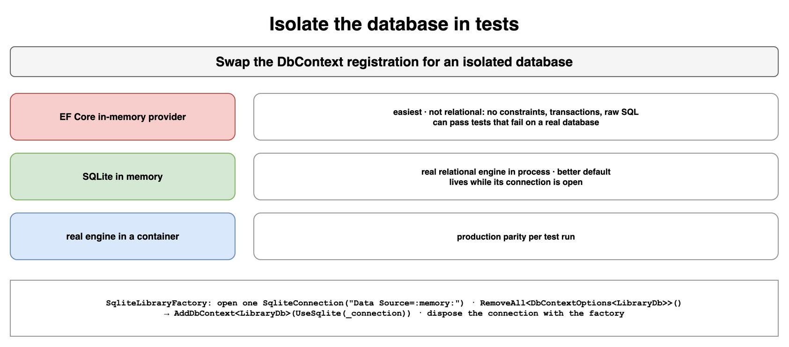

# Testing ASP.NET Core Apps

## Unit test custom middleware

Middleware is a class with an `InvokeAsync(HttpContext)` method and a `next` delegate, so you can test it without a server. Create a `DefaultHttpContext`, set the request properties you need, pass a lambda as `next`, and assert on the response or on whether `next` ran.

The response body of a `DefaultHttpContext` is `Stream.Null` by default, so writes disappear. Set `context.Response.Body` to a `MemoryStream` when the test reads the body, and rewind it before reading. The app below defines the middleware. The test checks that `/ping` short-circuits and that other paths reach `next`.

```csharp
var builder = WebApplication.CreateBuilder(args);
var app = builder.Build();
app.UseMiddleware<PingMiddleware>();
app.MapGet("/", () => "catalog");
app.Run();

public class PingMiddleware(RequestDelegate next)
{
    public async Task InvokeAsync(HttpContext context)
    {
        if (context.Request.Path == "/ping") await context.Response.WriteAsync("pong");
        else await next(context);
    }
}
```

```csharp
// StudyApi.Tests/PingMiddlewareTests.cs
using Microsoft.AspNetCore.Http;

namespace StudyApi.Tests;

public class PingMiddlewareTests
{
    [Fact]
    public async Task Ping_returns_pong_without_calling_next()
    {
        var nextCalled = false;
        var middleware = new PingMiddleware(_ => { nextCalled = true; return Task.CompletedTask; });
        var context = new DefaultHttpContext();
        context.Request.Path = "/ping";
        context.Response.Body = new MemoryStream();

        await middleware.InvokeAsync(context);

        context.Response.Body.Position = 0;
        Assert.Equal("pong", await new StreamReader(context.Response.Body).ReadToEndAsync());
        Assert.False(nextCalled);
    }
}
```

[Microsoft Learn](https://learn.microsoft.com/en-us/aspnet/core/test/middleware?view=aspnetcore-10.0)



*Source: [`diagrams/testing-aspnet-apps.drawio`](/content/12_ASP.NET_Core/36_Testing_ASP.NET_Core_Apps/diagrams/testing-aspnet-apps.drawio), page 1.*

## Unit test Minimal API handlers and controllers

Handlers that are lambdas inside `Program.cs` can't be called from a test. Move them into static methods and map those methods instead. Return `TypedResults` with a `Results<T1, T2>` return type. The test can then check the concrete result type and its value instead of parsing JSON.

Controllers are classes too. Create one with fake dependencies, call the action, and assert on the `IActionResult`, such as `OkObjectResult` or `NotFoundResult`. Unit tests of controllers don't run filters, model binding, or validation. Those need integration tests. The example tests both styles.

```csharp
using Microsoft.AspNetCore.Http.HttpResults;
using Microsoft.AspNetCore.Mvc;

var builder = WebApplication.CreateBuilder(args);
builder.Services.AddControllers();
var app = builder.Build();
app.MapGet("/books/{id:int}", BookHandlers.GetById);
app.MapControllers();
app.Run();

public record Book(int Id, string Title);

public static class BookHandlers
{
    public static readonly Book[] Books = [new(1, "Atlas")];

    public static Results<Ok<Book>, NotFound> GetById(int id) =>
        Books.FirstOrDefault(b => b.Id == id) is { } book ? TypedResults.Ok(book) : TypedResults.NotFound();
}

[ApiController, Route("api/books")]
public class BooksController : ControllerBase
{
    [HttpGet("{id:int}")]
    public IActionResult Get(int id) => BookHandlers.Books.FirstOrDefault(b => b.Id == id) is { } book ? Ok(book) : NotFound();
}
```

```csharp
// StudyApi.Tests/BookTests.cs
using Microsoft.AspNetCore.Http.HttpResults;
using Microsoft.AspNetCore.Mvc;

namespace StudyApi.Tests;

public class BookTests
{
    [Fact]
    public void Handler_returns_ok_for_known_id()
    {
        var ok = Assert.IsType<Ok<Book>>(BookHandlers.GetById(1).Result);
        Assert.Equal("Atlas", ok.Value!.Title);
    }

    [Fact]
    public void Controller_returns_not_found_for_unknown_id() =>
        Assert.IsType<NotFoundResult>(new BooksController().Get(99));
}
```

[Microsoft Learn](https://learn.microsoft.com/en-us/aspnet/core/fundamentals/minimal-apis/test-min-api?view=aspnetcore-10.0)



*Source: [`diagrams/testing-aspnet-apps.drawio`](/content/12_ASP.NET_Core/36_Testing_ASP.NET_Core_Apps/diagrams/testing-aspnet-apps.drawio), page 2.*

## Integration tests with TestServer

`TestServer`, from the `Microsoft.AspNetCore.TestHost` package, runs an ASP.NET Core pipeline in memory. Requests from its `HttpClient` go straight into the pipeline without sockets or ports, so integration tests are fast and run in parallel without port clashes. Routing, middleware, filters, and serialization all run for real.

Build a host with `UseTestServer()` and the pipeline you want to test. This suits testing middleware or a library's endpoints with a small, purpose-built app. Use the generic host builder, because .NET 10 marks `WebHostBuilder` obsolete. The test uses `PingMiddleware` from the first card's `Program.cs`. To test your actual app, use `WebApplicationFactory`, covered next.

```csharp
// StudyApi.Tests/TestServerTests.cs
using Microsoft.AspNetCore.Builder;
using Microsoft.AspNetCore.Hosting;
using Microsoft.AspNetCore.Http;
using Microsoft.AspNetCore.TestHost;
using Microsoft.Extensions.Hosting;

namespace StudyApi.Tests;

public class TestServerTests
{
    [Fact]
    public async Task Ping_middleware_answers_in_a_real_pipeline()
    {
        using var host = await new HostBuilder()
            .ConfigureWebHost(web => web.UseTestServer().Configure(app =>
            {
                app.UseMiddleware<PingMiddleware>();
                app.Run(context => context.Response.WriteAsync("fallthrough"));
            }))
            .StartAsync();

        var response = await host.GetTestClient().GetStringAsync("/ping");

        Assert.Equal("pong", response);
    }
}
```

[Microsoft Learn](https://learn.microsoft.com/en-us/aspnet/core/test/middleware?view=aspnetcore-10.0)



*Source: [`diagrams/testing-aspnet-apps.drawio`](/content/12_ASP.NET_Core/36_Testing_ASP.NET_Core_Apps/diagrams/testing-aspnet-apps.drawio), page 3.*

## Test the whole app with WebApplicationFactory

`WebApplicationFactory<TEntryPoint>`, from `Microsoft.AspNetCore.Mvc.Testing`, starts your real app on a `TestServer`. It runs `Program.cs` with its services, configuration, and middleware, and gives you an `HttpClient` from `CreateClient()`. Use it as an xUnit class fixture so all tests in a class share one app instance.

`TEntryPoint` is usually `Program`. Top-level statements generate an internal `Program` class. In .NET 10, a source generator makes it public, so the old `public partial class Program { }` line is no longer needed. The factory sets the environment to Development and finds the app's content root. The test below calls the app from the previous card.

```csharp
// StudyApi.Tests/BooksApiTests.cs
using System.Net;
using System.Net.Http.Json;
using Microsoft.AspNetCore.Mvc.Testing;

namespace StudyApi.Tests;

public class BooksApiTests(WebApplicationFactory<Program> factory) : IClassFixture<WebApplicationFactory<Program>>
{
    [Fact]
    public async Task Get_book_returns_json()
    {
        var book = await factory.CreateClient().GetFromJsonAsync<Book>("/books/1");

        Assert.Equal("Atlas", book!.Title);
    }

    [Fact]
    public async Task Unknown_book_returns_404()
    {
        var response = await factory.CreateClient().GetAsync("/books/99");

        Assert.Equal(HttpStatusCode.NotFound, response.StatusCode);
    }
}
```

[Microsoft Learn](https://learn.microsoft.com/en-us/aspnet/core/test/integration-tests?view=aspnetcore-10.0)



*Source: [`diagrams/testing-aspnet-apps.drawio`](/content/12_ASP.NET_Core/36_Testing_ASP.NET_Core_Apps/diagrams/testing-aspnet-apps.drawio), page 4.*

## Replace dependencies in WebApplicationFactory

Integration tests often need to swap one dependency, such as the clock, an email sender, or a remote API client, while keeping the rest of the app real. `WithWebHostBuilder` creates a customized factory. Its `ConfigureTestServices` registrations run after the app's own, so a registration there replaces the app's service for that factory.

`UseSetting` overrides configuration values, and `UseEnvironment` picks the environment. Each customized factory starts its own app instance, so create one per scenario rather than per test where you can. The app here returns the current date from a `TimeProvider`, and the test fixes the date with a fake.

```csharp
var builder = WebApplication.CreateBuilder(args);
builder.Services.AddSingleton(TimeProvider.System);
var app = builder.Build();
app.MapGet("/today", (TimeProvider time) => time.GetUtcNow().ToString("yyyy-MM-dd"));
app.Run();
```

```csharp
// StudyApi.Tests/TodayTests.cs
using Microsoft.AspNetCore.Mvc.Testing;
using Microsoft.AspNetCore.TestHost;
using Microsoft.Extensions.DependencyInjection;

namespace StudyApi.Tests;

public class TodayTests(WebApplicationFactory<Program> factory) : IClassFixture<WebApplicationFactory<Program>>
{
    [Fact]
    public async Task Today_uses_the_clock()
    {
        var client = factory.WithWebHostBuilder(web => web.ConfigureTestServices(services =>
            services.AddSingleton<TimeProvider>(new FixedTime(new DateTimeOffset(2030, 1, 2, 0, 0, 0, TimeSpan.Zero)))))
            .CreateClient();

        Assert.Equal("2030-01-02", await client.GetStringAsync("/today"));
    }

    private sealed class FixedTime(DateTimeOffset now) : TimeProvider
    {
        public override DateTimeOffset GetUtcNow() => now;
    }
}
```

[Microsoft Learn](https://learn.microsoft.com/en-us/aspnet/core/test/integration-tests?view=aspnetcore-10.0#inject-mock-services)



*Source: [`diagrams/testing-aspnet-apps.drawio`](/content/12_ASP.NET_Core/36_Testing_ASP.NET_Core_Apps/diagrams/testing-aspnet-apps.drawio), page 5.*

## A custom WebApplicationFactory

When many test classes need the same customizations, put them in a subclass of `WebApplicationFactory<Program>`. Override `ConfigureWebHost` to set the environment, override configuration, and replace services in one place. Test classes then use the subclass as their fixture.

A `Testing` environment with its own `appsettings.Testing.json` keeps test settings out of Development. Expose helpers, such as a method that creates an authenticated client, so tests read as scenarios rather than setup. The example uses the `/today` app from the previous card.

```csharp
// StudyApi.Tests/LibraryAppFactory.cs
using Microsoft.AspNetCore.Hosting;
using Microsoft.AspNetCore.Mvc.Testing;
using Microsoft.AspNetCore.TestHost;
using Microsoft.Extensions.DependencyInjection;

namespace StudyApi.Tests;

public class LibraryAppFactory : WebApplicationFactory<Program>
{
    public static readonly DateTimeOffset Today = new(2030, 1, 2, 0, 0, 0, TimeSpan.Zero);

    protected override void ConfigureWebHost(IWebHostBuilder builder)
    {
        builder.UseEnvironment("Testing");
        builder.UseSetting("Library:Name", "Test branch");
        builder.ConfigureTestServices(services => services.AddSingleton<TimeProvider>(new FixedTime(Today)));
    }

    private sealed class FixedTime(DateTimeOffset now) : TimeProvider
    {
        public override DateTimeOffset GetUtcNow() => now;
    }
}

public class TodayWithFactoryTests(LibraryAppFactory factory) : IClassFixture<LibraryAppFactory>
{
    [Fact]
    public async Task Today_is_fixed() =>
        Assert.Equal("2030-01-02", await factory.CreateClient().GetStringAsync("/today"));
}
```

[Microsoft Learn](https://learn.microsoft.com/en-us/aspnet/core/test/integration-tests?view=aspnetcore-10.0#customize-webapplicationfactory)



*Source: [`diagrams/testing-aspnet-apps.drawio`](/content/12_ASP.NET_Core/36_Testing_ASP.NET_Core_Apps/diagrams/testing-aspnet-apps.drawio), page 6.*

## Isolate the database in tests

Integration tests that share a real database interfere with each other and leave data behind. Swap the `DbContext` registration in the factory for an isolated database. EF Core's in-memory provider is the easiest option, but it isn't relational. It doesn't enforce relational constraints, doesn't support transactions or raw SQL, and can pass tests that would fail against a real database.

SQLite in memory is a better default. It's a real relational engine that runs in the process. The database lives only as long as its connection is open, so open one connection per test class and keep it open. For production parity, run the real database engine in a container per test run. Remove the app's `DbContextOptions` registration before adding the test one.

```csharp
// StudyApi.Tests/SqliteLibraryFactory.cs
using Microsoft.AspNetCore.Hosting;
using Microsoft.AspNetCore.Mvc.Testing;
using Microsoft.AspNetCore.TestHost;
using Microsoft.Data.Sqlite;
using Microsoft.EntityFrameworkCore;
using Microsoft.Extensions.DependencyInjection;
using Microsoft.Extensions.DependencyInjection.Extensions;

namespace StudyApi.Tests;

public class SqliteLibraryFactory : WebApplicationFactory<Program>
{
    private readonly SqliteConnection _connection = new("Data Source=:memory:");

    protected override void ConfigureWebHost(IWebHostBuilder builder)
    {
        _connection.Open();
        builder.ConfigureTestServices(services =>
        {
            services.RemoveAll<DbContextOptions<LibraryDb>>();
            services.AddDbContext<LibraryDb>(options => options.UseSqlite(_connection));
        });
    }

    protected override void Dispose(bool disposing)
    {
        base.Dispose(disposing);
        if (disposing) _connection.Dispose();
    }
}
```

[Microsoft Learn](https://learn.microsoft.com/en-us/ef/core/testing/choosing-a-testing-strategy)



*Source: [`diagrams/testing-aspnet-apps.drawio`](/content/12_ASP.NET_Core/36_Testing_ASP.NET_Core_Apps/diagrams/testing-aspnet-apps.drawio), page 7.*
