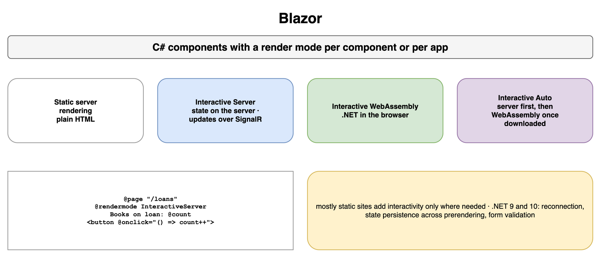
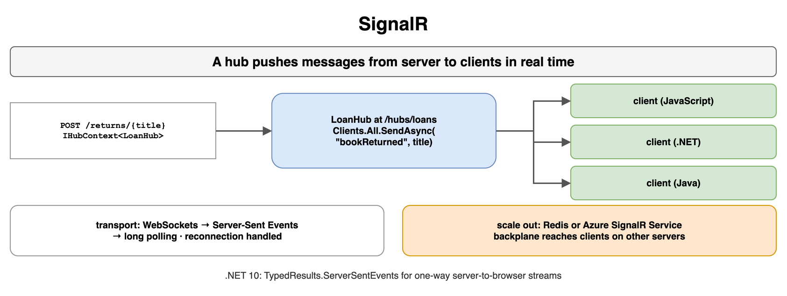
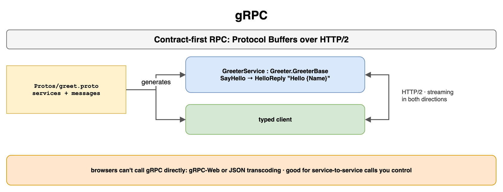
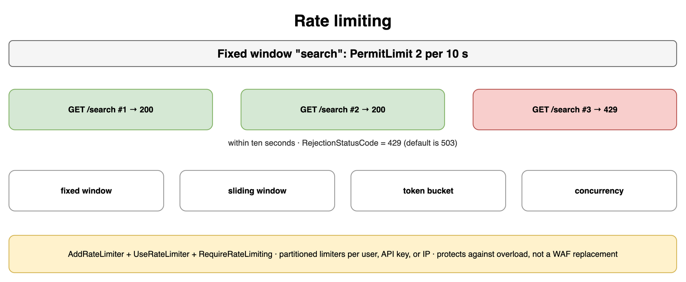
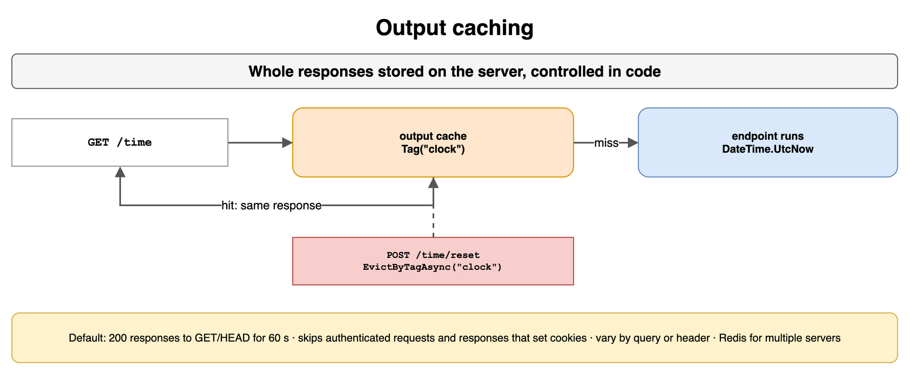
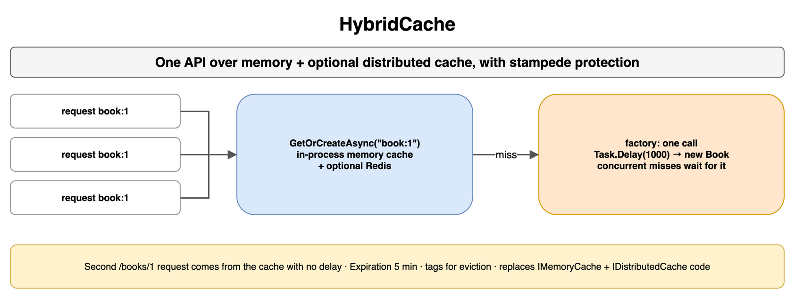
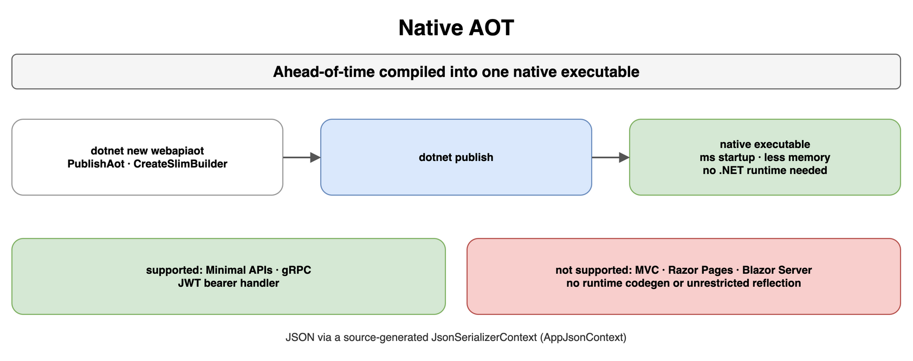
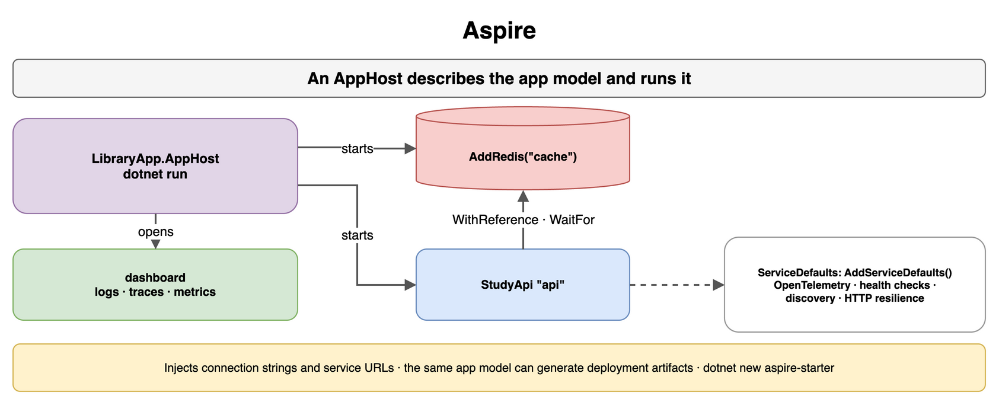

# Beyond the Book

## Blazor

Blazor builds interactive web UI with C# components instead of JavaScript. A component is a `.razor` file with markup and an `@code` block. Since .NET 8, the Blazor Web App template supports several render modes. Static server rendering sends plain HTML. Interactive Server keeps component state on the server and updates the page over a SignalR connection. Interactive WebAssembly runs the component in the browser on .NET compiled to WebAssembly. Interactive Auto starts on the server and switches to WebAssembly once the runtime has downloaded.

You choose a render mode per component or per app, so mostly static sites can add interactivity only where it's needed. .NET 9 and 10 improved reconnection, state persistence across prerendering, and form validation. Create an app with `dotnet new blazor --interactivity Server` and look at `Components/Pages/Counter.razor`. The component below is a minimal interactive counter.

```razor
@* Components/Pages/Loans.razor *@
@page "/loans"
@rendermode InteractiveServer

<h1>Loans</h1>
<p>Books on loan: @count</p>
<button @onclick="() => count++">Lend one</button>

@code {
    private int count;
}
```

[Microsoft Learn](https://learn.microsoft.com/en-us/aspnet/core/blazor/?view=aspnetcore-10.0)



*Source: [`diagrams/beyond-the-book.drawio`](/content/12_ASP.NET_Core/37_Beyond_the_Book/diagrams/beyond-the-book.drawio), page 1.*

## SignalR

SignalR pushes messages from server to clients in real time. A hub is a class whose public methods clients call. The hub calls methods on clients through `Clients.All`, `Clients.Group`, or `Clients.User`. SignalR picks the best transport the client supports: WebSockets, then Server-Sent Events, then long polling. It handles reconnection and serialization for you.

Clients exist for JavaScript, .NET, and Java. Scaling out across servers needs a backplane, such as Redis or Azure SignalR Service, so a message sent on one server reaches clients connected to another. For one-way server-to-browser streams, .NET 10 also adds `TypedResults.ServerSentEvents` for Minimal APIs. The example hub broadcasts every returned book.

```csharp
using Microsoft.AspNetCore.SignalR;

var builder = WebApplication.CreateBuilder(args);
builder.Services.AddSignalR();
var app = builder.Build();
app.MapHub<LoanHub>("/hubs/loans");
app.MapPost("/returns/{title}", async (string title, IHubContext<LoanHub> hub) =>
{
    await hub.Clients.All.SendAsync("bookReturned", title);
    return Results.Accepted();
});
app.Run();

public class LoanHub : Hub
{
    public Task Announce(string message) => Clients.Others.SendAsync("announcement", message);
}
```

[Microsoft Learn](https://learn.microsoft.com/en-us/aspnet/core/signalr/introduction?view=aspnetcore-10.0)



*Source: [`diagrams/beyond-the-book.drawio`](/content/12_ASP.NET_Core/37_Beyond_the_Book/diagrams/beyond-the-book.drawio), page 2.*

## gRPC

gRPC is a contract-first RPC framework. You describe services and messages in a `.proto` file, and tooling generates a C# base class for the server and a typed client. Messages travel as compact Protocol Buffers over HTTP/2, with streaming in both directions. That makes gRPC a good fit for service-to-service calls where both sides are under your control.

Browsers can't call gRPC directly. Use gRPC-Web, or JSON transcoding, which exposes the same services as JSON APIs. Create a project with `dotnet new grpc`. The generated `Program.cs` looks like the example, and `GreeterService` derives from the class generated from `Protos/greet.proto`.

```csharp
using Grpc.Core;
using StudyGrpc;

var builder = WebApplication.CreateBuilder(args);
builder.Services.AddGrpc();
var app = builder.Build();
app.MapGrpcService<GreeterService>();
app.MapGet("/", () => "Use a gRPC client to call this server.");
app.Run();

public class GreeterService : Greeter.GreeterBase
{
    public override Task<HelloReply> SayHello(HelloRequest request, ServerCallContext context) =>
        Task.FromResult(new HelloReply { Message = $"Hello {request.Name}" });
}
```

[Microsoft Learn](https://learn.microsoft.com/en-us/aspnet/core/grpc/?view=aspnetcore-10.0)



*Source: [`diagrams/beyond-the-book.drawio`](/content/12_ASP.NET_Core/37_Beyond_the_Book/diagrams/beyond-the-book.drawio), page 3.*

## Rate limiting

The rate limiting middleware, added in .NET 7, caps how many requests a client or endpoint may make. Four algorithms are built in: fixed window, sliding window, token bucket, and concurrency. Register named policies with `AddRateLimiter`, add `UseRateLimiter`, and attach a policy with `RequireRateLimiting` or `[EnableRateLimiting]`.

Rejected requests get 503 by default. Set `RejectionStatusCode = 429` for the standard "Too Many Requests" status. Partitioned limiters give each user, API key, or IP address its own counter. Rate limiting protects your app from overload. It doesn't replace a gateway or WAF against deliberate attacks. Call `/search` three times within ten seconds.

```csharp
using System.Threading.RateLimiting;
using Microsoft.AspNetCore.RateLimiting;

var builder = WebApplication.CreateBuilder(args);
builder.Services.AddRateLimiter(options =>
{
    options.RejectionStatusCode = StatusCodes.Status429TooManyRequests;
    options.AddFixedWindowLimiter("search", window =>
    {
        window.PermitLimit = 2;
        window.Window = TimeSpan.FromSeconds(10);
    });
});
var app = builder.Build();
app.UseRateLimiter();
app.MapGet("/search", (string? q) => $"results for {q}").RequireRateLimiting("search");
app.Run();
```

[Microsoft Learn](https://learn.microsoft.com/en-us/aspnet/core/performance/rate-limit?view=aspnetcore-10.0)



*Source: [`diagrams/beyond-the-book.drawio`](/content/12_ASP.NET_Core/37_Beyond_the_Book/diagrams/beyond-the-book.drawio), page 4.*

## Output caching

Output caching, added in .NET 7, stores whole responses on the server and serves them without running the endpoint again. Unlike response caching, it doesn't depend on client cache headers, and you control it in code. Add `AddOutputCache` and `UseOutputCache`, then mark endpoints with `CacheOutput()` or `[OutputCache]`.

The default policy caches only 200 responses to GET and HEAD requests, for 60 seconds, and skips authenticated requests and responses that set cookies. Policies can vary the cache by query or header, and tags let you evict related entries with `EvictByTagAsync` after an update. Redis can store the cache for multiple servers. Request `/time` twice and compare.

```csharp
using Microsoft.AspNetCore.OutputCaching;

var builder = WebApplication.CreateBuilder(args);
builder.Services.AddOutputCache();
var app = builder.Build();
app.UseOutputCache();
app.MapGet("/time", () => DateTime.UtcNow.ToString("O")).CacheOutput(policy => policy.Tag("clock"));
app.MapPost("/time/reset", async (IOutputCacheStore store, CancellationToken token) =>
{
    await store.EvictByTagAsync("clock", token);
    return Results.NoContent();
});
app.Run();
```

[Microsoft Learn](https://learn.microsoft.com/en-us/aspnet/core/performance/caching/output?view=aspnetcore-10.0)



*Source: [`diagrams/beyond-the-book.drawio`](/content/12_ASP.NET_Core/37_Beyond_the_Book/diagrams/beyond-the-book.drawio), page 5.*

## HybridCache

`HybridCache`, generally available since early 2025 for .NET 9 and later, combines an in-process memory cache with an optional distributed cache such as Redis. `GetOrCreateAsync` returns a cached value or runs your factory to create it. Concurrent requests for the same missing key wait for one factory call instead of all hitting the database, which avoids a cache stampede.

It replaces the common pattern of hand-written `IMemoryCache` plus `IDistributedCache` code with one API, and it supports tags for eviction. Add the `Microsoft.Extensions.Caching.Hybrid` package. Request `/books/1` twice. The second response comes from the cache, with no delay.

```csharp
using Microsoft.Extensions.Caching.Hybrid;

var builder = WebApplication.CreateBuilder(args);
builder.Services.AddHybridCache(options =>
    options.DefaultEntryOptions = new HybridCacheEntryOptions { Expiration = TimeSpan.FromMinutes(5) });
var app = builder.Build();
app.MapGet("/books/{id:int}", async (int id, HybridCache cache, CancellationToken token) =>
    await cache.GetOrCreateAsync($"book:{id}", async cancel =>
    {
        await Task.Delay(1000, cancel);
        return new Book(id, $"Book {id}", DateTime.UtcNow);
    }, cancellationToken: token));
app.Run();

public record Book(int Id, string Title, DateTime LoadedAt);
```

[Microsoft Learn](https://learn.microsoft.com/en-us/aspnet/core/performance/caching/hybrid?view=aspnetcore-10.0)



*Source: [`diagrams/beyond-the-book.drawio`](/content/12_ASP.NET_Core/37_Beyond_the_Book/diagrams/beyond-the-book.drawio), page 6.*

## Native AOT

Native AOT, supported for ASP.NET Core since .NET 8, compiles the app ahead of time into a single native executable. It starts in milliseconds, uses less memory, and needs no .NET runtime on the machine, which suits containers and serverless functions. The trade-off is that runtime code generation and unrestricted reflection aren't available.

Minimal APIs, gRPC, and the JWT bearer handler support AOT. MVC, Razor Pages, and Blazor Server don't. `dotnet new webapiaot` sets `<PublishAot>true</PublishAot>` and uses `WebApplication.CreateSlimBuilder`. JSON serialization goes through a source-generated `JsonSerializerContext`. Publish with `dotnet publish` and run the file in `bin/Release/net10.0/<rid>/publish`.

```csharp
using System.Text.Json.Serialization;

var builder = WebApplication.CreateSlimBuilder(args);
builder.Services.ConfigureHttpJsonOptions(options =>
    options.SerializerOptions.TypeInfoResolverChain.Insert(0, AppJsonContext.Default));
var app = builder.Build();
app.MapGet("/books", () => new[] { new Book(1, "Atlas"), new Book(2, "Primer") });
app.Run();

public record Book(int Id, string Title);

[JsonSerializable(typeof(Book[]))]
internal partial class AppJsonContext : JsonSerializerContext;
```

[Microsoft Learn](https://learn.microsoft.com/en-us/aspnet/core/fundamentals/native-aot?view=aspnetcore-10.0)



*Source: [`diagrams/beyond-the-book.drawio`](/content/12_ASP.NET_Core/37_Beyond_the_Book/diagrams/beyond-the-book.drawio), page 7.*

## Aspire

Aspire is an opinionated stack for building and running distributed .NET apps locally and in the cloud. An AppHost project describes the app model in C#: your projects, databases, caches, and how they reference each other. `dotnet run` on the AppHost starts everything, injects connection strings and service URLs, and opens a dashboard with logs, traces, and metrics.

A ServiceDefaults project adds OpenTelemetry, health checks, service discovery, and HTTP resilience to each service with one `AddServiceDefaults()` call. The same app model can generate deployment artifacts. Start with `dotnet new aspire-starter`. The AppHost below runs the API with a Redis cache and passes the connection string to it.

```csharp
// LibraryApp.AppHost/AppHost.cs
var builder = DistributedApplication.CreateBuilder(args);
var cache = builder.AddRedis("cache");
builder.AddProject<Projects.StudyApi>("api")
    .WithReference(cache)
    .WaitFor(cache);
builder.Build().Run();
```

[Microsoft Learn](https://learn.microsoft.com/en-us/dotnet/aspire/get-started/aspire-overview)



*Source: [`diagrams/beyond-the-book.drawio`](/content/12_ASP.NET_Core/37_Beyond_the_Book/diagrams/beyond-the-book.drawio), page 8.*
