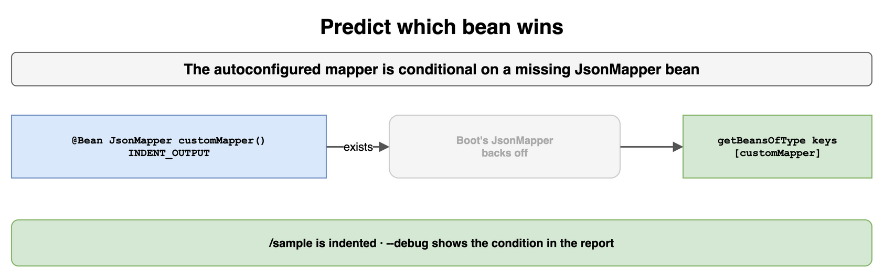
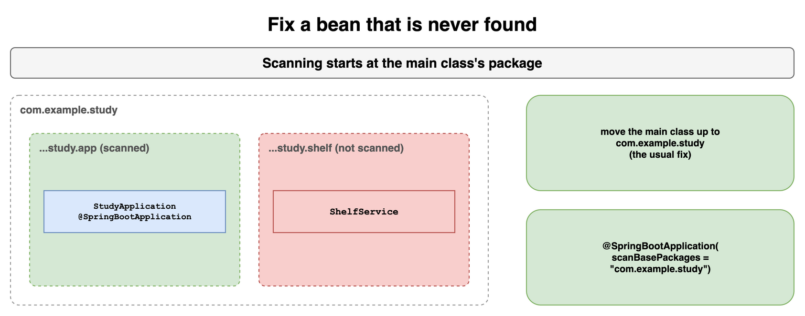

# Core Features and Autoconfiguration — Drills

Predict the result before running the example.

## Predict which bean wins

The application defines a `JsonMapper` with indentation enabled. Boot's Jackson autoconfiguration also knows how to create a `JsonMapper`. How many `JsonMapper` beans does the context contain, and is the `/sample` response indented?

```java
import java.util.Map;
import org.springframework.boot.SpringApplication;
import org.springframework.boot.autoconfigure.SpringBootApplication;
import org.springframework.context.annotation.Bean;
import org.springframework.web.bind.annotation.GetMapping;
import org.springframework.web.bind.annotation.RestController;
import tools.jackson.databind.SerializationFeature;
import tools.jackson.databind.json.JsonMapper;

@SpringBootApplication
public class StudyApplication {
    public static void main(String[] args) {
        var context = SpringApplication.run(StudyApplication.class, args);
        System.out.println(context.getBeansOfType(JsonMapper.class).keySet());
    }

    @Bean
    JsonMapper customMapper() {
        return JsonMapper.builder().enable(SerializationFeature.INDENT_OUTPUT).build();
    }
}

@RestController
class SampleController {
    @GetMapping("/sample")
    Map<String, Integer> sample() {
        return Map.of("pages", 120);
    }
}
```

**Answer**

One bean, named `customMapper`. The autoconfigured mapper is conditional on a missing `JsonMapper` bean, so it backs off, and the response is indented. Run with `--debug` to see that condition in the report. The [backing-off card](#13_Spring_Boot/01_Core_Features_and_Autoconfiguration/concepts/autoconfiguration-backs-off) covers the rule.



*Source: [`diagrams/autoconfiguration-drills.drawio`](/content/13_Spring_Boot/01_Core_Features_and_Autoconfiguration/diagrams/autoconfiguration-drills.drawio), page 1.*

## Fix a bean that is never found

The app fails at startup because no `ShelfService` bean exists. The main class is in `com.example.study.app` and the service is in `com.example.study.shelf`. What are two ways to fix it?

```java
package com.example.study.app;

import org.springframework.boot.SpringApplication;
import org.springframework.boot.autoconfigure.SpringBootApplication;

@SpringBootApplication
public class StudyApplication {
    public static void main(String[] args) {
        SpringApplication.run(StudyApplication.class, args);
    }
}
```

**Answer**

Component scanning starts at the main class's package, `com.example.study.app`, and does not reach the sibling package `com.example.study.shelf`. Move the main class up to `com.example.study`, which is the usual fix, or declare `@SpringBootApplication(scanBasePackages = "com.example.study")`. See [the application context](#13_Spring_Boot/01_Core_Features_and_Autoconfiguration/concepts/the-application-context).



*Source: [`diagrams/autoconfiguration-drills.drawio`](/content/13_Spring_Boot/01_Core_Features_and_Autoconfiguration/diagrams/autoconfiguration-drills.drawio), page 2.*
