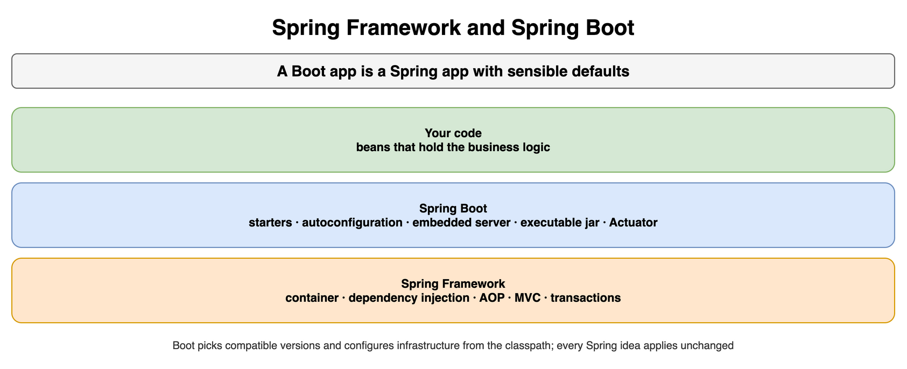
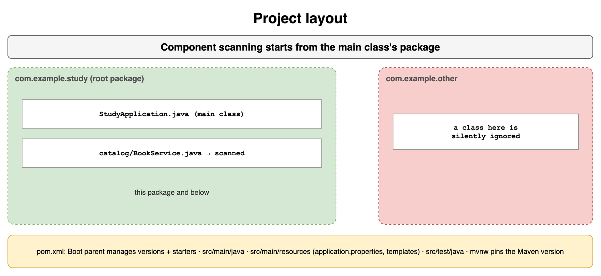
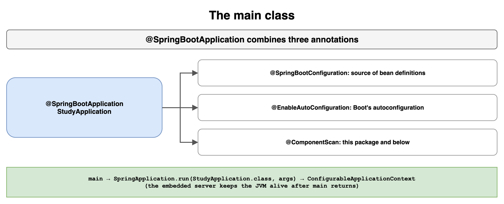
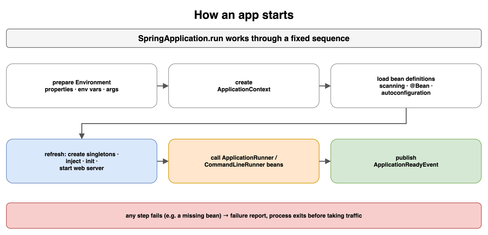
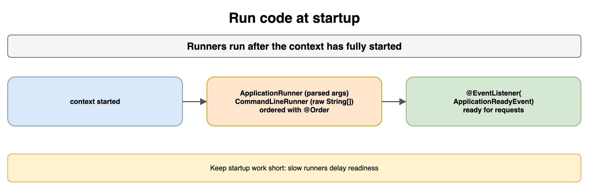
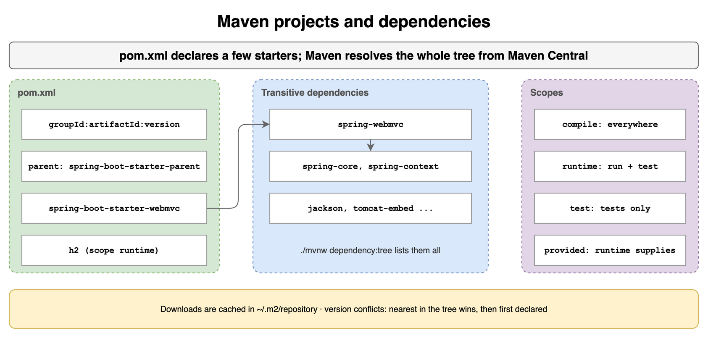
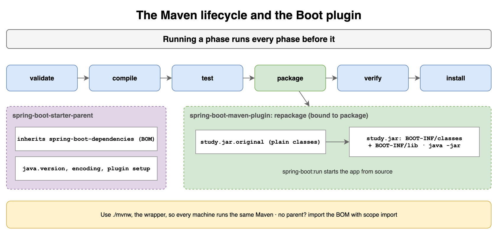
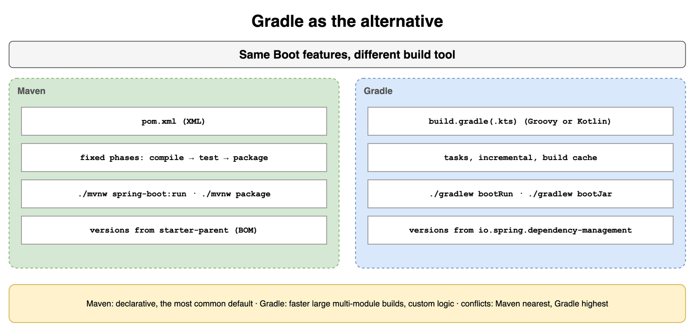

# Spring Project Anatomy and Startup

## Spring Framework and Spring Boot

Spring Framework is the foundation: a container that creates and connects your objects, plus modules for web, data access, transactions, and messaging. On its own it asks you to choose libraries, versions, and configuration yourself. Spring Boot sits on top. It picks compatible versions, configures common infrastructure from what is on the classpath, and packages the app as one runnable jar with an embedded server.

So a Boot app is a Spring app with sensible defaults. Every Spring idea in this part, beans, injection, proxies, transactions, applies unchanged; Boot only decides more of the setup for you. [Topic 9](#13_Spring_Boot/09_Core_Features_and_Autoconfiguration) shows how Boot's autoconfiguration makes those decisions.

| Layer | Gives you |
|---|---|
| Spring Framework | Container, dependency injection, AOP, MVC, transactions |
| Spring Boot | Starters, autoconfiguration, embedded server, executable jar, Actuator |
| Your code | Beans that hold the business logic |

[Spring Boot docs](https://docs.spring.io/spring-boot/index.html)



*Source: [`diagrams/project-anatomy.drawio`](/content/13_Spring_Boot/01_Spring_Project_Anatomy_and_Startup/diagrams/project-anatomy.drawio), page 1.*

## Project layout

A generated Maven project has a fixed shape. `pom.xml` is the build file, described in [Maven projects and dependencies](#13_Spring_Boot/01_Spring_Project_Anatomy_and_Startup/concepts/maven-projects-and-dependencies). Java code lives in `src/main/java`, configuration and templates in `src/main/resources`, and tests in `src/test/java`. `mvnw` is the Maven wrapper, covered with the [Maven lifecycle](#13_Spring_Boot/01_Spring_Project_Anatomy_and_Startup/concepts/the-maven-lifecycle-and-the-boot-plugin).

Put the main class in a root package, such as `com.example.study`, and every other class in that package or below. Component scanning starts from the main class's package, so a class in `com.example.other` is silently ignored.

```text
study/
├── pom.xml
├── mvnw
└── src/
    ├── main/
    │   ├── java/com/example/study/
    │   │   ├── StudyApplication.java
    │   │   └── catalog/BookService.java
    │   └── resources/
    │       ├── application.properties
    │       └── templates/
    └── test/java/com/example/study/StudyApplicationTests.java
```

[Spring Boot docs](https://docs.spring.io/spring-boot/reference/using/structuring-your-code.html)



*Source: [`diagrams/project-anatomy.drawio`](/content/13_Spring_Boot/01_Spring_Project_Anatomy_and_Startup/diagrams/project-anatomy.drawio), page 2.*

## The main class

`@SpringBootApplication` combines three annotations. `@SpringBootConfiguration` marks the class as a source of bean definitions. `@EnableAutoConfiguration` turns on Boot's autoconfiguration. `@ComponentScan` finds annotated classes in this package and below.

`main` calls `SpringApplication.run`, which builds the container and returns it once the app has started. The returned `ConfigurableApplicationContext` is the running container; in a web app the embedded server keeps the JVM alive after `main` returns.

```java
import org.springframework.boot.SpringApplication;
import org.springframework.boot.autoconfigure.SpringBootApplication;

@SpringBootApplication
public class StudyApplication {
    public static void main(String[] args) {
        SpringApplication.run(StudyApplication.class, args);
    }
}
```

[Spring Boot docs](https://docs.spring.io/spring-boot/reference/using/using-the-springbootapplication-annotation.html)



*Source: [`diagrams/project-anatomy.drawio`](/content/13_Spring_Boot/01_Spring_Project_Anatomy_and_Startup/diagrams/project-anatomy.drawio), page 3.*

## How an app starts

`SpringApplication.run` works through a fixed sequence. It prepares the `Environment` from properties files, environment variables, and arguments. It creates the application context and loads bean definitions from your classes and from autoconfiguration. It then refreshes the context: it creates every singleton bean, injects dependencies, and runs initialization callbacks. A web app starts its embedded server during the refresh.

Last, it calls every `ApplicationRunner` and `CommandLineRunner` bean and publishes `ApplicationReadyEvent`. If any step fails, for example a missing bean, startup stops with a failure report and the process exits. Failing at startup is a feature: wiring errors surface before the app takes traffic.

```text
run()
 ├─ prepare Environment          (properties, env vars, args)
 ├─ create ApplicationContext
 ├─ load bean definitions         (scanning, @Bean, autoconfiguration)
 ├─ refresh                       (create singletons, inject, init, start web server)
 ├─ call ApplicationRunner / CommandLineRunner beans
 └─ publish ApplicationReadyEvent
```

[Spring Boot docs](https://docs.spring.io/spring-boot/reference/features/spring-application.html)



*Source: [`diagrams/project-anatomy.drawio`](/content/13_Spring_Boot/01_Spring_Project_Anatomy_and_Startup/diagrams/project-anatomy.drawio), page 4.*

## Run code at startup

To do work once the app is ready, such as loading sample data or printing a report, declare an `ApplicationRunner` or `CommandLineRunner` bean. Both run after the context is fully started. `ApplicationRunner` receives parsed arguments; `CommandLineRunner` receives the raw string array. Order several runners with `@Order`.

To react to lifecycle moments elsewhere, listen for events with `@EventListener`. `ApplicationReadyEvent` fires when the app can serve requests. Keep startup work short, because slow runners delay readiness.

```java
import org.springframework.boot.ApplicationRunner;
import org.springframework.boot.context.event.ApplicationReadyEvent;
import org.springframework.context.annotation.Bean;
import org.springframework.context.annotation.Configuration;
import org.springframework.context.event.EventListener;

@Configuration
class StartupConfig {
    @Bean
    ApplicationRunner greet() {
        return args -> System.out.println("Options: " + args.getOptionNames());
    }

    @EventListener(ApplicationReadyEvent.class)
    void ready() {
        System.out.println("Ready for requests");
    }
}
```

[Spring Boot docs](https://docs.spring.io/spring-boot/reference/features/spring-application.html#features.spring-application.command-line-runner)



*Source: [`diagrams/project-anatomy.drawio`](/content/13_Spring_Boot/01_Spring_Project_Anatomy_and_Startup/diagrams/project-anatomy.drawio), page 5.*

## Maven projects and dependencies

Maven is the build tool that start.spring.io generates by default. `pom.xml` describes the project: its coordinates, the parent it inherits from, its dependencies, and its plugins. Coordinates name any artifact as `groupId:artifactId:version`, such as `org.springframework.boot:spring-boot-starter-webmvc`. Maven downloads artifacts from Maven Central into the local cache, `~/.m2/repository`.

Dependencies are transitive: a starter pulls in Spring MVC, which pulls in Spring Core, and so on. You declare a handful of starters and get dozens of jars; `./mvnw dependency:tree` shows them all. A scope limits where a dependency is visible. When two paths bring different versions of one library, Maven picks the one nearest your project in the tree, and the first declared when the depths are equal.

| Scope | On the classpath for | Typical use |
|---|---|---|
| `compile` (default) | Compile, test, and run | Starters, your libraries |
| `runtime` | Test and run, not compile | JDBC drivers |
| `test` | Tests only | `spring-boot-starter-test` |
| `provided` | Compile and test; the runtime supplies it | Servlet API on an external server |

```xml
<project>
    <modelVersion>4.0.0</modelVersion>
    <parent>
        <groupId>org.springframework.boot</groupId>
        <artifactId>spring-boot-starter-parent</artifactId>
        <version>4.1.2</version>
    </parent>
    <groupId>com.example</groupId>
    <artifactId>study</artifactId>
    <version>0.0.1-SNAPSHOT</version>

    <dependencies>
        <dependency>
            <groupId>org.springframework.boot</groupId>
            <artifactId>spring-boot-starter-webmvc</artifactId>
        </dependency>
        <dependency>
            <groupId>com.h2database</groupId>
            <artifactId>h2</artifactId>
            <scope>runtime</scope>
        </dependency>
    </dependencies>
</project>
```

[Maven docs](https://maven.apache.org/guides/introduction/introduction-to-dependency-mechanism.html)



*Source: [`diagrams/project-anatomy.drawio`](/content/13_Spring_Boot/01_Spring_Project_Anatomy_and_Startup/diagrams/project-anatomy.drawio), page 6.*

## The Maven lifecycle and the Boot plugin

Maven builds in phases. Running a phase runs every phase before it: `./mvnw package` validates, compiles, runs the tests, and then packages the jar. `install` adds a copy to your local repository so other projects on your machine can depend on it. Plugins do the actual work; each plugin goal is bound to a phase. Use `./mvnw`, the wrapper script committed with the project, rather than a globally installed `mvn`, so every machine and CI runner uses the Maven version the project expects.

`spring-boot-maven-plugin` adds Boot's goals. `spring-boot:run` starts the app from source. Its `repackage` goal runs during `package` and turns the plain jar into an executable fat jar with your dependencies under `BOOT-INF/lib`, so `java -jar target/study-0.0.1-SNAPSHOT.jar` runs the app. `spring-boot-starter-parent` binds that goal, sets the Java version and encoding, and inherits `spring-boot-dependencies`, the bill of materials (BOM) that fixes a tested version for every library Boot supports. That is why starters in the POM have no `<version>`.

```sh
./mvnw spring-boot:run         # run from source
./mvnw package                 # compile, test, build the executable jar
./mvnw -DskipTests package     # skip the tests for a quick local build
java -jar target/study-0.0.1-SNAPSHOT.jar
```

```xml
<properties>
    <java.version>25</java.version>
    <!-- Override one managed version by setting its property. -->
    <flyway.version>11.10.0</flyway.version>
</properties>

<build>
    <plugins>
        <plugin>
            <groupId>org.springframework.boot</groupId>
            <artifactId>spring-boot-maven-plugin</artifactId>
        </plugin>
    </plugins>
</build>
```

If the project already has its own parent, import the BOM instead: add `spring-boot-dependencies` with `<type>pom</type>` and `<scope>import</scope>` under `<dependencyManagement>`. You then configure the plugin's `repackage` execution yourself. [Topic 23](#13_Spring_Boot/23_Executable_Jars_and_Container_Images) goes deeper into the jar layout and container images.

[Spring Boot Maven plugin docs](https://docs.spring.io/spring-boot/maven-plugin/index.html)



*Source: [`diagrams/project-anatomy.drawio`](/content/13_Spring_Boot/01_Spring_Project_Anatomy_and_Startup/diagrams/project-anatomy.drawio), page 7.*

## Gradle as the alternative

Gradle is the other build tool start.spring.io offers. The build is a script, `build.gradle` in Groovy or `build.gradle.kts` in Kotlin, and work is organized into tasks rather than fixed phases. Tasks declare their inputs and outputs, so Gradle skips tasks whose inputs have not changed and can reuse a build cache. `./gradlew` is the wrapper, the same idea as `./mvnw`.

The `org.springframework.boot` plugin adds `bootRun` and `bootJar`, and `./gradlew build` produces the executable jar in `build/libs`. The `io.spring.dependency-management` plugin applies Boot's BOM, so dependencies need no versions, as with the Maven parent. Gradle names its scopes differently: `implementation`, `runtimeOnly`, and `testImplementation`. When two versions of a library meet, Gradle picks the highest, not the nearest.

```kotlin
// build.gradle.kts
plugins {
    java
    id("org.springframework.boot") version "4.1.2"
    id("io.spring.dependency-management") version "1.1.7"
}

group = "com.example"
version = "0.0.1-SNAPSHOT"

java {
    toolchain { languageVersion = JavaLanguageVersion.of(25) }
}

repositories { mavenCentral() }

dependencies {
    implementation("org.springframework.boot:spring-boot-starter-webmvc")
    runtimeOnly("com.h2database:h2")
    testImplementation("org.springframework.boot:spring-boot-starter-test")
}
```

```sh
./gradlew bootRun     # run from source
./gradlew bootJar     # build only the executable jar
./gradlew build       # compile, test, and build both jars
```

Pick Maven for a fixed, declarative structure that most Java developers and tools understand, and that is usually enough for a single service. Pick Gradle when builds are large or multi-module and incremental builds save real time, or when the build needs custom logic. Teams usually follow the organization's existing convention; Boot supports both equally.

[Spring Boot Gradle plugin docs](https://docs.spring.io/spring-boot/gradle-plugin/index.html)



*Source: [`diagrams/project-anatomy.drawio`](/content/13_Spring_Boot/01_Spring_Project_Anatomy_and_Startup/diagrams/project-anatomy.drawio), page 8.*
