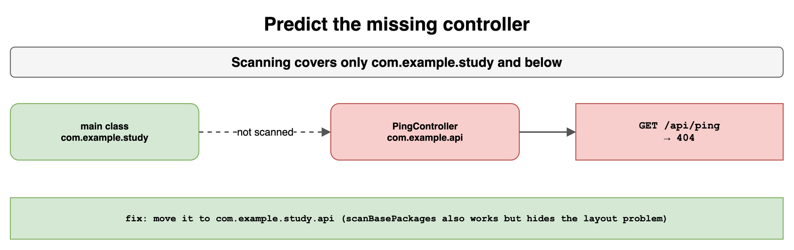
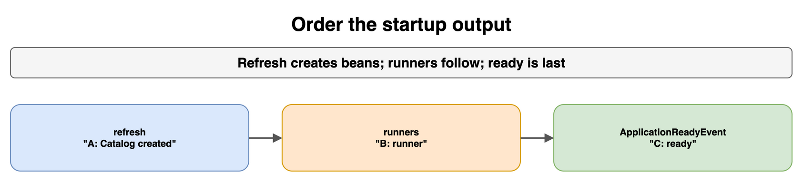
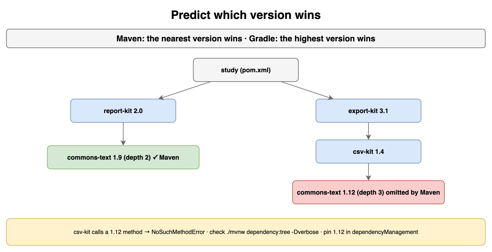

# Spring Project Anatomy and Startup — Drills

Predict the result before running the example.

## Predict the missing controller

The main class is `com.example.study.StudyApplication`. A teammate adds this controller. What does `GET /api/ping` return, and why?

```java
package com.example.api;

@RestController
class PingController {
    @GetMapping("/api/ping")
    String ping() {
        return "pong";
    }
}
```

**Answer**

404. Component scanning starts at `com.example.study`, and `com.example.api` is outside it, so the controller is never registered. Move it to `com.example.study.api`, or below. Widening the scan with `scanBasePackages` also works but hides a layout problem. See [project layout](#13_Spring_Boot/01_Spring_Project_Anatomy_and_Startup/concepts/project-layout).



*Source: [`diagrams/project-anatomy-drills.drawio`](/content/13_Spring_Boot/01_Spring_Project_Anatomy_and_Startup/diagrams/project-anatomy-drills.drawio), page 1.*

## Order the startup output

The app below prints three lines. In which order, and why?

```java
@Component
class Catalog {
    Catalog() {
        System.out.println("A: Catalog created");
    }
}

@Configuration
class StartupConfig {
    @Bean
    CommandLineRunner runner() {
        return args -> System.out.println("B: runner");
    }

    @EventListener(ApplicationReadyEvent.class)
    void ready() {
        System.out.println("C: ready");
    }
}
```

**Answer**

A, then B, then C. Beans are created during the context refresh. Runners are called after the refresh, and `ApplicationReadyEvent` is published last, once the runners have finished. See [how an app starts](#13_Spring_Boot/01_Spring_Project_Anatomy_and_Startup/concepts/how-an-app-starts).



*Source: [`diagrams/project-anatomy-drills.drawio`](/content/13_Spring_Boot/01_Spring_Project_Anatomy_and_Startup/diagrams/project-anatomy-drills.drawio), page 2.*

## Predict which version wins

`pom.xml` declares two libraries. `report-kit` depends directly on `commons-text` 1.9. `export-kit` depends on `csv-kit`, which depends on `commons-text` 1.12. Which `commons-text` ends up in the jar, and what changes with Gradle?

```text
study
├── report-kit 2.0
│   └── commons-text 1.9
└── export-kit 3.1
    └── csv-kit 1.4
        └── commons-text 1.12
```

**Answer**

Maven picks 1.9, because it is nearer to the project: two levels down instead of three. Code in `csv-kit` that needs a 1.12 method then fails at runtime with `NoSuchMethodError`. Run `./mvnw dependency:tree -Dverbose` to see the omitted version, then pin the one you want under `<dependencyManagement>` or declare `commons-text` 1.12 directly. Gradle would pick 1.12, the highest version. See [Maven projects and dependencies](#13_Spring_Boot/01_Spring_Project_Anatomy_and_Startup/concepts/maven-projects-and-dependencies).



*Source: [`diagrams/project-anatomy-drills.drawio`](/content/13_Spring_Boot/01_Spring_Project_Anatomy_and_Startup/diagrams/project-anatomy-drills.drawio), page 3.*
