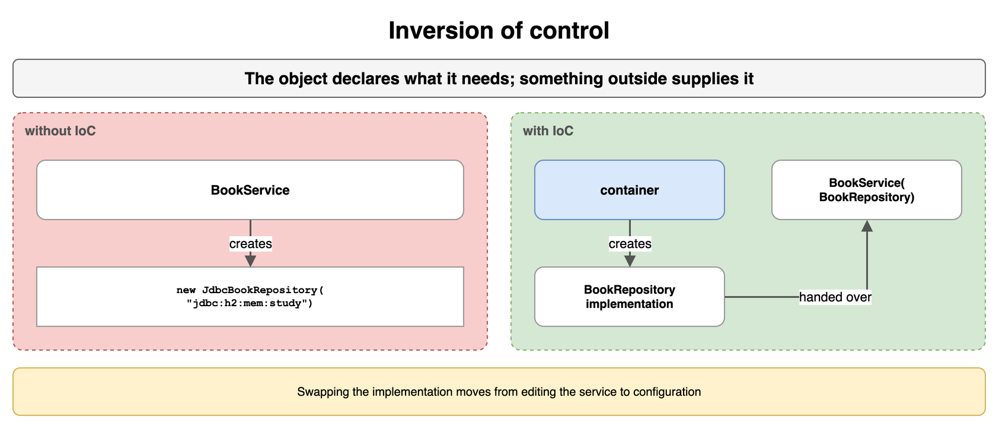
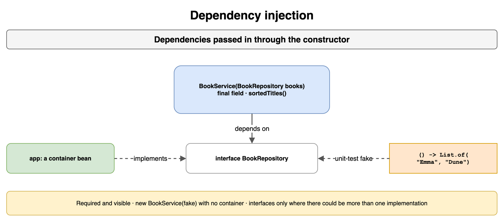
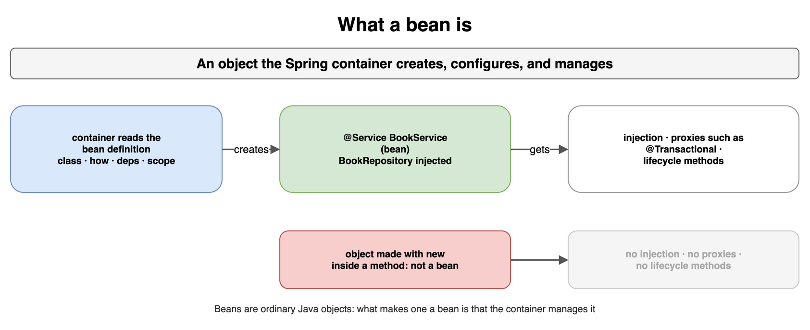
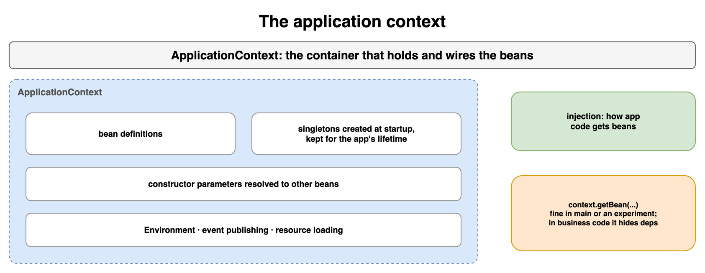
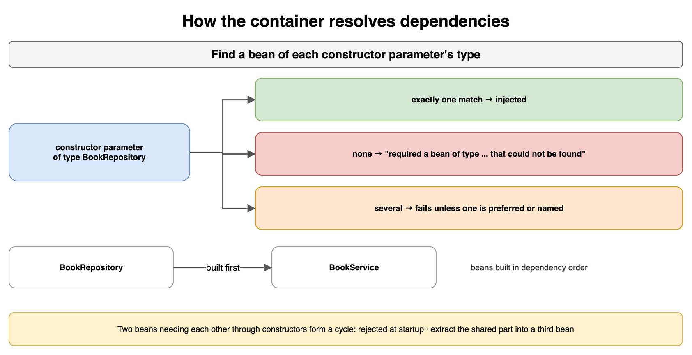

# IoC, Dependency Injection, and Beans

## Inversion of control

In plain Java, an object creates what it needs: a service calls `new JdbcBookRepository()` inside its constructor. The service then decides which implementation it uses and how that implementation is configured, so swapping it for a test double or a different database means editing the service.

Inversion of control turns that around. The object only declares what it needs, and something outside creates the parts and hands them over. In Spring, that outside party is the container. Your classes stop managing their collaborators and focus on their own job, and the choice of implementation moves to configuration.

```java
// Without IoC: the service picks and builds its repository.
class BookService {
    private final BookRepository books = new JdbcBookRepository("jdbc:h2:mem:study");
}

// With IoC: the service states its need; someone else supplies it.
class BookService {
    private final BookRepository books;

    BookService(BookRepository books) {
        this.books = books;
    }
}
```

[Spring Framework docs](https://docs.spring.io/spring-framework/reference/core/beans/introduction.html)



*Source: [`diagrams/ioc-and-beans.drawio`](/content/13_Spring_Boot/02_IoC_Dependency_Injection_and_Beans/diagrams/ioc-and-beans.drawio), page 1.*

## Dependency injection

Dependency injection is the usual form of inversion of control: dependencies are passed in, preferably through the constructor. A constructor parameter makes the dependency required and visible, allows `final` fields, and lets a unit test build the object with `new` and a fake, with no container at all.

Depend on interfaces where there could be more than one implementation, such as a repository or a payment gateway. For a class with only one sensible implementation, depending on the class directly is fine; an interface for its own sake adds nothing.

```java
import java.util.List;

interface BookRepository {
    List<String> titles();
}

class BookService {
    private final BookRepository books;

    BookService(BookRepository books) {
        this.books = books;
    }

    List<String> sortedTitles() {
        return books.titles().stream().sorted().toList();
    }
}

// In a unit test: new BookService(() -> List.of("Emma", "Dune")).sortedTitles()
```

[Spring Framework docs](https://docs.spring.io/spring-framework/reference/core/beans/dependencies/factory-collaborators.html)



*Source: [`diagrams/ioc-and-beans.drawio`](/content/13_Spring_Boot/02_IoC_Dependency_Injection_and_Beans/diagrams/ioc-and-beans.drawio), page 2.*

## What a bean is

A bean is an object that the Spring container creates, configures, and manages. You do not call `new` for it. The container reads a bean definition, which says which class to create, how, with which dependencies, and in which scope, then creates the instance and injects it wherever it is needed.

Beans are ordinary Java objects; nothing in the class must extend Spring types. What makes an object a bean is that the container manages it. An object you create with `new` inside a method is not a bean: Spring does not inject into it, apply proxies such as `@Transactional`, or call its lifecycle methods.

```java
import org.springframework.stereotype.Service;

@Service // Registers a bean definition: "create one BookService and inject a BookRepository".
class BookService {
    private final BookRepository books;

    BookService(BookRepository books) {
        this.books = books;
    }
}
```

[Spring Framework docs](https://docs.spring.io/spring-framework/reference/core/beans/definition.html)



*Source: [`diagrams/ioc-and-beans.drawio`](/content/13_Spring_Boot/02_IoC_Dependency_Injection_and_Beans/diagrams/ioc-and-beans.drawio), page 3.*

## The application context

The container is the `ApplicationContext`. It holds the bean definitions, creates singleton beans at startup, resolves each constructor parameter to another bean, and keeps the instances for the app's lifetime. It also provides the `Environment`, event publishing, and resource loading. [Topic 9](#13_Spring_Boot/09_Core_Features_and_Autoconfiguration/concepts/the-application-context) shows how Boot fills it.

Application code rarely asks the context for beans directly; injection does that. Looking beans up with `context.getBean(...)` in business code hides dependencies and is a sign that injection is missing. It is fine in a `main` method or a quick experiment.

```java
import org.springframework.boot.SpringApplication;
import org.springframework.context.ConfigurableApplicationContext;

public static void main(String[] args) {
    ConfigurableApplicationContext context = SpringApplication.run(StudyApplication.class, args);
    BookService service = context.getBean(BookService.class);
    System.out.println(context.getBeanDefinitionCount() + " beans, service: " + service);
}
```

[Spring Framework docs](https://docs.spring.io/spring-framework/reference/core/beans/basics.html)



*Source: [`diagrams/ioc-and-beans.drawio`](/content/13_Spring_Boot/02_IoC_Dependency_Injection_and_Beans/diagrams/ioc-and-beans.drawio), page 4.*

## How the container resolves dependencies

For each bean, the container looks at its constructor parameters and finds a bean of a matching type. If exactly one matches, it is injected. If none match, startup fails with "required a bean of type ... that could not be found". If several match, startup fails unless one is preferred or named; [wiring](#13_Spring_Boot/04_Wiring_Dependencies) covers how to choose.

The container builds beans in dependency order, so a repository exists before the service that needs it. Two beans that need each other through their constructors form a cycle, which Spring Boot rejects at startup. A cycle usually means one class does too much; extract the shared part into a third bean.

```text
***************************
APPLICATION FAILED TO START
***************************

Description:
Parameter 0 of constructor in com.example.study.BookService required a bean of type
'com.example.study.BookRepository' that could not be found.
```

[Spring Framework docs](https://docs.spring.io/spring-framework/reference/core/beans/dependencies/factory-dependencies.html)



*Source: [`diagrams/ioc-and-beans.drawio`](/content/13_Spring_Boot/02_IoC_Dependency_Injection_and_Beans/diagrams/ioc-and-beans.drawio), page 5.*
