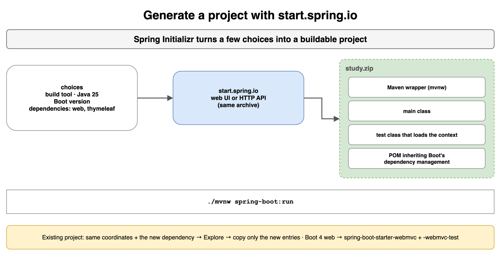
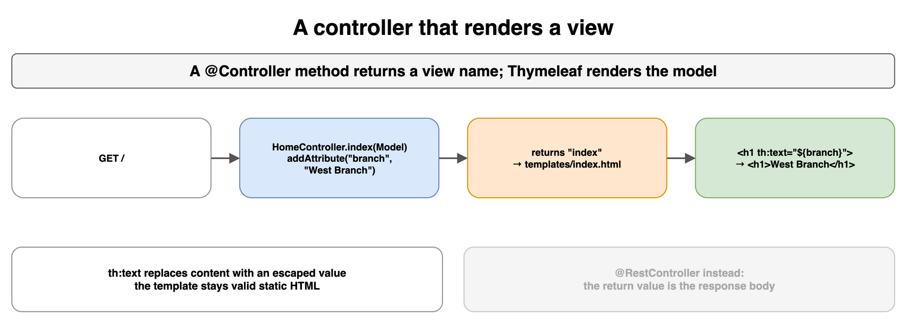
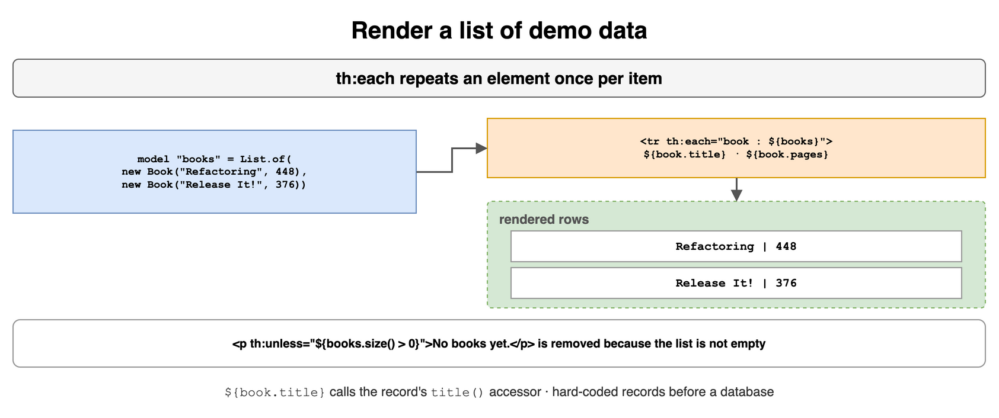
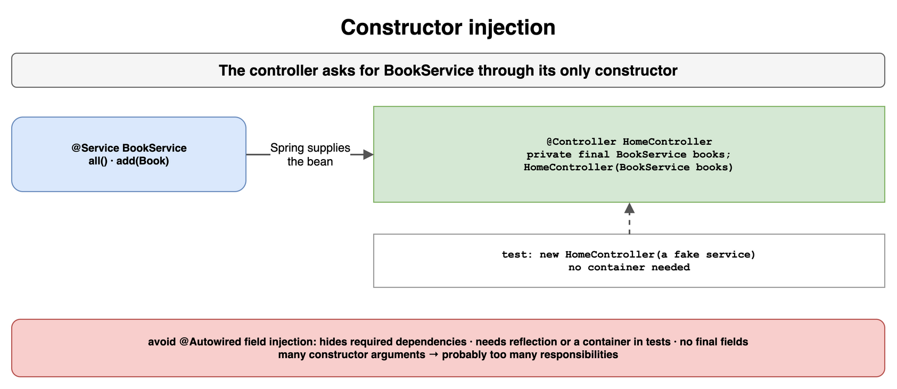
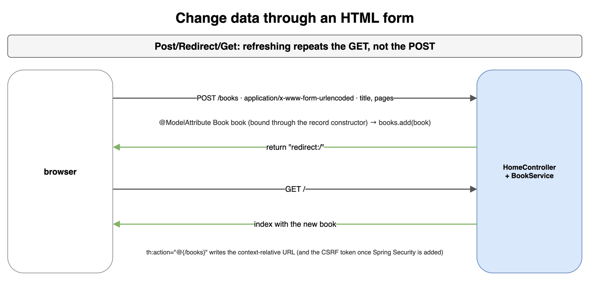
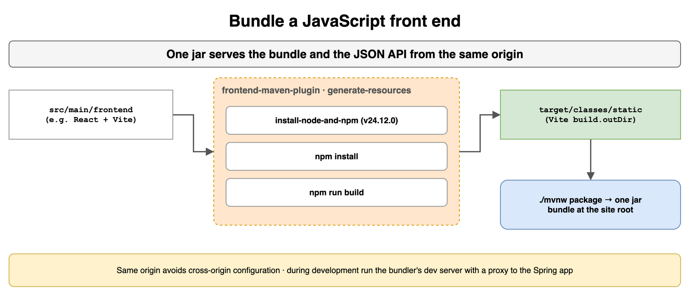

# Spring MVC Controllers and Templates

## Generate a project with start.spring.io

Spring Initializr at start.spring.io generates a buildable project from a few choices: the build tool, the Java version, the Boot version, and the dependencies. The project includes the Maven wrapper, a main class, a test class that loads the context, and a POM that inherits Boot's dependency management. The web UI and its HTTP API produce the same archive.

To add a feature to an existing project, select the same coordinates and the new dependency on start.spring.io, then use **Explore** to view the generated POM. Copy only the new dependency entries. For Boot 4 the `web` dependency adds `spring-boot-starter-webmvc` and `spring-boot-starter-webmvc-test`.

```sh
curl -s https://start.spring.io/starter.zip -d type=maven-project -d javaVersion=25 \
  -d dependencies=web,thymeleaf -d groupId=com.example -d artifactId=study \
  -d name=study -d packageName=com.example.study -o study.zip
unzip study.zip -d study && cd study && ./mvnw spring-boot:run
```

[Spring Boot docs](https://docs.spring.io/spring-boot/tutorial/first-application/index.html)



*Source: [`diagrams/spring-mvc.drawio`](/content/13_Spring_Boot/03_Spring_MVC_Controllers_and_Templates/diagrams/spring-mvc.drawio), page 1.*

## A controller that renders a view

A `@Controller` method handles a request and returns a view name. The method adds attributes to the `Model`. Thymeleaf resolves the view name `index` to `src/main/resources/templates/index.html` and renders the attributes into HTML. Use `@RestController` instead when the method's return value is the response body.

`th:text` replaces an element's content with an escaped expression value, so the template remains valid HTML that can be opened as a static file. Save the template below as `templates/index.html` next to the Java example.

```java
import org.springframework.boot.SpringApplication;
import org.springframework.boot.autoconfigure.SpringBootApplication;
import org.springframework.stereotype.Controller;
import org.springframework.ui.Model;
import org.springframework.web.bind.annotation.GetMapping;

@SpringBootApplication
public class StudyApplication {
    public static void main(String[] args) {
        SpringApplication.run(StudyApplication.class, args);
    }
}

@Controller
class HomeController {
    @GetMapping("/")
    String index(Model model) {
        model.addAttribute("branch", "West Branch");
        return "index";
    }
}
```

```html
<!DOCTYPE html>
<html xmlns:th="http://www.thymeleaf.org">
<body>
  <h1 th:text="${branch}">Branch name</h1>
</body>
</html>
```

[Spring Framework docs](https://docs.spring.io/spring-framework/reference/web/webmvc/mvc-controller.html)



*Source: [`diagrams/spring-mvc.drawio`](/content/13_Spring_Boot/03_Spring_MVC_Controllers_and_Templates/diagrams/spring-mvc.drawio), page 2.*

## Render a list of demo data

`th:each` repeats an element once per item in a collection. Each item exposes record components and bean properties by name, so `${book.title}` calls the record's `title()` accessor. Use a few hard-coded records to build the page before a database is involved.

The controller adds a list of records to the model. The template renders one row per book and shows a message when the list is empty. `th:unless` removes its element when the condition is true.

```java
import java.util.List;
import org.springframework.boot.SpringApplication;
import org.springframework.boot.autoconfigure.SpringBootApplication;
import org.springframework.stereotype.Controller;
import org.springframework.ui.Model;
import org.springframework.web.bind.annotation.GetMapping;

@SpringBootApplication
public class StudyApplication {
    public static void main(String[] args) {
        SpringApplication.run(StudyApplication.class, args);
    }
}

record Book(String title, int pages) {
}

@Controller
class HomeController {
    @GetMapping("/")
    String index(Model model) {
        model.addAttribute("books", List.of(new Book("Refactoring", 448), new Book("Release It!", 376)));
        return "index";
    }
}
```

```html
<table>
  <tr th:each="book : ${books}">
    <td th:text="${book.title}">Title</td>
    <td th:text="${book.pages}">0</td>
  </tr>
</table>
<p th:unless="${books.size() > 0}">No books yet.</p>
```

[Thymeleaf docs](https://www.thymeleaf.org/doc/tutorials/3.1/usingthymeleaf.html#iteration)



*Source: [`diagrams/spring-mvc.drawio`](/content/13_Spring_Boot/03_Spring_MVC_Controllers_and_Templates/diagrams/spring-mvc.drawio), page 3.*

## Constructor injection

Move data access out of the controller into a service, and have the controller request the service through its constructor. Spring calls the only constructor and supplies the bean. Mark the field `final` so the dependency cannot change and an incomplete object cannot exist. A test can construct the controller directly with a fake service.

Avoid field injection with `@Autowired`. It hides required dependencies, needs reflection or a container in tests, and prevents `final` fields. If a class needs many constructor arguments, it probably has too many responsibilities.

```java
import java.util.List;
import java.util.concurrent.CopyOnWriteArrayList;
import org.springframework.boot.SpringApplication;
import org.springframework.boot.autoconfigure.SpringBootApplication;
import org.springframework.stereotype.Controller;
import org.springframework.stereotype.Service;
import org.springframework.ui.Model;
import org.springframework.web.bind.annotation.GetMapping;

@SpringBootApplication
public class StudyApplication {
    public static void main(String[] args) {
        SpringApplication.run(StudyApplication.class, args);
    }
}

record Book(String title, int pages) {
}

@Service
class BookService {
    private final List<Book> books = new CopyOnWriteArrayList<>(List.of(new Book("Refactoring", 448)));

    List<Book> all() {
        return List.copyOf(books);
    }

    void add(Book book) {
        books.add(book);
    }
}

@Controller
class HomeController {
    private final BookService books;

    HomeController(BookService books) {
        this.books = books;
    }

    @GetMapping("/")
    String index(Model model) {
        model.addAttribute("books", books.all());
        return "index";
    }
}
```

[Spring Framework docs](https://docs.spring.io/spring-framework/reference/core/beans/dependencies/factory-collaborators.html#beans-constructor-injection)



*Source: [`diagrams/spring-mvc.drawio`](/content/13_Spring_Boot/03_Spring_MVC_Controllers_and_Templates/diagrams/spring-mvc.drawio), page 4.*

## Change data through an HTML form

A form posts its fields as `application/x-www-form-urlencoded` data. Spring MVC binds them to a `@ModelAttribute` parameter by name, and a record is bound through its constructor. After a successful change, redirect to a GET page. With this Post/Redirect/Get pattern, refreshing the browser does not submit the form again.

This example extends the [constructor injection example](#13_Spring_Boot/03_Spring_MVC_Controllers_and_Templates/concepts/constructor-injection) with a POST handler. Add the form to the list template in `index.html`. Thymeleaf's `th:action` writes the context-relative URL. When Spring Security is added, it also inserts the CSRF token as described in the [CSRF card](#13_Spring_Boot/08_Spring_Security_Foundations/concepts/csrf-protection).

```java
import java.util.List;
import java.util.concurrent.CopyOnWriteArrayList;
import org.springframework.boot.SpringApplication;
import org.springframework.boot.autoconfigure.SpringBootApplication;
import org.springframework.stereotype.Controller;
import org.springframework.stereotype.Service;
import org.springframework.ui.Model;
import org.springframework.web.bind.annotation.GetMapping;
import org.springframework.web.bind.annotation.ModelAttribute;
import org.springframework.web.bind.annotation.PostMapping;

@SpringBootApplication
public class StudyApplication {
    public static void main(String[] args) {
        SpringApplication.run(StudyApplication.class, args);
    }
}

record Book(String title, int pages) {
}

@Service
class BookService {
    private final List<Book> books = new CopyOnWriteArrayList<>();
    List<Book> all() { return List.copyOf(books); }
    void add(Book book) { books.add(book); }
}

@Controller
class HomeController {
    private final BookService books;

    HomeController(BookService books) {
        this.books = books;
    }

    @GetMapping("/")
    String index(Model model) {
        model.addAttribute("books", books.all());
        return "index";
    }

    @PostMapping("/books")
    String add(@ModelAttribute Book book) {
        books.add(book);
        return "redirect:/";
    }
}
```

```html
<form method="post" th:action="@{/books}">
  <input name="title" required>
  <input name="pages" type="number" min="1" required>
  <button type="submit">Add</button>
</form>
```

[Spring Framework docs](https://docs.spring.io/spring-framework/reference/web/webmvc/mvc-controller/ann-methods/modelattrib-method-args.html)



*Source: [`diagrams/spring-mvc.drawio`](/content/13_Spring_Boot/03_Spring_MVC_Controllers_and_Templates/diagrams/spring-mvc.drawio), page 5.*

## Bundle a JavaScript front end

Boot serves files from `classpath:/static`, so anything the build copies to `target/classes/static` is available at the site root. A JavaScript front end such as a React app can live in `src/main/frontend` and be built by Node into that folder. The Spring app then serves the bundle and its JSON API from the same origin, which avoids cross-origin configuration.

The `frontend-maven-plugin` downloads a pinned Node version into the project and runs npm during `generate-resources`, so `./mvnw package` produces one jar that contains the bundle. Configure the front-end bundler, for example Vite's `build.outDir`, to write into `target/classes/static`. During development, run the bundler's dev server with a proxy to the Spring app.

```xml
<plugin>
  <groupId>com.github.eirslett</groupId>
  <artifactId>frontend-maven-plugin</artifactId>
  <version>2.0.2</version>
  <configuration>
    <workingDirectory>src/main/frontend</workingDirectory>
    <nodeVersion>v24.12.0</nodeVersion>
  </configuration>
  <executions>
    <execution>
      <id>install node and npm</id>
      <goals><goal>install-node-and-npm</goal></goals>
    </execution>
    <execution>
      <id>npm install</id>
      <goals><goal>npm</goal></goals>
      <configuration><arguments>install</arguments></configuration>
    </execution>
    <execution>
      <id>npm run build</id>
      <goals><goal>npm</goal></goals>
      <configuration><arguments>run build</arguments></configuration>
    </execution>
  </executions>
</plugin>
```

[Spring Boot docs](https://docs.spring.io/spring-boot/reference/web/servlet.html#web.servlet.spring-mvc.static-content)



*Source: [`diagrams/spring-mvc.drawio`](/content/13_Spring_Boot/03_Spring_MVC_Controllers_and_Templates/diagrams/spring-mvc.drawio), page 6.*
