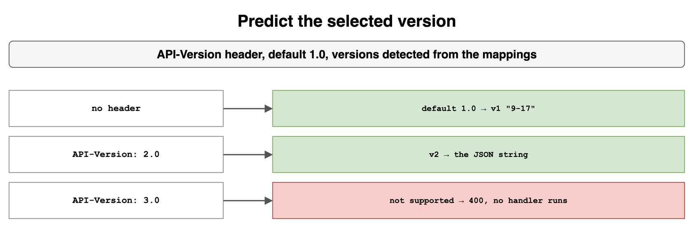
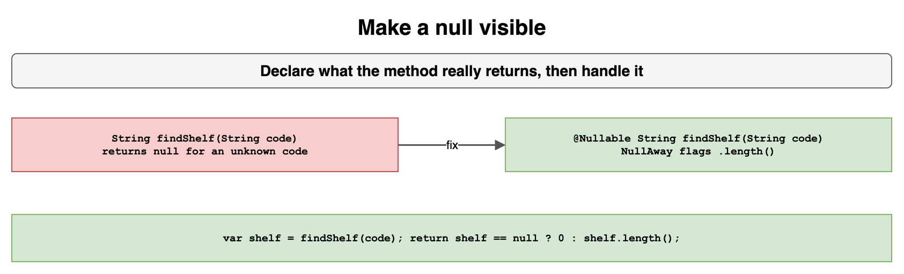

# API Versioning and Null Safety — Drills

Predict the result before running the example.

## Predict the selected version

The app uses the [versioned mappings](#13_Spring_Boot/05_API_Versioning_and_Null_Safety/concepts/versioned-request-mappings) properties: the `API-Version` header with a default of 1.0. What does each request return: no header, `API-Version: 2.0`, and `API-Version: 3.0`?

```java
import org.springframework.web.bind.annotation.GetMapping;
import org.springframework.web.bind.annotation.RestController;

@RestController
class HoursApi {
    @GetMapping(path = "/api/hours", version = "1.0")
    String v1() {
        return "9-17";
    }

    @GetMapping(path = "/api/hours", version = "2.0")
    String v2() {
        return "{\"open\":\"09:00\",\"close\":\"17:00\"}";
    }
}
```

**Answer**

No header uses the default and returns `9-17`. `2.0` returns the JSON string. `3.0` is not a supported version, so the request fails with 400 before any handler runs. Supported versions are detected from the mappings unless you list them yourself.



*Source: [`diagrams/api-versioning-drills.drawio`](/content/13_Spring_Boot/05_API_Versioning_and_Null_Safety/diagrams/api-versioning-drills.drawio), page 1.*

## Make a null visible

The package is `@NullMarked`. `findShelf` returns `null` for an unknown code, and a caller later fails with a `NullPointerException`. Change the declaration so tools warn the caller, and handle the missing case.

```java
import java.util.Map;
import org.springframework.stereotype.Service;

@Service
class ShelfLookup {
    private final Map<String, String> shelves = Map.of("A1", "Architecture");

    String findShelf(String code) {
        return shelves.get(code);
    }

    int labelLength(String code) {
        return findShelf(code).length();
    }
}
```

**Answer**

Declare the return type as `@Nullable String` (from `org.jspecify.annotations`). The declaration then matches the behavior, and a checker such as NullAway flags `findShelf(code).length()`. Handle the absent case, for example `var shelf = findShelf(code); return shelf == null ? 0 : shelf.length();`. See [null safety with JSpecify](#13_Spring_Boot/05_API_Versioning_and_Null_Safety/concepts/null-safety-with-jspecify).



*Source: [`diagrams/api-versioning-drills.drawio`](/content/13_Spring_Boot/05_API_Versioning_and_Null_Safety/diagrams/api-versioning-drills.drawio), page 2.*
