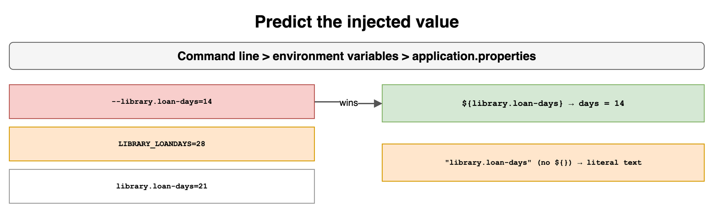
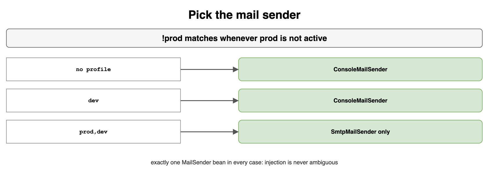

# Values, SpEL, Environment, and Profiles — Drills

Predict the result before running the example.

## Predict the injected value

`application.properties` contains `library.loan-days=21`. The app starts with `--library.loan-days=14` and the environment variable `LIBRARY_LOANDAYS=28`. What do the two parameters below receive?

```java
LoanInfo(@Value("${library.loan-days}") int days,
         @Value("library.loan-days") String key) { }
```

**Answer**

`days` is 14: command-line arguments outrank environment variables, which outrank `application.properties`. `key` is the literal text `"library.loan-days"`, because without `${...}` the annotation value is not a placeholder. See [the Environment](#13_Spring_Boot/06_Values_SpEL_Environment_and_Profiles/concepts/the-environment).



*Source: [`diagrams/values-and-profiles-drills.drawio`](/content/13_Spring_Boot/06_Values_SpEL_Environment_and_Profiles/diagrams/values-and-profiles-drills.drawio), page 1.*

## Pick the mail sender

With the two senders from [profiles](#13_Spring_Boot/06_Values_SpEL_Environment_and_Profiles/concepts/profiles), which `MailSender` bean exists when the app runs with no active profile, with `dev`, and with `prod,dev`?

**Answer**

No profile: `ConsoleMailSender`, because `!prod` matches when `prod` is not active. `dev`: `ConsoleMailSender`. `prod,dev`: `SmtpMailSender` only, since `prod` is active and `!prod` no longer matches. In every case exactly one bean exists, so injection into `MailSender` never becomes ambiguous.



*Source: [`diagrams/values-and-profiles-drills.drawio`](/content/13_Spring_Boot/06_Values_SpEL_Environment_and_Profiles/diagrams/values-and-profiles-drills.drawio), page 2.*
