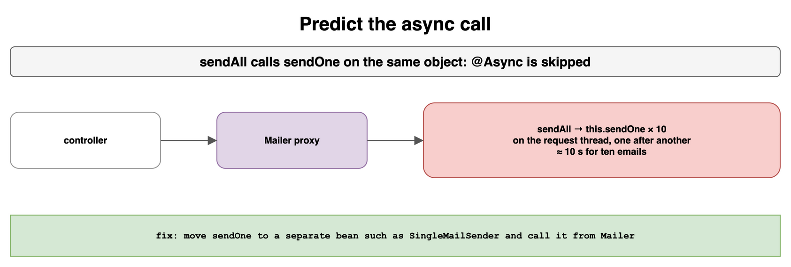
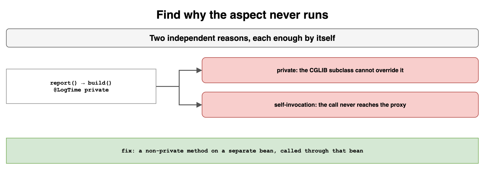

# Proxies and AOP — Drills

Predict the result before running the example.

## Predict the async call

The controller calls `sendAll()`. Does each `sendOne` run on a separate thread, and how long does the request take if each email takes one second?

```java
@Service
class Mailer {
    void sendAll(List<String> emails) {
        emails.forEach(this::sendOne);
    }

    @Async
    void sendOne(String email) {
        slowSmtpSend(email); // about one second
    }
}
```

**Answer**

No. `sendAll` calls `sendOne` on the same object, so the call skips the proxy and `@Async` is ignored. All emails are sent one after another on the request thread, and ten emails take about ten seconds. Move `sendOne` to a separate bean, such as `SingleMailSender`, and call it from `Mailer`. See [the self-invocation trap](#13_Spring_Boot/07_Proxies_and_AOP/concepts/the-self-invocation-trap).



*Source: [`diagrams/proxies-and-aop-drills.drawio`](/content/13_Spring_Boot/07_Proxies_and_AOP/diagrams/proxies-and-aop-drills.drawio), page 1.*

## Find why the aspect never runs

The `TimingAspect` from [write an aspect](#13_Spring_Boot/07_Proxies_and_AOP/concepts/write-an-aspect) is a bean and the starter is present, but this method never logs its time. Why?

```java
@Service
class ReportService {
    @LogTime
    private String build() {
        return "report";
    }

    String report() {
        return build();
    }
}
```

**Answer**

Two reasons, each enough by itself: `build` is `private`, so the CGLIB subclass cannot override it, and it is called from `report` on the same object, so the call never reaches the proxy. Make it a non-private method on a separate bean and call it through that bean. See [proxy limits to remember](#13_Spring_Boot/07_Proxies_and_AOP/concepts/proxy-limits-to-remember).



*Source: [`diagrams/proxies-and-aop-drills.drawio`](/content/13_Spring_Boot/07_Proxies_and_AOP/diagrams/proxies-and-aop-drills.drawio), page 2.*
