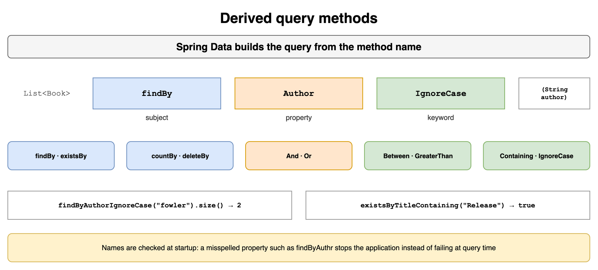
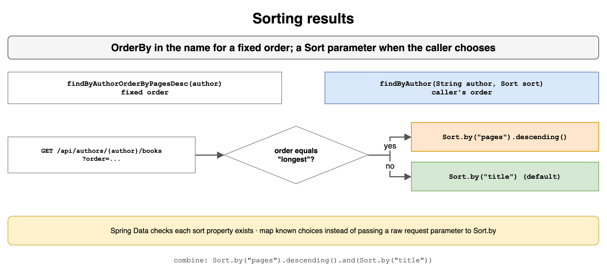
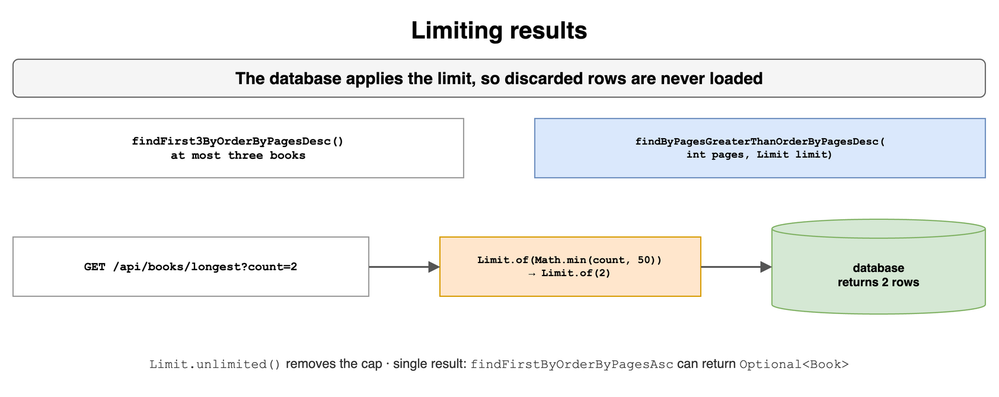
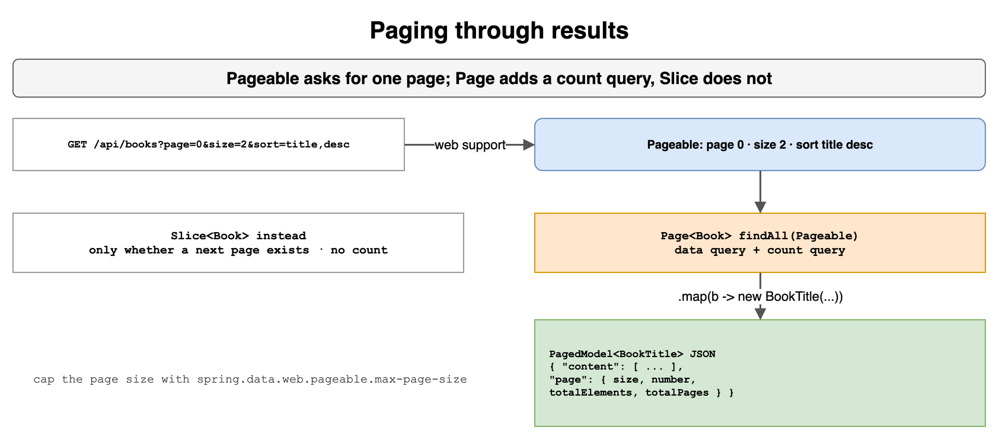
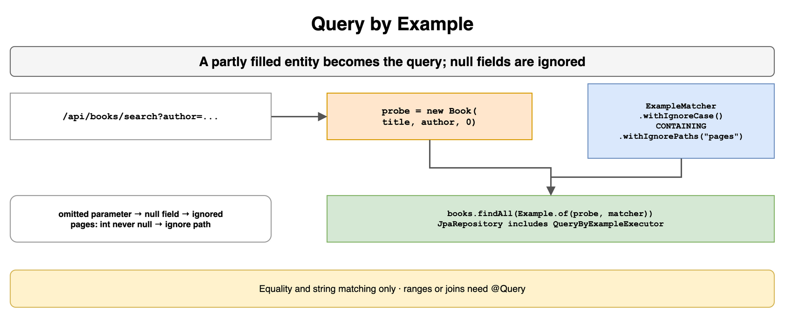
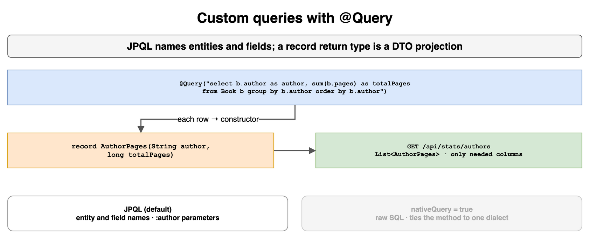
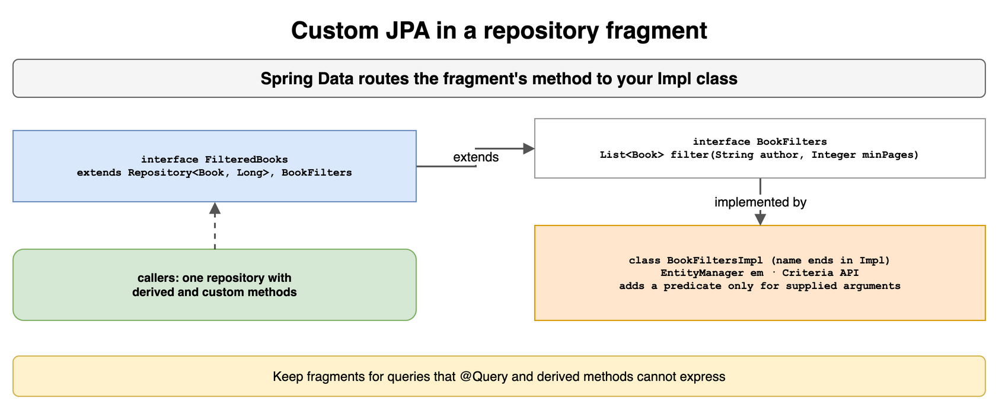

# Queries with Spring Data

## Derived query methods

Spring Data reads a repository method name and builds the query from it. A name starts with a subject such as `findBy`, `existsBy`, `countBy`, or `deleteBy`, followed by property names joined with `And` or `Or`. Keywords such as `Between`, `GreaterThan`, `Containing`, and `IgnoreCase` modify a condition. Each method parameter supplies one value, in order.

The names are checked at startup. A misspelled property such as `findByAuthr` stops the application with an error instead of failing at query time. The app below is the base for this topic: it maps a `Book`, seeds four rows, and prints two derived queries.

```java
import jakarta.persistence.Entity;
import jakarta.persistence.GeneratedValue;
import jakarta.persistence.Id;
import java.util.List;
import org.springframework.boot.CommandLineRunner;
import org.springframework.boot.SpringApplication;
import org.springframework.boot.autoconfigure.SpringBootApplication;
import org.springframework.context.annotation.Bean;
import org.springframework.data.repository.ListCrudRepository;

@SpringBootApplication
public class StudyApplication {
    public static void main(String[] args) {
        SpringApplication.run(StudyApplication.class, args);
    }

    @Bean
    CommandLineRunner seed(BookRepository books) {
        return args -> {
            books.saveAll(List.of(new Book("Refactoring", "Fowler", 448), new Book("Analysis Patterns", "Fowler", 384),
                    new Book("Release It!", "Nygard", 376), new Book("Accelerate", "Forsgren", 288)));
            System.out.println(books.findByAuthorIgnoreCase("fowler").size());
            System.out.println(books.existsByTitleContaining("Release"));
        };
    }
}

@Entity
class Book {
    @Id @GeneratedValue Long id;
    String title;
    String author;
    int pages;

    protected Book() {
    }

    Book(String title, String author, int pages) {
        this.title = title;
        this.author = author;
        this.pages = pages;
    }

    public String getTitle() { return title; }
    public String getAuthor() { return author; }
    public int getPages() { return pages; }
}

interface BookRepository extends ListCrudRepository<Book, Long> {
    List<Book> findByAuthorIgnoreCase(String author);
    List<Book> findByPagesBetween(int min, int max);
    boolean existsByTitleContaining(String text);
}
```

[Spring Data JPA docs](https://docs.spring.io/spring-data/jpa/reference/jpa/query-methods.html)



*Source: [`diagrams/spring-data-queries.drawio`](/content/13_Spring_Boot/07_Queries_with_Spring_Data/diagrams/spring-data-queries.drawio), page 1.*

## Sorting results

Add `OrderBy` to a method name for a fixed order, such as `findByAuthorOrderByPagesDesc`. When the caller chooses the order, add a `Sort` parameter instead. `Sort.by("pages").descending().and(Sort.by("title"))` sorts by pages and then by title. Spring Data checks that each sort property exists on the entity.

Do not pass a raw request parameter straight into `Sort.by` unless invalid names should produce an error. This endpoint lets the client choose between two known orders. Add it, with its repository, to the [derived query example](#13_Spring_Boot/07_Queries_with_Spring_Data/concepts/derived-query-methods).

```java
import java.util.List;
import org.springframework.data.domain.Sort;
import org.springframework.data.repository.Repository;
import org.springframework.web.bind.annotation.GetMapping;
import org.springframework.web.bind.annotation.PathVariable;
import org.springframework.web.bind.annotation.RequestParam;
import org.springframework.web.bind.annotation.RestController;

interface SortedBooks extends Repository<Book, Long> {
    List<Book> findByAuthor(String author, Sort sort);
}

@RestController
class SortedBookApi {
    private final SortedBooks books;

    SortedBookApi(SortedBooks books) {
        this.books = books;
    }

    @GetMapping("/api/authors/{author}/books")
    List<String> byAuthor(@PathVariable String author, @RequestParam(defaultValue = "title") String order) {
        var sort = order.equals("longest") ? Sort.by("pages").descending() : Sort.by("title");
        return books.findByAuthor(author, sort).stream().map(Book::getTitle).toList();
    }
}
```

[Spring Data JPA docs](https://docs.spring.io/spring-data/jpa/reference/repositories/query-methods-details.html#repositories.special-parameters)



*Source: [`diagrams/spring-data-queries.drawio`](/content/13_Spring_Boot/07_Queries_with_Spring_Data/diagrams/spring-data-queries.drawio), page 2.*

## Limiting results

`First` or `Top` with a number in the method name caps the result: `findFirst3ByOrderByPagesDesc` returns at most three books. When the cap varies, declare a `Limit` parameter and call the method with `Limit.of(5)`. `Limit.unlimited()` removes the cap. The database applies the limit, so the application never loads the rows it would discard.

A method that returns a single entity, such as `findFirstByOrderByPagesAsc`, can return `Optional<Book>` for the empty-table case. Add this repository and endpoint to the [derived query example](#13_Spring_Boot/07_Queries_with_Spring_Data/concepts/derived-query-methods) and request `/api/books/longest?count=2`.

```java
import java.util.List;
import org.springframework.data.domain.Limit;
import org.springframework.data.repository.Repository;
import org.springframework.web.bind.annotation.GetMapping;
import org.springframework.web.bind.annotation.RequestParam;
import org.springframework.web.bind.annotation.RestController;

interface RankedBooks extends Repository<Book, Long> {
    List<Book> findFirst3ByOrderByPagesDesc();
    List<Book> findByPagesGreaterThanOrderByPagesDesc(int pages, Limit limit);
}

@RestController
class RankedBookApi {
    private final RankedBooks books;

    RankedBookApi(RankedBooks books) {
        this.books = books;
    }

    @GetMapping("/api/books/longest")
    List<String> longest(@RequestParam(defaultValue = "3") int count) {
        return books.findByPagesGreaterThanOrderByPagesDesc(0, Limit.of(Math.min(count, 50)))
                .stream().map(Book::getTitle).toList();
    }
}
```

[Spring Data JPA docs](https://docs.spring.io/spring-data/jpa/reference/repositories/query-methods-details.html#repositories.limit-query-result)



*Source: [`diagrams/spring-data-queries.drawio`](/content/13_Spring_Boot/07_Queries_with_Spring_Data/diagrams/spring-data-queries.drawio), page 3.*

## Paging through results

A `Pageable` parameter asks for one page: a page number, a page size, and an optional sort. A method that returns `Page<Book>` also runs a count query so the result knows the total number of elements and pages. Return `Slice<Book>` instead when the client only needs to know whether a next page exists, which avoids the count query.

Spring Data's web support resolves a `Pageable` controller parameter from `?page=0&size=2&sort=title,desc`. Wrap the page in `PagedModel` before returning it so the JSON has a stable shape with `content` and `page` metadata. Cap the page size with `spring.data.web.pageable.max-page-size`.

```java
import org.springframework.data.domain.Page;
import org.springframework.data.domain.Pageable;
import org.springframework.data.repository.Repository;
import org.springframework.data.web.PagedModel;
import org.springframework.web.bind.annotation.GetMapping;
import org.springframework.web.bind.annotation.RestController;

record BookTitle(String title, int pages) {
}

interface PagedBooks extends Repository<Book, Long> {
    Page<Book> findAll(Pageable pageable);
}

@RestController
class PagedBookApi {
    private final PagedBooks books;

    PagedBookApi(PagedBooks books) {
        this.books = books;
    }

    @GetMapping("/api/books")
    PagedModel<BookTitle> page(Pageable pageable) {
        return new PagedModel<>(books.findAll(pageable).map(b -> new BookTitle(b.getTitle(), b.getPages())));
    }
}
```

[Spring Data docs](https://docs.spring.io/spring-data/commons/reference/repositories/core-extensions.html#core.web.basic)



*Source: [`diagrams/spring-data-queries.drawio`](/content/13_Spring_Boot/07_Queries_with_Spring_Data/diagrams/spring-data-queries.drawio), page 4.*

## Query by Example

Query by Example builds a query from a partly filled entity. Set the fields to match, wrap the probe in an `Example`, and pass it to a repository that extends `QueryByExampleExecutor`, which `JpaRepository` already does. Fields that are `null` are ignored, which suits search forms where users fill in only some fields.

An `ExampleMatcher` controls how fields match. Here strings match case-insensitively as substrings, and `pages` is ignored because a primitive `int` is never `null`. Query by Example handles equality and string matching only; use a [`@Query`](#13_Spring_Boot/07_Queries_with_Spring_Data/concepts/custom-queries-with-query) for ranges or joins.

```java
import java.util.List;
import org.springframework.data.domain.Example;
import org.springframework.data.domain.ExampleMatcher;
import org.springframework.data.jpa.repository.JpaRepository;
import org.springframework.web.bind.annotation.GetMapping;
import org.springframework.web.bind.annotation.RequestParam;
import org.springframework.web.bind.annotation.RestController;

interface SearchableBooks extends JpaRepository<Book, Long> {
}

@RestController
class BookSearchApi {
    private final SearchableBooks books;

    BookSearchApi(SearchableBooks books) {
        this.books = books;
    }

    @GetMapping("/api/books/search")
    List<String> search(@RequestParam(required = false) String title,
                        @RequestParam(required = false) String author) {
        var probe = new Book(title, author, 0);
        var matcher = ExampleMatcher.matching()
                .withIgnoreCase()
                .withStringMatcher(ExampleMatcher.StringMatcher.CONTAINING)
                .withIgnorePaths("pages");
        return books.findAll(Example.of(probe, matcher)).stream().map(Book::getTitle).toList();
    }
}
```

[Spring Data JPA docs](https://docs.spring.io/spring-data/jpa/reference/repositories/query-by-example.html)



*Source: [`diagrams/spring-data-queries.drawio`](/content/13_Spring_Boot/07_Queries_with_Spring_Data/diagrams/spring-data-queries.drawio), page 5.*

## Custom queries with @Query

When a method name would become unreadable, or the query needs aggregation or a join, write it with `@Query`. The query is JPQL by default and refers to entity and field names, not tables. Bind parameters by name with `:author`. `nativeQuery = true` sends SQL directly to the database, which ties the method to one database's dialect.

The return type can be a record. Spring Data maps each row to its constructor, called a DTO projection, so the query returns only the needed columns instead of whole entities. This repository returns the page count per author.

```java
import java.util.List;
import org.springframework.data.jpa.repository.Query;
import org.springframework.data.repository.Repository;
import org.springframework.web.bind.annotation.GetMapping;
import org.springframework.web.bind.annotation.RestController;

record AuthorPages(String author, long totalPages) {
}

interface BookStats extends Repository<Book, Long> {
    @Query("select b.author as author, sum(b.pages) as totalPages from Book b group by b.author order by b.author")
    List<AuthorPages> pagesPerAuthor();
}

@RestController
class StatsApi {
    private final BookStats stats;

    StatsApi(BookStats stats) {
        this.stats = stats;
    }

    @GetMapping("/api/stats/authors")
    List<AuthorPages> authors() {
        return stats.pagesPerAuthor();
    }
}
```

[Spring Data JPA docs](https://docs.spring.io/spring-data/jpa/reference/jpa/query-methods.html#jpa.query-methods.at-query)



*Source: [`diagrams/spring-data-queries.drawio`](/content/13_Spring_Boot/07_Queries_with_Spring_Data/diagrams/spring-data-queries.drawio), page 6.*

## Custom JPA in a repository fragment

When a query must be assembled at run time, write it yourself and attach it to a repository as a fragment. Declare an interface with the custom method, implement it in a class whose name ends in `Impl`, and extend the interface from the repository. Spring Data routes calls on that method to your implementation, which can inject the `EntityManager`.

This fragment uses the JPA Criteria API to add filters only for the arguments supplied. Callers still see one repository with both derived and custom methods. Keep fragments for queries that `@Query` and derived methods cannot express.

```java
import jakarta.persistence.EntityManager;
import jakarta.persistence.criteria.Predicate;
import java.util.ArrayList;
import java.util.List;
import org.springframework.data.repository.Repository;

interface BookFilters {
    List<Book> filter(String author, Integer minPages);
}

class BookFiltersImpl implements BookFilters {
    private final EntityManager em;

    BookFiltersImpl(EntityManager em) {
        this.em = em;
    }

    @Override
    public List<Book> filter(String author, Integer minPages) {
        var cb = em.getCriteriaBuilder();
        var query = cb.createQuery(Book.class);
        var book = query.from(Book.class);
        var conditions = new ArrayList<Predicate>();
        if (author != null) conditions.add(cb.equal(book.get("author"), author));
        if (minPages != null) conditions.add(cb.ge(book.<Integer>get("pages"), minPages));
        query.where(conditions.toArray(Predicate[]::new));
        return em.createQuery(query).getResultList();
    }
}

interface FilteredBooks extends Repository<Book, Long>, BookFilters {
}
```

[Spring Data JPA docs](https://docs.spring.io/spring-data/jpa/reference/repositories/custom-implementations.html)



*Source: [`diagrams/spring-data-queries.drawio`](/content/13_Spring_Boot/07_Queries_with_Spring_Data/diagrams/spring-data-queries.drawio), page 7.*
