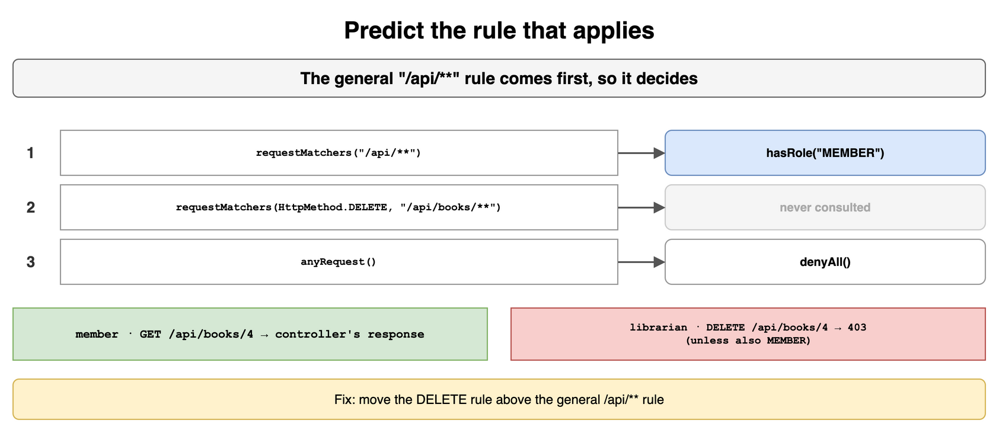
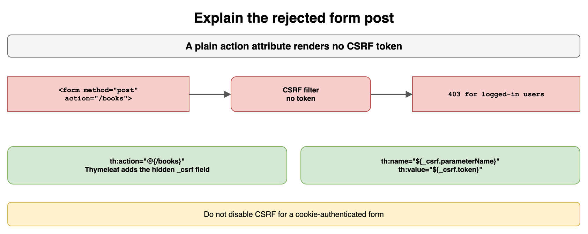

# Spring Security Foundations — Drills

Predict the result before running the example.

## Predict the rule that applies

A librarian sends `DELETE /api/books/4` and a member sends `GET /api/books/4`, both authenticated with HTTP Basic. Which status does each receive with this rule order? How do you fix it?

```java
import org.springframework.context.annotation.Bean;
import org.springframework.context.annotation.Configuration;
import org.springframework.http.HttpMethod;
import org.springframework.security.config.Customizer;
import org.springframework.security.config.annotation.web.builders.HttpSecurity;
import org.springframework.security.web.SecurityFilterChain;

@Configuration
class OrderedRules {
    @Bean
    SecurityFilterChain api(HttpSecurity http) throws Exception {
        http.authorizeHttpRequests(auth -> auth
                        .requestMatchers("/api/**").hasRole("MEMBER")
                        .requestMatchers(HttpMethod.DELETE, "/api/books/**").hasRole("LIBRARIAN")
                        .anyRequest().denyAll())
                .httpBasic(Customizer.withDefaults())
                .csrf(csrf -> csrf.ignoringRequestMatchers("/api/**"));
        return http.build();
    }
}
```

**Answer**

The first rule matches both requests, so the member's GET gets the controller's response, and the librarian's DELETE gets 403 unless the librarian also has the `MEMBER` role. The DELETE rule is never consulted. Move the specific DELETE rule above the general `/api/**` rule; see [secure routes and HTTP verbs](#13_Spring_Boot/08_Spring_Security_Foundations/concepts/secure-routes-and-http-verbs).



*Source: [`diagrams/spring-security-drills.drawio`](/content/13_Spring_Boot/08_Spring_Security_Foundations/diagrams/spring-security-drills.drawio), page 1.*

## Explain the rejected form post

Security is added to an app whose form was written in plain HTML with `action="/books"`. Logged-in users now get 403 when they submit it. What is missing, and what are two ways to fix it?

```html
<form method="post" action="/books">
  <input name="title">
  <button type="submit">Add</button>
</form>
```

**Answer**

The POST has no CSRF token, so the CSRF filter rejects it with 403. Use `th:action="@{/books}"` so Thymeleaf adds the hidden `_csrf` field, or add the field yourself with `th:name="${_csrf.parameterName}"` and `th:value="${_csrf.token}"`. Do not disable CSRF for a cookie-authenticated form. See [CSRF protection](#13_Spring_Boot/08_Spring_Security_Foundations/concepts/csrf-protection).



*Source: [`diagrams/spring-security-drills.drawio`](/content/13_Spring_Boot/08_Spring_Security_Foundations/diagrams/spring-security-drills.drawio), page 2.*
