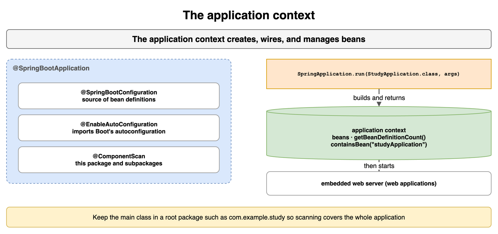
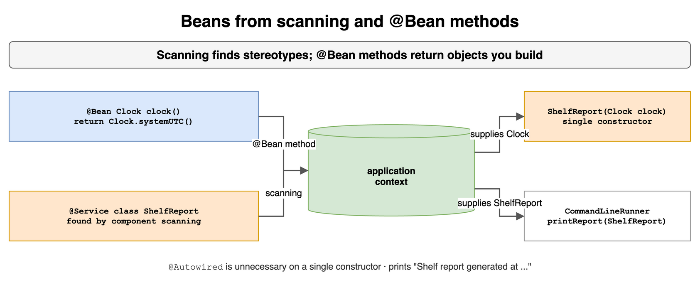
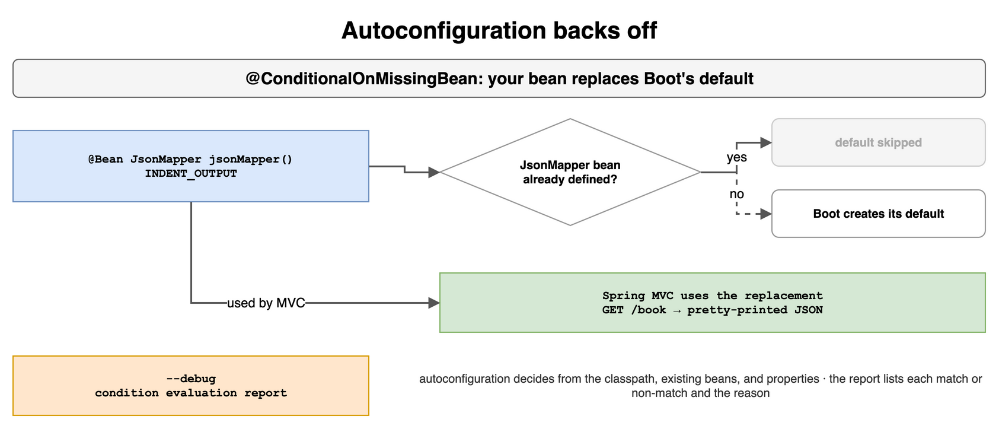
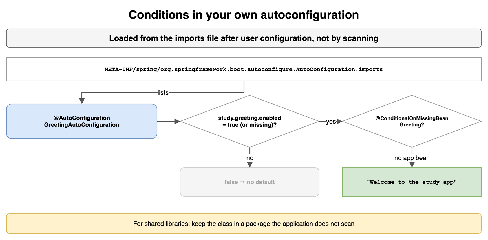
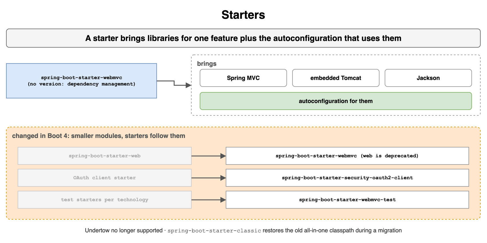

# Core Features and Autoconfiguration

## The application context

A Spring application is a set of objects, called beans, that the application context creates, wires together, and manages. `SpringApplication.run` builds that context from your configuration and returns it. Spring Boot then starts the embedded web server if the application is a web application.

`@SpringBootApplication` combines three annotations. `@SpringBootConfiguration` marks the class as a source of bean definitions, `@EnableAutoConfiguration` imports Boot's autoconfiguration, and `@ComponentScan` finds annotated classes in this package and its subpackages. Keep the main class in a root package such as `com.example.study` so scanning covers the whole application.

```java
import org.springframework.boot.SpringApplication;
import org.springframework.boot.autoconfigure.SpringBootApplication;

@SpringBootApplication
public class StudyApplication {
    public static void main(String[] args) {
        var context = SpringApplication.run(StudyApplication.class, args);
        System.out.println("Beans: " + context.getBeanDefinitionCount());
        System.out.println("Has StudyApplication bean: " + context.containsBean("studyApplication"));
    }
}
```

[Spring Boot docs](https://docs.spring.io/spring-boot/reference/using/using-the-springbootapplication-annotation.html)



*Source: [`diagrams/autoconfiguration.drawio`](/content/13_Spring_Boot/09_Core_Features_and_Autoconfiguration/diagrams/autoconfiguration.drawio), page 1.*

## Beans from scanning and @Bean methods

There are two common ways to define a bean. Component scanning registers a class annotated with a stereotype such as `@Component` or `@Service`. A `@Bean` method in a `@Configuration` class returns an object that you build yourself, which suits third-party types and objects that need setup code.

When a bean has one constructor, Spring calls it and supplies the constructor arguments from the context. Here `ShelfReport` receives the `Clock` bean declared in the configuration class. `@Autowired` is unnecessary on a single constructor. The [constructor injection card](#13_Spring_Boot/11_Spring_MVC_Controllers_and_Templates/concepts/constructor-injection) shows the same idea in a web controller.

```java
import java.time.Clock;
import org.springframework.boot.CommandLineRunner;
import org.springframework.boot.SpringApplication;
import org.springframework.boot.autoconfigure.SpringBootApplication;
import org.springframework.context.annotation.Bean;
import org.springframework.stereotype.Service;

@SpringBootApplication
public class StudyApplication {
    public static void main(String[] args) {
        SpringApplication.run(StudyApplication.class, args);
    }

    @Bean
    Clock clock() {
        return Clock.systemUTC();
    }

    @Bean
    CommandLineRunner printReport(ShelfReport report) {
        return args -> System.out.println(report.summary());
    }
}

@Service
class ShelfReport {
    private final Clock clock;

    ShelfReport(Clock clock) {
        this.clock = clock;
    }

    String summary() {
        return "Shelf report generated at " + clock.instant();
    }
}
```

[Spring Framework docs](https://docs.spring.io/spring-framework/reference/core/beans/java/basic-concepts.html)



*Source: [`diagrams/autoconfiguration.drawio`](/content/13_Spring_Boot/09_Core_Features_and_Autoconfiguration/diagrams/autoconfiguration.drawio), page 2.*

## Autoconfiguration backs off

Autoconfiguration classes contribute beans based on the classpath, existing beans, and properties. Most beans they register are guarded by `@ConditionalOnMissingBean`. If you declare a bean of the same type, Boot uses yours and skips its default. This is why Boot can supply defaults without preventing you from replacing them.

This app defines its own Jackson 3 `JsonMapper`, so the default mapper from Boot's Jackson autoconfiguration is not created. Spring MVC uses the replacement and pretty-prints `/book`. Start the app with `--debug` to print the condition evaluation report, which lists each autoconfiguration that matched or did not match and the reason.

```java
import java.util.Map;
import org.springframework.boot.SpringApplication;
import org.springframework.boot.autoconfigure.SpringBootApplication;
import org.springframework.context.annotation.Bean;
import org.springframework.web.bind.annotation.GetMapping;
import org.springframework.web.bind.annotation.RestController;
import tools.jackson.databind.SerializationFeature;
import tools.jackson.databind.json.JsonMapper;

@SpringBootApplication
public class StudyApplication {
    public static void main(String[] args) {
        SpringApplication.run(StudyApplication.class, args);
    }

    @Bean
    JsonMapper jsonMapper() {
        return JsonMapper.builder().enable(SerializationFeature.INDENT_OUTPUT).build();
    }
}

@RestController
class BookController {
    @GetMapping("/book")
    Map<String, Object> book() {
        return Map.of("title", "Domain Modeling", "pages", 312);
    }
}
```

[Spring Boot docs](https://docs.spring.io/spring-boot/reference/using/auto-configuration.html)



*Source: [`diagrams/autoconfiguration.drawio`](/content/13_Spring_Boot/09_Core_Features_and_Autoconfiguration/diagrams/autoconfiguration.drawio), page 3.*

## Conditions in your own autoconfiguration

An autoconfiguration is an ordinary configuration class annotated with `@AutoConfiguration` and listed in `META-INF/spring/org.springframework.boot.autoconfigure.AutoConfiguration.imports`. Boot does not find it through component scanning. It loads it after user configuration, so conditions such as `@ConditionalOnMissingBean` can see the beans that the application declared.

Use this pattern in a shared library that several applications import. The class below supplies a default greeting unless the application defines its own `Greeting` bean or sets `study.greeting.enabled=false`. Put the class in a package that the application does not scan, and add its fully qualified name to the imports file.

```java
import org.springframework.boot.autoconfigure.AutoConfiguration;
import org.springframework.boot.autoconfigure.condition.ConditionalOnMissingBean;
import org.springframework.boot.autoconfigure.condition.ConditionalOnProperty;
import org.springframework.context.annotation.Bean;

@AutoConfiguration
@ConditionalOnProperty(name = "study.greeting.enabled", havingValue = "true", matchIfMissing = true)
public class GreetingAutoConfiguration {
    @Bean
    @ConditionalOnMissingBean
    Greeting greeting() {
        return () -> "Welcome to the study app";
    }
}

interface Greeting {
    String text();
}
```

[Spring Boot docs](https://docs.spring.io/spring-boot/reference/features/developing-auto-configuration.html)



*Source: [`diagrams/autoconfiguration.drawio`](/content/13_Spring_Boot/09_Core_Features_and_Autoconfiguration/diagrams/autoconfiguration.drawio), page 4.*

## Starters

A starter is a dependency that brings in a coherent set of libraries for one feature, together with the autoconfiguration that uses them. Add `spring-boot-starter-webmvc` and Boot provides Spring MVC, an embedded Tomcat server, and Jackson. The starter does not declare a version in your build; Boot's dependency management supplies it.

Changed in Boot 4: the codebase is split into smaller modules, and starters follow them. `spring-boot-starter-web` is deprecated in favor of `spring-boot-starter-webmvc`, the OAuth client starter is now `spring-boot-starter-security-oauth2-client`, and each technology has a matching test starter such as `spring-boot-starter-webmvc-test`. Undertow is no longer supported as an embedded server. `spring-boot-starter-classic` restores the old all-in-one classpath during a migration.

```xml
<dependencies>
  <dependency>
    <groupId>org.springframework.boot</groupId>
    <artifactId>spring-boot-starter-webmvc</artifactId>
  </dependency>
  <dependency>
    <groupId>org.springframework.boot</groupId>
    <artifactId>spring-boot-starter-webmvc-test</artifactId>
    <scope>test</scope>
  </dependency>
</dependencies>
```

[Spring Boot docs](https://docs.spring.io/spring-boot/reference/using/build-systems.html#using.build-systems.starters)



*Source: [`diagrams/autoconfiguration.drawio`](/content/13_Spring_Boot/09_Core_Features_and_Autoconfiguration/diagrams/autoconfiguration.drawio), page 5.*
