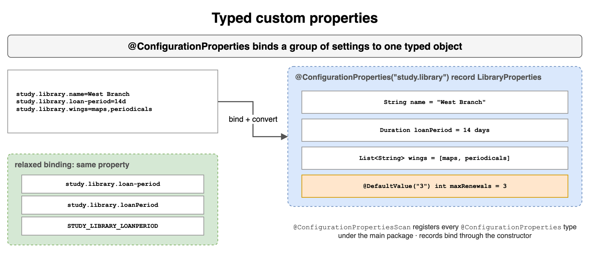
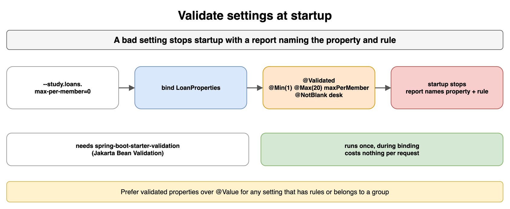
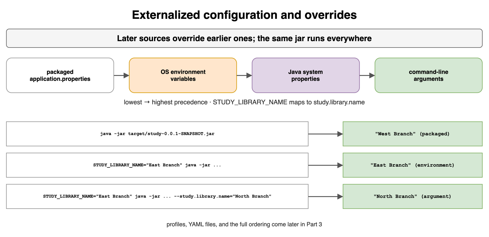
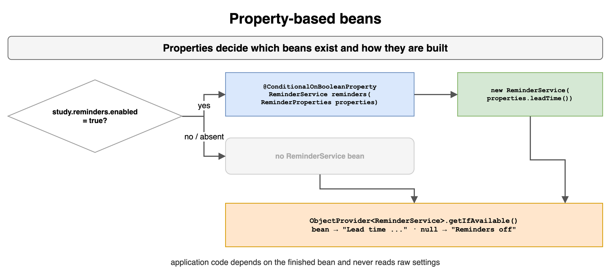
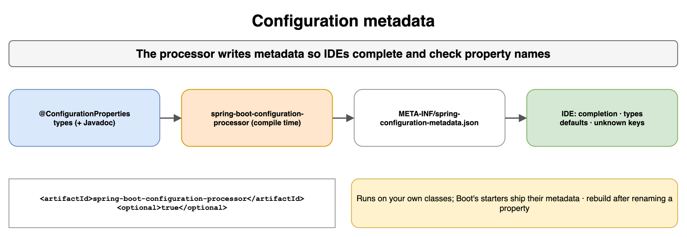
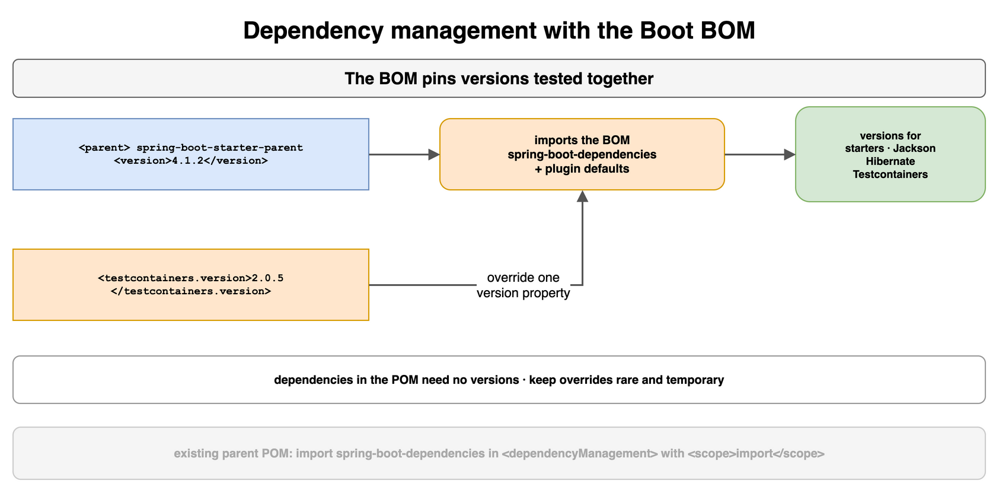

# Configuration Properties and Dependency Management

## Typed custom properties

`@ConfigurationProperties` binds a group of related settings to one typed object. Boot converts each value to the field's type, so `14d` becomes a `Duration` and a comma-separated list becomes a `List`. A Java record is a good fit because the bound settings are immutable after startup. Boot binds through the record's constructor.

`@ConfigurationPropertiesScan` registers every `@ConfigurationProperties` type under the main package. Relaxed binding means `study.library.loan-period`, `study.library.loanPeriod` and the environment variable `STUDY_LIBRARY_LOANPERIOD` all reach the same component. `@DefaultValue` supplies a value when no source sets the property. Add the settings to `src/main/resources/application.properties` and run the app.

```properties
study.library.name=West Branch
study.library.loan-period=14d
study.library.wings=maps,periodicals
```

```java
import java.time.Duration;
import java.util.List;
import org.springframework.boot.CommandLineRunner;
import org.springframework.boot.SpringApplication;
import org.springframework.boot.autoconfigure.SpringBootApplication;
import org.springframework.boot.context.properties.ConfigurationProperties;
import org.springframework.boot.context.properties.ConfigurationPropertiesScan;
import org.springframework.boot.context.properties.bind.DefaultValue;
import org.springframework.context.annotation.Bean;

@SpringBootApplication
@ConfigurationPropertiesScan
public class StudyApplication {
    public static void main(String[] args) {
        SpringApplication.run(StudyApplication.class, args);
    }

    @Bean
    CommandLineRunner show(LibraryProperties library) {
        return args -> System.out.println(library);
    }
}

@ConfigurationProperties("study.library")
record LibraryProperties(String name, Duration loanPeriod, List<String> wings,
                         @DefaultValue("3") int maxRenewals) {
}
```

[Spring Boot docs](https://docs.spring.io/spring-boot/reference/features/external-config.html#features.external-config.typesafe-configuration-properties)



*Source: [`diagrams/configuration-properties.drawio`](/content/13_Spring_Boot/10_Configuration_Properties_and_Dependency_Management/diagrams/configuration-properties.drawio), page 1.*

## Validate settings at startup

A misspelled or missing setting is cheaper to find at startup than at the first request that uses it. Annotate the properties type with `@Validated` and add Jakarta Bean Validation constraints. With `spring-boot-starter-validation` on the classpath, Boot validates the bound object and stops startup with a report that names the property and the violated rule.

Start this app with `--study.loans.max-per-member=0` to see the failure. Validation runs once, during binding, so it costs nothing per request. Prefer validated properties over `@Value` for any setting that has rules or belongs to a group.

```java
import jakarta.validation.constraints.Max;
import jakarta.validation.constraints.Min;
import jakarta.validation.constraints.NotBlank;
import org.springframework.boot.SpringApplication;
import org.springframework.boot.autoconfigure.SpringBootApplication;
import org.springframework.boot.context.properties.ConfigurationProperties;
import org.springframework.boot.context.properties.ConfigurationPropertiesScan;
import org.springframework.validation.annotation.Validated;

@SpringBootApplication
@ConfigurationPropertiesScan
public class StudyApplication {
    public static void main(String[] args) {
        SpringApplication.run(StudyApplication.class, args);
    }
}

@Validated
@ConfigurationProperties("study.loans")
record LoanProperties(@Min(1) @Max(20) int maxPerMember, @NotBlank String desk) {
}
```

[Spring Boot docs](https://docs.spring.io/spring-boot/reference/features/external-config.html#features.external-config.typesafe-configuration-properties.validation)



*Source: [`diagrams/configuration-properties.drawio`](/content/13_Spring_Boot/10_Configuration_Properties_and_Dependency_Management/diagrams/configuration-properties.drawio), page 2.*

## Externalized configuration and overrides

Boot reads properties from many sources and gives each a precedence. The packaged `application.properties` holds defaults. Operating system environment variables override it, Java system properties override environment variables, and command-line arguments override all three. The same jar can therefore run in several environments with different settings and no rebuild.

Environment variable names use uppercase letters and underscores: `STUDY_LIBRARY_NAME` maps to `study.library.name`. Run the [typed properties example](#13_Spring_Boot/10_Configuration_Properties_and_Dependency_Management/concepts/typed-custom-properties) three ways and compare the printed name. Profiles, YAML files, and the full ordering are covered later in Part 3.

```sh
java -jar target/study-0.0.1-SNAPSHOT.jar
STUDY_LIBRARY_NAME="East Branch" java -jar target/study-0.0.1-SNAPSHOT.jar
STUDY_LIBRARY_NAME="East Branch" java -jar target/study-0.0.1-SNAPSHOT.jar --study.library.name="North Branch"
```

[Spring Boot docs](https://docs.spring.io/spring-boot/reference/features/external-config.html)



*Source: [`diagrams/configuration-properties.drawio`](/content/13_Spring_Boot/10_Configuration_Properties_and_Dependency_Management/diagrams/configuration-properties.drawio), page 3.*

## Property-based beans

Properties can decide which beans exist and how they are built. `@ConditionalOnBooleanProperty` registers a bean only when a flag is set. A `@Bean` method can also receive a properties record and use it as constructor input. Application code then depends on the finished bean and never reads raw settings.

Here the reminder service is created only when `study.reminders.enabled=true`. Its lead time comes from configuration. When the flag is absent, the `ObjectProvider` returns `null` and the runner prints that reminders are off.

```java
import java.time.Duration;
import org.springframework.beans.factory.ObjectProvider;
import org.springframework.boot.CommandLineRunner;
import org.springframework.boot.SpringApplication;
import org.springframework.boot.autoconfigure.SpringBootApplication;
import org.springframework.boot.autoconfigure.condition.ConditionalOnBooleanProperty;
import org.springframework.boot.context.properties.ConfigurationProperties;
import org.springframework.boot.context.properties.ConfigurationPropertiesScan;
import org.springframework.context.annotation.Bean;

@SpringBootApplication
@ConfigurationPropertiesScan
public class StudyApplication {
    public static void main(String[] args) {
        SpringApplication.run(StudyApplication.class, args);
    }

    @Bean
    @ConditionalOnBooleanProperty("study.reminders.enabled")
    ReminderService reminders(ReminderProperties properties) {
        return new ReminderService(properties.leadTime());
    }

    @Bean
    CommandLineRunner report(ObjectProvider<ReminderService> reminders) {
        return args -> {
            var service = reminders.getIfAvailable();
            System.out.println(service == null ? "Reminders off" : "Lead time " + service.leadTime());
        };
    }
}

@ConfigurationProperties("study.reminders")
record ReminderProperties(boolean enabled, Duration leadTime) {
}

record ReminderService(Duration leadTime) {
}
```

[Spring Boot docs](https://docs.spring.io/spring-boot/reference/features/developing-auto-configuration.html#features.developing-auto-configuration.condition-annotations.property-conditions)



*Source: [`diagrams/configuration-properties.drawio`](/content/13_Spring_Boot/10_Configuration_Properties_and_Dependency_Management/diagrams/configuration-properties.drawio), page 4.*

## Configuration metadata

Add `spring-boot-configuration-processor` as an optional, annotation-processor dependency. During compilation it reads your `@ConfigurationProperties` types and writes `META-INF/spring-configuration-metadata.json`. IDEs use that file to complete property names, show types and defaults, and flag unknown keys in `application.properties`.

Javadoc on a record component becomes the property's description. The processor runs on your own classes; Boot's own starters already ship their metadata. Rebuild after renaming a property so completion follows.

```xml
<dependency>
  <groupId>org.springframework.boot</groupId>
  <artifactId>spring-boot-configuration-processor</artifactId>
  <optional>true</optional>
</dependency>
```

[Spring Boot docs](https://docs.spring.io/spring-boot/specification/configuration-metadata/annotation-processor.html)



*Source: [`diagrams/configuration-properties.drawio`](/content/13_Spring_Boot/10_Configuration_Properties_and_Dependency_Management/diagrams/configuration-properties.drawio), page 5.*

## Dependency management with the Boot BOM

Boot publishes a bill of materials, `spring-boot-dependencies`, that pins a tested version for each library it supports. Inheriting from `spring-boot-starter-parent` imports that BOM and sets sensible plugin defaults, so starters and managed libraries such as Jackson, Hibernate, or Testcontainers appear in the POM without versions.

To move one library to a different version, override its version property instead of adding a version to the dependency. Keep overrides rare and temporary, because the BOM's versions are the ones tested together. If the project already has a parent POM, import `spring-boot-dependencies` in `<dependencyManagement>` with `<scope>import</scope>` instead.

```xml
<parent>
  <groupId>org.springframework.boot</groupId>
  <artifactId>spring-boot-starter-parent</artifactId>
  <version>4.1.2</version>
</parent>

<properties>
  <java.version>25</java.version>
  <testcontainers.version>2.0.5</testcontainers.version>
</properties>
```

[Spring Boot docs](https://docs.spring.io/spring-boot/maven-plugin/using.html)



*Source: [`diagrams/configuration-properties.drawio`](/content/13_Spring_Boot/10_Configuration_Properties_and_Dependency_Management/diagrams/configuration-properties.drawio), page 6.*
