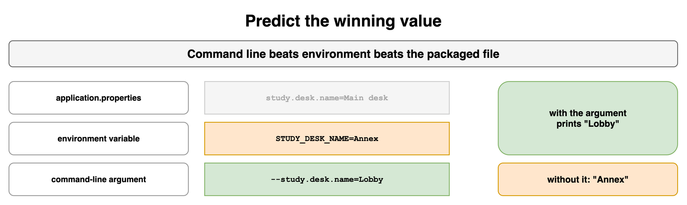
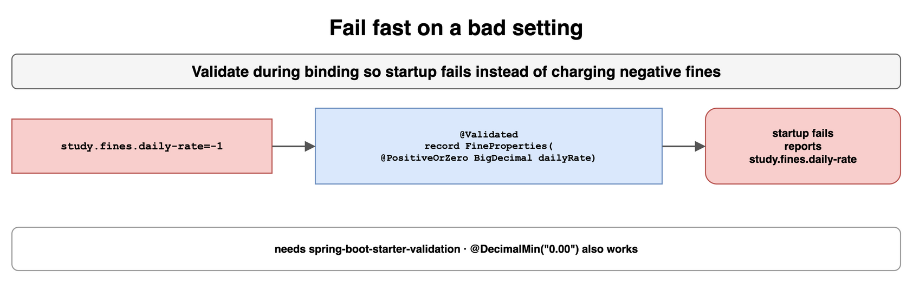

# Configuration Properties and Dependency Management — Drills

Predict the result before running the example.

## Predict the winning value

`application.properties` sets `study.desk.name=Main desk`. The app is started with the environment variable `STUDY_DESK_NAME=Annex` and the argument `--study.desk.name=Lobby`. What does the runner print? What prints if you remove the argument?

```java
import org.springframework.boot.CommandLineRunner;
import org.springframework.boot.SpringApplication;
import org.springframework.boot.autoconfigure.SpringBootApplication;
import org.springframework.boot.context.properties.ConfigurationProperties;
import org.springframework.boot.context.properties.ConfigurationPropertiesScan;
import org.springframework.context.annotation.Bean;

@SpringBootApplication
@ConfigurationPropertiesScan
public class StudyApplication {
    public static void main(String[] args) {
        SpringApplication.run(StudyApplication.class, args);
    }

    @Bean
    CommandLineRunner print(DeskProperties desk) {
        return args -> System.out.println(desk.name());
    }
}

@ConfigurationProperties("study.desk")
record DeskProperties(String name) {
}
```

**Answer**

`Lobby`, because command-line arguments override environment variables and both override the packaged file. Without the argument it prints `Annex`. See [externalized configuration and overrides](#13_Spring_Boot/10_Configuration_Properties_and_Dependency_Management/concepts/externalized-configuration-and-overrides).



*Source: [`diagrams/configuration-properties-drills.drawio`](/content/13_Spring_Boot/10_Configuration_Properties_and_Dependency_Management/diagrams/configuration-properties-drills.drawio), page 1.*

## Fail fast on a bad setting

An operator sets `study.fines.daily-rate=-1`. The app starts and charges negative fines. Change the properties type so startup fails instead, and say which dependency the check needs.

```java
import java.math.BigDecimal;
import org.springframework.boot.context.properties.ConfigurationProperties;

@ConfigurationProperties("study.fines")
record FineProperties(BigDecimal dailyRate) {
}
```

**Answer**

Add `@Validated` to the record and `@PositiveOrZero` (or `@DecimalMin("0.00")`) to `dailyRate`, and add `spring-boot-starter-validation`. Boot then validates during binding and reports `study.fines.daily-rate` in the startup failure. The pattern is in [validate settings at startup](#13_Spring_Boot/10_Configuration_Properties_and_Dependency_Management/concepts/validate-settings-at-startup).



*Source: [`diagrams/configuration-properties-drills.drawio`](/content/13_Spring_Boot/10_Configuration_Properties_and_Dependency_Management/diagrams/configuration-properties-drills.drawio), page 2.*
