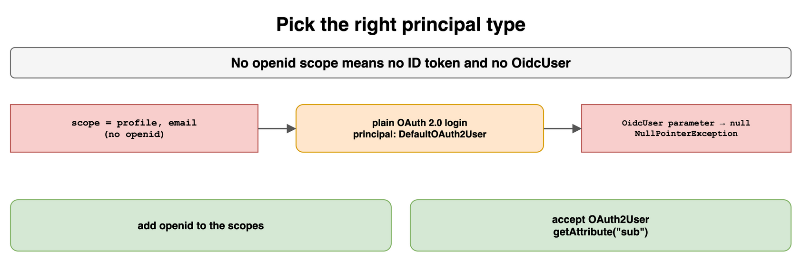
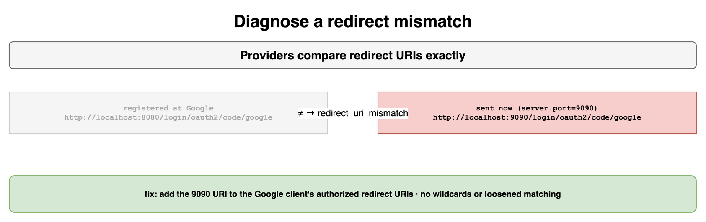

# OAuth 2.1 and OpenID Connect — Drills

Predict the result before running the example.

## Pick the right principal type

The registration requests only the `profile` and `email` scopes, without `openid`. After a successful Google login, `/me` throws a `NullPointerException`. Why, and which two fixes are available?

```java
import org.springframework.security.core.annotation.AuthenticationPrincipal;
import org.springframework.security.oauth2.core.oidc.user.OidcUser;
import org.springframework.web.bind.annotation.GetMapping;
import org.springframework.web.bind.annotation.RestController;

@RestController
class MeApi {
    @GetMapping("/me")
    String me(@AuthenticationPrincipal OidcUser user) {
        return user.getSubject();
    }
}
```

**Answer**

Without the `openid` scope, the login is plain OAuth 2.0. No ID token is issued, and the principal is a `DefaultOAuth2User`, so the `OidcUser` parameter resolves to `null`. Add `openid` to the registration's scopes, or accept an `OAuth2User` and read attributes such as `sub` with `getAttribute`. See [OAuth 2.0 and OpenID Connect](#13_Spring_Boot/10_OAuth_2.1_and_OpenID_Connect/concepts/oauth-2-0-and-openid-connect).



*Source: [`diagrams/oauth-oidc-drills.drawio`](/content/13_Spring_Boot/10_OAuth_2.1_and_OpenID_Connect/diagrams/oauth-oidc-drills.drawio), page 1.*

## Diagnose a redirect mismatch

Google shows `redirect_uri_mismatch` after the app moves from port 8080 to 9090. The console lists `http://localhost:8080/login/oauth2/code/google`. What does Spring send now, and what is the fix?

```properties
server.port=9090
spring.security.oauth2.client.registration.google.client-id=${GOOGLE_CLIENT_ID}
spring.security.oauth2.client.registration.google.client-secret=${GOOGLE_CLIENT_SECRET}
spring.security.oauth2.client.registration.google.scope=openid,profile,email
```

**Answer**

Spring builds the redirect URI from the request's base URL, so it sends `http://localhost:9090/login/oauth2/code/google`. Providers compare redirect URIs exactly, which OAuth 2.1 requires. Add the new URI to the Google client's authorized redirect URIs. Avoid wildcard or loosened matching. See [register a Google client](#13_Spring_Boot/10_OAuth_2.1_and_OpenID_Connect/concepts/register-a-google-client).



*Source: [`diagrams/oauth-oidc-drills.drawio`](/content/13_Spring_Boot/10_OAuth_2.1_and_OpenID_Connect/diagrams/oauth-oidc-drills.drawio), page 2.*
