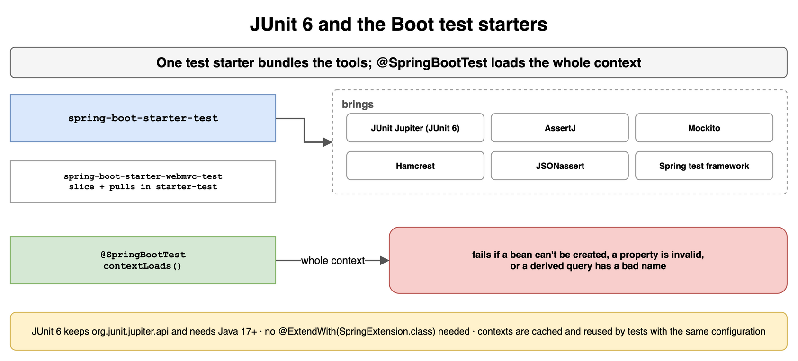
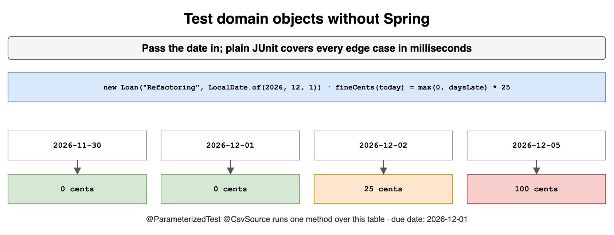
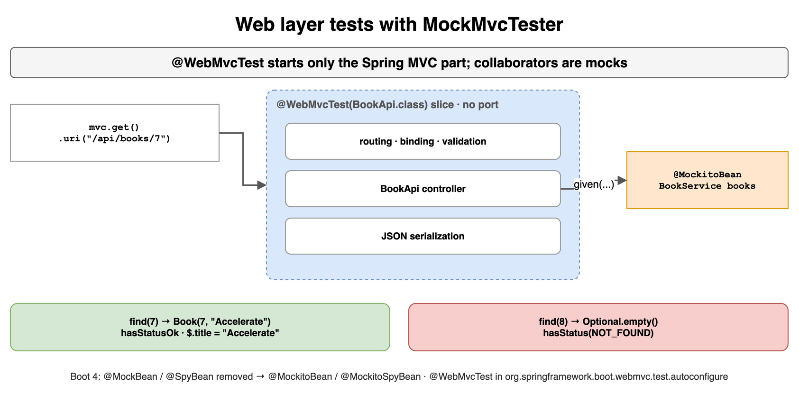
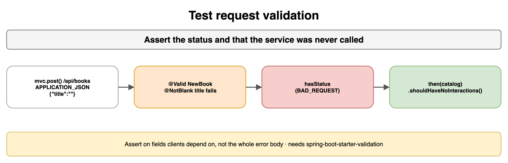
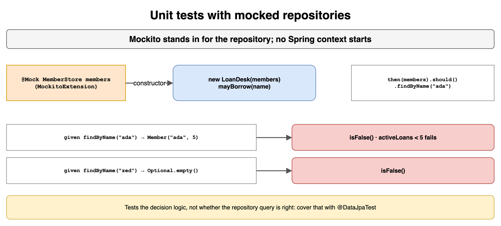
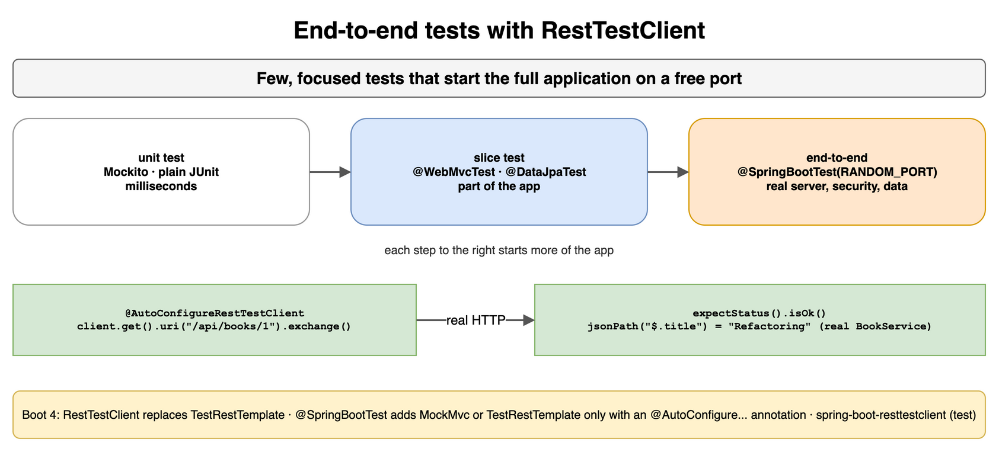

# Unit and Web Layer Tests

## JUnit 6 and the Boot test starters

`spring-boot-starter-test` brings JUnit Jupiter, AssertJ, Mockito, Hamcrest, JSONassert, and Spring's test framework. Changed in Boot 4: the platform moves to JUnit 6, which keeps the Jupiter programming model (`org.junit.jupiter.api`) and requires Java 17 or later. Each technology also has a test starter, such as `spring-boot-starter-webmvc-test`, that adds its test slice and pulls in `spring-boot-starter-test`.

The generated test class starts the whole application context once. It fails if any bean cannot be created, a property is invalid, or a derived query has a bad name. Boot's test annotations already carry the Spring extension, so `@ExtendWith(SpringExtension.class)` is unnecessary. Spring caches the context, and later tests with the same configuration reuse it.

```java
import org.junit.jupiter.api.Test;
import org.springframework.boot.test.context.SpringBootTest;

@SpringBootTest
class StudyApplicationTests {
    @Test
    void contextLoads() {
    }
}
```

[Spring Boot docs](https://docs.spring.io/spring-boot/reference/testing/index.html)



*Source: [`diagrams/unit-and-web-tests.drawio`](/content/13_Spring_Boot/12_Unit_and_Web_Layer_Tests/diagrams/unit-and-web-tests.drawio), page 1.*

## Test domain objects without Spring

Domain logic such as due dates and fines needs no application context. Test it with plain JUnit and AssertJ: construct the object, call the method, and assert the result. These tests run in milliseconds, so they can cover every edge case. Use `@ParameterizedTest` to run one test method over a table of inputs.

Put the `Loan` record in `src/main/java` and the test in `src/test/java`. Passing the date in as a parameter, rather than calling `LocalDate.now()` inside the record, is what makes the logic testable.

```java
import java.time.LocalDate;
import java.time.temporal.ChronoUnit;

record Loan(String title, LocalDate due) {
    long fineCents(LocalDate today) {
        long daysLate = ChronoUnit.DAYS.between(due, today);
        return Math.max(0, daysLate) * 25;
    }
}
```

```java
import static org.assertj.core.api.Assertions.assertThat;

import java.time.LocalDate;
import org.junit.jupiter.params.ParameterizedTest;
import org.junit.jupiter.params.provider.CsvSource;

class LoanTests {
    private final Loan loan = new Loan("Refactoring", LocalDate.of(2026, 12, 1));

    @ParameterizedTest
    @CsvSource({"2026-11-30, 0", "2026-12-01, 0", "2026-12-02, 25", "2026-12-05, 100"})
    void finesAccrueAfterTheDueDate(LocalDate today, long expectedCents) {
        assertThat(loan.fineCents(today)).isEqualTo(expectedCents);
    }
}
```

[JUnit docs](https://docs.junit.org/current/user-guide/#writing-tests-parameterized-tests)



*Source: [`diagrams/unit-and-web-tests.drawio`](/content/13_Spring_Boot/12_Unit_and_Web_Layer_Tests/diagrams/unit-and-web-tests.drawio), page 2.*

## Web layer tests with MockMvcTester

`@WebMvcTest` starts only the Spring MVC part of the application: controllers, advice, converters, and filters, but not services or repositories. Provide each collaborator with `@MockitoBean`. Requests go through `MockMvcTester`, which exercises routing, binding, validation, and JSON serialization without opening a port. Its AssertJ-based API gives readable assertions on status and body.

Changed in Boot 4: `@MockBean` and `@SpyBean` are removed in favor of Spring Framework's `@MockitoBean` and `@MockitoSpyBean`, and `@WebMvcTest` moved to `org.springframework.boot.webmvc.test.autoconfigure` in the `spring-boot-starter-webmvc-test` starter. Put the first block in `StudyApplication.java` and the second in the test folder.

```java
import java.util.Optional;
import org.springframework.boot.SpringApplication;
import org.springframework.boot.autoconfigure.SpringBootApplication;
import org.springframework.http.ResponseEntity;
import org.springframework.stereotype.Service;
import org.springframework.web.bind.annotation.GetMapping;
import org.springframework.web.bind.annotation.PathVariable;
import org.springframework.web.bind.annotation.RestController;

@SpringBootApplication
public class StudyApplication {
    public static void main(String[] args) {
        SpringApplication.run(StudyApplication.class, args);
    }
}

record Book(long id, String title) {
}

@Service
class BookService {
    Optional<Book> find(long id) {
        return id == 1 ? Optional.of(new Book(1, "Refactoring")) : Optional.empty();
    }
}

@RestController
class BookApi {
    private final BookService books;

    BookApi(BookService books) {
        this.books = books;
    }

    @GetMapping("/api/books/{id}")
    ResponseEntity<Book> one(@PathVariable long id) {
        return ResponseEntity.of(books.find(id));
    }
}
```

```java
import static org.assertj.core.api.Assertions.assertThat;
import static org.mockito.BDDMockito.given;

import java.util.Optional;
import org.junit.jupiter.api.Test;
import org.springframework.beans.factory.annotation.Autowired;
import org.springframework.boot.webmvc.test.autoconfigure.WebMvcTest;
import org.springframework.http.HttpStatus;
import org.springframework.test.context.bean.override.mockito.MockitoBean;
import org.springframework.test.web.servlet.assertj.MockMvcTester;

@WebMvcTest(BookApi.class)
class BookApiTests {
    @Autowired MockMvcTester mvc;
    @MockitoBean BookService books;

    @Test
    void returnsTheBook() {
        given(books.find(7)).willReturn(Optional.of(new Book(7, "Accelerate")));
        assertThat(mvc.get().uri("/api/books/7"))
                .hasStatusOk()
                .bodyJson().extractingPath("$.title").isEqualTo("Accelerate");
    }

    @Test
    void unknownBookIsNotFound() {
        given(books.find(8)).willReturn(Optional.empty());
        assertThat(mvc.get().uri("/api/books/8")).hasStatus(HttpStatus.NOT_FOUND);
    }
}
```

[Spring Boot docs](https://docs.spring.io/spring-boot/reference/testing/spring-boot-applications.html#testing.spring-boot-applications.spring-mvc-tests)



*Source: [`diagrams/unit-and-web-tests.drawio`](/content/13_Spring_Boot/12_Unit_and_Web_Layer_Tests/diagrams/unit-and-web-tests.drawio), page 3.*

## Test request validation

A web layer test is the right place to check the HTTP contract for bad input: the status code, the error body, and that the service was never called. Send JSON with `content` and a content type, then assert on the response. `then(mock).shouldHaveNoInteractions()` from BDDMockito proves that the controller rejected the request before reaching the service.

Add `spring-boot-starter-validation` for this example. It uses the controller from the [validation card](#13_Spring_Boot/04_JSON_APIs/concepts/validate-request-records), extended to call a service. Assert on the response fields that clients depend on, not on the whole error body.

```java
import jakarta.validation.Valid;
import jakarta.validation.constraints.NotBlank;
import org.springframework.http.HttpStatus;
import org.springframework.stereotype.Service;
import org.springframework.web.bind.annotation.PostMapping;
import org.springframework.web.bind.annotation.RequestBody;
import org.springframework.web.bind.annotation.ResponseStatus;
import org.springframework.web.bind.annotation.RestController;

record NewBook(@NotBlank String title) {
}

@Service
class Catalog {
    NewBook add(NewBook book) {
        return book;
    }
}

@RestController
class NewBookApi {
    private final Catalog catalog;

    NewBookApi(Catalog catalog) {
        this.catalog = catalog;
    }

    @PostMapping("/api/books")
    @ResponseStatus(HttpStatus.CREATED)
    NewBook create(@Valid @RequestBody NewBook input) {
        return catalog.add(input);
    }
}
```

```java
import static org.assertj.core.api.Assertions.assertThat;
import static org.mockito.BDDMockito.then;

import org.junit.jupiter.api.Test;
import org.springframework.beans.factory.annotation.Autowired;
import org.springframework.boot.webmvc.test.autoconfigure.WebMvcTest;
import org.springframework.http.HttpStatus;
import org.springframework.http.MediaType;
import org.springframework.test.context.bean.override.mockito.MockitoBean;
import org.springframework.test.web.servlet.assertj.MockMvcTester;

@WebMvcTest(NewBookApi.class)
class NewBookApiTests {
    @Autowired MockMvcTester mvc;
    @MockitoBean Catalog catalog;

    @Test
    void blankTitleIsRejected() {
        assertThat(mvc.post().uri("/api/books")
                .contentType(MediaType.APPLICATION_JSON)
                .content("{\"title\":\"\"}"))
                .hasStatus(HttpStatus.BAD_REQUEST);
        then(catalog).shouldHaveNoInteractions();
    }
}
```

[Spring Framework docs](https://docs.spring.io/spring-framework/reference/testing/mockmvc/assertj.html)



*Source: [`diagrams/unit-and-web-tests.drawio`](/content/13_Spring_Boot/12_Unit_and_Web_Layer_Tests/diagrams/unit-and-web-tests.drawio), page 4.*

## Unit tests with mocked repositories

A service that applies rules around a repository can be tested without a database. Mockito's `@Mock` creates a stand-in repository, and you construct the service with it, which constructor injection makes easy. Stub what the repository returns with `given`, then check the result and the calls the service made with `then`.

This style tests the decision logic: what the service does with the data. It cannot tell you whether the repository's query is right. Cover that with a [`@DataJpaTest`](#13_Spring_Boot/13_Data_and_Security_Tests/concepts/repository-tests-with-datajpatest). `MockitoExtension` is plain Mockito, so no Spring context starts.

```java
import java.util.Optional;
import org.springframework.stereotype.Service;

record Member(String name, int activeLoans) {
}

interface MemberStore {
    Optional<Member> findByName(String name);
}

@Service
class LoanDesk {
    private final MemberStore members;

    LoanDesk(MemberStore members) {
        this.members = members;
    }

    boolean mayBorrow(String name) {
        return members.findByName(name).map(m -> m.activeLoans() < 5).orElse(false);
    }
}
```

```java
import static org.assertj.core.api.Assertions.assertThat;
import static org.mockito.BDDMockito.given;
import static org.mockito.BDDMockito.then;

import java.util.Optional;
import org.junit.jupiter.api.Test;
import org.junit.jupiter.api.extension.ExtendWith;
import org.mockito.Mock;
import org.mockito.junit.jupiter.MockitoExtension;

@ExtendWith(MockitoExtension.class)
class LoanDeskTests {
    @Mock MemberStore members;

    @Test
    void memberAtTheLimitMayNotBorrow() {
        given(members.findByName("ada")).willReturn(Optional.of(new Member("ada", 5)));
        assertThat(new LoanDesk(members).mayBorrow("ada")).isFalse();
        then(members).should().findByName("ada");
    }

    @Test
    void unknownMemberMayNotBorrow() {
        given(members.findByName("zed")).willReturn(Optional.empty());
        assertThat(new LoanDesk(members).mayBorrow("zed")).isFalse();
    }
}
```

[Mockito docs](https://javadoc.io/doc/org.mockito/mockito-core/latest/org.mockito/org/mockito/Mockito.html)



*Source: [`diagrams/unit-and-web-tests.drawio`](/content/13_Spring_Boot/12_Unit_and_Web_Layer_Tests/diagrams/unit-and-web-tests.drawio), page 5.*

## End-to-end tests with RestTestClient

`@SpringBootTest(webEnvironment = RANDOM_PORT)` starts the full application on a free port, including security, data, and the real web server. Changed in Boot 4: `@AutoConfigureRestTestClient` supplies a `RestTestClient`, Spring Framework 7's fluent test client for HTTP calls, as the recommended replacement for `TestRestTemplate`. `@SpringBootTest` also no longer adds MockMvc or `TestRestTemplate` unless you ask for them with an `@AutoConfigure...` annotation.

Add `spring-boot-resttestclient` with test scope. This test calls the [web layer example](#13_Spring_Boot/12_Unit_and_Web_Layer_Tests/concepts/web-layer-tests-with-mockmvctester) through real HTTP with the real `BookService`. Keep end-to-end tests few and focused on wiring, because each one starts more of the app than a slice test.

```java
import org.junit.jupiter.api.Test;
import org.springframework.beans.factory.annotation.Autowired;
import org.springframework.boot.resttestclient.autoconfigure.AutoConfigureRestTestClient;
import org.springframework.boot.test.context.SpringBootTest;
import org.springframework.boot.test.context.SpringBootTest.WebEnvironment;
import org.springframework.test.web.servlet.client.RestTestClient;

@SpringBootTest(webEnvironment = WebEnvironment.RANDOM_PORT)
@AutoConfigureRestTestClient
class BookApiEndToEndTests {
    @Autowired RestTestClient client;

    @Test
    void servesABookOverHttp() {
        client.get().uri("/api/books/1")
                .exchange()
                .expectStatus().isOk()
                .expectBody()
                .jsonPath("$.title").isEqualTo("Refactoring");
    }
}
```

[Spring Boot docs](https://docs.spring.io/spring-boot/reference/testing/spring-boot-applications.html#testing.spring-boot-applications.with-running-server)



*Source: [`diagrams/unit-and-web-tests.drawio`](/content/13_Spring_Boot/12_Unit_and_Web_Layer_Tests/diagrams/unit-and-web-tests.drawio), page 6.*
