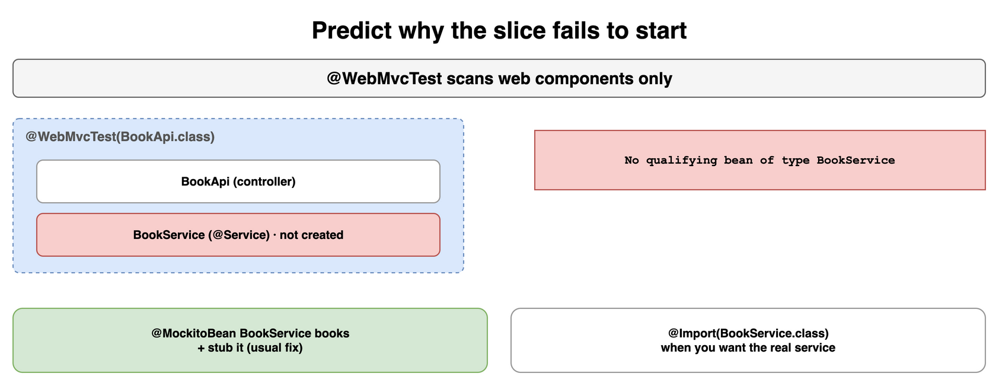
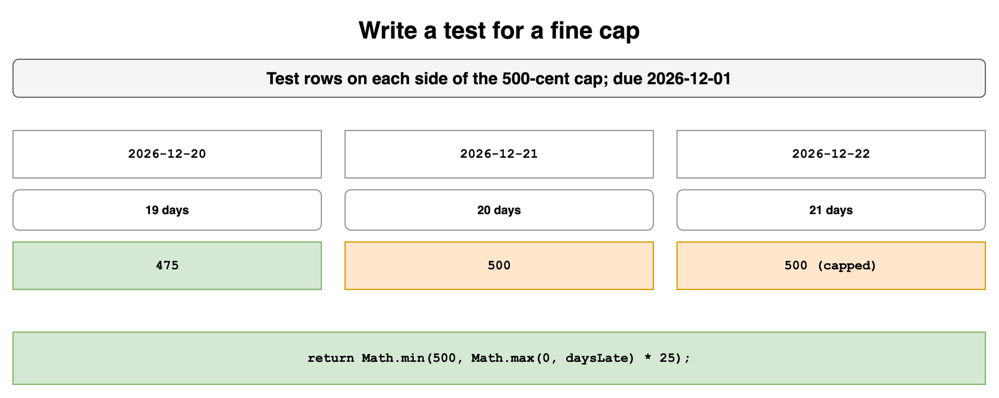

# Unit and Web Layer Tests — Drills

Predict the result before running the example.

## Predict why the slice fails to start

This test sits next to the [web layer example](#13_Spring_Boot/12_Unit_and_Web_Layer_Tests/concepts/web-layer-tests-with-mockmvctester). The context fails with "No qualifying bean of type BookService". Why does `@WebMvcTest` not create the service, and what is the usual fix?

```java
import static org.assertj.core.api.Assertions.assertThat;

import org.junit.jupiter.api.Test;
import org.springframework.beans.factory.annotation.Autowired;
import org.springframework.boot.webmvc.test.autoconfigure.WebMvcTest;
import org.springframework.test.web.servlet.assertj.MockMvcTester;

@WebMvcTest(BookApi.class)
class BrokenBookApiTests {
    @Autowired MockMvcTester mvc;

    @Test
    void returnsTheBook() {
        assertThat(mvc.get().uri("/api/books/1")).hasStatusOk();
    }
}
```

**Answer**

`@WebMvcTest` scans only web components such as controllers and advice; regular `@Service` beans are left out. Declare `@MockitoBean BookService books;` and stub it, which keeps the test about the web layer. Use `@Import(BookService.class)` only when you want the real service in the slice.



*Source: [`diagrams/unit-and-web-tests-drills.drawio`](/content/13_Spring_Boot/12_Unit_and_Web_Layer_Tests/diagrams/unit-and-web-tests-drills.drawio), page 1.*

## Write a test for a fine cap

The library now caps fines at 500 cents. Write the test cases first, then change `fineCents` so they pass. Which dates make good boundary cases for a loan due on 2026-12-01?

```java
import java.time.LocalDate;
import java.time.temporal.ChronoUnit;

record Loan(String title, LocalDate due) {
    long fineCents(LocalDate today) {
        long daysLate = ChronoUnit.DAYS.between(due, today);
        return Math.max(0, daysLate) * 25;
    }
}
```

**Answer**

Add `@CsvSource` rows for 2026-12-20 (19 days, 475), 2026-12-21 (20 days, exactly 500) and 2026-12-22 (21 days, still 500), keeping the on-time rows. Then return `Math.min(500, Math.max(0, daysLate) * 25)`. Rows on each side of the cap catch off-by-one mistakes; see [test domain objects without Spring](#13_Spring_Boot/12_Unit_and_Web_Layer_Tests/concepts/test-domain-objects-without-spring).



*Source: [`diagrams/unit-and-web-tests-drills.drawio`](/content/13_Spring_Boot/12_Unit_and_Web_Layer_Tests/diagrams/unit-and-web-tests-drills.drawio), page 2.*
