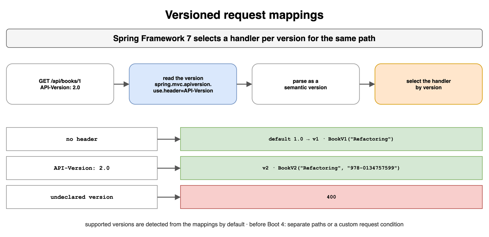
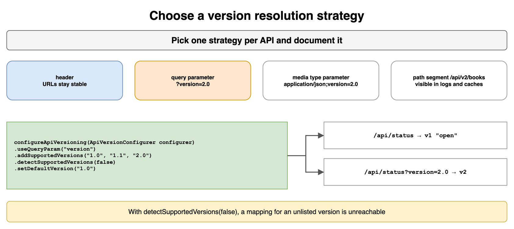
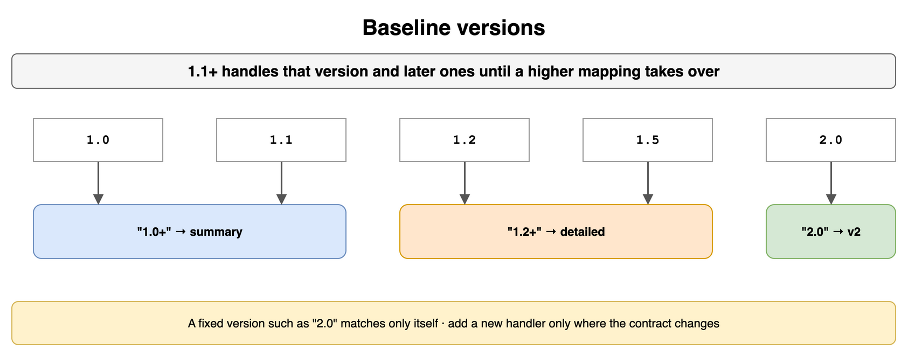
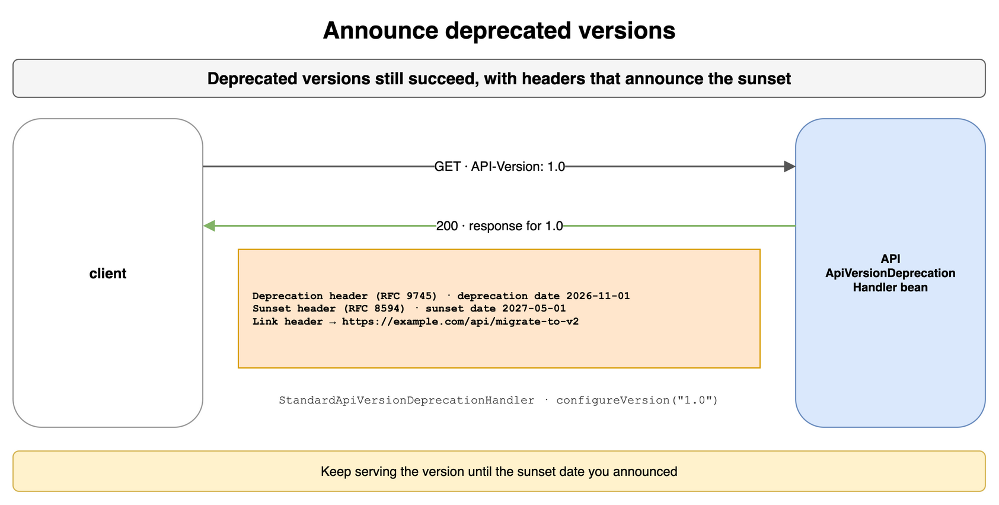
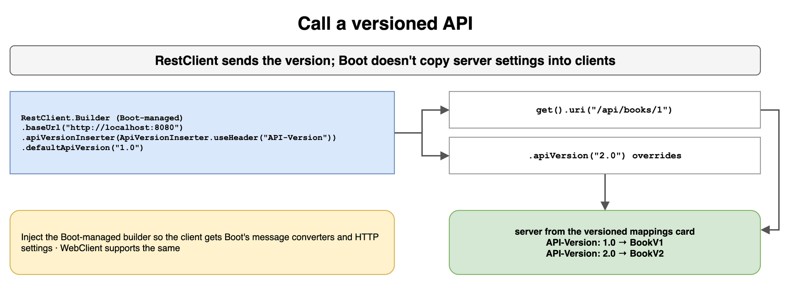
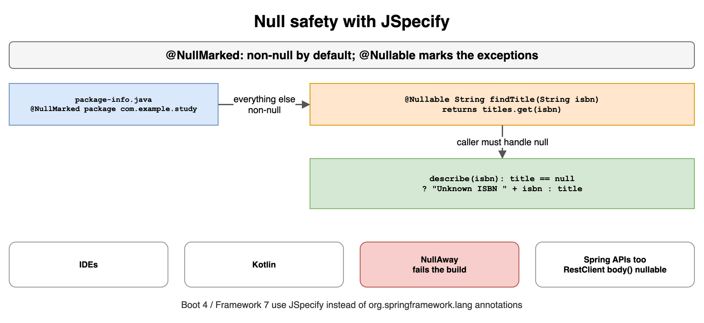

# API Versioning and Null Safety

## Versioned request mappings

Changed in Boot 4: Spring Framework 7 adds first-class API versioning to Spring MVC. A mapping annotation takes a `version` attribute, so the same path can have one handler per version. The framework reads the requested version from the request, parses it as a semantic version, and selects the handler. Before Boot 4 this required separate paths or a custom request condition.

Configure where the version comes from with `spring.mvc.apiversion.*` properties. Here clients send an `API-Version` header, and requests without it are treated as version 1.0. A version that no mapping declares is rejected with 400. Versions supported by the API are detected from the mappings by default.

```properties
spring.mvc.apiversion.use.header=API-Version
spring.mvc.apiversion.default=1.0
```

```java
import org.springframework.boot.SpringApplication;
import org.springframework.boot.autoconfigure.SpringBootApplication;
import org.springframework.web.bind.annotation.GetMapping;
import org.springframework.web.bind.annotation.PathVariable;
import org.springframework.web.bind.annotation.RestController;

@SpringBootApplication
public class StudyApplication {
    public static void main(String[] args) {
        SpringApplication.run(StudyApplication.class, args);
    }
}

record BookV1(String title) {
}

record BookV2(String title, String isbn) {
}

@RestController
class BookApi {
    @GetMapping(path = "/api/books/{id}", version = "1.0")
    BookV1 v1(@PathVariable long id) {
        return new BookV1("Refactoring");
    }

    @GetMapping(path = "/api/books/{id}", version = "2.0")
    BookV2 v2(@PathVariable long id) {
        return new BookV2("Refactoring", "978-0134757599");
    }
}
```

[Spring Boot docs](https://docs.spring.io/spring-boot/reference/web/servlet.html#web.servlet.spring-mvc.api-versioning)



*Source: [`diagrams/api-versioning.drawio`](/content/13_Spring_Boot/13_API_Versioning_and_Null_Safety/diagrams/api-versioning.drawio), page 1.*

## Choose a version resolution strategy

A request can carry its version in a header, a query parameter, a media type parameter such as `application/json;version=2.0`, or a path segment such as `/api/v2/books`. Pick one strategy per API and document it. A header keeps URLs stable. A path segment is visible in logs and caches, but every route then needs the segment.

For more control, implement `WebMvcConfigurer.configureApiVersioning`. This configuration reads a `version` query parameter, lists the supported versions explicitly, and makes the version optional with a default. Turning off `detectSupportedVersions` means a mapping for an unlisted version is unreachable.

```java
import org.springframework.boot.SpringApplication;
import org.springframework.boot.autoconfigure.SpringBootApplication;
import org.springframework.context.annotation.Configuration;
import org.springframework.web.bind.annotation.GetMapping;
import org.springframework.web.bind.annotation.RestController;
import org.springframework.web.servlet.config.annotation.ApiVersionConfigurer;
import org.springframework.web.servlet.config.annotation.WebMvcConfigurer;

@SpringBootApplication
public class StudyApplication {
    public static void main(String[] args) {
        SpringApplication.run(StudyApplication.class, args);
    }
}

@Configuration
class ApiVersions implements WebMvcConfigurer {
    @Override
    public void configureApiVersioning(ApiVersionConfigurer configurer) {
        configurer.useQueryParam("version")
                .addSupportedVersions("1.0", "1.1", "2.0")
                .detectSupportedVersions(false)
                .setDefaultVersion("1.0");
    }
}

@RestController
class StatusApi {
    @GetMapping(path = "/api/status", version = "1.0")
    String v1() {
        return "open";
    }

    @GetMapping(path = "/api/status", version = "2.0")
    String v2() {
        return "{\"open\":true}";
    }
}
```

[Spring Framework docs](https://docs.spring.io/spring-framework/reference/web/webmvc/mvc-config/api-version.html)



*Source: [`diagrams/api-versioning.drawio`](/content/13_Spring_Boot/13_API_Versioning_and_Null_Safety/diagrams/api-versioning.drawio), page 2.*

## Baseline versions

A version followed by `+`, such as `1.1+`, is a baseline. The mapping handles that version and every later supported version until another mapping declares a higher version. This lets a handler carry forward through minor releases. You add a new handler only for the version where the contract changes.

With the mappings below, versions 1.0 and 1.1 return the summary, 1.2 and 1.5 return the detailed view, and 2.0 returns the new shape. A fixed version such as `"2.0"` matches only itself.

```java
import org.springframework.boot.SpringApplication;
import org.springframework.boot.autoconfigure.SpringBootApplication;
import org.springframework.web.bind.annotation.GetMapping;
import org.springframework.web.bind.annotation.RestController;

@SpringBootApplication
public class StudyApplication {
    public static void main(String[] args) {
        SpringApplication.run(StudyApplication.class, args);
    }
}

@RestController
class CatalogApi {
    @GetMapping(path = "/api/catalog", version = "1.0+")
    String summary() {
        return "summary";
    }

    @GetMapping(path = "/api/catalog", version = "1.2+")
    String detailed() {
        return "detailed";
    }

    @GetMapping(path = "/api/catalog", version = "2.0")
    String v2() {
        return "v2";
    }
}
```

[Spring Framework docs](https://docs.spring.io/spring-framework/reference/web/webmvc/mvc-controller/ann-requestmapping.html#mvc-ann-requestmapping-version)



*Source: [`diagrams/api-versioning.drawio`](/content/13_Spring_Boot/13_API_Versioning_and_Null_Safety/diagrams/api-versioning.drawio), page 3.*

## Announce deprecated versions

Clients need advance notice before a version disappears. `StandardApiVersionDeprecationHandler` adds the `Deprecation` and `Sunset` response headers (RFC 9745 and RFC 8594), plus `Link` headers that point to migration notes, to responses for the versions you configure. Boot passes an `ApiVersionDeprecationHandler` bean to the Spring MVC configuration.

Combine this bean with the header-based properties from the [versioned mappings card](#13_Spring_Boot/13_API_Versioning_and_Null_Safety/concepts/versioned-request-mappings). Requests for 1.0 still succeed, but their responses carry the deprecation headers. Keep serving the version until the sunset date you announced.

```java
import java.net.URI;
import java.time.ZonedDateTime;
import org.springframework.context.annotation.Bean;
import org.springframework.context.annotation.Configuration;
import org.springframework.web.accept.ApiVersionDeprecationHandler;
import org.springframework.web.accept.StandardApiVersionDeprecationHandler;

@Configuration
class Deprecations {
    @Bean
    ApiVersionDeprecationHandler deprecations() {
        var handler = new StandardApiVersionDeprecationHandler();
        handler.configureVersion("1.0")
                .setDeprecationDate(ZonedDateTime.parse("2026-11-01T00:00:00Z"))
                .setSunsetDate(ZonedDateTime.parse("2027-05-01T00:00:00Z"))
                .setDeprecationLink(URI.create("https://example.com/api/migrate-to-v2"));
        return handler;
    }
}
```

[Spring Framework docs](https://docs.spring.io/spring-framework/reference/web/webmvc-versioning.html#mvc-versioning-deprecation-handler)



*Source: [`diagrams/api-versioning.drawio`](/content/13_Spring_Boot/13_API_Versioning_and_Null_Safety/diagrams/api-versioning.drawio), page 4.*

## Call a versioned API

Changed in Boot 4: `RestClient` and `WebClient` can send an API version. Configure an `ApiVersionInserter` on the builder to say where the version goes, optionally with a default, and call `apiVersion` on a request to override it. Boot does not copy the server's versioning settings into clients, so configure the client explicitly.

This runner calls the API from the [versioned mappings card](#13_Spring_Boot/13_API_Versioning_and_Null_Safety/concepts/versioned-request-mappings) in the same app, first with the default version and then with 2.0. Inject the Boot-managed `RestClient.Builder` so the client picks up Boot's message converters and HTTP settings.

```java
import org.springframework.boot.ApplicationRunner;
import org.springframework.context.annotation.Bean;
import org.springframework.context.annotation.Configuration;
import org.springframework.web.client.ApiVersionInserter;
import org.springframework.web.client.RestClient;

@Configuration
class BookClientConfig {
    @Bean
    ApplicationRunner callBooks(RestClient.Builder builder) {
        RestClient client = builder.baseUrl("http://localhost:8080")
                .apiVersionInserter(ApiVersionInserter.useHeader("API-Version"))
                .defaultApiVersion("1.0")
                .build();
        return args -> {
            System.out.println(client.get().uri("/api/books/1").retrieve().body(String.class));
            System.out.println(client.get().uri("/api/books/1").apiVersion("2.0").retrieve().body(String.class));
        };
    }
}
```

[Spring Framework docs](https://docs.spring.io/spring-framework/reference/integration/rest-clients.html)



*Source: [`diagrams/api-versioning.drawio`](/content/13_Spring_Boot/13_API_Versioning_and_Null_Safety/diagrams/api-versioning.drawio), page 5.*

## Null safety with JSpecify

Changed in Boot 4: Spring Framework 7 and Spring Boot 4 annotate their APIs with JSpecify instead of the older `org.springframework.lang` annotations. `@NullMarked` on a package makes every type usage in it non-null by default, and `@Nullable` marks the exceptions. IDEs and Kotlin read the annotations, and a build-time checker such as NullAway can fail compilation on an unchecked null.

Apply the same convention to your code. Put `@NullMarked` in `package-info.java`, then mark only the values that can be absent. A caller of `findTitle` sees that it must handle `null`. Spring's own APIs follow the same rules, for example `RestClient`'s `body` method is annotated as possibly returning `null`.

```java
@NullMarked
package com.example.study;

import org.jspecify.annotations.NullMarked;
```

```java
import java.util.Map;
import org.jspecify.annotations.Nullable;
import org.springframework.stereotype.Service;

@Service
class TitleLookup {
    private final Map<String, String> titles = Map.of("978-0134757599", "Refactoring");

    @Nullable String findTitle(String isbn) {
        return titles.get(isbn);
    }

    String describe(String isbn) {
        var title = findTitle(isbn);
        return title == null ? "Unknown ISBN " + isbn : title;
    }
}
```

[Spring Framework docs](https://docs.spring.io/spring-framework/reference/core/null-safety.html)



*Source: [`diagrams/api-versioning.drawio`](/content/13_Spring_Boot/13_API_Versioning_and_Null_Safety/diagrams/api-versioning.drawio), page 6.*
