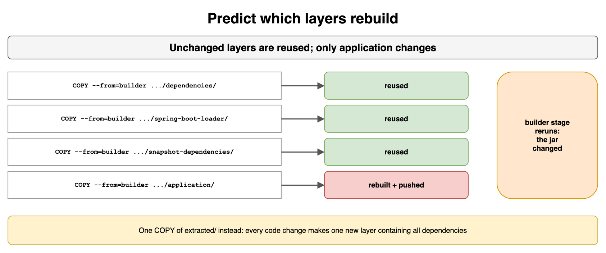
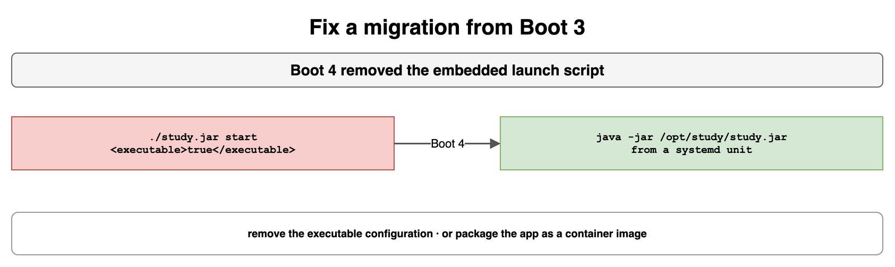

# Executable Jars and Container Images — Drills

Predict the result before running the example.

## Predict which layers rebuild

You change one controller and rebuild with this Dockerfile. Which `COPY` steps does Docker rebuild, and what would change if the four `COPY --from` lines were replaced by one `COPY --from=builder /builder/extracted/ ./`?

```dockerfile
FROM eclipse-temurin:25-jre AS builder
WORKDIR /builder
COPY target/*.jar application.jar
RUN java -Djarmode=tools -jar application.jar extract --layers --destination extracted

FROM eclipse-temurin:25-jre
WORKDIR /application
COPY --from=builder /builder/extracted/dependencies/ ./
COPY --from=builder /builder/extracted/spring-boot-loader/ ./
COPY --from=builder /builder/extracted/snapshot-dependencies/ ./
COPY --from=builder /builder/extracted/application/ ./
ENTRYPOINT ["java", "-jar", "application.jar"]
```

**Answer**

The builder stage reruns because the jar changed. In the final stage, the three dependency and loader layers have the same content, so Docker reuses them and only the `application` layer is rebuilt and pushed. With a single `COPY`, every code change produces one new layer that contains all dependencies. See [write a Dockerfile](#13_Spring_Boot/15_Executable_Jars_and_Container_Images/concepts/write-a-dockerfile).



*Source: [`diagrams/jars-and-images-drills.drawio`](/content/13_Spring_Boot/15_Executable_Jars_and_Container_Images/diagrams/jars-and-images-drills.drawio), page 1.*

## Fix a migration from Boot 3

A Boot 3 service was installed as `/opt/study/study.jar` and started as `./study.jar start` through its embedded launch script. After the upgrade to Boot 4 the command fails. What changed, and how should the service start now?

```xml
<plugin>
  <groupId>org.springframework.boot</groupId>
  <artifactId>spring-boot-maven-plugin</artifactId>
  <configuration>
    <executable>true</executable>
  </configuration>
</plugin>
```

**Answer**

Boot 4 removed support for the embedded launch script, so the jar is no longer a shell script. Remove the `executable` configuration and start the app with `java -jar /opt/study/study.jar` from a systemd unit, or package it as a container image. See [the executable uber jar](#13_Spring_Boot/15_Executable_Jars_and_Container_Images/concepts/the-executable-uber-jar).



*Source: [`diagrams/jars-and-images-drills.drawio`](/content/13_Spring_Boot/15_Executable_Jars_and_Container_Images/diagrams/jars-and-images-drills.drawio), page 2.*
