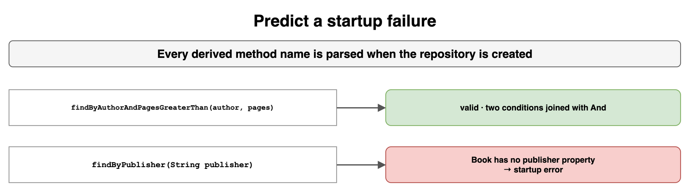
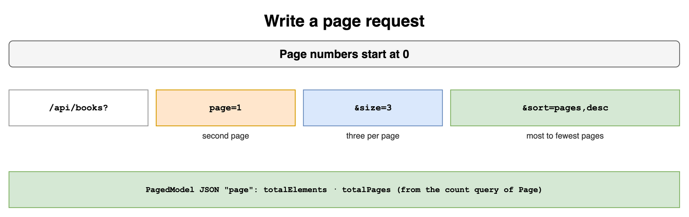

# Queries with Spring Data — Drills

Predict the result before running the example.

## Predict a startup failure

A teammate adds two methods to the repository from the [derived query example](#13_Spring_Boot/15_Queries_with_Spring_Data/concepts/derived-query-methods). The application no longer starts. Which method is the problem, and why does it fail at startup instead of at the first call?

```java
import java.util.List;
import org.springframework.data.repository.Repository;

interface BrokenBooks extends Repository<Book, Long> {
    List<Book> findByAuthorAndPagesGreaterThan(String author, int pages);
    List<Book> findByPublisher(String publisher);
}
```

**Answer**

`findByPublisher` fails, because `Book` has no `publisher` property. Spring Data parses every derived method name while creating the repository, so an unknown property is reported as a startup error. The first method is valid and combines two conditions with `And`.



*Source: [`diagrams/spring-data-queries-drills.drawio`](/content/13_Spring_Boot/15_Queries_with_Spring_Data/diagrams/spring-data-queries-drills.drawio), page 1.*

## Write a page request

Write the URL that requests the second page of books, three per page, ordered by pages from most to least, using the [paging endpoint](#13_Spring_Boot/15_Queries_with_Spring_Data/concepts/paging-through-results). Which part of the response tells the client how many pages exist?

```java
import org.springframework.data.domain.Page;
import org.springframework.data.domain.Pageable;
import org.springframework.data.repository.Repository;

interface PageOfBooks extends Repository<Book, Long> {
    Page<Book> findAll(Pageable pageable);
}
```

**Answer**

`/api/books?page=1&size=3&sort=pages,desc`. Page numbers start at 0 by default, so the second page is `page=1`. The `page` object in the `PagedModel` JSON contains `totalElements` and `totalPages`, which come from the count query that a `Page` return type triggers.



*Source: [`diagrams/spring-data-queries-drills.drawio`](/content/13_Spring_Boot/15_Queries_with_Spring_Data/diagrams/spring-data-queries-drills.drawio), page 2.*
