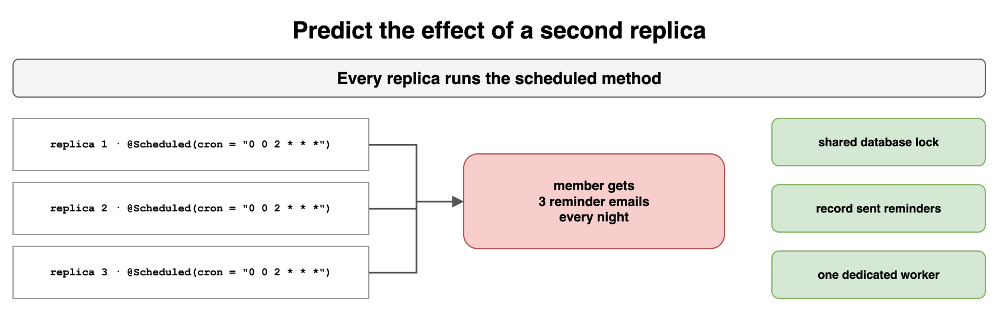
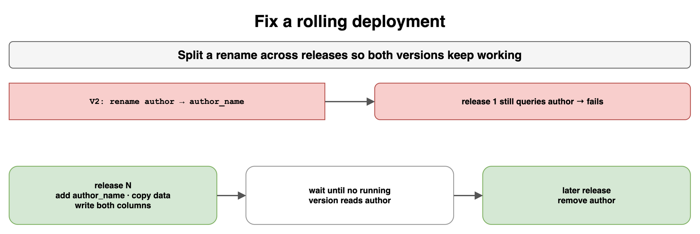

# Running and Scaling in Production — Drills

Predict the result before running the example.

## Predict the effect of a second replica

The app sends a reminder email to each member with an overdue loan every night at 02:00. The deployment scales from one replica to three. What do members notice, and what are two ways to fix it?

```java
import org.springframework.scheduling.annotation.Scheduled;
import org.springframework.stereotype.Component;

@Component
class OverdueReminders {
    @Scheduled(cron = "0 0 2 * * *")
    void sendReminders() {
        System.out.println("Sending overdue reminders");
    }
}
```

**Answer**

Every replica runs the scheduled method, so members get three emails each night. Guard the job with a shared lock in the database so only one instance runs it, or record which reminders were sent so a repeat is a no-op. A third option is to run the job in one dedicated worker. See [stateless instances](#13_Spring_Boot/16_Running_and_Scaling_in_Production/concepts/stateless-instances).



*Source: [`diagrams/production-scaling-drills.drawio`](/content/13_Spring_Boot/16_Running_and_Scaling_in_Production/diagrams/production-scaling-drills.drawio), page 1.*

## Fix a rolling deployment

Release 2 renames the column `author` to `author_name` in one migration. During the rolling deployment, release 1 instances start failing. Why, and how should the change be split?

```sql
-- V2__rename_author.sql
alter table book rename column author to author_name;
```

**Answer**

Release 1 instances are still running and still query `author`, which no longer exists once V2 runs. Split the change across releases. First add `author_name`, copy the data, and have the code write both columns. Remove `author` in a later release, after no running version reads it. See [a shared database with migrations](#13_Spring_Boot/16_Running_and_Scaling_in_Production/concepts/a-shared-database-with-migrations).



*Source: [`diagrams/production-scaling-drills.drawio`](/content/13_Spring_Boot/16_Running_and_Scaling_in_Production/diagrams/production-scaling-drills.drawio), page 2.*
