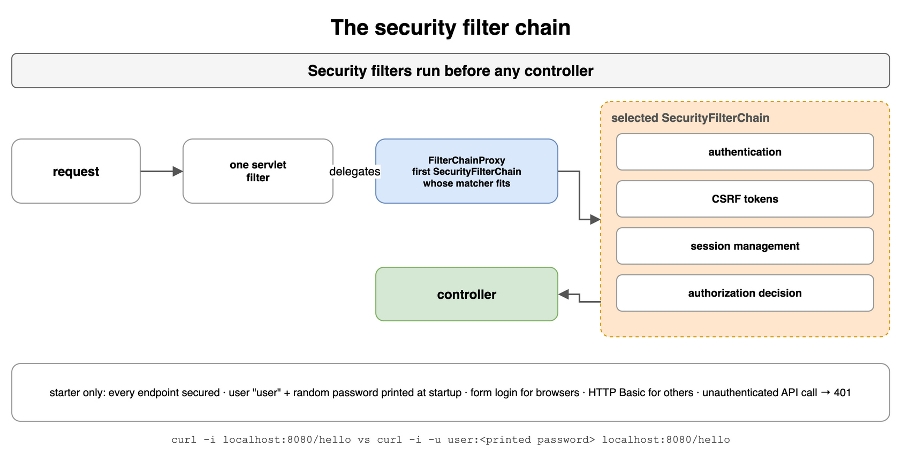
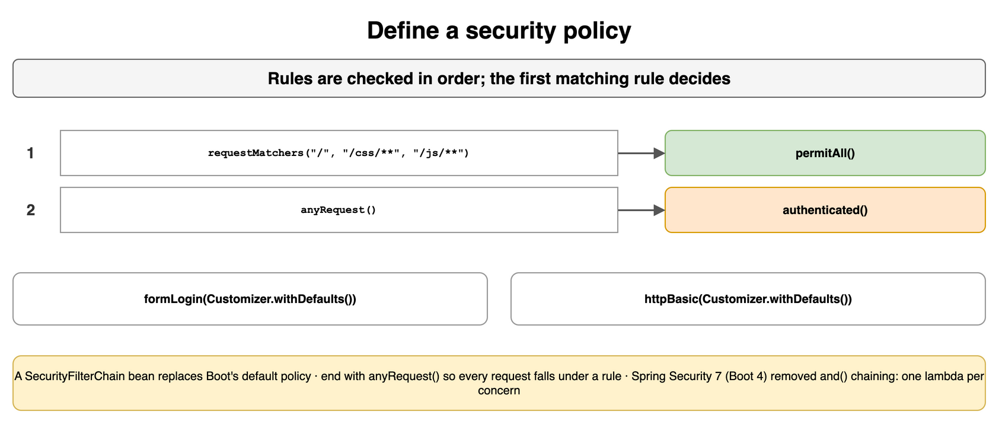
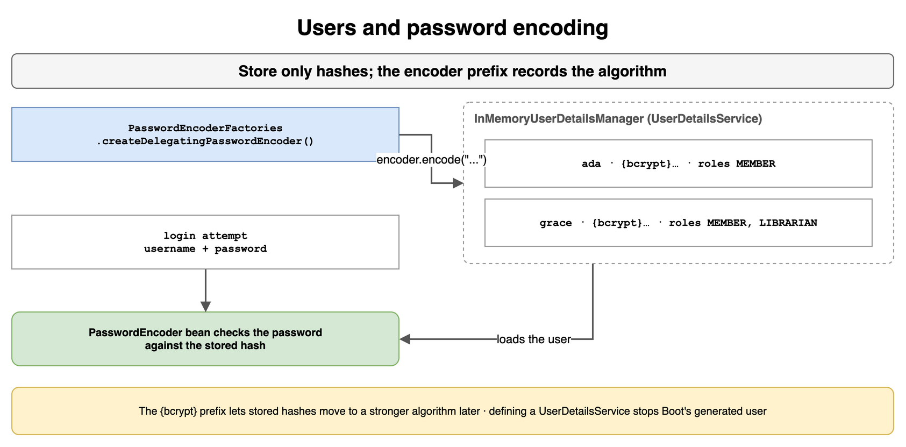
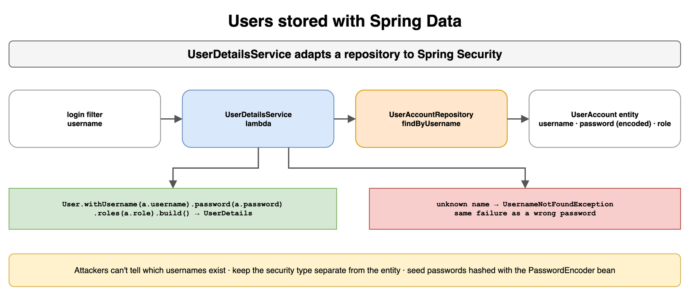
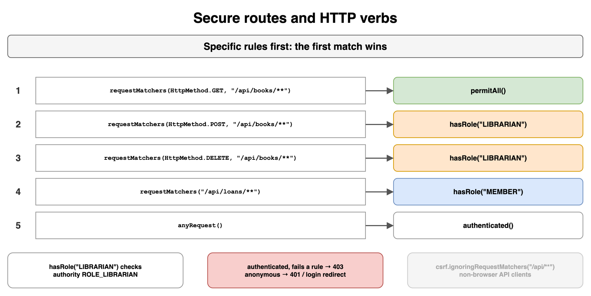
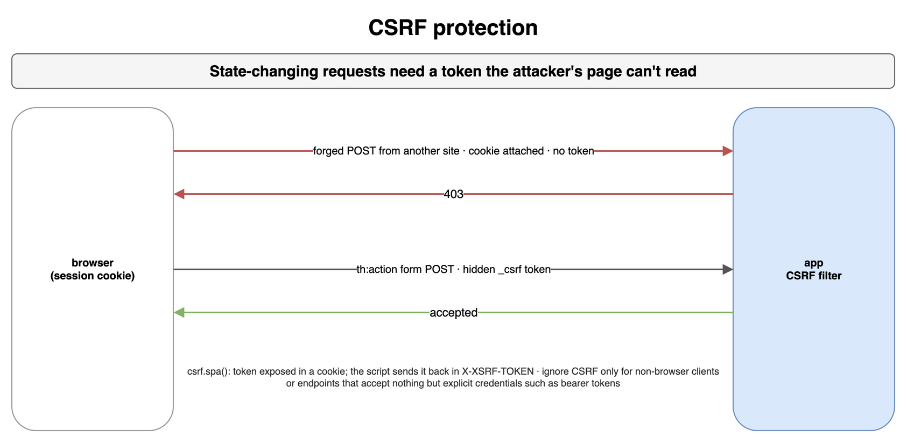

# Spring Security Foundations

## The security filter chain

Spring Security protects a servlet application with filters that run before any controller. A single servlet filter delegates to `FilterChainProxy`, which picks the first `SecurityFilterChain` whose request matcher fits the request and runs that chain's filters. These filters handle authentication, CSRF tokens, session management, and the final authorization decision.

Adding `spring-boot-starter-security` with no configuration secures every endpoint. Boot creates one user named `user` with a random password printed at startup, enables form login for browsers and HTTP Basic for other clients, and returns 401 to an unauthenticated API call. Start this app and compare `curl -i localhost:8080/hello` with the same call using `-u user:<printed password>`.

```java
import org.springframework.boot.SpringApplication;
import org.springframework.boot.autoconfigure.SpringBootApplication;
import org.springframework.web.bind.annotation.GetMapping;
import org.springframework.web.bind.annotation.RestController;

@SpringBootApplication
public class StudyApplication {
    public static void main(String[] args) {
        SpringApplication.run(StudyApplication.class, args);
    }
}

@RestController
class HelloApi {
    @GetMapping("/hello")
    String hello() {
        return "hello";
    }
}
```

[Spring Security docs](https://docs.spring.io/spring-security/reference/servlet/architecture.html)



*Source: [`diagrams/spring-security.drawio`](/content/13_Spring_Boot/16_Spring_Security_Foundations/diagrams/spring-security.drawio), page 1.*

## Define a security policy

Declare a `SecurityFilterChain` bean to replace Boot's default policy. The `HttpSecurity` builder configures each concern with a lambda. `authorizeHttpRequests` lists rules that are checked in order, and the first matching rule decides. End with `anyRequest()` so every request falls under some rule.

This policy leaves the home page and static assets public and requires a login for everything else. Changed in Boot 4: Spring Security 7 removed the old `and()` chaining style, so configure each concern with a lambda as shown.

```java
import org.springframework.context.annotation.Bean;
import org.springframework.context.annotation.Configuration;
import org.springframework.security.config.Customizer;
import org.springframework.security.config.annotation.web.builders.HttpSecurity;
import org.springframework.security.web.SecurityFilterChain;

@Configuration
class SecurityConfig {
    @Bean
    SecurityFilterChain security(HttpSecurity http) throws Exception {
        http.authorizeHttpRequests(auth -> auth
                        .requestMatchers("/", "/css/**", "/js/**").permitAll()
                        .anyRequest().authenticated())
                .formLogin(Customizer.withDefaults())
                .httpBasic(Customizer.withDefaults());
        return http.build();
    }
}
```

[Spring Security docs](https://docs.spring.io/spring-security/reference/servlet/authorization/authorize-http-requests.html)



*Source: [`diagrams/spring-security.drawio`](/content/13_Spring_Boot/16_Spring_Security_Foundations/diagrams/spring-security.drawio), page 2.*

## Users and password encoding

A `UserDetailsService` loads a user by name for the authentication filters. `InMemoryUserDetailsManager` is a ready-made implementation for demos and tests. Store only password hashes. The delegating encoder from `PasswordEncoderFactories` writes the algorithm as a prefix, such as `{bcrypt}`, so stored hashes can move to a stronger algorithm later.

Declare the `PasswordEncoder` as a bean. Boot then uses it to check login attempts, and application code uses it to hash new passwords. Defining a `UserDetailsService` bean also stops Boot from creating the generated `user` account.

```java
import org.springframework.context.annotation.Bean;
import org.springframework.context.annotation.Configuration;
import org.springframework.security.core.userdetails.User;
import org.springframework.security.core.userdetails.UserDetailsService;
import org.springframework.security.crypto.factory.PasswordEncoderFactories;
import org.springframework.security.crypto.password.PasswordEncoder;
import org.springframework.security.provisioning.InMemoryUserDetailsManager;

@Configuration
class UserConfig {
    @Bean
    PasswordEncoder passwordEncoder() {
        return PasswordEncoderFactories.createDelegatingPasswordEncoder();
    }

    @Bean
    UserDetailsService users(PasswordEncoder encoder) {
        return new InMemoryUserDetailsManager(
                User.withUsername("ada").password(encoder.encode("reading-room")).roles("MEMBER").build(),
                User.withUsername("grace").password(encoder.encode("front-desk")).roles("MEMBER", "LIBRARIAN").build());
    }
}
```

[Spring Security docs](https://docs.spring.io/spring-security/reference/features/authentication/password-storage.html)



*Source: [`diagrams/spring-security.drawio`](/content/13_Spring_Boot/16_Spring_Security_Foundations/diagrams/spring-security.drawio), page 3.*

## Users stored with Spring Data

For real accounts, store users in the database and implement `UserDetailsService` with a repository. The service looks up an account by username and converts it to Spring Security's `UserDetails`. Throw `UsernameNotFoundException` for an unknown name; the login filter turns it into the same failure as a wrong password, so attackers cannot tell which usernames exist.

The account entity stores the encoded password and a role. Seed users by hashing their passwords with the `PasswordEncoder` bean from the [password encoding card](#13_Spring_Boot/16_Spring_Security_Foundations/concepts/users-and-password-encoding). Keep the security type separate from the entity so the entity does not depend on Spring Security interfaces.

```java
import jakarta.persistence.Entity;
import jakarta.persistence.GeneratedValue;
import jakarta.persistence.Id;
import java.util.Optional;
import org.springframework.context.annotation.Bean;
import org.springframework.context.annotation.Configuration;
import org.springframework.data.repository.ListCrudRepository;
import org.springframework.security.core.userdetails.User;
import org.springframework.security.core.userdetails.UserDetailsService;
import org.springframework.security.core.userdetails.UsernameNotFoundException;

@Entity
class UserAccount {
    @Id @GeneratedValue Long id;
    String username;
    String password;
    String role;

    protected UserAccount() {
    }

    UserAccount(String username, String password, String role) {
        this.username = username;
        this.password = password;
        this.role = role;
    }
}

interface UserAccountRepository extends ListCrudRepository<UserAccount, Long> {
    Optional<UserAccount> findByUsername(String username);
}

@Configuration
class AccountSecurity {
    @Bean
    UserDetailsService userDetailsService(UserAccountRepository accounts) {
        return username -> accounts.findByUsername(username)
                .map(a -> User.withUsername(a.username).password(a.password).roles(a.role).build())
                .orElseThrow(() -> new UsernameNotFoundException(username));
    }
}
```

[Spring Security docs](https://docs.spring.io/spring-security/reference/servlet/authentication/passwords/user-details-service.html)



*Source: [`diagrams/spring-security.drawio`](/content/13_Spring_Boot/16_Spring_Security_Foundations/diagrams/spring-security.drawio), page 4.*

## Secure routes and HTTP verbs

Rules can match on the HTTP method as well as the path. A common API policy lets anyone read the catalog, lets members borrow, and lets only librarians add or remove books. `hasRole("LIBRARIAN")` checks for the authority `ROLE_LIBRARIAN`, which the `roles(...)` builder adds for you.

Put specific rules before general ones, because the first match wins. If `/api/**` with `authenticated()` came first, the librarian rules below would never be reached. An authenticated user who fails a rule receives 403; an anonymous user receives 401 or a login redirect. This API serves scripts and other non-browser clients, so it skips CSRF tokens for `/api/**` as explained in the [CSRF card](#13_Spring_Boot/16_Spring_Security_Foundations/concepts/csrf-protection).

```java
import org.springframework.context.annotation.Bean;
import org.springframework.context.annotation.Configuration;
import org.springframework.http.HttpMethod;
import org.springframework.security.config.Customizer;
import org.springframework.security.config.annotation.web.builders.HttpSecurity;
import org.springframework.security.web.SecurityFilterChain;

@Configuration
class ApiSecurity {
    @Bean
    SecurityFilterChain api(HttpSecurity http) throws Exception {
        http.authorizeHttpRequests(auth -> auth
                        .requestMatchers(HttpMethod.GET, "/api/books/**").permitAll()
                        .requestMatchers(HttpMethod.POST, "/api/books/**").hasRole("LIBRARIAN")
                        .requestMatchers(HttpMethod.DELETE, "/api/books/**").hasRole("LIBRARIAN")
                        .requestMatchers("/api/loans/**").hasRole("MEMBER")
                        .anyRequest().authenticated())
                .httpBasic(Customizer.withDefaults())
                .csrf(csrf -> csrf.ignoringRequestMatchers("/api/**"));
        return http.build();
    }
}
```

[Spring Security docs](https://docs.spring.io/spring-security/reference/servlet/authorization/authorize-http-requests.html#match-by-httpmethod)



*Source: [`diagrams/spring-security.drawio`](/content/13_Spring_Boot/16_Spring_Security_Foundations/diagrams/spring-security.drawio), page 5.*

## CSRF protection

Cross-site request forgery tricks a logged-in browser into sending a state-changing request that carries its session cookie. Spring Security therefore requires a CSRF token on POST, PUT, PATCH, and DELETE requests by default. Thymeleaf forms rendered with `th:action` include the token automatically, so the [form example](#13_Spring_Boot/11_Spring_MVC_Controllers_and_Templates/concepts/change-data-through-an-html-form) keeps working once security is added.

Keep CSRF protection for any endpoint that a browser can reach with a session cookie or cached Basic credentials. A JavaScript front end can use `csrf.spa()`, as below, which exposes the token in a cookie for the script to send back in the `X-XSRF-TOKEN` header. `csrf.ignoringRequestMatchers(...)` suits only endpoints used by non-browser clients, or endpoints that accept nothing but explicitly sent credentials such as bearer tokens.

```java
import org.springframework.context.annotation.Bean;
import org.springframework.context.annotation.Configuration;
import org.springframework.security.config.Customizer;
import org.springframework.security.config.annotation.web.builders.HttpSecurity;
import org.springframework.security.web.SecurityFilterChain;

@Configuration
class CsrfConfig {
    @Bean
    SecurityFilterChain web(HttpSecurity http) throws Exception {
        http.authorizeHttpRequests(auth -> auth.anyRequest().authenticated())
                .formLogin(Customizer.withDefaults())
                .csrf(csrf -> csrf.spa());
        return http.build();
    }
}
```

[Spring Security docs](https://docs.spring.io/spring-security/reference/servlet/exploits/csrf.html)



*Source: [`diagrams/spring-security.drawio`](/content/13_Spring_Boot/16_Spring_Security_Foundations/diagrams/spring-security.drawio), page 6.*
