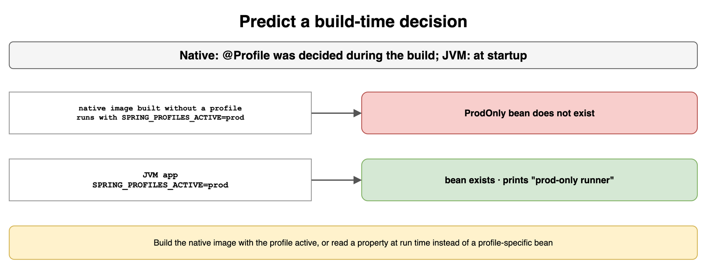
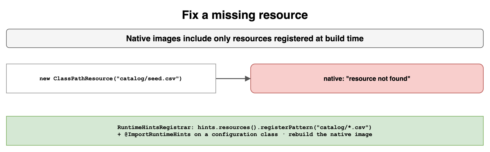

# Native Images with GraalVM — Drills

Predict the result before running the example.

## Predict a build-time decision

The native image was built without any profile. In production it starts with `SPRING_PROFILES_ACTIVE=prod`. Does the `prod`-only bean exist? Would it exist in the JVM version of the same app?

```java
import org.springframework.boot.ApplicationRunner;
import org.springframework.context.annotation.Bean;
import org.springframework.context.annotation.Configuration;
import org.springframework.context.annotation.Profile;

@Configuration
@Profile("prod")
class ProdOnly {
    @Bean
    ApplicationRunner announce() {
        return args -> System.out.println("prod-only runner");
    }
}
```

**Answer**

In the native image it does not exist. AOT processing evaluated `@Profile` during the build, when `prod` was not active, and generated no definition for it. The JVM app evaluates profiles at startup, so there the bean exists. Build the native image with the profile active, or replace the profile-specific bean with configuration that reads a property at run time. See [Spring AOT processing](#13_Spring_Boot/17_Native_Images_with_GraalVM/concepts/spring-aot-processing).



*Source: [`diagrams/native-images-drills.drawio`](/content/13_Spring_Boot/17_Native_Images_with_GraalVM/diagrams/native-images-drills.drawio), page 1.*

## Fix a missing resource

The JVM build reads `catalog/seed.csv` fine. The native executable fails with "resource not found". The file is on the classpath under `src/main/resources/catalog/`. Write the fix.

```java
import java.io.IOException;
import java.nio.charset.StandardCharsets;
import org.springframework.core.io.ClassPathResource;
import org.springframework.stereotype.Component;

@Component
class SeedReader {
    String read() throws IOException {
        return new ClassPathResource("catalog/seed.csv").getContentAsString(StandardCharsets.UTF_8);
    }
}
```

**Answer**

Native images include only the resources that are registered at build time. Add a `RuntimeHintsRegistrar` that calls `hints.resources().registerPattern("catalog/*.csv")` and import it with `@ImportRuntimeHints` on a configuration class, as in [runtime hints for reflection and resources](#13_Spring_Boot/17_Native_Images_with_GraalVM/concepts/runtime-hints-for-reflection-and-resources). Then rebuild the native image.



*Source: [`diagrams/native-images-drills.drawio`](/content/13_Spring_Boot/17_Native_Images_with_GraalVM/diagrams/native-images-drills.drawio), page 2.*
