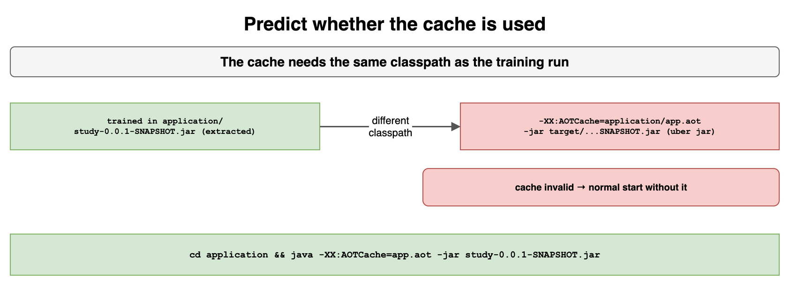
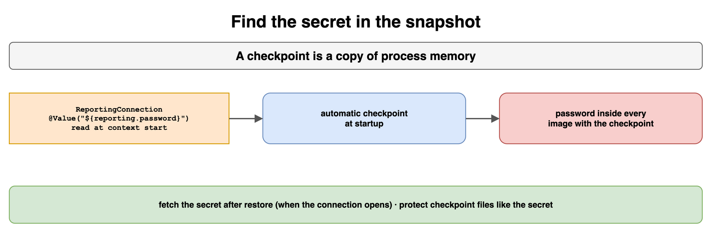

# AOT Cache and Fast Startup — Drills

Predict the result before running the example.

## Predict whether the cache is used

A cache was trained from the extracted application. A teammate then starts the uber jar with that cache. Is the cache used, and what should the command be?

```sh
java -Djarmode=tools -jar target/study-0.0.1-SNAPSHOT.jar extract --destination application
(cd application && java -XX:AOTCacheOutput=app.aot -Dspring.context.exit=onRefresh -jar study-0.0.1-SNAPSHOT.jar)
java -XX:AOTCache=application/app.aot -jar target/study-0.0.1-SNAPSHOT.jar
```

**Answer**

No. The classpath differs from the training run, so the JVM finds the cache invalid and starts normally without it. Run the extracted jar that was used for training: `cd application && java -XX:AOTCache=app.aot -jar study-0.0.1-SNAPSHOT.jar`. See [enable the AOT cache for a Boot app](#13_Spring_Boot/18_AOT_Cache_and_Fast_Startup/concepts/enable-the-aot-cache-for-a-boot-app).



*Source: [`diagrams/aot-cache-drills.drawio`](/content/13_Spring_Boot/18_AOT_Cache_and_Fast_Startup/diagrams/aot-cache-drills.drawio), page 1.*

## Find the secret in the snapshot

The service reads a database password when the context starts. The team uses CRaC with an automatic checkpoint at startup and stores the checkpoint in the container image. What is the risk, and how should the password be handled?

```java
import org.springframework.beans.factory.annotation.Value;
import org.springframework.stereotype.Component;

@Component
class ReportingConnection {
    private final String password;

    ReportingConnection(@Value("${reporting.password}") String password) {
        this.password = password;
    }
}
```

**Answer**

The checkpoint is a copy of process memory, so the password is stored inside every image that contains it. Anyone who can read the image can recover it. Fetch the secret after restore, for example when the connection is opened, and keep checkpoint files as protected as the secret itself. See [checkpoint and restore with CRaC](#13_Spring_Boot/18_AOT_Cache_and_Fast_Startup/concepts/checkpoint-and-restore-with-crac).



*Source: [`diagrams/aot-cache-drills.drawio`](/content/13_Spring_Boot/18_AOT_Cache_and_Fast_Startup/diagrams/aot-cache-drills.drawio), page 2.*
