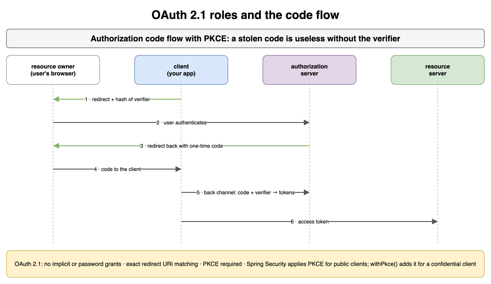
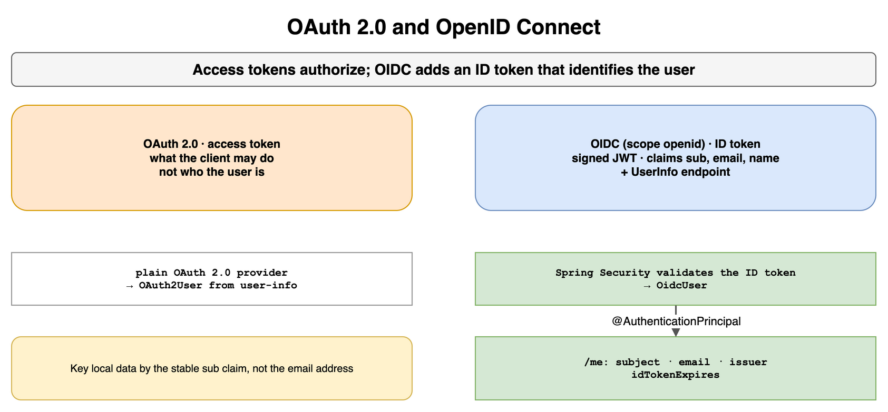
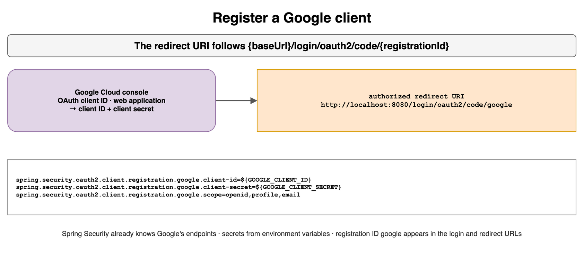
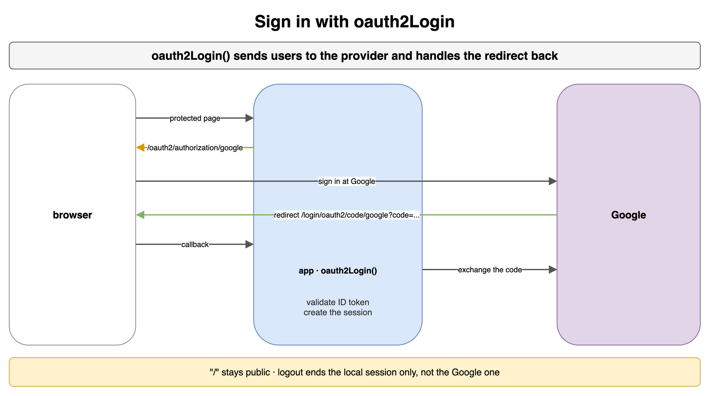
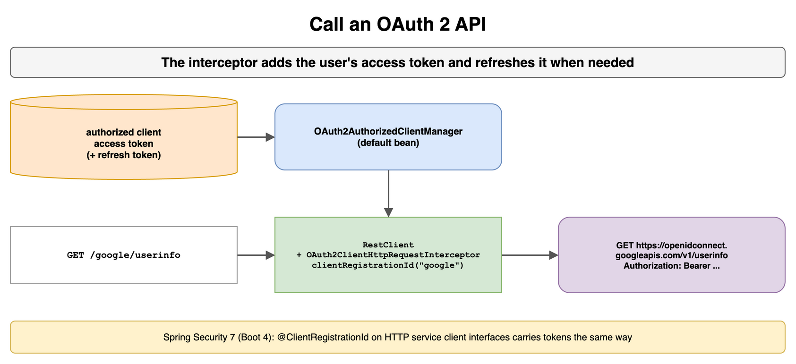

# OAuth 2.1 and OpenID Connect

## OAuth 2.1 roles and the code flow

OAuth lets a user grant an application limited access to their data at another service without sharing a password. There are four roles: the resource owner (the user), the client (your app), the authorization server that authenticates the user and issues tokens, and the resource server that accepts the access token. In the authorization code flow, the browser is redirected to the authorization server, and the client exchanges the returned one-time code for tokens on a back channel.

OAuth 2.1 is a consolidation of OAuth 2.0 and its security best practices. It drops the implicit and password grants, requires exact redirect URI matching, and requires PKCE for the authorization code flow. With PKCE, the client sends a hash of a secret verifier first and the verifier itself later, so a stolen code is useless. Spring Security applies PKCE automatically for public clients. This filter chain adds it for a confidential client that has a secret, using the registrations from the [Google client card](#13_Spring_Boot/18_OAuth_2.1_and_OpenID_Connect/concepts/register-a-google-client).

```java
import org.springframework.context.annotation.Bean;
import org.springframework.context.annotation.Configuration;
import org.springframework.security.config.annotation.web.builders.HttpSecurity;
import org.springframework.security.oauth2.client.registration.ClientRegistrationRepository;
import org.springframework.security.oauth2.client.web.DefaultOAuth2AuthorizationRequestResolver;
import org.springframework.security.oauth2.client.web.OAuth2AuthorizationRequestCustomizers;
import org.springframework.security.web.SecurityFilterChain;

@Configuration
class PkceConfig {
    @Bean
    SecurityFilterChain web(HttpSecurity http, ClientRegistrationRepository registrations) throws Exception {
        var resolver = new DefaultOAuth2AuthorizationRequestResolver(registrations, "/oauth2/authorization");
        resolver.setAuthorizationRequestCustomizer(OAuth2AuthorizationRequestCustomizers.withPkce());
        http.authorizeHttpRequests(auth -> auth.anyRequest().authenticated())
                .oauth2Login(login -> login.authorizationEndpoint(
                        endpoint -> endpoint.authorizationRequestResolver(resolver)));
        return http.build();
    }
}
```

[Spring Security docs](https://docs.spring.io/spring-security/reference/servlet/oauth2/client/authorization-grants.html#oauth2-client-authorization-code)



*Source: [`diagrams/oauth-oidc.drawio`](/content/13_Spring_Boot/18_OAuth_2.1_and_OpenID_Connect/diagrams/oauth-oidc.drawio), page 1.*

## OAuth 2.0 and OpenID Connect

OAuth is about authorization: an access token says what the client may do, not who the user is. OpenID Connect (OIDC) is an identity layer on top of OAuth 2.0. When the client requests the `openid` scope, the provider also returns an ID token, a signed JWT whose claims identify the user, such as `sub`, `email`, and `name`, and it exposes a UserInfo endpoint for more claims.

Spring Security validates the ID token and represents the signed-in user as an `OidcUser`. A plain OAuth 2.0 provider without OIDC yields an `OAuth2User` built from its user-info response instead. Use the stable `sub` claim, not the email address, as the key for local data about the user.

```java
import java.util.Map;
import org.springframework.security.core.annotation.AuthenticationPrincipal;
import org.springframework.security.oauth2.core.oidc.user.OidcUser;
import org.springframework.web.bind.annotation.GetMapping;
import org.springframework.web.bind.annotation.RestController;

@RestController
class MeApi {
    @GetMapping("/me")
    Map<String, Object> me(@AuthenticationPrincipal OidcUser user) {
        return Map.of(
                "subject", user.getSubject(),
                "email", String.valueOf(user.getEmail()),
                "issuer", user.getIssuer().toString(),
                "idTokenExpires", user.getIdToken().getExpiresAt().toString());
    }
}
```

[Spring Security docs](https://docs.spring.io/spring-security/reference/servlet/oauth2/login/core.html)



*Source: [`diagrams/oauth-oidc.drawio`](/content/13_Spring_Boot/18_OAuth_2.1_and_OpenID_Connect/diagrams/oauth-oidc.drawio), page 2.*

## Register a Google client

In the Google Cloud console, create an OAuth client ID of type web application. Set the authorized redirect URI to `http://localhost:8080/login/oauth2/code/google`, which is Spring Security's default pattern `{baseUrl}/login/oauth2/code/{registrationId}`. Google then issues a client ID and a client secret.

Spring Security already knows Google's endpoints, so the registration needs only the credentials and scopes. Keep the secret out of source control by reading it from environment variables. The registration ID, `google` here, appears in the login and redirect URLs.

```properties
spring.security.oauth2.client.registration.google.client-id=${GOOGLE_CLIENT_ID}
spring.security.oauth2.client.registration.google.client-secret=${GOOGLE_CLIENT_SECRET}
spring.security.oauth2.client.registration.google.scope=openid,profile,email
```

[Spring Boot docs](https://docs.spring.io/spring-boot/reference/web/spring-security.html#web.security.oauth2.client)



*Source: [`diagrams/oauth-oidc.drawio`](/content/13_Spring_Boot/18_OAuth_2.1_and_OpenID_Connect/diagrams/oauth-oidc.drawio), page 3.*

## Sign in with oauth2Login

Changed in Boot 4: add `spring-boot-starter-security-oauth2-client`, the new name of the OAuth client starter. With a client registration present, `oauth2Login()` in the filter chain sends unauthenticated users to the provider and handles the redirect back. The callback filter exchanges the code, validates the ID token, and creates the session.

This chain keeps the home page public and requires a Google login for everything else. `/oauth2/authorization/google` starts the flow, so a "Sign in with Google" link can point straight to it. Logging out ends the local session; it does not sign the user out of Google.

```java
import org.springframework.context.annotation.Bean;
import org.springframework.context.annotation.Configuration;
import org.springframework.security.config.Customizer;
import org.springframework.security.config.annotation.web.builders.HttpSecurity;
import org.springframework.security.web.SecurityFilterChain;

@Configuration
class LoginConfig {
    @Bean
    SecurityFilterChain web(HttpSecurity http) throws Exception {
        http.authorizeHttpRequests(auth -> auth
                        .requestMatchers("/").permitAll()
                        .anyRequest().authenticated())
                .oauth2Login(Customizer.withDefaults())
                .logout(logout -> logout.logoutSuccessUrl("/"));
        return http.build();
    }
}
```

[Spring Security docs](https://docs.spring.io/spring-security/reference/servlet/oauth2/login/core.html)



*Source: [`diagrams/oauth-oidc.drawio`](/content/13_Spring_Boot/18_OAuth_2.1_and_OpenID_Connect/diagrams/oauth-oidc.drawio), page 4.*

## Call an OAuth 2 API

After login, Spring Security stores an authorized client that holds the user's access token and, if granted, a refresh token. `OAuth2ClientHttpRequestInterceptor` adds that token as a bearer header to `RestClient` requests and refreshes it when needed. The `clientRegistrationId` request attribute names the registration whose token to use.

This endpoint calls Google's OIDC UserInfo endpoint with the signed-in user's token. Spring Security registers a default `OAuth2AuthorizedClientManager` bean when a client registration exists. Changed in Boot 4: Spring Security 7 also supports `@ClientRegistrationId` on HTTP service client interfaces, so declarative clients can carry tokens the same way.

```java
import static org.springframework.security.oauth2.client.web.client.RequestAttributeClientRegistrationIdResolver.clientRegistrationId;

import java.util.Map;
import org.springframework.core.ParameterizedTypeReference;
import org.springframework.security.oauth2.client.OAuth2AuthorizedClientManager;
import org.springframework.security.oauth2.client.web.client.OAuth2ClientHttpRequestInterceptor;
import org.springframework.web.bind.annotation.GetMapping;
import org.springframework.web.bind.annotation.RestController;
import org.springframework.web.client.RestClient;

@RestController
class GoogleProfileApi {
    private final RestClient google;

    GoogleProfileApi(RestClient.Builder builder, OAuth2AuthorizedClientManager clients) {
        this.google = builder.baseUrl("https://openidconnect.googleapis.com")
                .requestInterceptor(new OAuth2ClientHttpRequestInterceptor(clients))
                .build();
    }

    @GetMapping("/google/userinfo")
    Map<String, Object> userInfo() {
        return google.get().uri("/v1/userinfo")
                .attributes(clientRegistrationId("google"))
                .retrieve()
                .body(new ParameterizedTypeReference<>() {});
    }
}
```

[Spring Security docs](https://docs.spring.io/spring-security/reference/servlet/oauth2/client/authorized-clients.html#oauth2-client-rest-client)



*Source: [`diagrams/oauth-oidc.drawio`](/content/13_Spring_Boot/18_OAuth_2.1_and_OpenID_Connect/diagrams/oauth-oidc.drawio), page 5.*
