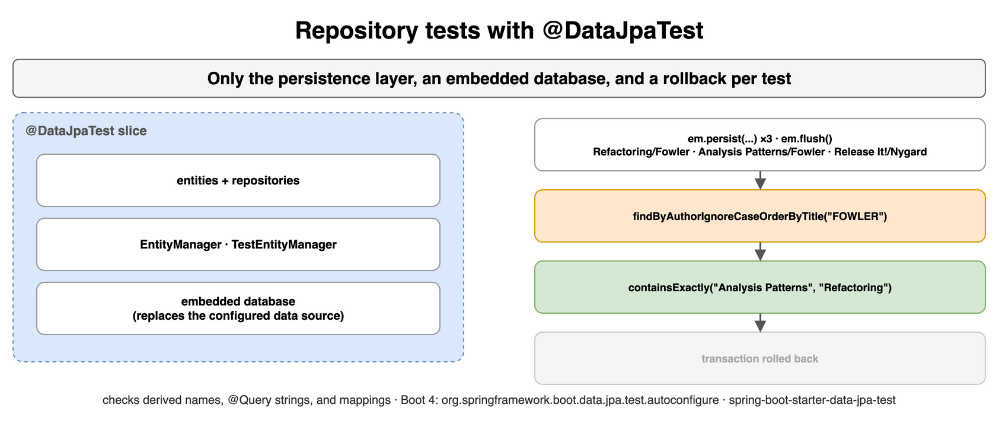
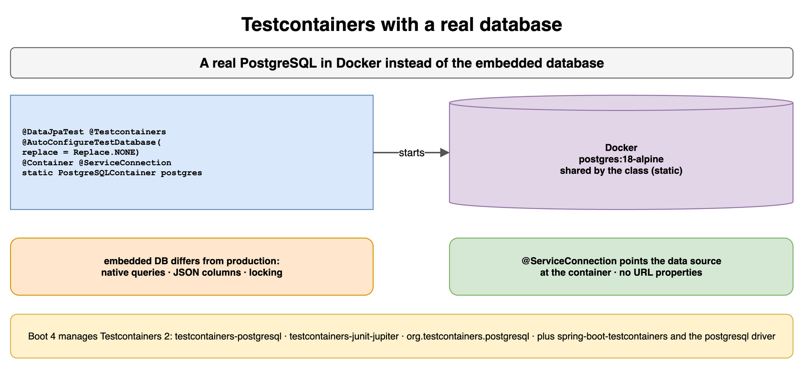
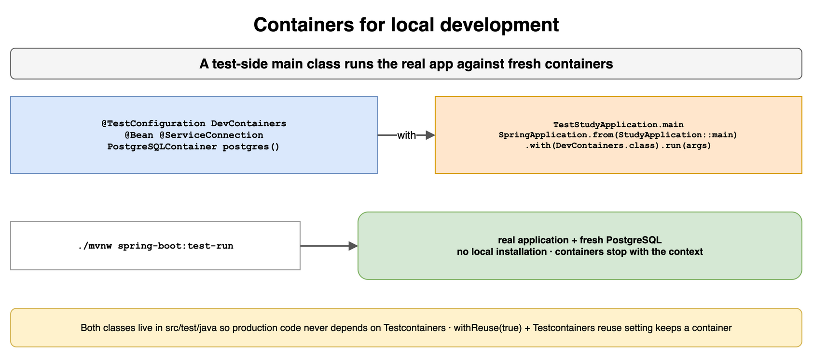
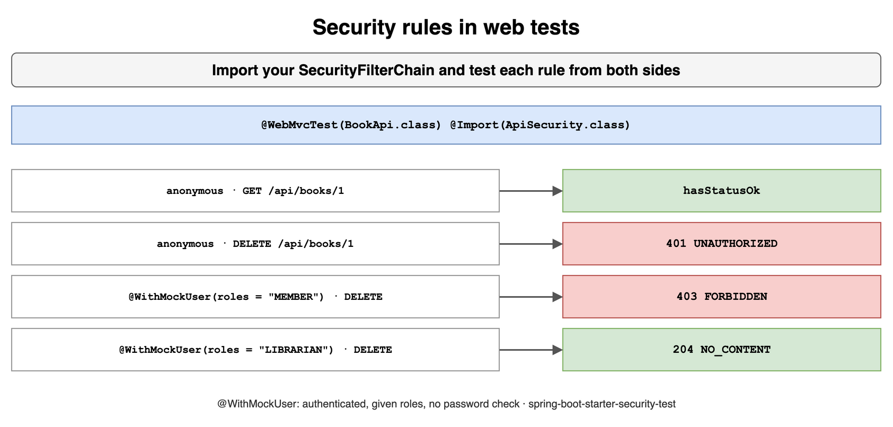
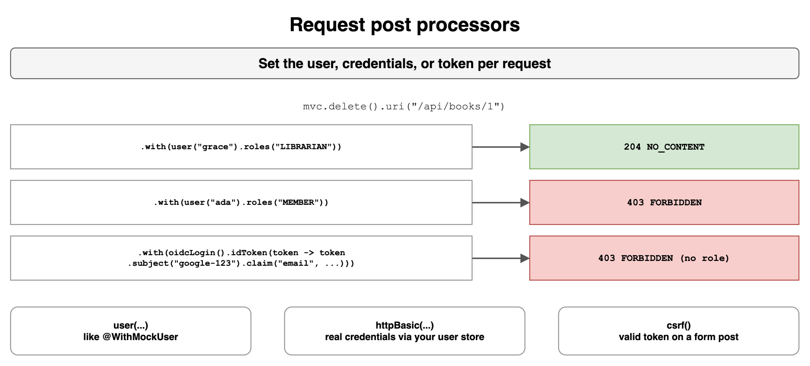
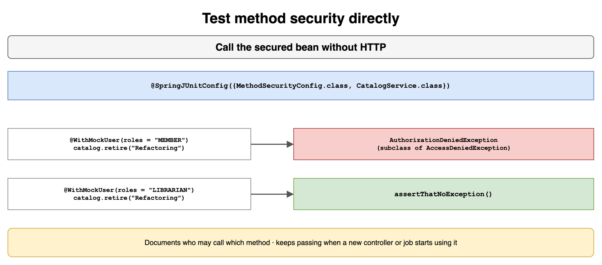

# Data and Security Tests

## Repository tests with @DataJpaTest

`@DataJpaTest` starts only the persistence layer: entities, repositories, the `EntityManager`, and an embedded database that replaces any configured data source. Each test runs in a transaction that is rolled back at the end, so tests do not see each other's rows. Use it to check that derived names, `@Query` strings, and mappings do what you expect.

`TestEntityManager` inserts fixture rows directly, without going through the repository under test. Changed in Boot 4: `@DataJpaTest` lives in `org.springframework.boot.data.jpa.test.autoconfigure` and comes with `spring-boot-starter-data-jpa-test`. Put the first block in `StudyApplication.java`.

```java
import jakarta.persistence.Entity;
import jakarta.persistence.GeneratedValue;
import jakarta.persistence.Id;
import java.util.List;
import org.springframework.boot.SpringApplication;
import org.springframework.boot.autoconfigure.SpringBootApplication;
import org.springframework.data.repository.ListCrudRepository;

@SpringBootApplication
public class StudyApplication {
    public static void main(String[] args) {
        SpringApplication.run(StudyApplication.class, args);
    }
}

@Entity
class Book {
    @Id @GeneratedValue Long id;
    String title;
    String author;

    protected Book() {
    }

    Book(String title, String author) {
        this.title = title;
        this.author = author;
    }
}

interface BookRepository extends ListCrudRepository<Book, Long> {
    List<Book> findByAuthorIgnoreCaseOrderByTitle(String author);
}
```

```java
import static org.assertj.core.api.Assertions.assertThat;

import org.junit.jupiter.api.Test;
import org.springframework.beans.factory.annotation.Autowired;
import org.springframework.boot.data.jpa.test.autoconfigure.DataJpaTest;
import org.springframework.boot.jpa.test.autoconfigure.TestEntityManager;

@DataJpaTest
class BookRepositoryTests {
    @Autowired TestEntityManager em;
    @Autowired BookRepository books;

    @Test
    void findsAnAuthorsBooksInTitleOrder() {
        em.persist(new Book("Refactoring", "Fowler"));
        em.persist(new Book("Analysis Patterns", "Fowler"));
        em.persist(new Book("Release It!", "Nygard"));
        em.flush();

        assertThat(books.findByAuthorIgnoreCaseOrderByTitle("FOWLER"))
                .extracting(b -> b.title)
                .containsExactly("Analysis Patterns", "Refactoring");
    }
}
```

[Spring Boot docs](https://docs.spring.io/spring-boot/reference/testing/spring-boot-applications.html#testing.spring-boot-applications.autoconfigured-spring-data-jpa)



*Source: [`diagrams/data-and-security-tests.drawio`](/content/13_Spring_Boot/21_Data_and_Security_Tests/diagrams/data-and-security-tests.drawio), page 1.*

## Testcontainers with a real database

An embedded database does not behave exactly like production PostgreSQL. Native queries, JSON columns, and locking can differ. Testcontainers starts a real PostgreSQL in Docker for the test. `@ServiceConnection` tells Boot to point the data source at the container, so no URL properties are needed. `@AutoConfigureTestDatabase(replace = NONE)` stops `@DataJpaTest` from swapping in the embedded database.

Changed in Boot 4: Boot manages Testcontainers 2. Its modules are named `testcontainers-postgresql`, `testcontainers-junit-jupiter`, and so on, and the PostgreSQL container class moved to `org.testcontainers.postgresql`. Add those two test dependencies, `spring-boot-testcontainers`, and the `postgresql` driver, and keep Docker running. A `static` container is shared by the tests in the class.

```java
import static org.assertj.core.api.Assertions.assertThat;

import org.junit.jupiter.api.Test;
import org.springframework.beans.factory.annotation.Autowired;
import org.springframework.boot.data.jpa.test.autoconfigure.DataJpaTest;
import org.springframework.boot.jdbc.test.autoconfigure.AutoConfigureTestDatabase;
import org.springframework.boot.testcontainers.service.connection.ServiceConnection;
import org.testcontainers.junit.jupiter.Container;
import org.testcontainers.junit.jupiter.Testcontainers;
import org.testcontainers.postgresql.PostgreSQLContainer;

@DataJpaTest
@Testcontainers
@AutoConfigureTestDatabase(replace = AutoConfigureTestDatabase.Replace.NONE)
class BookRepositoryPostgresTests {
    @Container
    @ServiceConnection
    static PostgreSQLContainer postgres = new PostgreSQLContainer("postgres:18-alpine");

    @Autowired BookRepository books;

    @Test
    void savesAndQueriesOnPostgres() {
        books.save(new Book("Refactoring", "Fowler"));
        assertThat(books.findByAuthorIgnoreCaseOrderByTitle("fowler")).hasSize(1);
    }
}
```

[Spring Boot docs](https://docs.spring.io/spring-boot/reference/testing/testcontainers.html)



*Source: [`diagrams/data-and-security-tests.drawio`](/content/13_Spring_Boot/21_Data_and_Security_Tests/diagrams/data-and-security-tests.drawio), page 2.*

## Containers for local development

The same container definitions can back the application while you develop. Declare containers as `@Bean` methods with `@ServiceConnection` in a test configuration class. Then add a test-side main class that starts the real application with that configuration. Run it with `./mvnw spring-boot:test-run`, and the app starts against a fresh PostgreSQL with no local installation.

Both classes live in `src/test/java`, so production code never depends on Testcontainers. Container beans are stopped when the application context closes. Mark a container with `withReuse(true)` and enable reuse in Testcontainers' settings to keep it between runs.

```java
import org.springframework.boot.SpringApplication;
import org.springframework.boot.test.context.TestConfiguration;
import org.springframework.boot.testcontainers.service.connection.ServiceConnection;
import org.springframework.context.annotation.Bean;
import org.testcontainers.postgresql.PostgreSQLContainer;

@TestConfiguration(proxyBeanMethods = false)
class DevContainers {
    @Bean
    @ServiceConnection
    PostgreSQLContainer postgres() {
        return new PostgreSQLContainer("postgres:18-alpine");
    }
}

public class TestStudyApplication {
    public static void main(String[] args) {
        SpringApplication.from(StudyApplication::main).with(DevContainers.class).run(args);
    }
}
```

[Spring Boot docs](https://docs.spring.io/spring-boot/reference/features/dev-services.html#features.dev-services.testcontainers.at-development-time)



*Source: [`diagrams/data-and-security-tests.drawio`](/content/13_Spring_Boot/21_Data_and_Security_Tests/diagrams/data-and-security-tests.drawio), page 3.*

## Security rules in web tests

Security rules are code and need tests. With the security starter on the classpath, a `@WebMvcTest` applies Spring Security's filters to every request. Import your `SecurityFilterChain` configuration so the slice uses your rules instead of Boot's defaults. `spring-boot-starter-security-test` adds Spring Security's test support.

`@WithMockUser` runs a test as an authenticated user with the given roles and no password check. Test each rule from both sides: the caller who is allowed and the one who is not. Put the first block, which repeats the [route rules](#13_Spring_Boot/16_Spring_Security_Foundations/concepts/secure-routes-and-http-verbs) with a small controller, in the main source folder.

```java
import org.springframework.boot.SpringApplication;
import org.springframework.boot.autoconfigure.SpringBootApplication;
import org.springframework.context.annotation.Bean;
import org.springframework.context.annotation.Configuration;
import org.springframework.http.HttpMethod;
import org.springframework.http.ResponseEntity;
import org.springframework.security.config.Customizer;
import org.springframework.security.config.annotation.web.builders.HttpSecurity;
import org.springframework.security.web.SecurityFilterChain;
import org.springframework.web.bind.annotation.DeleteMapping;
import org.springframework.web.bind.annotation.GetMapping;
import org.springframework.web.bind.annotation.PathVariable;
import org.springframework.web.bind.annotation.RestController;

@SpringBootApplication
public class StudyApplication {
    public static void main(String[] args) {
        SpringApplication.run(StudyApplication.class, args);
    }
}

@Configuration
class ApiSecurity {
    @Bean
    SecurityFilterChain api(HttpSecurity http) throws Exception {
        http.authorizeHttpRequests(auth -> auth
                        .requestMatchers(HttpMethod.GET, "/api/books/**").permitAll()
                        .requestMatchers(HttpMethod.DELETE, "/api/books/**").hasRole("LIBRARIAN")
                        .anyRequest().authenticated())
                .httpBasic(Customizer.withDefaults())
                .csrf(csrf -> csrf.ignoringRequestMatchers("/api/**"));
        return http.build();
    }
}

@RestController
class BookApi {
    @GetMapping("/api/books/{id}")
    String one(@PathVariable long id) {
        return "Refactoring";
    }

    @DeleteMapping("/api/books/{id}")
    ResponseEntity<Void> delete(@PathVariable long id) {
        return ResponseEntity.noContent().build();
    }
}
```

```java
import static org.assertj.core.api.Assertions.assertThat;

import org.junit.jupiter.api.Test;
import org.springframework.beans.factory.annotation.Autowired;
import org.springframework.boot.webmvc.test.autoconfigure.WebMvcTest;
import org.springframework.context.annotation.Import;
import org.springframework.http.HttpStatus;
import org.springframework.security.test.context.support.WithMockUser;
import org.springframework.test.web.servlet.assertj.MockMvcTester;

@WebMvcTest(BookApi.class)
@Import(ApiSecurity.class)
class BookApiSecurityTests {
    @Autowired MockMvcTester mvc;

    @Test
    void anyoneCanRead() {
        assertThat(mvc.get().uri("/api/books/1")).hasStatusOk();
    }

    @Test
    void anonymousDeleteIsUnauthorized() {
        assertThat(mvc.delete().uri("/api/books/1")).hasStatus(HttpStatus.UNAUTHORIZED);
    }

    @Test
    @WithMockUser(roles = "MEMBER")
    void memberCannotDelete() {
        assertThat(mvc.delete().uri("/api/books/1")).hasStatus(HttpStatus.FORBIDDEN);
    }

    @Test
    @WithMockUser(roles = "LIBRARIAN")
    void librarianCanDelete() {
        assertThat(mvc.delete().uri("/api/books/1")).hasStatus(HttpStatus.NO_CONTENT);
    }
}
```

[Spring Security docs](https://docs.spring.io/spring-security/reference/servlet/test/mockmvc/setup.html)



*Source: [`diagrams/data-and-security-tests.drawio`](/content/13_Spring_Boot/21_Data_and_Security_Tests/diagrams/data-and-security-tests.drawio), page 4.*

## Request post processors

Annotations set one user for a whole test method. Request post processors from `SecurityMockMvcRequestPostProcessors` set the user, credentials, or tokens per request instead. `user("grace").roles("LIBRARIAN")` acts like `@WithMockUser`, `httpBasic(...)` sends real Basic credentials through your user store, and `csrf()` adds a valid CSRF token to a form post.

For OAuth logins, `oidcLogin()` creates an authenticated `OidcUser` with claims you choose, so the code from the [OpenID Connect card](#13_Spring_Boot/18_OAuth_2.1_and_OpenID_Connect/concepts/oauth-2-0-and-openid-connect) can be tested without Google. This test reuses the [security rules example](#13_Spring_Boot/21_Data_and_Security_Tests/concepts/security-rules-in-web-tests).

```java
import static org.assertj.core.api.Assertions.assertThat;
import static org.springframework.security.test.web.servlet.request.SecurityMockMvcRequestPostProcessors.oidcLogin;
import static org.springframework.security.test.web.servlet.request.SecurityMockMvcRequestPostProcessors.user;

import org.junit.jupiter.api.Test;
import org.springframework.beans.factory.annotation.Autowired;
import org.springframework.boot.webmvc.test.autoconfigure.WebMvcTest;
import org.springframework.context.annotation.Import;
import org.springframework.http.HttpStatus;
import org.springframework.test.web.servlet.assertj.MockMvcTester;

@WebMvcTest(BookApi.class)
@Import(ApiSecurity.class)
class PerRequestUserTests {
    @Autowired MockMvcTester mvc;

    @Test
    void roleComesFromTheRequest() {
        assertThat(mvc.delete().uri("/api/books/1").with(user("grace").roles("LIBRARIAN")))
                .hasStatus(HttpStatus.NO_CONTENT);
        assertThat(mvc.delete().uri("/api/books/1").with(user("ada").roles("MEMBER")))
                .hasStatus(HttpStatus.FORBIDDEN);
    }

    @Test
    void oidcUserWithoutTheRoleIsForbidden() {
        assertThat(mvc.delete().uri("/api/books/1")
                .with(oidcLogin().idToken(token -> token.subject("google-123").claim("email", "ada@example.com"))))
                .hasStatus(HttpStatus.FORBIDDEN);
    }
}
```

[Spring Security docs](https://docs.spring.io/spring-security/reference/servlet/test/mockmvc/request-post-processors.html)



*Source: [`diagrams/data-and-security-tests.drawio`](/content/13_Spring_Boot/21_Data_and_Security_Tests/diagrams/data-and-security-tests.drawio), page 5.*

## Test method security directly

Method-level rules can be tested by calling the bean, without HTTP. Load a context that contains the secured bean and method security, set the user with `@WithMockUser`, and call the method. A denied call throws `AuthorizationDeniedException`, a subclass of `AccessDeniedException`.

These tests document who may call which service method. They keep passing if a new controller or job starts using the method. The configuration below loads only the [method security example](#13_Spring_Boot/17_Method_Security_and_Data_Ownership/concepts/enable-method-security) instead of the whole application.

```java
import static org.assertj.core.api.Assertions.assertThatNoException;
import static org.assertj.core.api.Assertions.assertThatThrownBy;

import org.junit.jupiter.api.Test;
import org.springframework.beans.factory.annotation.Autowired;
import org.springframework.security.authorization.AuthorizationDeniedException;
import org.springframework.security.test.context.support.WithMockUser;
import org.springframework.test.context.junit.jupiter.SpringJUnitConfig;

@SpringJUnitConfig({MethodSecurityConfig.class, CatalogService.class})
class CatalogServiceSecurityTests {
    @Autowired CatalogService catalog;

    @Test
    @WithMockUser(roles = "MEMBER")
    void memberCannotRetire() {
        assertThatThrownBy(() -> catalog.retire("Refactoring")).isInstanceOf(AuthorizationDeniedException.class);
    }

    @Test
    @WithMockUser(roles = "LIBRARIAN")
    void librarianCanRetire() {
        assertThatNoException().isThrownBy(() -> catalog.retire("Refactoring"));
    }
}
```

[Spring Security docs](https://docs.spring.io/spring-security/reference/servlet/test/method.html)



*Source: [`diagrams/data-and-security-tests.drawio`](/content/13_Spring_Boot/21_Data_and_Security_Tests/diagrams/data-and-security-tests.drawio), page 6.*
