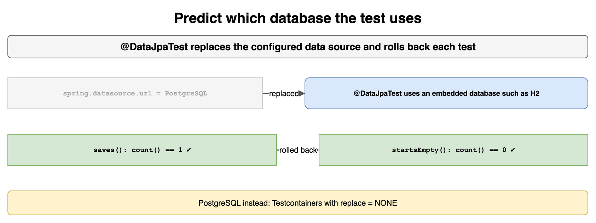
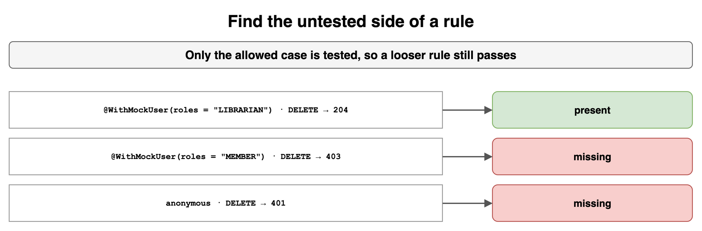

# Data and Security Tests — Drills

Predict the result before running the example.

## Predict which database the test uses

The application sets `spring.datasource.url` to a PostgreSQL server. This test has no other configuration. Which database does it use, and is the saved row still there in the next test method?

```java
import static org.assertj.core.api.Assertions.assertThat;

import org.junit.jupiter.api.Test;
import org.springframework.beans.factory.annotation.Autowired;
import org.springframework.boot.data.jpa.test.autoconfigure.DataJpaTest;

@DataJpaTest
class WhichDatabaseTests {
    @Autowired BookRepository books;

    @Test
    void saves() {
        books.save(new Book("Refactoring", "Fowler"));
        assertThat(books.count()).isEqualTo(1);
    }

    @Test
    void startsEmpty() {
        assertThat(books.count()).isZero();
    }
}
```

**Answer**

It uses an embedded database such as H2, because `@DataJpaTest` replaces the configured data source by default. Both tests pass: each test method runs in a transaction that is rolled back, so the row from `saves` is gone in `startsEmpty`. To test against PostgreSQL, use the [Testcontainers setup](#13_Spring_Boot/21_Data_and_Security_Tests/concepts/testcontainers-with-a-real-database) with `replace = NONE`.



*Source: [`diagrams/data-and-security-tests-drills.drawio`](/content/13_Spring_Boot/21_Data_and_Security_Tests/diagrams/data-and-security-tests-drills.drawio), page 1.*

## Find the untested side of a rule

This class tests that librarians may delete books. A refactoring later changes the rule to `authenticated()` by mistake, and the suite stays green. Which tests are missing?

```java
import static org.assertj.core.api.Assertions.assertThat;

import org.junit.jupiter.api.Test;
import org.springframework.beans.factory.annotation.Autowired;
import org.springframework.boot.webmvc.test.autoconfigure.WebMvcTest;
import org.springframework.context.annotation.Import;
import org.springframework.http.HttpStatus;
import org.springframework.security.test.context.support.WithMockUser;
import org.springframework.test.web.servlet.assertj.MockMvcTester;

@WebMvcTest(BookApi.class)
@Import(ApiSecurity.class)
class HappyPathOnlyTests {
    @Autowired MockMvcTester mvc;

    @Test
    @WithMockUser(roles = "LIBRARIAN")
    void librarianCanDelete() {
        assertThat(mvc.delete().uri("/api/books/1")).hasStatus(HttpStatus.NO_CONTENT);
    }
}
```

**Answer**

There is no test for the denied side: a `MEMBER` should get 403 and an anonymous caller 401. With only the allowed case, any rule that admits librarians passes. Add the two denial tests from [security rules in web tests](#13_Spring_Boot/21_Data_and_Security_Tests/concepts/security-rules-in-web-tests).



*Source: [`diagrams/data-and-security-tests-drills.drawio`](/content/13_Spring_Boot/21_Data_and_Security_Tests/diagrams/data-and-security-tests-drills.drawio), page 2.*
