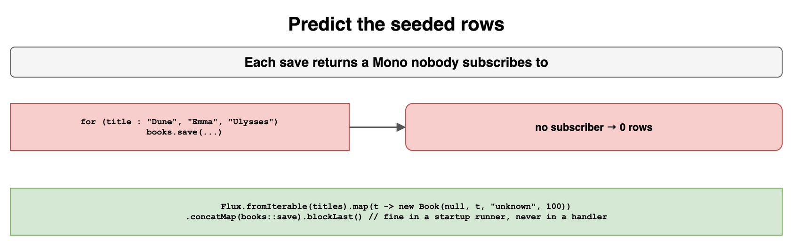
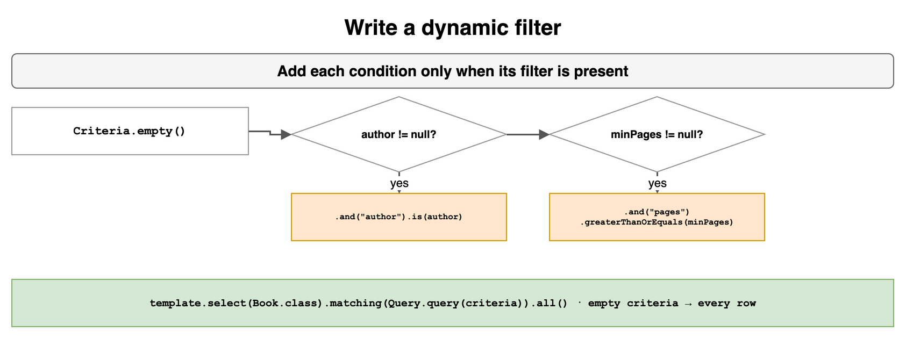

# Reactive Data with R2DBC — Drills

Predict the result before running the example.

## Predict the seeded rows

This runner should insert three books at startup. After the app starts, how many rows are in the table?

```java
@Bean
CommandLineRunner seed(BookRepository books) {
    return args -> {
        for (String title : List.of("Dune", "Emma", "Ulysses")) {
            books.save(new Book(null, title, "unknown", 100));
        }
    };
}
```

**Answer**

Zero. Each `save` returns a `Mono` that nobody subscribes to, so no insert runs. Build one pipeline and subscribe to it: `Flux.fromIterable(titles).map(t -> new Book(null, t, "unknown", 100)).concatMap(books::save).blockLast();`. Blocking is fine in a runner at startup, but never in a request handler. See [load data with R2dbcEntityTemplate](#13_Spring_Boot/21_Reactive_Data_with_R2DBC/concepts/load-data-with-r2dbcentitytemplate).



*Source: [`diagrams/r2dbc-drills.drawio`](/content/13_Spring_Boot/21_Reactive_Data_with_R2DBC/diagrams/r2dbc-drills.drawio), page 1.*

## Write a dynamic filter

Write a method that returns books filtered by an optional author and an optional minimum page count. Either filter may be null. Use `R2dbcEntityTemplate`.

**Answer**

```java
Flux<Book> search(String author, Integer minPages) {
    Criteria criteria = Criteria.empty();
    if (author != null) criteria = criteria.and("author").is(author);
    if (minPages != null) criteria = criteria.and("pages").greaterThanOrEquals(minPages);
    return template.select(Book.class).matching(Query.query(criteria)).all();
}
```

Each condition is added only when its filter is present, and an empty criteria selects every row. See [load data with R2dbcEntityTemplate](#13_Spring_Boot/21_Reactive_Data_with_R2DBC/concepts/load-data-with-r2dbcentitytemplate).



*Source: [`diagrams/r2dbc-drills.drawio`](/content/13_Spring_Boot/21_Reactive_Data_with_R2DBC/diagrams/r2dbc-drills.drawio), page 2.*
