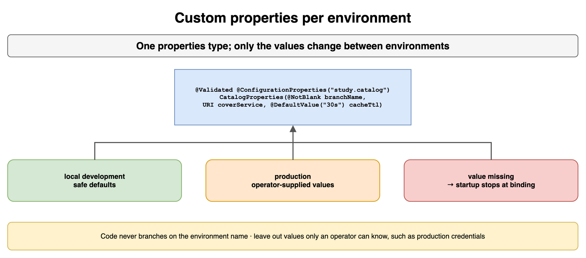
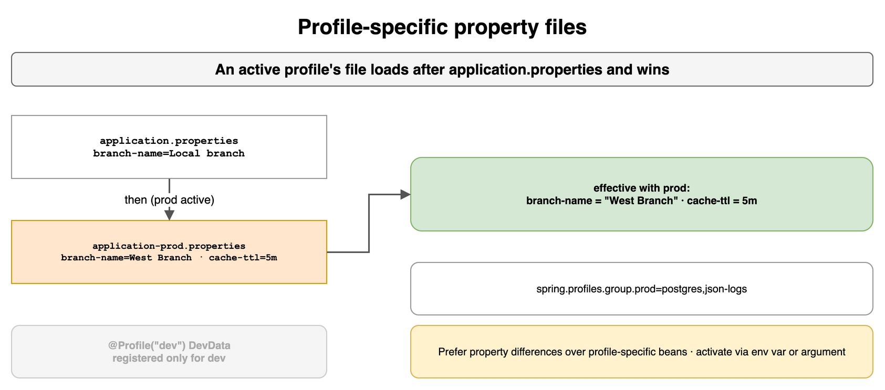
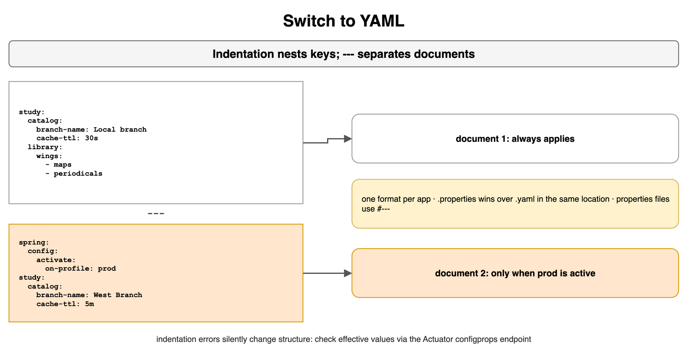
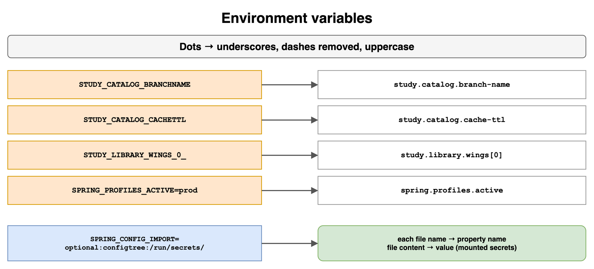
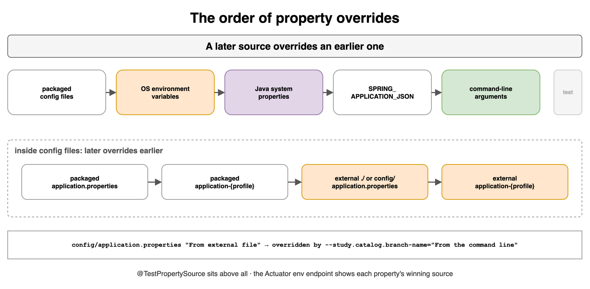

# Profiles, YAML, and Property Overrides

## Custom properties per environment

The [typed properties card](#13_Spring_Boot/10_Configuration_Properties_and_Dependency_Management/concepts/typed-custom-properties) binds a group of settings to a record. Releasing an app adds a second question: which values apply in which environment. Keep one properties type for the whole group, and change only the values from one environment to the next. Code should never branch on the environment's name.

Give every property a safe default for local development, either in `application.properties` or with `@DefaultValue`. Leave out values that only an operator can know, such as production credentials. A missing value should stop startup instead of letting the app fall back to a development setting. Pair the record with `@Validated` and constraints so that check happens during binding.

```java
import jakarta.validation.constraints.NotBlank;
import java.net.URI;
import java.time.Duration;
import org.springframework.boot.context.properties.ConfigurationProperties;
import org.springframework.boot.context.properties.bind.DefaultValue;
import org.springframework.validation.annotation.Validated;

@Validated
@ConfigurationProperties("study.catalog")
record CatalogProperties(@NotBlank String branchName,
                         URI coverService,
                         @DefaultValue("30s") Duration cacheTtl) {
}
```

[Spring Boot docs](https://docs.spring.io/spring-boot/reference/features/external-config.html#features.external-config.typesafe-configuration-properties)



*Source: [`diagrams/profiles-and-overrides.drawio`](/content/13_Spring_Boot/22_Profiles_YAML_and_Property_Overrides/diagrams/profiles-and-overrides.drawio), page 1.*

## Profile-specific property files

A profile is a named set of configuration, such as `dev` or `prod`. When a profile is active, Boot loads `application-{profile}.properties` after `application.properties`, so the profile's values win. Activate profiles with `spring.profiles.active`, usually from an environment variable or a command-line argument, so the jar stays the same everywhere.

A profile group activates several profiles under one name. `@Profile` on a bean or configuration class registers it only when the profile is active. Prefer property differences over profile-specific beans, which create code paths that run in only one environment.

```properties
# application.properties
study.catalog.branch-name=Local branch
spring.profiles.group.prod=postgres,json-logs

# application-prod.properties
study.catalog.branch-name=West Branch
study.catalog.cache-ttl=5m
```

```java
import org.springframework.boot.ApplicationRunner;
import org.springframework.context.annotation.Bean;
import org.springframework.context.annotation.Configuration;
import org.springframework.context.annotation.Profile;

@Configuration
@Profile("dev")
class DevData {
    @Bean
    ApplicationRunner seedDemoBooks() {
        return args -> System.out.println("Seeding demo books for the dev profile");
    }
}
```

[Spring Boot docs](https://docs.spring.io/spring-boot/reference/features/profiles.html)



*Source: [`diagrams/profiles-and-overrides.drawio`](/content/13_Spring_Boot/22_Profiles_YAML_and_Property_Overrides/diagrams/profiles-and-overrides.drawio), page 2.*

## Switch to YAML

Boot reads `application.yaml` (or `.yml`) as well as `.properties`. YAML nests keys by indentation and writes lists as items, which keeps large groups of settings readable. Use one format per application. If both files exist in the same location, `.properties` takes precedence.

One YAML file can hold several documents separated by `---`. A document with `spring.config.activate.on-profile` applies only when that profile is active, so a small app can keep all environments in one file. Properties files use `#---` for the same purpose. Indentation errors silently change the structure, so check the effective values in the Actuator `configprops` endpoint or at startup.

```yaml
study:
  catalog:
    branch-name: Local branch
    cache-ttl: 30s
  library:
    wings:
      - maps
      - periodicals
---
spring:
  config:
    activate:
      on-profile: prod
study:
  catalog:
    branch-name: West Branch
    cache-ttl: 5m
```

[Spring Boot docs](https://docs.spring.io/spring-boot/reference/features/external-config.html#features.external-config.yaml)



*Source: [`diagrams/profiles-and-overrides.drawio`](/content/13_Spring_Boot/22_Profiles_YAML_and_Property_Overrides/diagrams/profiles-and-overrides.drawio), page 3.*

## Environment variables

Container platforms pass settings as environment variables. Boot maps them to property names: replace dots with underscores, remove dashes, and use uppercase. `STUDY_CATALOG_BRANCHNAME` sets `study.catalog.branch-name`. A number between underscores addresses a list index, so `STUDY_LIBRARY_WINGS_0_` sets the first wing.

`SPRING_PROFILES_ACTIVE=prod` selects profiles. For secrets mounted as files, as Kubernetes does with volume-mounted secrets, import a configuration tree. Each file name becomes a property name and its content becomes the value.

```sh
export SPRING_PROFILES_ACTIVE=prod
export STUDY_CATALOG_BRANCHNAME="East Branch"
export STUDY_CATALOG_CACHETTL=10m
export SPRING_CONFIG_IMPORT=optional:configtree:/run/secrets/
java -jar target/study-0.0.1-SNAPSHOT.jar
```

[Spring Boot docs](https://docs.spring.io/spring-boot/reference/features/external-config.html#features.external-config.typesafe-configuration-properties.relaxed-binding.environment-variables)



*Source: [`diagrams/profiles-and-overrides.drawio`](/content/13_Spring_Boot/22_Profiles_YAML_and_Property_Overrides/diagrams/profiles-and-overrides.drawio), page 4.*

## The order of property overrides

Boot assembles one environment from many sources, and a later source overrides an earlier one. In increasing priority, the main sources are:

- packaged config files;
- OS environment variables;
- Java system properties;
- `SPRING_APPLICATION_JSON`;
- command-line arguments.

Test annotations such as `@TestPropertySource` sit above all of them.

Config files have their own order. Profile-specific files override plain ones, and files outside the jar, in the working directory or a `config/` subdirectory, override files packaged inside it. An operator can therefore drop a `config/application.properties` next to the jar without rebuilding. When a value is surprising, the Actuator `env` endpoint shows each property's winning source.

```sh
# Packaged default, overridden by an external file, then by an argument
mkdir -p config && echo 'study.catalog.branch-name=From external file' > config/application.properties
java -jar target/study-0.0.1-SNAPSHOT.jar --study.catalog.branch-name="From the command line"
```

[Spring Boot docs](https://docs.spring.io/spring-boot/reference/features/external-config.html)



*Source: [`diagrams/profiles-and-overrides.drawio`](/content/13_Spring_Boot/22_Profiles_YAML_and_Property_Overrides/diagrams/profiles-and-overrides.drawio), page 5.*
