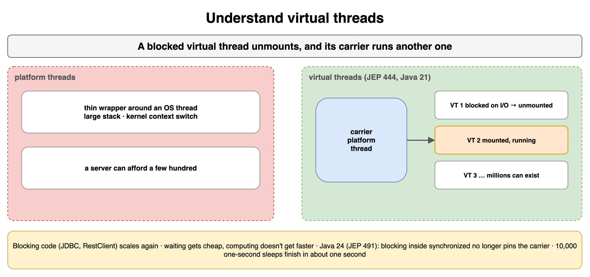
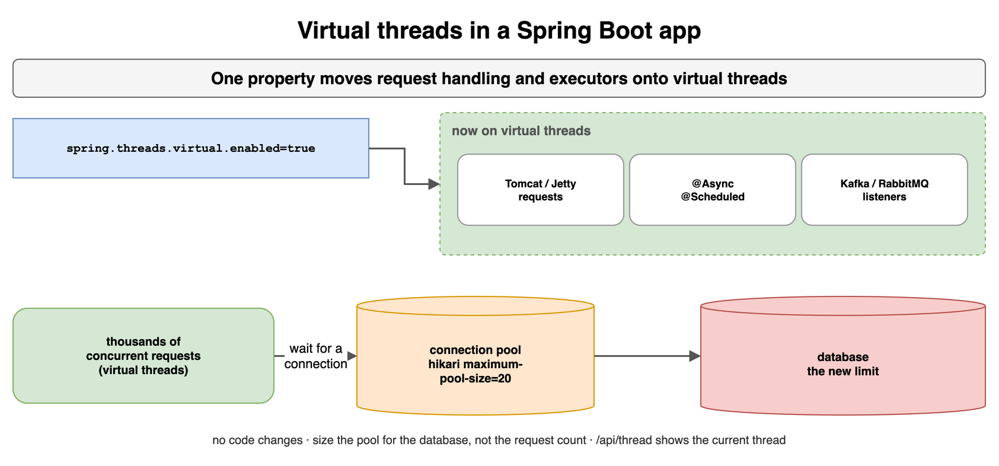
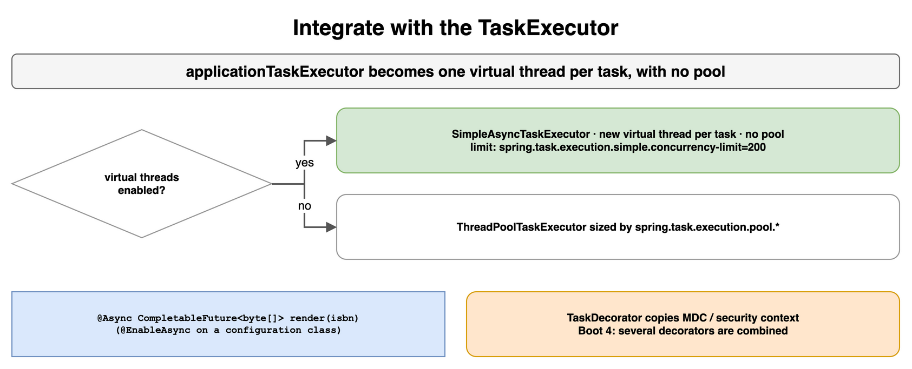
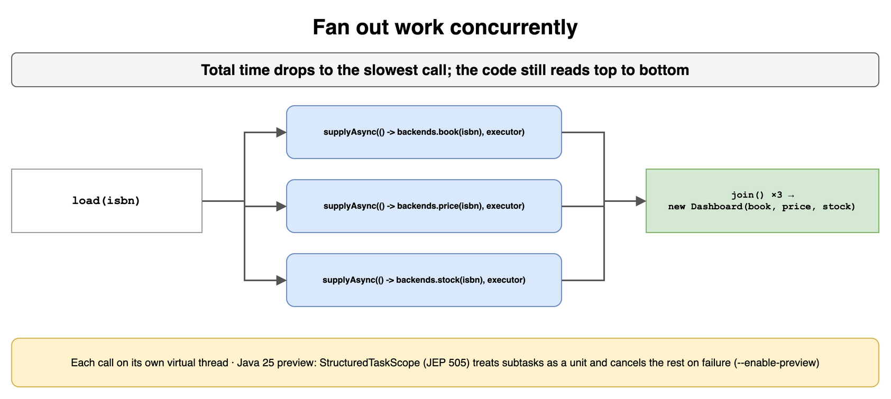
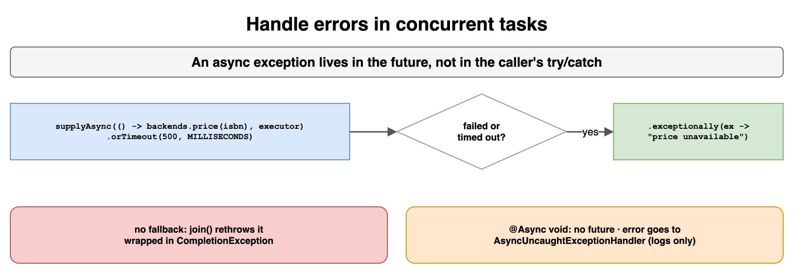

# Virtual Threads

## Understand virtual threads

A platform thread is a thin wrapper around an operating-system thread. Each one reserves a large stack and costs a kernel context switch, so a server can afford a few hundred. A virtual thread (JEP 444, final in Java 21) is managed by the JVM instead. When it blocks on I/O, the JVM unmounts it from its carrier platform thread and runs another virtual thread there. Millions can exist at once.

This brings the scalability of non-blocking code back to plain blocking code. A request can call JDBC or `RestClient` in a straight line, and while it waits, its carrier thread serves other work. Virtual threads make waiting cheap, not computing faster: CPU-bound work gains nothing. Since Java 24 (JEP 491), blocking inside `synchronized` no longer pins the carrier, which removed the main pitfall of Java 21.

```java
import java.time.Duration;
import java.util.concurrent.Executors;
import java.util.stream.IntStream;

try (var executor = Executors.newVirtualThreadPerTaskExecutor()) {
    IntStream.range(0, 10_000).forEach(i -> executor.submit(() -> {
        Thread.sleep(Duration.ofSeconds(1));
        return i;
    }));
} // All 10,000 tasks finish in about one second.
```

[OpenJDK JEP 444](https://openjdk.org/jeps/444)



*Source: [`diagrams/virtual-threads.drawio`](/content/13_Spring_Boot/22_Virtual_Threads/diagrams/virtual-threads.drawio), page 1.*

## Virtual threads in a Spring Boot app

One property switches a Spring Boot app to virtual threads: `spring.threads.virtual.enabled=true`. Tomcat and Jetty then handle each request on a new virtual thread instead of a pooled platform thread. The same applies to the task executor used by `@Async`, the scheduler for `@Scheduled`, and listener containers for Kafka and RabbitMQ.

Code does not change. A Spring MVC app with JPA keeps its blocking style and can serve far more concurrent requests that wait on I/O. The database is now the limit: thousands of concurrent requests still share one connection pool, so a request may wait for a connection instead of a thread. Size the pool for what the database can handle, not for the request count.

```properties
spring.threads.virtual.enabled=true
spring.datasource.hikari.maximum-pool-size=20
```

```java
import org.springframework.web.bind.annotation.GetMapping;
import org.springframework.web.bind.annotation.RestController;

@RestController
class ThreadInfo {
    @GetMapping("/api/thread")
    String thread() {
        return Thread.currentThread().toString();
    }
}
```

[Spring Boot docs](https://docs.spring.io/spring-boot/reference/features/spring-application.html#features.spring-application.virtual-threads)



*Source: [`diagrams/virtual-threads.drawio`](/content/13_Spring_Boot/22_Virtual_Threads/diagrams/virtual-threads.drawio), page 2.*

## Integrate with the TaskExecutor

Boot autoconfigures an `AsyncTaskExecutor` bean named `applicationTaskExecutor`, used by `@Async` methods and by Spring MVC for asynchronous requests. With virtual threads enabled, it becomes a `SimpleAsyncTaskExecutor` that starts a new virtual thread per task, with no pool. Without them, it is a `ThreadPoolTaskExecutor` sized by `spring.task.execution.pool.*`.

Because there is no pool to bound concurrency, limit it where a downstream resource needs it, for example with `spring.task.execution.simple.concurrency-limit`. A `TaskDecorator` can copy context such as MDC values or the security context into each task. Changed in Boot 4: when several `TaskDecorator` beans exist, Boot combines them instead of ignoring them.

```properties
spring.task.execution.simple.concurrency-limit=200
```

```java
import java.util.concurrent.CompletableFuture;
import org.springframework.scheduling.annotation.Async;
import org.springframework.scheduling.annotation.EnableAsync;
import org.springframework.stereotype.Service;

@Service
class CoverService {
    @Async
    CompletableFuture<byte[]> render(String isbn) {
        return CompletableFuture.completedFuture(slowRender(isbn));
    }

    private byte[] slowRender(String isbn) {
        return isbn.getBytes();
    }
}

// Add @EnableAsync to StudyApplication or another configuration class.
```

[Spring Boot docs](https://docs.spring.io/spring-boot/reference/features/task-execution-and-scheduling.html)



*Source: [`diagrams/virtual-threads.drawio`](/content/13_Spring_Boot/22_Virtual_Threads/diagrams/virtual-threads.drawio), page 3.*

## Fan out work concurrently

A request that needs data from three services can call them in parallel instead of one after another. Submit each call to the task executor, which runs it on its own virtual thread, then join the results. The total time drops to that of the slowest call, and the code still reads top to bottom.

`CompletableFuture.supplyAsync` with the `applicationTaskExecutor` is the portable way. Java 25 also offers structured concurrency (JEP 505) as a preview: `StructuredTaskScope` treats the subtasks as one unit, so if one fails the others are cancelled. Preview APIs need `--enable-preview` and can still change.

```java
import java.util.concurrent.CompletableFuture;
import org.springframework.core.task.AsyncTaskExecutor;
import org.springframework.stereotype.Service;

record Dashboard(String book, String price, String stock) {}

@Service
class DashboardService {
    private final AsyncTaskExecutor executor;
    private final Backends backends;

    DashboardService(AsyncTaskExecutor executor, Backends backends) {
        this.executor = executor;
        this.backends = backends;
    }

    Dashboard load(String isbn) {
        var book = CompletableFuture.supplyAsync(() -> backends.book(isbn), executor);
        var price = CompletableFuture.supplyAsync(() -> backends.price(isbn), executor);
        var stock = CompletableFuture.supplyAsync(() -> backends.stock(isbn), executor);
        return new Dashboard(book.join(), price.join(), stock.join());
    }
}
```

[OpenJDK JEP 505](https://openjdk.org/jeps/505)



*Source: [`diagrams/virtual-threads.drawio`](/content/13_Spring_Boot/22_Virtual_Threads/diagrams/virtual-threads.drawio), page 4.*

## Handle errors in concurrent tasks

An exception thrown inside an asynchronous task does not reach the caller's `try`/`catch`. It is stored in the future and rethrown, wrapped in a `CompletionException`, when the caller calls `join`. Decide per call what a failure means: fail the whole request, or fall back to a default with `exceptionally` and `orTimeout`.

An `@Async` method that returns `void` has no future to carry its error. The exception goes to an `AsyncUncaughtExceptionHandler`, which by default only logs it. Return a `CompletableFuture` when the caller needs to know, or register a handler through `AsyncConfigurer` to record failures.

```java
import java.util.concurrent.CompletableFuture;
import java.util.concurrent.TimeUnit;

var price = CompletableFuture.supplyAsync(() -> backends.price(isbn), executor)
        .orTimeout(500, TimeUnit.MILLISECONDS)
        .exceptionally(ex -> "price unavailable");
```

[Spring Framework docs](https://docs.spring.io/spring-framework/reference/integration/scheduling.html#scheduling-annotation-support-exception)



*Source: [`diagrams/virtual-threads.drawio`](/content/13_Spring_Boot/22_Virtual_Threads/diagrams/virtual-threads.drawio), page 5.*

## Choose virtual threads or WebFlux

Both models serve many concurrent requests that mostly wait. Virtual threads keep the familiar blocking style, work with JDBC and JPA, and give readable stack traces and simple debugging. WebFlux needs reactive libraries throughout, but adds backpressure, streaming, and operators for complex asynchronous flows.

For a typical CRUD service or one that calls a few other services, virtual threads are the simpler default. Choose WebFlux when the app streams data, needs backpressure, or already lives in a reactive ecosystem. Neither helps CPU-bound work, and both still need limits on connection pools and downstream calls.

| Need | Virtual threads | WebFlux |
|---|---|---|
| Blocking libraries such as JPA | Yes | Only off the event loop |
| Streaming and backpressure | Limited | Built in |
| Debugging and stack traces | Plain | Harder |
| Learning curve | Low | High |

[Spring Boot docs](https://docs.spring.io/spring-boot/reference/web/index.html)
