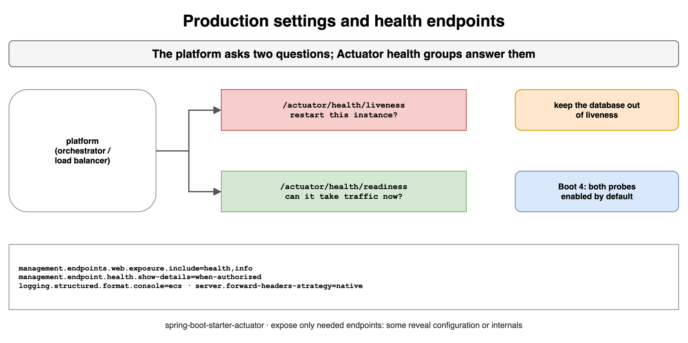
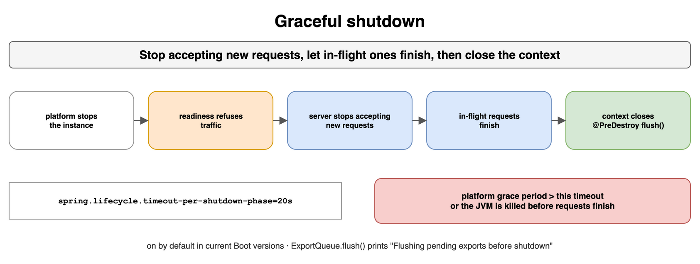
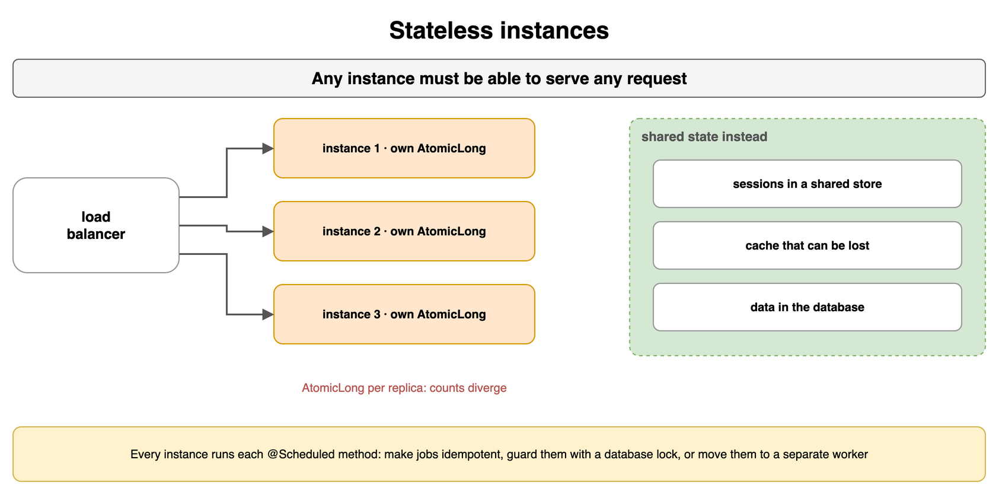
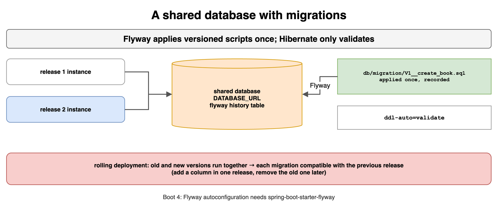
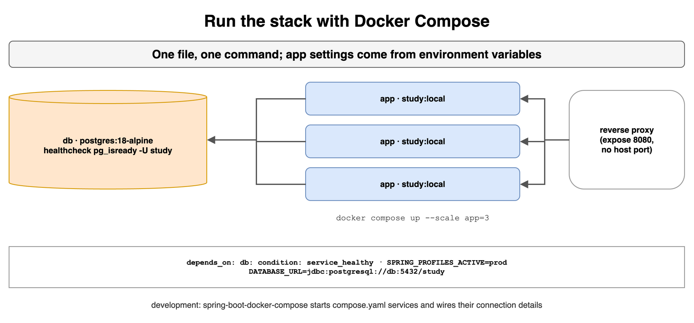

# Running and Scaling in Production

## Production settings and health endpoints

A production instance needs settings that a laptop does not. Platforms need health endpoints to decide when to route traffic and when to restart the app. Log aggregators read structured logs more easily than text. Add `spring-boot-starter-actuator` and expose only the endpoints you need over HTTP, because some reveal configuration or internals.

Boot's health groups `liveness` and `readiness` answer the platform's two questions: should this instance be restarted, and can it take traffic now? Changed in Boot 4: the liveness and readiness probes are enabled by default, so `/actuator/health/liveness` and `/actuator/health/readiness` exist without extra configuration. Keep external dependencies such as the database out of the liveness check, or a database outage restarts every instance.

```properties
management.endpoints.web.exposure.include=health,info
management.endpoint.health.show-details=when-authorized
logging.structured.format.console=ecs
server.forward-headers-strategy=native
```

[Spring Boot docs](https://docs.spring.io/spring-boot/reference/actuator/endpoints.html#actuator.endpoints.kubernetes-probes)



*Source: [`diagrams/production-scaling.drawio`](/content/13_Spring_Boot/24_Running_and_Scaling_in_Production/diagrams/production-scaling.drawio), page 1.*

## Graceful shutdown

During a deployment the platform stops old instances. With graceful shutdown, the embedded server stops accepting new requests and lets in-flight requests finish before the application context closes. Graceful shutdown is on by default in current Boot versions. `spring.lifecycle.timeout-per-shutdown-phase` caps how long each shutdown phase may wait.

Make the platform's grace period longer than that timeout, or it kills the JVM before requests finish. Behind a load balancer, readiness turns to refusing traffic when shutdown starts. Beans can release resources in a `@PreDestroy` method, which runs while the context closes.

```properties
spring.lifecycle.timeout-per-shutdown-phase=20s
```

```java
import jakarta.annotation.PreDestroy;
import org.springframework.stereotype.Component;

@Component
class ExportQueue {
    @PreDestroy
    void flush() {
        System.out.println("Flushing pending exports before shutdown");
    }
}
```

[Spring Boot docs](https://docs.spring.io/spring-boot/reference/web/graceful-shutdown.html)



*Source: [`diagrams/production-scaling.drawio`](/content/13_Spring_Boot/24_Running_and_Scaling_in_Production/diagrams/production-scaling.drawio), page 2.*

## Stateless instances

To scale out, run several identical instances behind a load balancer. That works only if any instance can serve any request. Keep no user-specific state in memory: store sessions in a shared store, use a shared or per-instance cache that can be lost, and keep data in the database. A local map that two instances update independently quietly diverges.

Scheduled jobs need the same care. Every instance runs each `@Scheduled` method, so a nightly reminder job would run once per instance. Make jobs idempotent, guard them with a database lock, or move them to a separate worker. The counter below is wrong as soon as a second instance starts.

```java
import java.util.concurrent.atomic.AtomicLong;
import org.springframework.web.bind.annotation.PostMapping;
import org.springframework.web.bind.annotation.RestController;

@RestController
class VisitCounter {
    // Per-instance state: each replica counts only the requests it received.
    private final AtomicLong visits = new AtomicLong();

    @PostMapping("/api/visits")
    long visit() {
        return visits.incrementAndGet();
    }
}
```

[Spring Boot docs](https://docs.spring.io/spring-boot/reference/web/spring-session.html)



*Source: [`diagrams/production-scaling.drawio`](/content/13_Spring_Boot/24_Running_and_Scaling_in_Production/diagrams/production-scaling.drawio), page 3.*

## A shared database with migrations

Instances share one database, and its schema must change in step with each release. Hibernate's schema generation is not safe for that. Use a migration tool such as Flyway, which applies versioned SQL scripts once and records them in a history table. Changed in Boot 4: Flyway autoconfiguration needs `spring-boot-starter-flyway` instead of just the Flyway library.

Point every instance at the same database with environment variables, and set `ddl-auto=validate` so Hibernate checks the schema without changing it. During a rolling deployment old and new versions run together. Make each migration compatible with the previous release, for example add a column in one release and remove the old one in a later release.

```sql
-- src/main/resources/db/migration/V1__create_book.sql
create table book (
    id bigint generated by default as identity primary key,
    title varchar(200) not null,
    author varchar(120) not null,
    pages int not null
);
```

```properties
spring.datasource.url=${DATABASE_URL}
spring.datasource.username=${DATABASE_USER}
spring.datasource.password=${DATABASE_PASSWORD}
spring.jpa.hibernate.ddl-auto=validate
```

[Spring Boot docs](https://docs.spring.io/spring-boot/how-to/data-initialization.html#howto.data-initialization.migration-tool.flyway)



*Source: [`diagrams/production-scaling.drawio`](/content/13_Spring_Boot/24_Running_and_Scaling_in_Production/diagrams/production-scaling.drawio), page 4.*

## Run the stack with Docker Compose

Docker Compose describes the application and its services in one file, so the whole stack starts with one command. The app's settings come from environment variables, using the [environment variable mapping](#13_Spring_Boot/22_Profiles_YAML_and_Property_Overrides/concepts/environment-variables). `depends_on` with a health condition delays the app until PostgreSQL accepts connections.

`docker compose up --scale app=3` starts three app replicas that share the database. Leave the app's host port unpublished when scaling and route through a reverse proxy, because replicas cannot all bind the same host port. For development, the `spring-boot-docker-compose` dependency can start the services in `compose.yaml` and wire their connection details when the app starts.

```yaml
services:
  db:
    image: postgres:18-alpine
    environment:
      POSTGRES_DB: study
      POSTGRES_USER: study
      POSTGRES_PASSWORD: study
    healthcheck:
      test: ["CMD-SHELL", "pg_isready -U study"]
      interval: 5s
  app:
    image: study:local
    environment:
      SPRING_PROFILES_ACTIVE: prod
      DATABASE_URL: jdbc:postgresql://db:5432/study
      DATABASE_USER: study
      DATABASE_PASSWORD: study
    depends_on:
      db:
        condition: service_healthy
    expose:
      - "8080"
```

[Spring Boot docs](https://docs.spring.io/spring-boot/reference/features/dev-services.html#features.dev-services.docker-compose)



*Source: [`diagrams/production-scaling.drawio`](/content/13_Spring_Boot/24_Running_and_Scaling_in_Production/diagrams/production-scaling.drawio), page 5.*
