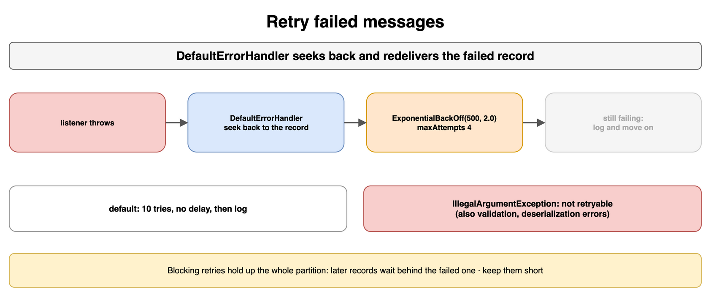
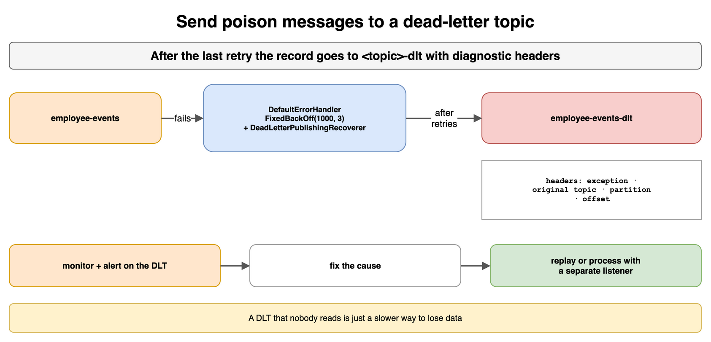
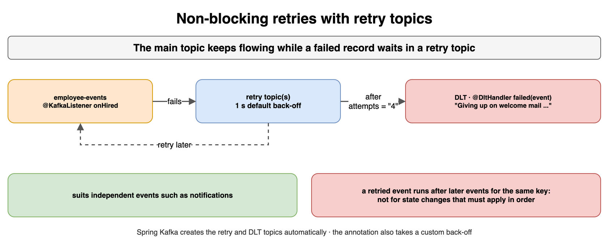
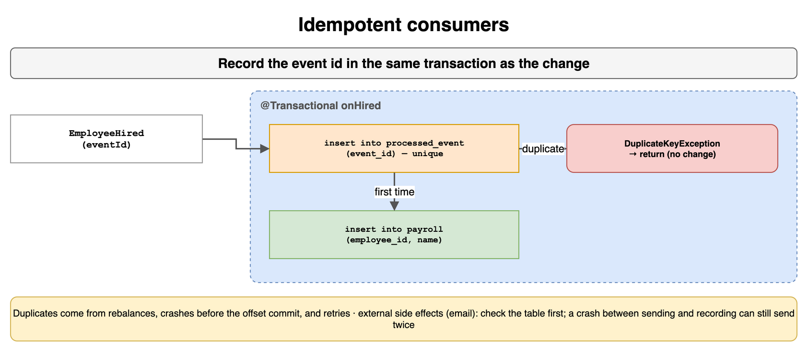
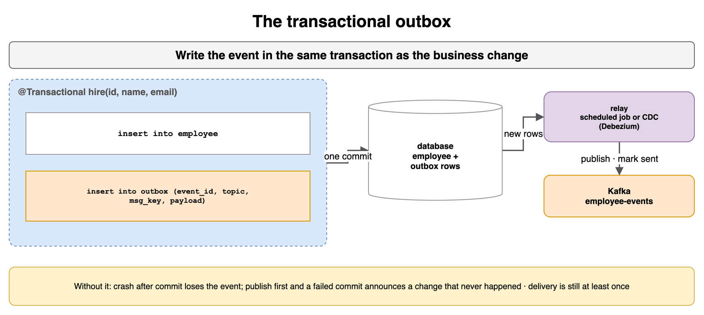

# Reliable Messaging Patterns

## Retry failed messages

When a listener throws, Spring Kafka's `DefaultErrorHandler` seeks back to the failed record and redelivers it. By default it tries ten times with no delay, then logs the record and moves on. Configure a back-off so a briefly unavailable dependency, such as a mail server, has time to recover.

Blocking retries hold up the whole partition while they wait, because later records cannot be processed before the failed one. Keep these retries short. Exceptions that will never succeed, such as a validation error or a deserialization failure, should not be retried at all; mark them as not retryable.

```java
import org.springframework.context.annotation.Bean;
import org.springframework.kafka.listener.DefaultErrorHandler;
import org.springframework.util.backoff.ExponentialBackOff;

@Bean
DefaultErrorHandler errorHandler() {
    ExponentialBackOff backOff = new ExponentialBackOff(500, 2.0);
    backOff.setMaxAttempts(4);
    DefaultErrorHandler handler = new DefaultErrorHandler(backOff);
    handler.addNotRetryableExceptions(IllegalArgumentException.class);
    return handler;
}
```

[Spring Kafka docs](https://docs.spring.io/spring-kafka/reference/kafka/annotation-error-handling.html#default-eh)



*Source: [`diagrams/reliable-messaging.drawio`](/content/13_Spring_Boot/25_Reliable_Messaging_Patterns/diagrams/reliable-messaging.drawio), page 1.*

## Send poison messages to a dead-letter topic

A message that fails every retry must not block the partition or vanish. A dead-letter topic (DLT) keeps it for inspection and replay. Give the error handler a `DeadLetterPublishingRecoverer`, and after the last retry it publishes the record to `<topic>-dlt`, adding headers with the exception, the original topic, partition, and offset.

Monitor the DLT and alert when it receives messages. Fix the cause, then replay the records to the original topic or process them with a separate listener. A DLT that nobody reads is just a slower way to lose data.

```java
import org.springframework.context.annotation.Bean;
import org.springframework.kafka.core.KafkaTemplate;
import org.springframework.kafka.listener.DeadLetterPublishingRecoverer;
import org.springframework.kafka.listener.DefaultErrorHandler;
import org.springframework.util.backoff.FixedBackOff;

@Bean
DefaultErrorHandler errorHandler(KafkaTemplate<Object, Object> template) {
    var recoverer = new DeadLetterPublishingRecoverer(template);
    return new DefaultErrorHandler(recoverer, new FixedBackOff(1000, 3));
}
```

[Spring Kafka docs](https://docs.spring.io/spring-kafka/reference/kafka/annotation-error-handling.html#dead-letters)



*Source: [`diagrams/reliable-messaging.drawio`](/content/13_Spring_Boot/25_Reliable_Messaging_Patterns/diagrams/reliable-messaging.drawio), page 2.*

## Non-blocking retries with retry topics

`@RetryableTopic` moves a failed record to a separate retry topic with a delay, and a listener on that topic tries again later. The main topic keeps flowing while the failed record waits. After the last attempt the record goes to a DLT, and a `@DltHandler` method in the same class can record it.

The trade-off is ordering. A retried event is processed after later events for the same key, so non-blocking retries suit independent events such as notifications, not state changes that must apply in order. Spring Kafka creates the retry and DLT topics automatically, and the default back-off waits one second between attempts; the annotation also takes a custom back-off.

```java
import org.springframework.kafka.annotation.DltHandler;
import org.springframework.kafka.annotation.KafkaListener;
import org.springframework.kafka.annotation.RetryableTopic;
import org.springframework.stereotype.Component;

@Component
class WelcomeNotifier {
    @RetryableTopic(attempts = "4")
    @KafkaListener(topics = "employee-events", groupId = "notification-service")
    void onHired(EmployeeHired event) {
        if (event.email().endsWith("@invalid")) {
            throw new IllegalStateException("mail server rejected " + event.email());
        }
        System.out.println("Welcome email to " + event.email());
    }

    @DltHandler
    void failed(EmployeeHired event) {
        System.err.println("Giving up on welcome mail for " + event.employeeId());
    }
}
```

[Spring Kafka docs](https://docs.spring.io/spring-kafka/reference/retrytopic.html)



*Source: [`diagrams/reliable-messaging.drawio`](/content/13_Spring_Boot/25_Reliable_Messaging_Patterns/diagrams/reliable-messaging.drawio), page 3.*

## Idempotent consumers

At-least-once delivery means a consumer will sometimes see the same event twice: after a rebalance, a crash before the offset commit, or a retry. An idempotent consumer produces the same result no matter how often it processes an event. Some operations are idempotent by nature, such as setting a status. Others, such as sending an email or adding to a balance, need a guard.

Record each processed event id in a table with a unique constraint, in the same database transaction as the business change. A duplicate fails the insert, so the change is not applied twice. For an external side effect such as an email, check the table first and accept that a crash between sending and recording can still send twice.

```java
import org.springframework.dao.DuplicateKeyException;
import org.springframework.jdbc.core.JdbcTemplate;
import org.springframework.kafka.annotation.KafkaListener;
import org.springframework.stereotype.Component;
import org.springframework.transaction.annotation.Transactional;

@Component
class PayrollConsumer {
    private final JdbcTemplate jdbc;

    PayrollConsumer(JdbcTemplate jdbc) {
        this.jdbc = jdbc;
    }

    @KafkaListener(topics = "employee-events", groupId = "payroll-service")
    @Transactional
    void onHired(EmployeeHired event) {
        try {
            jdbc.update("insert into processed_event (event_id) values (?)", event.eventId());
        } catch (DuplicateKeyException duplicate) {
            return;
        }
        jdbc.update("insert into payroll (employee_id, name) values (?, ?)", event.employeeId(), event.name());
    }
}
```

[Spring Kafka docs](https://docs.spring.io/spring-kafka/reference/kafka/transactions.html)



*Source: [`diagrams/reliable-messaging.drawio`](/content/13_Spring_Boot/25_Reliable_Messaging_Patterns/diagrams/reliable-messaging.drawio), page 4.*

## The transactional outbox

A service that writes to its database and then publishes to Kafka has two separate systems to update. If it crashes between the commit and the send, the event is lost; if it publishes first and the commit fails, consumers hear about a change that never happened. Kafka transactions do not cover the database.

The outbox pattern writes the event to an `outbox` table in the same transaction as the business change. A separate relay, a scheduled job or a change-data-capture tool such as Debezium, reads new outbox rows, publishes them, and marks them sent. Delivery is at least once, so consumers must still be idempotent.

```java
import org.springframework.jdbc.core.JdbcTemplate;
import org.springframework.stereotype.Service;
import org.springframework.transaction.annotation.Transactional;
import tools.jackson.databind.json.JsonMapper;

@Service
class HiringService {
    private final JdbcTemplate jdbc;
    private final JsonMapper json;

    HiringService(JdbcTemplate jdbc, JsonMapper json) {
        this.jdbc = jdbc;
        this.json = json;
    }

    @Transactional
    void hire(long id, String name, String email) {
        jdbc.update("insert into employee (id, name, email) values (?, ?, ?)", id, name, email);
        var event = EmployeeHired.of(id, name, email);
        jdbc.update("insert into outbox (event_id, topic, msg_key, payload) values (?, ?, ?, ?)",
                event.eventId(), "employee-events", String.valueOf(id), json.writeValueAsString(event));
    }
}
```

[Spring Modulith docs](https://docs.spring.io/spring-modulith/reference/events.html)



*Source: [`diagrams/reliable-messaging.drawio`](/content/13_Spring_Boot/25_Reliable_Messaging_Patterns/diagrams/reliable-messaging.drawio), page 5.*

## Choose between REST and messaging

Use REST when the caller needs an answer now: a query, a validation, or a step that the user waits on. Use messaging when the work can happen later, when several services react to the same fact, or when the producer must keep working while consumers are down. Many systems use both: a REST call to accept an order, then events to drive everything that follows.

Messaging is not free. It adds a broker to run, eventual consistency to explain to users, duplicate handling, schema evolution, and debugging across services. Choose it for the decoupling it buys, not by default.

| Question | REST | Messaging |
|---|---|---|
| Does the caller need the result now? | Yes | No |
| Several consumers of one fact? | Awkward | Natural |
| Consumer may be down? | Caller fails | Work waits |
| Consistency | Immediate | Eventual |

[Spring Kafka docs](https://docs.spring.io/spring-kafka/reference/)
