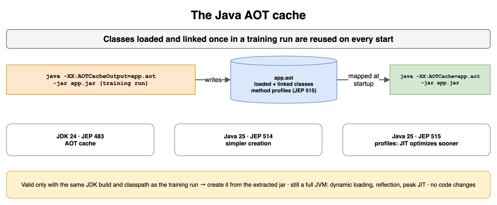
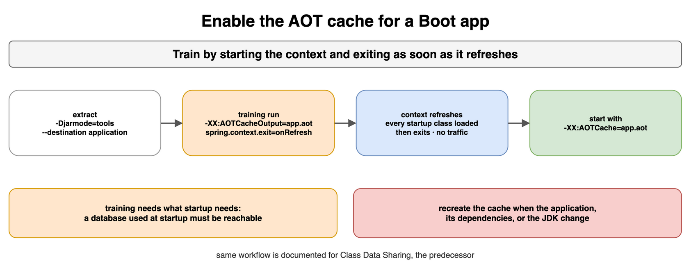
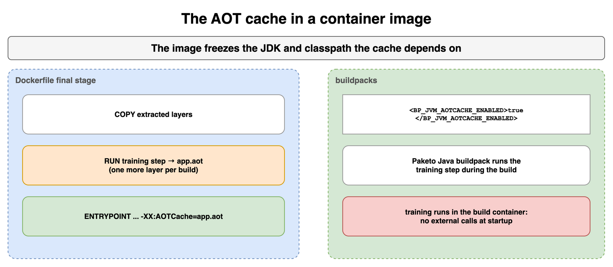
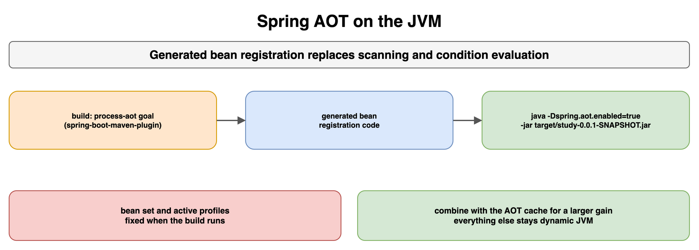
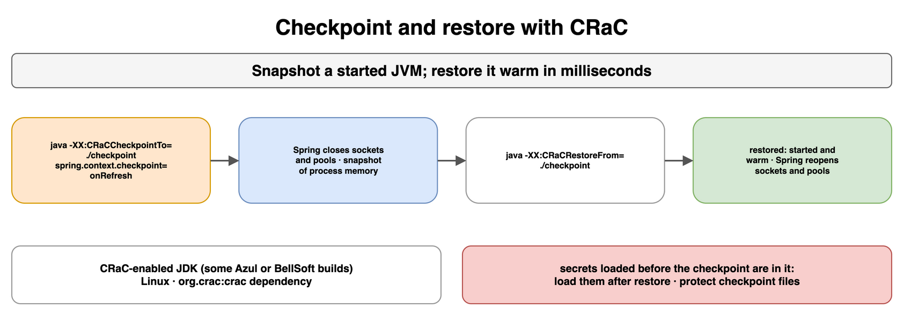

# AOT Cache and Fast Startup

## The Java AOT cache

Much of a JVM application's startup time goes to reading, parsing, verifying, and linking thousands of classes. The same work happens on every start. JDK 24 added an ahead-of-time cache (JEP 483) that stores classes already loaded and linked during a training run. Java 25 simplified creating it (JEP 514) and added method profiles (JEP 515), so the JIT compiler can start optimizing hot code sooner.

The cache is a file that the JVM maps at startup. It is valid only with the same JDK build and the same classpath as the training run, so it is created from the [extracted jar](#13_Spring_Boot/23_Executable_Jars_and_Container_Images/concepts/extract-the-jar-for-production), not from the uber jar. Unlike a native image, the app still runs on a full JVM with dynamic class loading, reflection, and peak JIT performance. The application code does not change.

```sh
java -XX:AOTCacheOutput=app.aot -jar app.jar
java -XX:AOTCache=app.aot -jar app.jar
```

[OpenJDK JEP 514](https://openjdk.org/jeps/514)



*Source: [`diagrams/aot-cache.drawio`](/content/13_Spring_Boot/26_AOT_Cache_and_Fast_Startup/diagrams/aot-cache.drawio), page 1.*

## Enable the AOT cache for a Boot app

A training run must exercise startup without becoming a real deployment. `spring.context.exit=onRefresh` makes Spring start the application context and exit as soon as it is refreshed. That loads every class that startup needs without serving traffic. Then start the extracted application with the cache file.

Boot documents this workflow for the AOT cache and for Class Data Sharing, its predecessor. Training needs whatever startup needs, so a database the app connects to during startup must be reachable, or startup must avoid connecting. Recreate the cache whenever the application, its dependencies, or the JDK change.

```sh
java -Djarmode=tools -jar target/study-0.0.1-SNAPSHOT.jar extract --destination application
cd application
java -XX:AOTCacheOutput=app.aot -Dspring.context.exit=onRefresh -jar study-0.0.1-SNAPSHOT.jar
java -XX:AOTCache=app.aot -jar study-0.0.1-SNAPSHOT.jar
```

[Spring Boot docs](https://docs.spring.io/spring-boot/reference/packaging/efficient.html)



*Source: [`diagrams/aot-cache.drawio`](/content/13_Spring_Boot/26_AOT_Cache_and_Fast_Startup/diagrams/aot-cache.drawio), page 2.*

## The AOT cache in a container image

Containers suit the AOT cache well, because the image freezes both the JDK and the classpath that the cache depends on. In a Dockerfile, run the training step in the final stage after copying the extracted layers, then use `-XX:AOTCache` in the entry point. The cache becomes another layer that changes with each application build.

With buildpacks, the Paketo Java buildpack can run the training step during the build when `BP_JVM_AOTCACHE_ENABLED` is set. Training runs inside the build container, so keep startup free of calls to external services or disable them for that run.

```xml
<plugin>
  <groupId>org.springframework.boot</groupId>
  <artifactId>spring-boot-maven-plugin</artifactId>
  <configuration>
    <image>
      <env>
        <BP_JVM_VERSION>25</BP_JVM_VERSION>
        <BP_JVM_AOTCACHE_ENABLED>true</BP_JVM_AOTCACHE_ENABLED>
      </env>
    </image>
  </configuration>
</plugin>
```

[Spring Boot docs](https://docs.spring.io/spring-boot/reference/packaging/container-images/cloud-native-buildpacks.html)



*Source: [`diagrams/aot-cache.drawio`](/content/13_Spring_Boot/26_AOT_Cache_and_Fast_Startup/diagrams/aot-cache.drawio), page 3.*

## Spring AOT on the JVM

The [Spring AOT processing](#13_Spring_Boot/25_Native_Images_with_GraalVM/concepts/spring-aot-processing) used for native images can also speed up a JVM app. The generated bean registration code replaces class scanning and condition evaluation at startup. Run the Maven plugin's `process-aot` goal during the build, then start the app with `-Dspring.aot.enabled=true` to use the generated code.

The restrictions are the native ones: the bean set and active profiles are fixed when the build runs. Combine it with the AOT cache for a larger gain. The JVM keeps its usual dynamic behavior for everything outside Spring's bean definitions.

```xml
<plugin>
  <groupId>org.springframework.boot</groupId>
  <artifactId>spring-boot-maven-plugin</artifactId>
  <executions>
    <execution>
      <id>process-aot</id>
      <goals>
        <goal>process-aot</goal>
      </goals>
    </execution>
  </executions>
</plugin>
```

```sh
java -Dspring.aot.enabled=true -jar target/study-0.0.1-SNAPSHOT.jar
```

[Spring Boot docs](https://docs.spring.io/spring-boot/reference/packaging/aot.html)



*Source: [`diagrams/aot-cache.drawio`](/content/13_Spring_Boot/26_AOT_Cache_and_Fast_Startup/diagrams/aot-cache.drawio), page 4.*

## Checkpoint and restore with CRaC

Coordinated Restore at Checkpoint (CRaC) snapshots a running JVM to disk and later restores it, already started and warmed up, in milliseconds. It needs a JDK build with CRaC support, such as some Azul or BellSoft builds, and it runs on Linux. Spring manages the lifecycle around the checkpoint: it closes sockets and pools before the snapshot and reopens them on restore. Add the `org.crac:crac` dependency.

`-Dspring.context.checkpoint=onRefresh` takes the checkpoint automatically once the context has started. The snapshot contains the process memory, so any secret loaded before the checkpoint is stored in the image. Load secrets and environment-specific settings after restore, and treat checkpoint files as sensitive.

```sh
java -XX:CRaCCheckpointTo=./checkpoint -Dspring.context.checkpoint=onRefresh -jar target/study-0.0.1-SNAPSHOT.jar
java -XX:CRaCRestoreFrom=./checkpoint
```

[Spring Framework docs](https://docs.spring.io/spring-framework/reference/integration/checkpoint-restore.html)



*Source: [`diagrams/aot-cache.drawio`](/content/13_Spring_Boot/26_AOT_Cache_and_Fast_Startup/diagrams/aot-cache.drawio), page 5.*

## Choose a startup strategy

The four options trade startup speed against build complexity and runtime flexibility. Measure your own application, because the gains depend on how much of startup is class loading, bean creation, or calls to external services. Boot logs the startup time in its `Started ... in N seconds` line.

| Option | Startup | Peak throughput | Constraints |
|---|---|---|---|
| Standard JVM | Slowest | Highest after warm-up | None |
| AOT cache | Faster | Same JVM, warms up sooner | Same JDK and classpath as training |
| Native image | Fastest, lowest memory | Can be lower | Closed world, long builds, hints |
| CRaC | Near instant, already warm | Same JVM | CRaC JDK on Linux, snapshot handling |

Start with the AOT cache, which needs no code changes. Choose a native image when memory and cold starts dominate, such as scale-to-zero services. Use CRaC when you control the runtime and need a warm JVM immediately.

```sh
java -jar target/study-0.0.1-SNAPSHOT.jar | grep 'Started StudyApplication'
```

[Spring Boot docs](https://docs.spring.io/spring-boot/reference/packaging/index.html)
