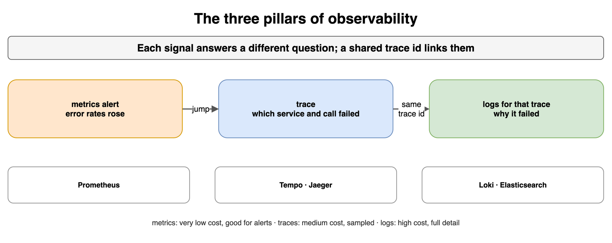
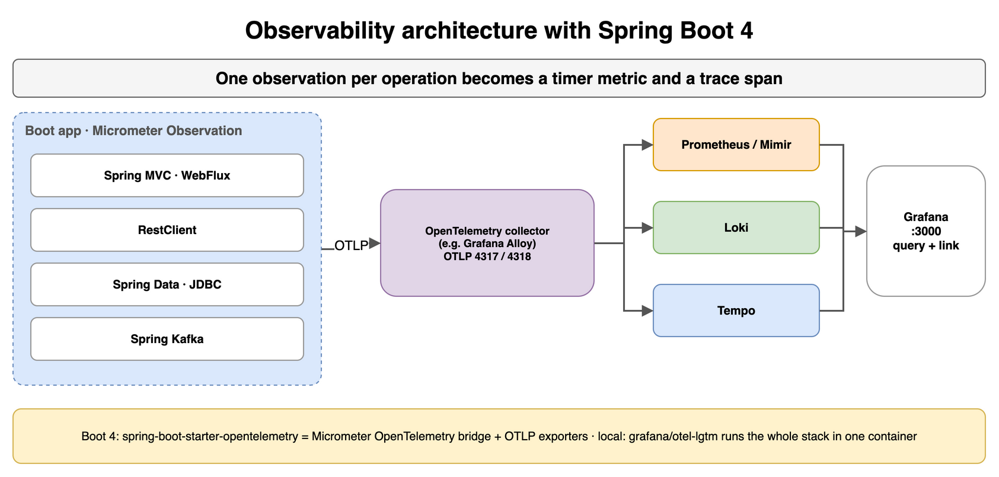
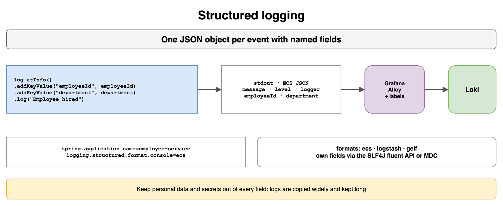
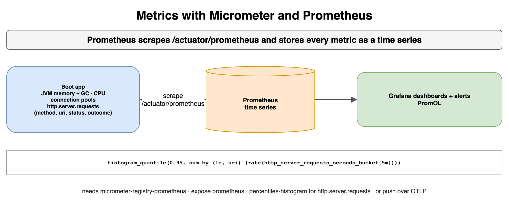
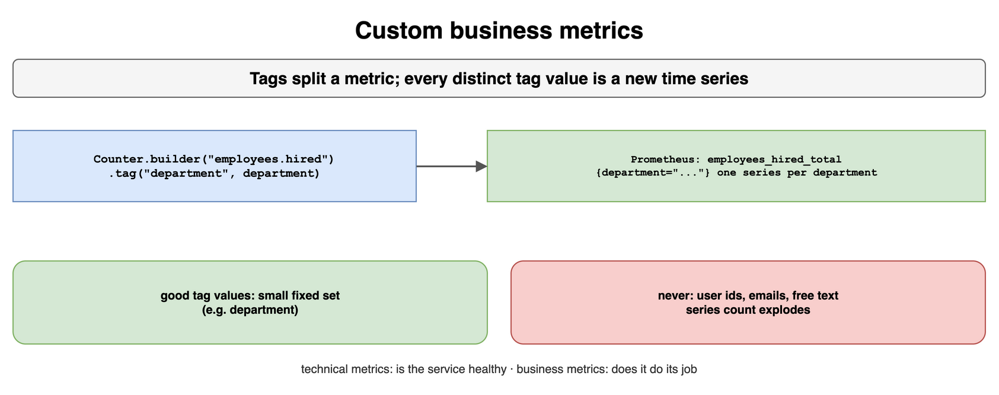
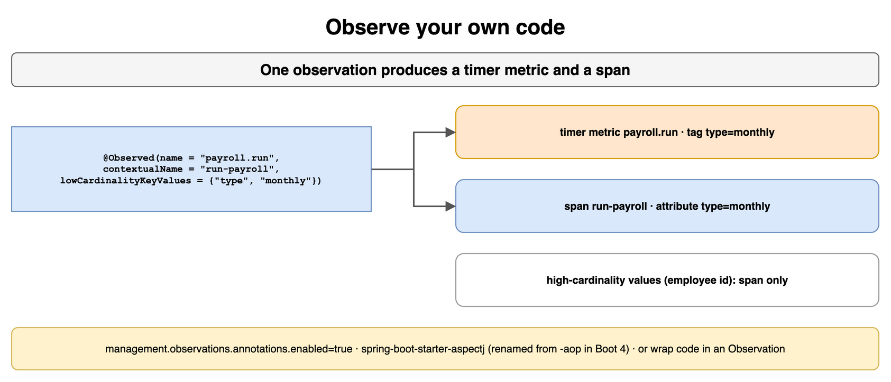

# Structured Logging and Metrics

## The three pillars of observability

Observability is the ability to explain what a running system is doing from the outside, without adding new code. Three kinds of signal support it. Logs record individual events with detail. Metrics are numbers aggregated over time, such as request rates and latencies, cheap to store and good for alerts. Traces follow one request across services and show where its time went.

Each signal answers a different question. A metric alert tells you error rates rose. A trace shows which service and call failed. The logs for that trace explain why. The signals pay off when you can jump between them, which needs a shared trace id in all three.

| Signal | Answers | Cost per event | Typical store |
|---|---|---|---|
| Logs | What happened, in detail? | High | Loki, Elasticsearch |
| Metrics | How much, how fast, how often? | Very low | Prometheus |
| Traces | Where did this request spend time? | Medium, sampled | Tempo, Jaeger |

[Spring Boot docs](https://docs.spring.io/spring-boot/reference/actuator/observability.html)



*Source: [`diagrams/logging-and-metrics.drawio`](/content/13_Spring_Boot/26_Structured_Logging_and_Metrics/diagrams/logging-and-metrics.drawio), page 1.*

## Observability architecture with Spring Boot 4

Spring Boot instruments applications through Micrometer. Its Observation API records one observation per operation, such as an HTTP request, a JDBC query, or a Kafka send, and turns each into a timer metric and a trace span. Spring MVC, WebFlux, `RestClient`, Spring Data, and Spring Kafka are instrumented out of the box.

A common open-source backend is the Grafana stack: Prometheus or Mimir for metrics, Loki for logs, Tempo for traces, and Grafana to query and link them. An OpenTelemetry collector such as Grafana Alloy can receive all three signals. Changed in Boot 4: `spring-boot-starter-opentelemetry` brings Micrometer's OpenTelemetry bridge and the OTLP exporters in one dependency. For local work, the `grafana/otel-lgtm` image runs the whole stack in one container.

```yaml
# compose.yaml
services:
  lgtm:
    image: grafana/otel-lgtm:latest
    ports:
      - "3000:3000"   # Grafana
      - "4317:4317"   # OTLP gRPC
      - "4318:4318"   # OTLP HTTP
```

[Spring Boot docs](https://docs.spring.io/spring-boot/reference/actuator/observability.html)



*Source: [`diagrams/logging-and-metrics.drawio`](/content/13_Spring_Boot/26_Structured_Logging_and_Metrics/diagrams/logging-and-metrics.drawio), page 2.*

## Structured logging

Text logs are written for people, and parsing them with regular expressions is fragile. Structured logs write each event as one JSON object with named fields, so a log store can filter by level, logger, or trace id. Boot supports structured logging natively: set `logging.structured.format.console` to `ecs` (Elastic Common Schema), `logstash`, or `gelf`.

In a container, write logs to standard output and let a collector such as Grafana Alloy ship them to Loki, adding labels such as the service name. Add your own fields through the SLF4J fluent API or the MDC. Keep personal data and secrets out of every field, because logs are copied widely and kept for a long time.

```properties
spring.application.name=employee-service
logging.structured.format.console=ecs
```

```java
import org.slf4j.Logger;
import org.slf4j.LoggerFactory;

class Hiring {
    private static final Logger log = LoggerFactory.getLogger(Hiring.class);

    void hired(long employeeId, String department) {
        log.atInfo()
                .addKeyValue("employeeId", employeeId)
                .addKeyValue("department", department)
                .log("Employee hired");
    }
}
```

[Spring Boot docs](https://docs.spring.io/spring-boot/reference/features/logging.html#features.logging.structured)



*Source: [`diagrams/logging-and-metrics.drawio`](/content/13_Spring_Boot/26_Structured_Logging_and_Metrics/diagrams/logging-and-metrics.drawio), page 3.*

## Metrics with Micrometer and Prometheus

Add `micrometer-registry-prometheus` and expose the `prometheus` actuator endpoint. Prometheus then scrapes `/actuator/prometheus` on an interval and stores every metric as a time series. Boot already records JVM memory and GC, CPU, connection pools, and `http.server.requests` with tags for method, URI template, status, and outcome.

Grafana dashboards and alerts query those series with PromQL. Turn on percentile histograms for the request timer so Prometheus can compute latency percentiles across instances. Alternatively, push metrics over OTLP to a collector instead of being scraped.

```properties
management.endpoints.web.exposure.include=health,info,prometheus
management.metrics.distribution.percentiles-histogram.http.server.requests=true
management.metrics.tags.application=${spring.application.name}
```

```text
histogram_quantile(0.95, sum by (le, uri) (rate(http_server_requests_seconds_bucket[5m])))
```

[Spring Boot docs](https://docs.spring.io/spring-boot/reference/actuator/metrics.html#actuator.metrics.export.prometheus)



*Source: [`diagrams/logging-and-metrics.drawio`](/content/13_Spring_Boot/26_Structured_Logging_and_Metrics/diagrams/logging-and-metrics.drawio), page 4.*

## Custom business metrics

Technical metrics show whether the service is healthy; business metrics show whether it does its job: employees hired, orders paid, notifications sent. Inject the `MeterRegistry` and create counters, timers, and gauges. Name metrics with dots, such as `employees.hired`; Prometheus converts the name to `employees_hired_total`.

Tags split a metric by dimension, such as department. Every distinct tag value creates a new time series, so use only values from a small, fixed set. Never tag with user ids, emails, or free text: the series count explodes and the metrics store slows down or drops data.

```java
import io.micrometer.core.instrument.Counter;
import io.micrometer.core.instrument.MeterRegistry;
import org.springframework.stereotype.Service;

@Service
class HiringMetrics {
    private final MeterRegistry registry;

    HiringMetrics(MeterRegistry registry) {
        this.registry = registry;
    }

    void hired(String department) {
        Counter.builder("employees.hired")
                .description("Employees hired")
                .tag("department", department)
                .register(registry)
                .increment();
    }
}
```

[Micrometer docs](https://docs.micrometer.io/micrometer/reference/concepts/counters.html)



*Source: [`diagrams/logging-and-metrics.drawio`](/content/13_Spring_Boot/26_Structured_Logging_and_Metrics/diagrams/logging-and-metrics.drawio), page 5.*

## Observe your own code

To time a business operation and give it a span in traces, wrap it in an `Observation`, or annotate the method with `@Observed`. One observation produces both a timer metric and a span, with the same name and low-cardinality tags. Turn on annotation support with `management.observations.annotations.enabled=true` and add `spring-boot-starter-aspectj`, which Boot 4 renamed from `spring-boot-starter-aop`.

Low-cardinality key values become metric tags and span attributes. High-cardinality values, such as an employee id, go only to the span, where they help to find one request without creating new metric series.

```properties
management.observations.annotations.enabled=true
```

```java
import io.micrometer.observation.annotation.Observed;
import org.springframework.stereotype.Service;

@Service
class PayrollService {
    @Observed(name = "payroll.run", contextualName = "run-payroll",
            lowCardinalityKeyValues = {"type", "monthly"})
    void runMonthly() {
        // Calculate salaries.
    }
}
```

[Spring Boot docs](https://docs.spring.io/spring-boot/reference/actuator/observability.html#actuator.observability.annotations)



*Source: [`diagrams/logging-and-metrics.drawio`](/content/13_Spring_Boot/26_Structured_Logging_and_Metrics/diagrams/logging-and-metrics.drawio), page 6.*
