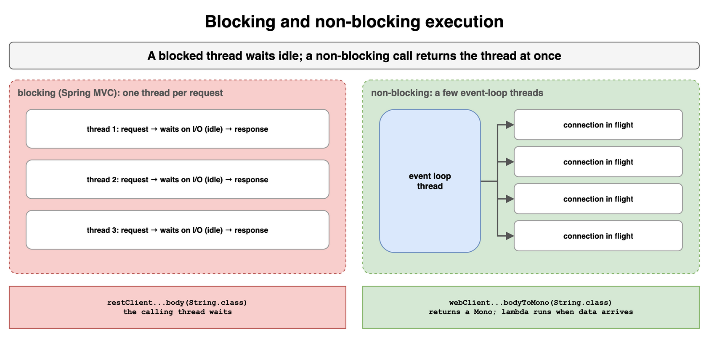
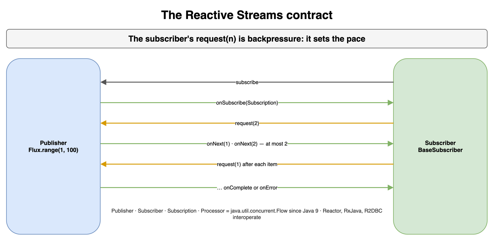
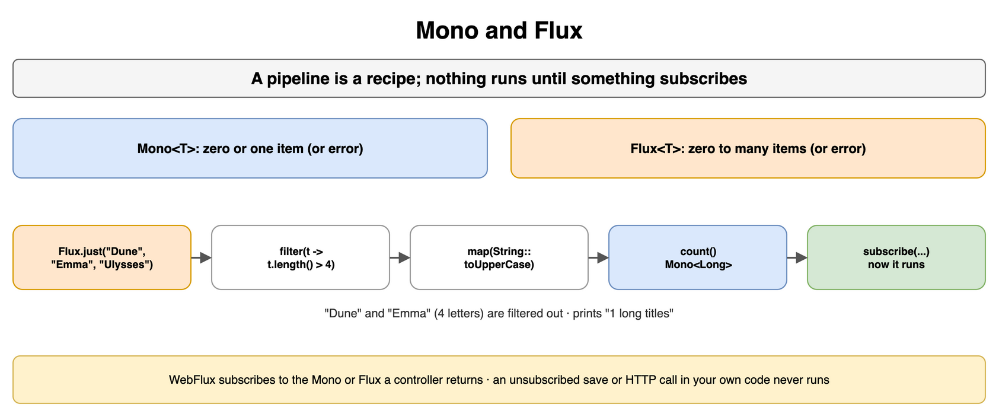
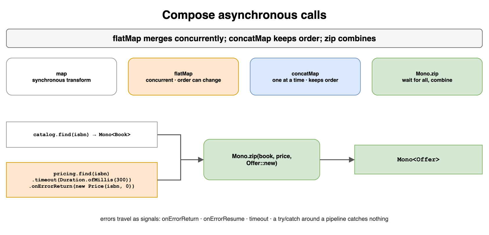
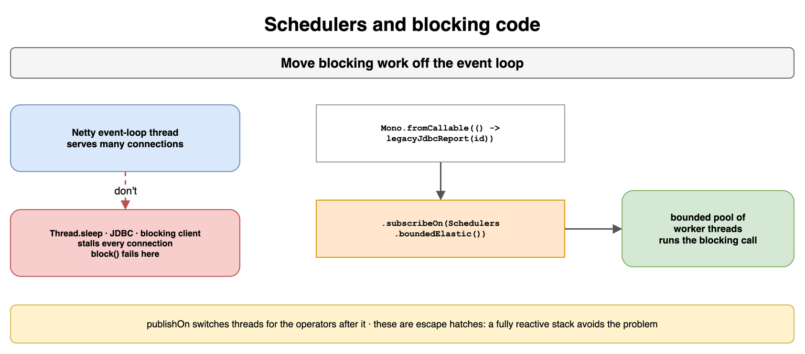

# Reactive Programming with Project Reactor

## Blocking and non-blocking execution

In the Spring MVC model, each request holds one thread from start to finish. When the code waits for a database or another HTTP service, that thread sits idle but cannot serve anyone else. Under load, the pool runs out of threads long before the CPU is busy, and new requests queue up.

Non-blocking code starts the I/O and returns the thread straight away. When the result arrives, a callback continues the work, often on another thread. A few event-loop threads can then keep thousands of connections in flight. The price is a different programming model: the code describes what should happen when data arrives, instead of waiting for it in a straight line.

```java
// Blocking: the calling thread waits for the response.
String body = restClient.get().uri("/books/1").retrieve().body(String.class);

// Non-blocking: the call returns a Mono at once; the lambda runs when data arrives.
Mono<String> later = webClient.get().uri("/books/1").retrieve().bodyToMono(String.class);
later.subscribe(b -> System.out.println("Got " + b.length() + " chars"));
```

[Spring Framework docs](https://docs.spring.io/spring-framework/reference/web/webflux/new-framework.html)



*Source: [`diagrams/project-reactor.drawio`](/content/13_Spring_Boot/27_Reactive_Programming_with_Project_Reactor/diagrams/project-reactor.drawio), page 1.*

## The Reactive Streams contract

Reactive Streams is a small specification with four interfaces: `Publisher`, `Subscriber`, `Subscription`, and `Processor`. A subscriber subscribes to a publisher and receives a subscription. It then calls `request(n)` to say how many items it can take. The publisher sends at most that many through `onNext`, then ends with `onComplete` or `onError`.

That request signal is backpressure: a slow consumer controls the pace instead of being flooded. Java has carried the same interfaces as `java.util.concurrent.Flow` since Java 9. Libraries such as Project Reactor, RxJava, and the R2DBC drivers all implement the contract, so they interoperate.

```java
import org.reactivestreams.Subscription;
import reactor.core.publisher.BaseSubscriber;
import reactor.core.publisher.Flux;

Flux.range(1, 100).subscribe(new BaseSubscriber<Integer>() {
    @Override
    protected void hookOnSubscribe(Subscription subscription) {
        request(2);
    }

    @Override
    protected void hookOnNext(Integer value) {
        System.out.println("Processing " + value);
        request(1);
    }
});
```

[Reactive Streams specification](https://www.reactive-streams.org/)



*Source: [`diagrams/project-reactor.drawio`](/content/13_Spring_Boot/27_Reactive_Programming_with_Project_Reactor/diagrams/project-reactor.drawio), page 2.*

## Mono and Flux

Project Reactor is the Reactive Streams library behind Spring WebFlux. It has two publisher types: `Mono<T>` emits zero or one item, and `Flux<T>` emits zero to many. Both may end with an error instead. Operators such as `map`, `filter`, `flatMap`, and `zip` build a pipeline that returns a new publisher at each step.

Nothing happens until something subscribes. A pipeline is a recipe, not a running computation. In a WebFlux controller, the framework subscribes to the `Mono` or `Flux` you return. In your own code, an unsubscribed pipeline is a common bug: the database save or HTTP call it describes never runs.

```java
import reactor.core.publisher.Flux;
import reactor.core.publisher.Mono;

Flux<String> titles = Flux.just("Dune", "Emma", "Ulysses")
        .filter(t -> t.length() > 4)
        .map(String::toUpperCase);

Mono<Long> count = titles.count();
count.subscribe(n -> System.out.println(n + " long titles"));
```

[Reactor reference](https://projectreactor.io/docs/core/release/reference/coreFeatures/flux.html)



*Source: [`diagrams/project-reactor.drawio`](/content/13_Spring_Boot/27_Reactive_Programming_with_Project_Reactor/diagrams/project-reactor.drawio), page 3.*

## Compose asynchronous calls

`map` transforms each value synchronously. `flatMap` takes each value to another publisher, such as a database lookup or HTTP call, and merges the results as they arrive, so the calls run concurrently and the order can change. `concatMap` keeps the order by running one inner publisher at a time. `Mono.zip` waits for several independent calls and combines their results.

Errors travel down the pipeline as a signal instead of a thrown exception. Handle them with operators: `onErrorReturn` supplies a fallback value, `onErrorResume` switches to another publisher, and `timeout` fails a call that takes too long. A `try`/`catch` around a pipeline catches nothing, because the work runs later.

```java
import java.time.Duration;
import reactor.core.publisher.Mono;

record Book(String isbn, String title) {}
record Price(String isbn, int cents) {}
record Offer(Book book, Price price) {}

Mono<Offer> offer(String isbn) {
    Mono<Book> book = catalog.find(isbn);
    Mono<Price> price = pricing.find(isbn)
            .timeout(Duration.ofMillis(300))
            .onErrorReturn(new Price(isbn, 0));
    return Mono.zip(book, price, Offer::new);
}
```

[Reactor reference](https://projectreactor.io/docs/core/release/reference/apdx-operatorChoice.html)



*Source: [`diagrams/project-reactor.drawio`](/content/13_Spring_Boot/27_Reactive_Programming_with_Project_Reactor/diagrams/project-reactor.drawio), page 4.*

## Schedulers and blocking code

Reactor does not choose threads by itself: a pipeline runs on whichever thread delivers its signals, usually a Netty event-loop thread in WebFlux. Blocking that thread, with `Thread.sleep`, JDBC, or a blocking client, stalls every connection it serves. `block()` is not allowed on those threads and fails with an exception.

When you must call blocking code, move it to a scheduler meant for it. `subscribeOn(Schedulers.boundedElastic())` runs the subscription, and so the blocking call, on a bounded pool of worker threads. `publishOn` switches the thread for the operators that follow it. Use these as an escape hatch; a fully reactive stack avoids the problem.

```java
import reactor.core.publisher.Mono;
import reactor.core.scheduler.Schedulers;

Mono<String> legacyReport(long id) {
    return Mono.fromCallable(() -> legacyJdbcReport(id))
            .subscribeOn(Schedulers.boundedElastic());
}
```

[Reactor reference](https://projectreactor.io/docs/core/release/reference/coreFeatures/schedulers.html)



*Source: [`diagrams/project-reactor.drawio`](/content/13_Spring_Boot/27_Reactive_Programming_with_Project_Reactor/diagrams/project-reactor.drawio), page 5.*
