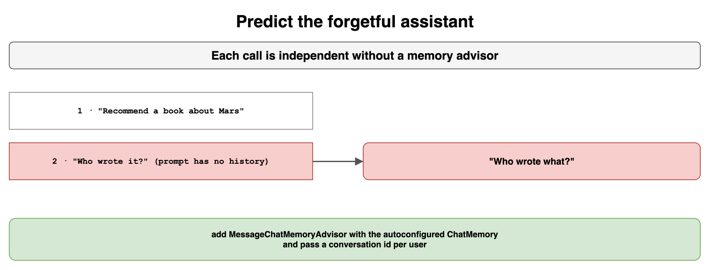
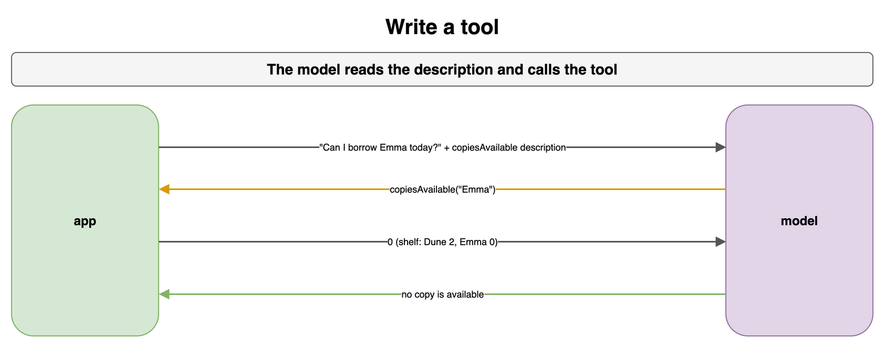

# Spring AI ChatClient, Prompts, and Tools — Drills

Predict the result before running the example.

## Predict the forgetful assistant

A user asks "Recommend a book about Mars", then "Who wrote it?". The second answer is "Who wrote what?". The client is built as below. Why, and what fixes it?

```java
ChatClient chat = builder.defaultSystem("You are a librarian.").build();

String reply(String message) {
    return chat.prompt().user(message).call().content();
}
```

**Answer**

Every call is independent, so the second prompt contains only "Who wrote it?". Add a `MessageChatMemoryAdvisor` with the autoconfigured `ChatMemory`, and pass a conversation id per user with `advisors(a -> a.param(ChatMemory.CONVERSATION_ID, id))`. See [conversation memory with advisors](#13_Spring_Boot/28_Spring_AI_ChatClient_Prompts_and_Tools/concepts/conversation-memory-with-advisors).



*Source: [`diagrams/spring-ai-chat-drills.drawio`](/content/13_Spring_Boot/28_Spring_AI_ChatClient_Prompts_and_Tools/diagrams/spring-ai-chat-drills.drawio), page 1.*

## Write a tool

Write a tool that tells the model whether a book is available to borrow, given its title, using a `Map<String, Integer>` of copies on the shelf. Then call it from a prompt.

**Answer**

```java
@Component
class AvailabilityTools {
    private final Map<String, Integer> shelf = Map.of("Dune", 2, "Emma", 0);

    @Tool(description = "Return how many copies of a book are on the shelf, by exact title")
    int copiesAvailable(@ToolParam(description = "Exact book title") String title) {
        return shelf.getOrDefault(title, 0);
    }
}
```

```java
chat.prompt().user("Can I borrow Emma today?").tools(availabilityTools).call().content();
```

The model reads the description, calls `copiesAvailable("Emma")`, receives 0, and answers that no copy is available. See [tool calling with the Tool annotation](#13_Spring_Boot/28_Spring_AI_ChatClient_Prompts_and_Tools/concepts/tool-calling-with-the-tool-annotation).



*Source: [`diagrams/spring-ai-chat-drills.drawio`](/content/13_Spring_Boot/28_Spring_AI_ChatClient_Prompts_and_Tools/diagrams/spring-ai-chat-drills.drawio), page 2.*
