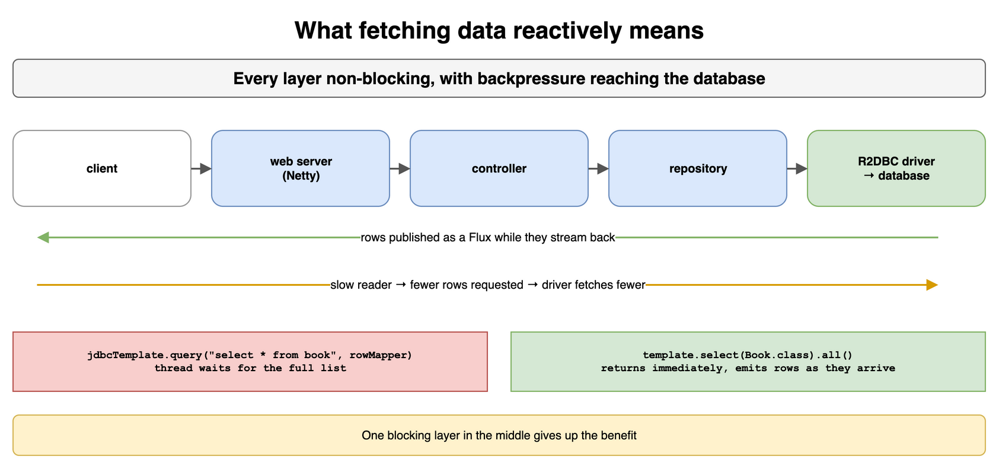
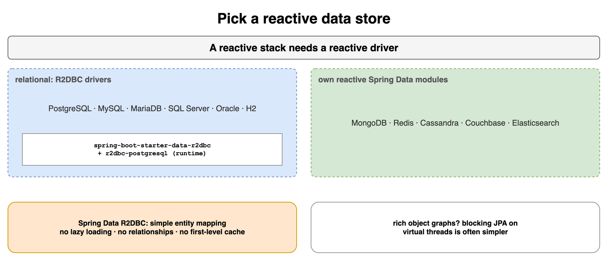
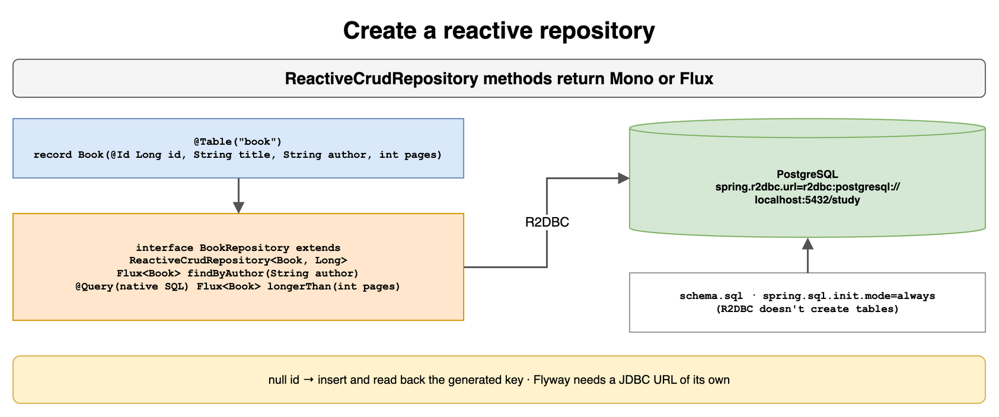
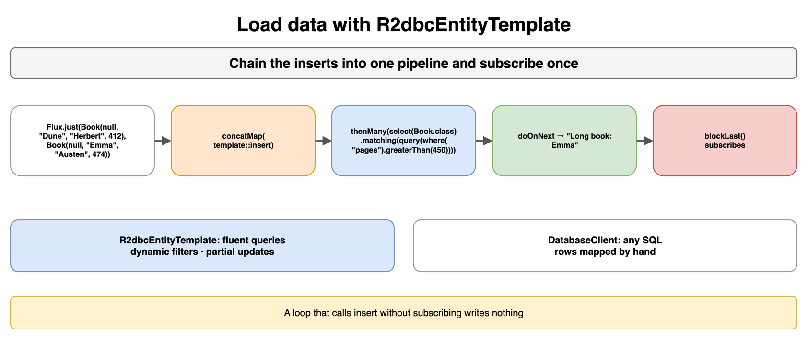
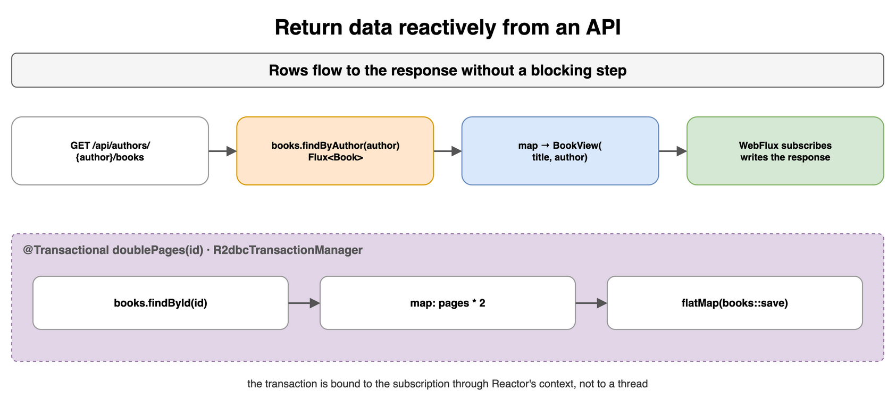
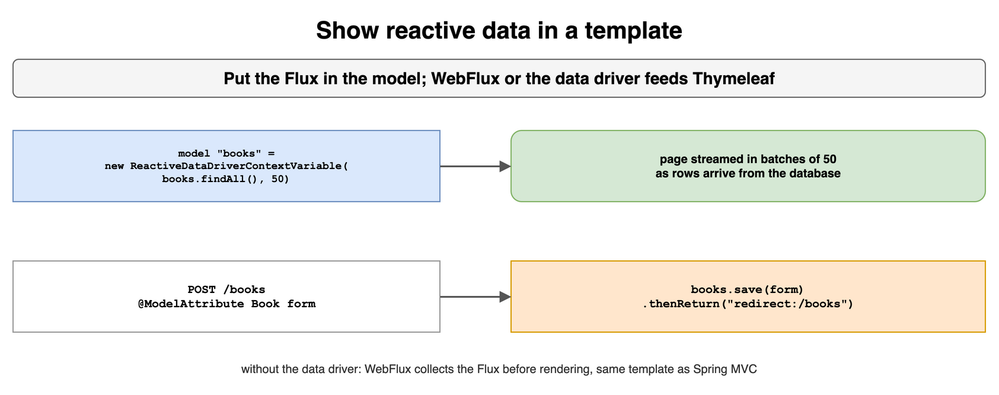

# Reactive Data with R2DBC

## What fetching data reactively means

JDBC is a blocking API: each query holds the calling thread until the database answers. In a WebFlux app that thread is an event-loop thread, so one JDBC call can stall many connections. Fetching data reactively means the driver sends the query, returns the thread at once, and publishes rows as a `Flux` while they stream back from the database.

Backpressure reaches all the way to the database. If the client reads slowly, the subscriber requests fewer rows and the driver fetches fewer. That only works when every layer is non-blocking: the web server, the controller, the repository, and the driver. One blocking layer in the middle gives up the benefit.

```java
// Blocking JDBC: the thread waits for the full result list.
List<Book> books = jdbcTemplate.query("select * from book", rowMapper);

// Reactive R2DBC: returns immediately and emits rows as they arrive.
Flux<Book> stream = template.select(Book.class).all();
```

[Spring Data R2DBC docs](https://docs.spring.io/spring-data/relational/reference/r2dbc.html)



*Source: [`diagrams/r2dbc.drawio`](/content/13_Spring_Boot/29_Reactive_Data_with_R2DBC/diagrams/r2dbc.drawio), page 1.*

## Pick a reactive data store

A reactive stack needs a reactive driver. For relational databases that is R2DBC (Reactive Relational Database Connectivity), with drivers for PostgreSQL, MySQL, MariaDB, SQL Server, Oracle, and H2. MongoDB, Redis, Cassandra, Couchbase, and Elasticsearch have their own reactive Spring Data modules.

R2DBC is not an ORM. Spring Data R2DBC maps rows to simple entities but has no lazy loading, no relationship mapping, and no first-level cache. Choose it when non-blocking throughput matters more than JPA's features. If the app needs rich object graphs, a blocking stack with JPA on [virtual threads](#13_Spring_Boot/30_Virtual_Threads/concepts/virtual-threads-in-a-spring-boot-app) is often the simpler choice.

```xml
<dependency>
  <groupId>org.springframework.boot</groupId>
  <artifactId>spring-boot-starter-data-r2dbc</artifactId>
</dependency>
<dependency>
  <groupId>org.postgresql</groupId>
  <artifactId>r2dbc-postgresql</artifactId>
  <scope>runtime</scope>
</dependency>
```

[Spring Boot docs](https://docs.spring.io/spring-boot/reference/data/sql.html#data.sql.r2dbc)



*Source: [`diagrams/r2dbc.drawio`](/content/13_Spring_Boot/29_Reactive_Data_with_R2DBC/diagrams/r2dbc.drawio), page 2.*

## Create a reactive repository

Map a table to a record or class with `@Table` and mark the key with `@Id`. A null id means a new row, so Spring Data inserts it and reads back the generated key. Extend `ReactiveCrudRepository` and every method returns `Mono` or `Flux`. Derived queries and `@Query` work much as in JPA, but `@Query` takes native SQL.

Boot configures the connection from `spring.r2dbc.url` and its username and password. R2DBC does not create tables. Put a `schema.sql` in `src/main/resources` and Boot's SQL initializer runs it through R2DBC at startup, or use Flyway, which needs a JDBC URL of its own.

```java
import org.springframework.data.annotation.Id;
import org.springframework.data.r2dbc.repository.Query;
import org.springframework.data.relational.core.mapping.Table;
import org.springframework.data.repository.reactive.ReactiveCrudRepository;
import reactor.core.publisher.Flux;

@Table("book")
record Book(@Id Long id, String title, String author, int pages) {}

interface BookRepository extends ReactiveCrudRepository<Book, Long> {
    Flux<Book> findByAuthor(String author);

    @Query("select * from book where pages > :pages order by pages desc")
    Flux<Book> longerThan(int pages);
}
```

```properties
spring.r2dbc.url=r2dbc:postgresql://localhost:5432/study
spring.r2dbc.username=study
spring.r2dbc.password=study
spring.sql.init.mode=always
```

[Spring Data R2DBC docs](https://docs.spring.io/spring-data/relational/reference/r2dbc/repositories.html)



*Source: [`diagrams/r2dbc.drawio`](/content/13_Spring_Boot/29_Reactive_Data_with_R2DBC/diagrams/r2dbc.drawio), page 3.*

## Load data with R2dbcEntityTemplate

`R2dbcEntityTemplate` is the lower-level API behind the repositories. Its fluent methods build queries in Java: `select(Book.class).matching(query(where("author").is(name)))`. It suits dynamic filters, partial updates, and work that does not fit a repository method. Boot autoconfigures it.

Below it sits `DatabaseClient`, which runs any SQL and maps rows by hand. To load sample data at startup, chain the inserts into one pipeline and subscribe once. A loop that calls `insert` without subscribing writes nothing.

```java
import static org.springframework.data.relational.core.query.Criteria.where;
import static org.springframework.data.relational.core.query.Query.query;

import org.springframework.boot.CommandLineRunner;
import org.springframework.context.annotation.Bean;
import org.springframework.data.r2dbc.core.R2dbcEntityTemplate;
import reactor.core.publisher.Flux;

@Bean
CommandLineRunner seed(R2dbcEntityTemplate template) {
    return args -> Flux.just(
                    new Book(null, "Dune", "Herbert", 412),
                    new Book(null, "Emma", "Austen", 474))
            .concatMap(template::insert)
            .thenMany(template.select(Book.class)
                    .matching(query(where("pages").greaterThan(450)))
                    .all())
            .doOnNext(b -> System.out.println("Long book: " + b.title()))
            .blockLast();
}
```

[Spring Data R2DBC docs](https://docs.spring.io/spring-data/relational/reference/r2dbc/entity-persistence.html)



*Source: [`diagrams/r2dbc.drawio`](/content/13_Spring_Boot/29_Reactive_Data_with_R2DBC/diagrams/r2dbc.drawio), page 4.*

## Return data reactively from an API

A WebFlux controller returns the repository's `Flux` or `Mono` directly. The database rows flow to the HTTP response without a blocking step, and the framework subscribes. Map entities to response records inside the pipeline so internal columns stay private.

Transactions work reactively too. Boot configures an `R2dbcTransactionManager`, and `@Transactional` on a method that returns a publisher keeps every statement in the pipeline in one transaction. The transaction is bound to the subscription through Reactor's context, not to a thread, so it follows the pipeline across threads.

```java
import org.springframework.transaction.annotation.Transactional;
import org.springframework.web.bind.annotation.GetMapping;
import org.springframework.web.bind.annotation.PathVariable;
import org.springframework.web.bind.annotation.PostMapping;
import org.springframework.web.bind.annotation.RestController;
import reactor.core.publisher.Flux;
import reactor.core.publisher.Mono;

record BookView(String title, String author) {}

@RestController
class BookApi {
    private final BookRepository books;

    BookApi(BookRepository books) {
        this.books = books;
    }

    @GetMapping("/api/authors/{author}/books")
    Flux<BookView> byAuthor(@PathVariable String author) {
        return books.findByAuthor(author).map(b -> new BookView(b.title(), b.author()));
    }

    @PostMapping("/api/books/{id}/double-pages")
    @Transactional
    Mono<Book> doublePages(@PathVariable long id) {
        return books.findById(id)
                .map(b -> new Book(b.id(), b.title(), b.author(), b.pages() * 2))
                .flatMap(books::save);
    }
}
```

[Spring Framework docs](https://docs.spring.io/spring-framework/reference/data-access/transaction/programmatic.html#tx-prog-operator)



*Source: [`diagrams/r2dbc.drawio`](/content/13_Spring_Boot/29_Reactive_Data_with_R2DBC/diagrams/r2dbc.drawio), page 5.*

## Show reactive data in a template

A page controller can put a repository's `Flux` straight into the model. WebFlux collects it before Thymeleaf renders, so the template is the same as in Spring MVC. For a long list, wrap the flux in `ReactiveDataDriverContextVariable` to stream the page in batches as rows arrive from the database.

Forms work as well: bind the submitted form to a record with `@ModelAttribute`, save it in the pipeline, and return a redirect view name such as `"redirect:/books"` once the save completes.

```java
import org.springframework.stereotype.Controller;
import org.springframework.ui.Model;
import org.springframework.web.bind.annotation.GetMapping;
import org.springframework.web.bind.annotation.ModelAttribute;
import org.springframework.web.bind.annotation.PostMapping;
import org.thymeleaf.spring6.context.webflux.ReactiveDataDriverContextVariable;
import reactor.core.publisher.Mono;

@Controller
class BookPages {
    private final BookRepository books;

    BookPages(BookRepository books) {
        this.books = books;
    }

    @GetMapping("/books")
    String list(Model model) {
        model.addAttribute("books", new ReactiveDataDriverContextVariable(books.findAll(), 50));
        return "books";
    }

    @PostMapping("/books")
    Mono<String> add(@ModelAttribute Book form) {
        return books.save(form).thenReturn("redirect:/books");
    }
}
```

[Thymeleaf docs](https://www.thymeleaf.org/doc/tutorials/3.1/thymeleafspring.html)



*Source: [`diagrams/r2dbc.drawio`](/content/13_Spring_Boot/29_Reactive_Data_with_R2DBC/diagrams/r2dbc.drawio), page 6.*
