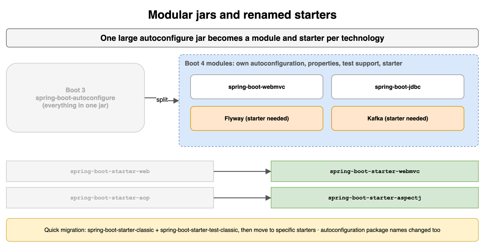
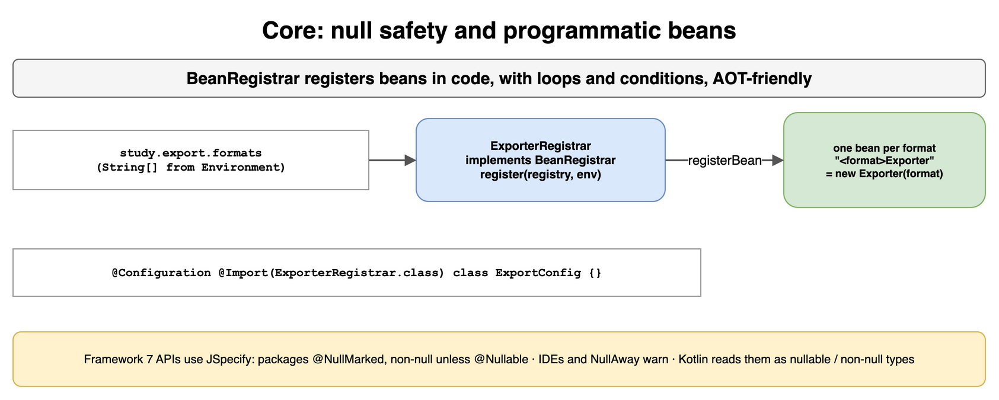
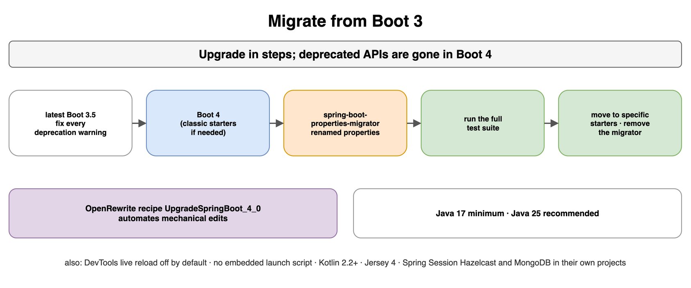

# What's New in Spring Boot 4

## Modular jars and renamed starters

Spring Boot 4 splits the large `spring-boot-autoconfigure` jar into small modules, one per technology, such as `spring-boot-webmvc` and `spring-boot-jdbc`. Each module brings its own autoconfiguration, properties, and test support, and each has a matching starter. Apps load less unused configuration, and the classpath says what the app really uses.

Some starters were renamed: `spring-boot-starter-web` became `spring-boot-starter-webmvc`, and `spring-boot-starter-aop` became `spring-boot-starter-aspectj`. Technologies that only needed a library before, such as Flyway and Kafka, now need their starter. For a quick migration, `spring-boot-starter-classic` and `spring-boot-starter-test-classic` restore the broad Boot 3 classpath; move to specific starters afterwards. Package names of autoconfiguration classes changed too, which matters if you exclude or import them by name.

```xml
<!-- Boot 3 -->
<artifactId>spring-boot-starter-web</artifactId>
<!-- Boot 4 -->
<artifactId>spring-boot-starter-webmvc</artifactId>
<artifactId>spring-boot-starter-webmvc-test</artifactId>
```

[Spring Boot 4.0 migration guide](https://github.com/spring-projects/spring-boot/wiki/Spring-Boot-4.0-Migration-Guide)



*Source: [`diagrams/whats-new-boot-4.drawio`](/content/13_Spring_Boot/31_Whats_New_in_Spring_Boot_4/diagrams/whats-new-boot-4.drawio), page 1.*

## Core: null safety and programmatic beans

Spring Framework 7 annotates its APIs with JSpecify: packages are `@NullMarked`, so every type is non-null unless marked `@Nullable`. IDEs and tools such as NullAway can then warn when your code passes or dereferences a possible null. Kotlin reads the annotations as nullable and non-null types. See [null safety in topic 5](#13_Spring_Boot/05_API_Versioning_and_Null_Safety).

`BeanRegistrar` is a new way to register beans in code, with loops and conditions, that also works with AOT and native images. Implement `register`, then `@Import` the registrar from a configuration class.

```java
import org.springframework.beans.factory.BeanRegistrar;
import org.springframework.beans.factory.BeanRegistry;
import org.springframework.core.env.Environment;

class ExporterRegistrar implements BeanRegistrar {
    @Override
    public void register(BeanRegistry registry, Environment env) {
        for (String format : env.getProperty("study.export.formats", String[].class, new String[0])) {
            registry.registerBean(format + "Exporter", Exporter.class,
                    spec -> spec.supplier(context -> new Exporter(format)));
        }
    }
}

// @Configuration @Import(ExporterRegistrar.class) class ExportConfig {}
```

[Spring Framework docs](https://docs.spring.io/spring-framework/reference/core/beans/java/programmatic-bean-registration.html)



*Source: [`diagrams/whats-new-boot-4.drawio`](/content/13_Spring_Boot/31_Whats_New_in_Spring_Boot_4/diagrams/whats-new-boot-4.drawio), page 2.*

## Jackson 3

Boot 4 uses Jackson 3 by default. Its packages moved from `com.fasterxml.jackson` to `tools.jackson`, except the annotations, which stay in `com.fasterxml.jackson.annotation`. `ObjectMapper` is immutable and built with `JsonMapper.builder()`, and Jackson's exceptions are now unchecked.

Customize Boot's mapper with a `JsonMapperBuilderCustomizer` bean or `spring.jackson.*` properties. Some Jackson defaults changed, so compare JSON output in your tests after upgrading. Jackson 2 support remains, deprecated, for libraries that still need it. See [JSON APIs in topic 4](#13_Spring_Boot/04_JSON_APIs).

```java
import org.springframework.boot.jackson.autoconfigure.JsonMapperBuilderCustomizer;
import org.springframework.context.annotation.Bean;
import tools.jackson.databind.SerializationFeature;

@Bean
JsonMapperBuilderCustomizer indentJson() {
    return builder -> builder.enable(SerializationFeature.INDENT_OUTPUT);
}
```

[Spring Boot docs](https://docs.spring.io/spring-boot/reference/features/json.html)

## Web changes

Spring MVC and WebFlux support [API versioning](#13_Spring_Boot/05_API_Versioning_and_Null_Safety) with a `version` attribute on mappings, configured from a header, query parameter, path segment, or media type. [HTTP service clients](#13_Spring_Boot/23_RestClient_and_HTTP_Service_Clients/concepts/register-http-service-clients-in-boot-4) are registered with `@ImportHttpServices` and configured from properties, and `RestTestClient` tests endpoints with the `RestClient` API.

Undertow is no longer supported, because it does not yet support Servlet 6.1; use Tomcat or Jetty. Static resources include a standard location for web fonts, so they are served and secured like other static files.

```java
@GetMapping(path = "/api/books", version = "2")
List<BookV2> booksV2() {
    return catalog.allV2();
}
```

[Spring Framework docs](https://docs.spring.io/spring-framework/reference/web/webmvc-versioning.html)

## Data and persistence

Spring Data JPA moves to Hibernate 7 and Jakarta Persistence 3.2, which drops long-deprecated Hibernate APIs and tightens some query rules. Boot adds a separate persistence module, so JPA-specific settings no longer depend on Spring Data. Elasticsearch moves to its Rest5 client, MongoDB settings are reorganized under clearer property names, and Redis client defaults changed.

Most changes affect configuration rather than code. Check the migration guide for renamed properties, then run the test suite against a real database with [Testcontainers](#13_Spring_Boot/13_Data_and_Security_Tests).

```properties
# Boot 4 reports renamed properties at startup when this module is present:
# spring-boot-properties-migrator (remove it after migrating)
spring.jpa.open-in-view=false
```

[Spring Boot docs](https://docs.spring.io/spring-boot/reference/data/sql.html)

## Security and testing

Spring Security 7 requires the lambda DSL and removes `and()` chains and other deprecated methods. Authorization rules use `AuthorizationManager` throughout, and the OAuth 2 starters were renamed, for example `spring-boot-starter-security-oauth2-client`. See [Spring Security foundations](#13_Spring_Boot/08_Spring_Security_Foundations).

Testing moves to JUnit 6 and Testcontainers 2. `@MockBean` and `@SpyBean` are gone; use `@MockitoBean` and `@MockitoSpyBean`. Web test clients are explicit: a `@SpringBootTest` with a running server no longer provides `TestRestTemplate` or `WebTestClient` by itself, so add `@AutoConfigureTestRestTemplate`, `@AutoConfigureWebTestClient`, or, for the new `RestTestClient`, `@AutoConfigureRestTestClient`. Support for Spock was removed. See [unit and web layer tests](#13_Spring_Boot/12_Unit_and_Web_Layer_Tests).

```java
// Boot 3
@MockBean BookRepository books;
// Boot 4
@MockitoBean BookRepository books;
```

[Spring Boot docs](https://docs.spring.io/spring-boot/reference/testing/index.html)

## Messaging, retry, and batch

Spring Framework 7 brings [retry and concurrency limits](#13_Spring_Boot/23_RestClient_and_HTTP_Service_Clients/concepts/retry-and-limit-calls-with-spring-framework-7) into the core with `@Retryable` and `@ConcurrencyLimit`, so many apps no longer need Spring Retry. Spring Kafka 4 serializes JSON with Jackson 3 and Boot adds more hooks to customize Kafka Streams. The reactive Pulsar support was removed.

Spring Batch 6 can run without a database: the default job repository is in memory, which suits short-lived jobs. Add a JDBC job repository when you need restarts across runs. Boot also autoconfigures a `JmsClient`, a fluent API like `JdbcClient` for sending and receiving JMS messages.

```java
jmsClient.destination("orders").send(new OrderPlaced(42));
```

[Spring Boot 4.0 release notes](https://github.com/spring-projects/spring-boot/wiki/Spring-Boot-4.0-Release-Notes)

## Observability, native, and AOT

`spring-boot-starter-opentelemetry` sets up OpenTelemetry export for traces, metrics, and logs in one dependency. Liveness and readiness probes are on by default, several `TaskDecorator` beans are combined, and SSL certificate health is reported through the health endpoint. See [observability](#13_Spring_Boot/26_Structured_Logging_and_Metrics).

For startup speed, Boot 4 improves AOT processing for native images and documents the Java 25 [AOT cache](#13_Spring_Boot/18_AOT_Cache_and_Fast_Startup/concepts/the-java-aot-cache) workflow. GraalVM 25 is the baseline for native images.

```properties
# Probes are on by default in Boot 4; set this only to turn them off.
management.endpoint.health.probes.enabled=false
```

[Spring Boot docs](https://docs.spring.io/spring-boot/reference/actuator/observability.html)

## Migrate from Boot 3

Upgrade to the latest Boot 3.5 first and fix every deprecation warning, because Boot 4 removes the deprecated APIs. Then move to Boot 4 with the classic starters if needed, add `spring-boot-properties-migrator` to report renamed properties, and run the full test suite. Java 17 remains the minimum, but Java 25 is the recommended version.

Watch for smaller changes: DevTools live reload is off by default, the embedded launch script is gone, Kotlin needs 2.2 or later, Jersey moves to version 4, and Spring Session's Hazelcast and MongoDB modules moved to their own projects. OpenRewrite recipes automate many of the mechanical edits.

```sh
./mvnw -U org.openrewrite.maven:rewrite-maven-plugin:run \
  -Drewrite.recipeArtifactCoordinates=org.openrewrite.recipe:rewrite-spring:RELEASE \
  -Drewrite.activeRecipes=org.openrewrite.java.spring.boot4.UpgradeSpringBoot_4_0
```

[Spring Boot 4.0 migration guide](https://github.com/spring-projects/spring-boot/wiki/Spring-Boot-4.0-Migration-Guide)



*Source: [`diagrams/whats-new-boot-4.drawio`](/content/13_Spring_Boot/31_Whats_New_in_Spring_Boot_4/diagrams/whats-new-boot-4.drawio), page 3.*
