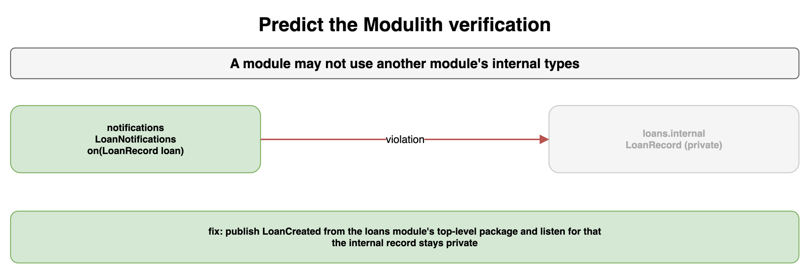
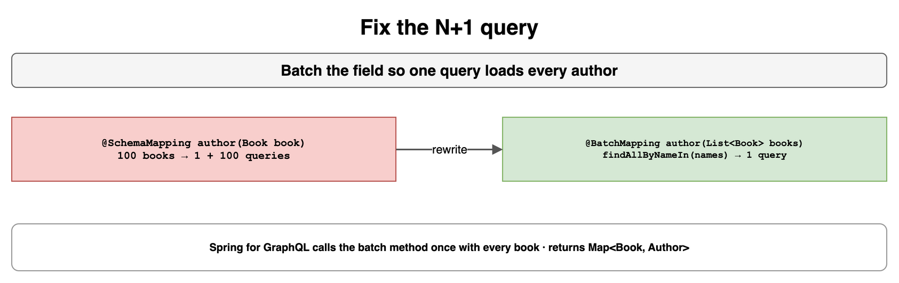

# Beyond the Book — Drills

Predict the result before running the example.

## Predict the Modulith verification

`notifications` contains this listener, which imports a class from `loans.internal`. What does `ApplicationModules.of(StudyApplication.class).verify()` report, and how do you fix it?

```java
package com.example.study.notifications;

import com.example.study.loans.internal.LoanRecord;

@Component
class LoanNotifications {
    @ApplicationModuleListener
    void on(LoanRecord loan) {
        System.out.println("Loan " + loan.id());
    }
}
```

**Answer**

The test fails with a violation: `notifications` depends on a non-exposed type in the `loans` module's internal package. Publish an event type from the `loans` module's top-level package, such as `LoanCreated`, and listen for that. The internal record stays private. See [modular monoliths with Spring Modulith](#13_Spring_Boot/32_Beyond_the_Book/concepts/modular-monoliths-with-spring-modulith).



*Source: [`diagrams/beyond-the-book-drills.drawio`](/content/13_Spring_Boot/32_Beyond_the_Book/diagrams/beyond-the-book-drills.drawio), page 1.*

## Fix the N+1 query

A GraphQL query returns 100 books with their authors, and the logs show 101 database queries. The author is resolved with the method below. Rewrite it to load all authors at once.

```java
@SchemaMapping
Author author(Book book) {
    return authors.findByName(book.authorName());
}
```

**Answer**

```java
@BatchMapping
Map<Book, Author> author(List<Book> books) {
    Set<String> names = books.stream().map(Book::authorName).collect(Collectors.toSet());
    Map<String, Author> byName = authors.findAllByNameIn(names).stream()
            .collect(Collectors.toMap(Author::name, a -> a));
    return books.stream().collect(Collectors.toMap(b -> b, b -> byName.get(b.authorName())));
}
```

Spring for GraphQL calls the batch method once with every book in the response, so one query loads all the authors. See [GraphQL APIs with Spring for GraphQL](#13_Spring_Boot/32_Beyond_the_Book/concepts/graphql-apis-with-spring-for-graphql).



*Source: [`diagrams/beyond-the-book-drills.drawio`](/content/13_Spring_Boot/32_Beyond_the_Book/diagrams/beyond-the-book-drills.drawio), page 2.*
