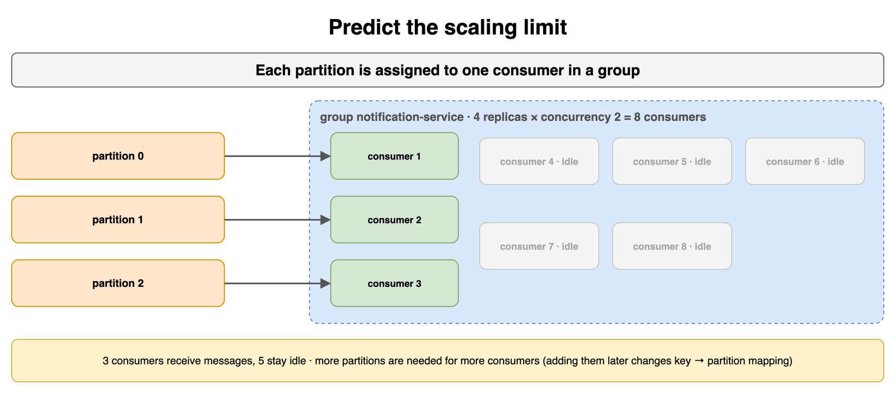
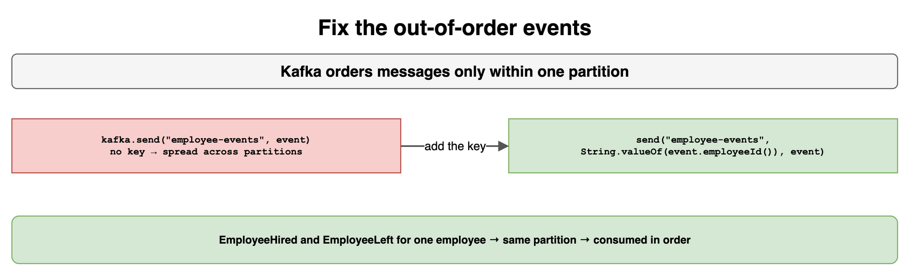

# Event-Driven Messaging with Kafka — Drills

Predict the result before running the example.

## Predict the scaling limit

The `employee-events` topic has 3 partitions. The notification service runs 4 replicas, each with `concurrency = "2"`, all in the group `notification-service`. How many consumers actually receive messages?

**Answer**

Three. Kafka assigns each partition to exactly one consumer in a group, so of the 8 consumers, 3 get a partition and 5 stay idle. To use more consumers, create the topic with more partitions. Adding partitions later changes which partition a key maps to, so plan the count up front. See [Kafka fundamentals](#13_Spring_Boot/32_Event_Driven_Messaging_with_Kafka/concepts/kafka-fundamentals).



*Source: [`diagrams/kafka-drills.drawio`](/content/13_Spring_Boot/32_Event_Driven_Messaging_with_Kafka/diagrams/kafka-drills.drawio), page 1.*

## Fix the out-of-order events

An employee's `EmployeeHired` and `EmployeeLeft` events are sometimes processed in the wrong order, so the notifier welcomes someone who has already left. The producer code is below. What is the fix?

```java
kafka.send("employee-events", event);
```

**Answer**

The messages have no key, so they are spread across partitions, and Kafka orders messages only within one partition. Send with the employee id as the key: `kafka.send("employee-events", String.valueOf(event.employeeId()), event);`. All events for one employee then land in the same partition and are consumed in order. See [produce events with KafkaTemplate](#13_Spring_Boot/32_Event_Driven_Messaging_with_Kafka/concepts/produce-events-with-kafkatemplate).



*Source: [`diagrams/kafka-drills.drawio`](/content/13_Spring_Boot/32_Event_Driven_Messaging_with_Kafka/diagrams/kafka-drills.drawio), page 2.*
