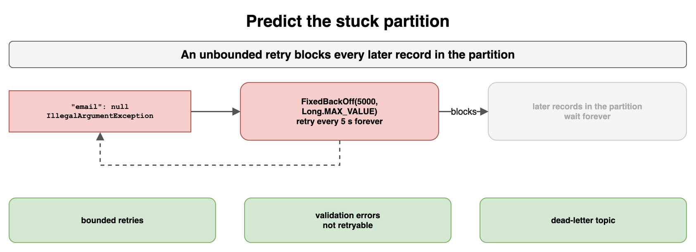

# Reliable Messaging Patterns — Drills

Predict the result before running the example.

## Predict the stuck partition

A listener receives a message whose JSON payload has `"email": null`, and the listener throws `IllegalArgumentException` for it. The error handler uses `new FixedBackOff(5000, Long.MAX_VALUE)`. What happens to the other messages in that partition?

**Answer**

They wait forever. The error handler seeks back to the failed record and retries it every 5 seconds without end, and later records in the partition cannot be processed before it. Retry a bounded number of times, mark validation errors as not retryable, and send the record to a [dead-letter topic](#13_Spring_Boot/33_Reliable_Messaging_Patterns/concepts/send-poison-messages-to-a-dead-letter-topic).



*Source: [`diagrams/reliable-messaging-drills.drawio`](/content/13_Spring_Boot/33_Reliable_Messaging_Patterns/diagrams/reliable-messaging-drills.drawio), page 1.*

## Make the consumer idempotent

This consumer adds a signing bonus to an account. After a rebalance, some employees receive the bonus twice. Fix it.

```java
@KafkaListener(topics = "employee-events", groupId = "payroll-service")
void onHired(EmployeeHired event) {
    jdbc.update("update account set balance = balance + 500 where employee_id = ?", event.employeeId());
}
```

**Answer**

Record the event id in a `processed_event` table with a unique key, in the same transaction as the update, and skip the update when the insert fails:

```java
@KafkaListener(topics = "employee-events", groupId = "payroll-service")
@Transactional
void onHired(EmployeeHired event) {
    try {
        jdbc.update("insert into processed_event (event_id) values (?)", event.eventId());
    } catch (DuplicateKeyException duplicate) {
        return;
    }
    jdbc.update("update account set balance = balance + 500 where employee_id = ?", event.employeeId());
}
```

A redelivered event then changes nothing. See [idempotent consumers](#13_Spring_Boot/33_Reliable_Messaging_Patterns/concepts/idempotent-consumers).
