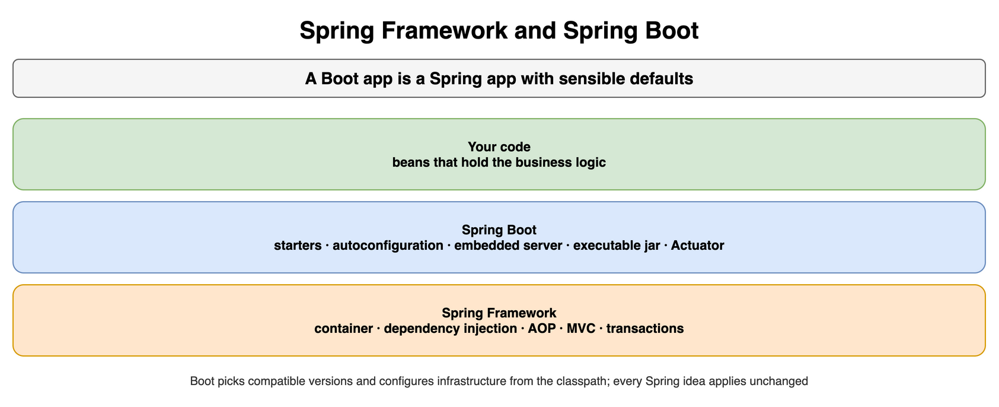
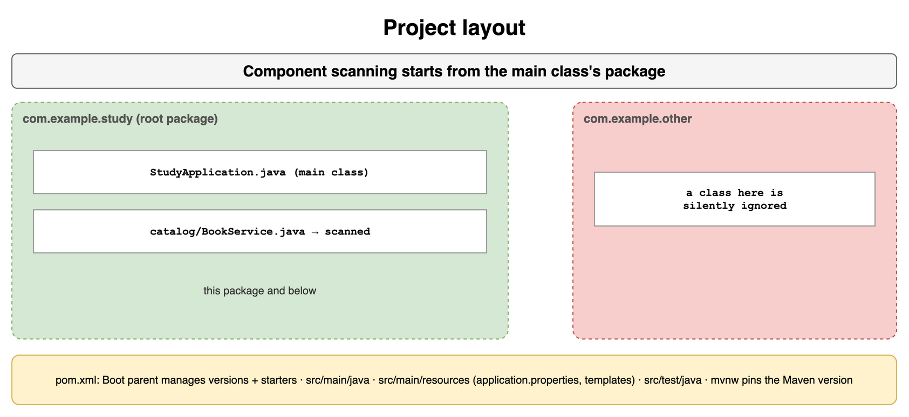
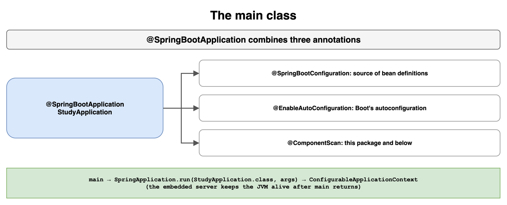
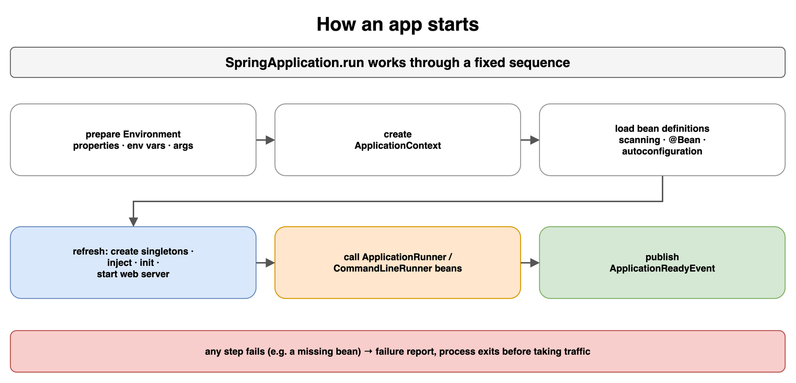
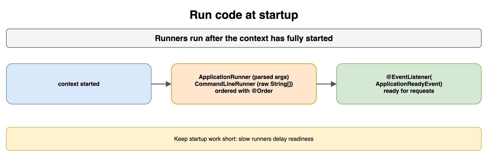

# Spring Project Anatomy and Startup

## Spring Framework and Spring Boot

Spring Framework is the foundation: a container that creates and connects your objects, plus modules for web, data access, transactions, and messaging. On its own it asks you to choose libraries, versions, and configuration yourself. Spring Boot sits on top. It picks compatible versions, configures common infrastructure from what is on the classpath, and packages the app as one runnable jar with an embedded server.

So a Boot app is a Spring app with sensible defaults. Every Spring idea in this part, beans, injection, proxies, transactions, applies unchanged; Boot only decides more of the setup for you. [Topic 1](#13_Spring_Boot/01_Core_Features_and_Autoconfiguration) shows how Boot's autoconfiguration makes those decisions.

| Layer | Gives you |
|---|---|
| Spring Framework | Container, dependency injection, AOP, MVC, transactions |
| Spring Boot | Starters, autoconfiguration, embedded server, executable jar, Actuator |
| Your code | Beans that hold the business logic |

[Spring Boot docs](https://docs.spring.io/spring-boot/index.html)



*Source: [`diagrams/project-anatomy.drawio`](/content/13_Spring_Boot/33_Spring_Project_Anatomy_and_Startup/diagrams/project-anatomy.drawio), page 1.*

## Project layout

A generated Maven project has a fixed shape. `pom.xml` declares the Boot parent, which manages dependency versions, and the starters you need. Java code lives in `src/main/java`, configuration and templates in `src/main/resources`, and tests in `src/test/java`. `mvnw` is the Maven wrapper, so builds use the same Maven version everywhere.

Put the main class in a root package, such as `com.example.study`, and every other class in that package or below. Component scanning starts from the main class's package, so a class in `com.example.other` is silently ignored.

```text
study/
├── pom.xml
├── mvnw
└── src/
    ├── main/
    │   ├── java/com/example/study/
    │   │   ├── StudyApplication.java
    │   │   └── catalog/BookService.java
    │   └── resources/
    │       ├── application.properties
    │       └── templates/
    └── test/java/com/example/study/StudyApplicationTests.java
```

[Spring Boot docs](https://docs.spring.io/spring-boot/reference/using/structuring-your-code.html)



*Source: [`diagrams/project-anatomy.drawio`](/content/13_Spring_Boot/33_Spring_Project_Anatomy_and_Startup/diagrams/project-anatomy.drawio), page 2.*

## The main class

`@SpringBootApplication` combines three annotations. `@SpringBootConfiguration` marks the class as a source of bean definitions. `@EnableAutoConfiguration` turns on Boot's autoconfiguration. `@ComponentScan` finds annotated classes in this package and below.

`main` calls `SpringApplication.run`, which builds the container and returns it once the app has started. The returned `ConfigurableApplicationContext` is the running container; in a web app the embedded server keeps the JVM alive after `main` returns.

```java
import org.springframework.boot.SpringApplication;
import org.springframework.boot.autoconfigure.SpringBootApplication;

@SpringBootApplication
public class StudyApplication {
    public static void main(String[] args) {
        SpringApplication.run(StudyApplication.class, args);
    }
}
```

[Spring Boot docs](https://docs.spring.io/spring-boot/reference/using/using-the-springbootapplication-annotation.html)



*Source: [`diagrams/project-anatomy.drawio`](/content/13_Spring_Boot/33_Spring_Project_Anatomy_and_Startup/diagrams/project-anatomy.drawio), page 3.*

## How an app starts

`SpringApplication.run` works through a fixed sequence. It prepares the `Environment` from properties files, environment variables, and arguments. It creates the application context and loads bean definitions from your classes and from autoconfiguration. It then refreshes the context: it creates every singleton bean, injects dependencies, and runs initialization callbacks. A web app starts its embedded server during the refresh.

Last, it calls every `ApplicationRunner` and `CommandLineRunner` bean and publishes `ApplicationReadyEvent`. If any step fails, for example a missing bean, startup stops with a failure report and the process exits. Failing at startup is a feature: wiring errors surface before the app takes traffic.

```text
run()
 ├─ prepare Environment          (properties, env vars, args)
 ├─ create ApplicationContext
 ├─ load bean definitions         (scanning, @Bean, autoconfiguration)
 ├─ refresh                       (create singletons, inject, init, start web server)
 ├─ call ApplicationRunner / CommandLineRunner beans
 └─ publish ApplicationReadyEvent
```

[Spring Boot docs](https://docs.spring.io/spring-boot/reference/features/spring-application.html)



*Source: [`diagrams/project-anatomy.drawio`](/content/13_Spring_Boot/33_Spring_Project_Anatomy_and_Startup/diagrams/project-anatomy.drawio), page 4.*

## Run code at startup

To do work once the app is ready, such as loading sample data or printing a report, declare an `ApplicationRunner` or `CommandLineRunner` bean. Both run after the context is fully started. `ApplicationRunner` receives parsed arguments; `CommandLineRunner` receives the raw string array. Order several runners with `@Order`.

To react to lifecycle moments elsewhere, listen for events with `@EventListener`. `ApplicationReadyEvent` fires when the app can serve requests. Keep startup work short, because slow runners delay readiness.

```java
import org.springframework.boot.ApplicationRunner;
import org.springframework.boot.context.event.ApplicationReadyEvent;
import org.springframework.context.annotation.Bean;
import org.springframework.context.annotation.Configuration;
import org.springframework.context.event.EventListener;

@Configuration
class StartupConfig {
    @Bean
    ApplicationRunner greet() {
        return args -> System.out.println("Options: " + args.getOptionNames());
    }

    @EventListener(ApplicationReadyEvent.class)
    void ready() {
        System.out.println("Ready for requests");
    }
}
```

[Spring Boot docs](https://docs.spring.io/spring-boot/reference/features/spring-application.html#features.spring-application.command-line-runner)



*Source: [`diagrams/project-anatomy.drawio`](/content/13_Spring_Boot/33_Spring_Project_Anatomy_and_Startup/diagrams/project-anatomy.drawio), page 5.*
