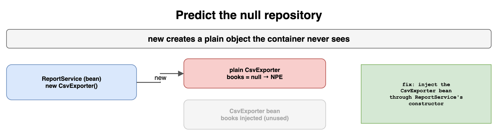
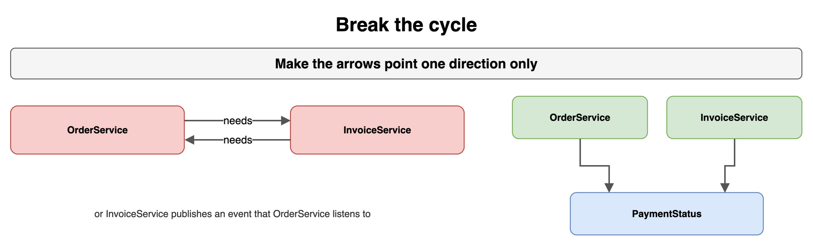

# IoC, Dependency Injection, and Beans — Drills

Predict the result before running the example.

## Predict the null repository

`ReportService` is a bean, and `BookRepository` is a bean too. Calling `report()` throws a `NullPointerException`. Why?

```java
@Service
class ReportService {
    String report() {
        var exporter = new CsvExporter();
        return exporter.export();
    }
}

@Component
class CsvExporter {
    @Autowired
    BookRepository books;

    String export() {
        return String.join(",", books.titles());
    }
}
```

**Answer**

`new CsvExporter()` creates a plain object that the container never sees, so nothing injects `books` and it stays null. The `CsvExporter` bean that Spring created is a different instance. Inject the bean into `ReportService` through its constructor instead of calling `new`. See [what a bean is](#13_Spring_Boot/34_IoC_Dependency_Injection_and_Beans/concepts/what-a-bean-is).



*Source: [`diagrams/ioc-and-beans-drills.drawio`](/content/13_Spring_Boot/34_IoC_Dependency_Injection_and_Beans/diagrams/ioc-and-beans-drills.drawio), page 1.*

## Break the cycle

Startup fails with "The dependencies of some of the beans in the application context form a cycle". How do you fix it without turning off the check?

```java
@Service
class OrderService {
    OrderService(InvoiceService invoices) { }
    void markPaid(long orderId) { }
}

@Service
class InvoiceService {
    InvoiceService(OrderService orders) { }
}
```

**Answer**

Each constructor needs the other bean first, so neither can be created. Find what each one uses from the other and move it into a third bean that both depend on, such as a `PaymentStatus` service, or let `InvoiceService` publish an event that `OrderService` listens to. Either way the arrows point one direction only. See [how the container resolves dependencies](#13_Spring_Boot/34_IoC_Dependency_Injection_and_Beans/concepts/how-the-container-resolves-dependencies).



*Source: [`diagrams/ioc-and-beans-drills.drawio`](/content/13_Spring_Boot/34_IoC_Dependency_Injection_and_Beans/diagrams/ioc-and-beans-drills.drawio), page 2.*
