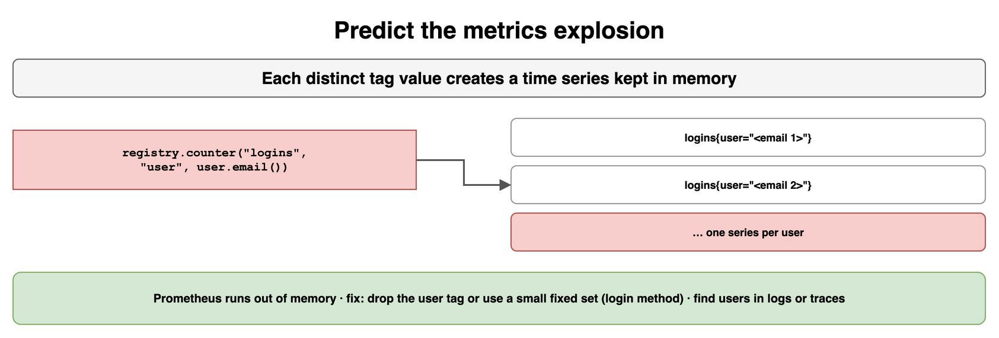

# Structured Logging and Metrics — Drills

Predict the result before running the example.

## Predict the metrics explosion

A teammate adds this counter to track logins. A week later the Prometheus server runs out of memory. Why?

```java
registry.counter("logins", "user", user.email()).increment();
```

**Answer**

Each distinct email creates a new time series, so the series count grows with the user base. Prometheus keeps every active series in memory. Remove the `user` tag or replace it with a value from a small fixed set, such as the login method. Find individual users in logs or traces instead. See [custom business metrics](#13_Spring_Boot/34_Structured_Logging_and_Metrics/concepts/custom-business-metrics).



*Source: [`diagrams/logging-and-metrics-drills.drawio`](/content/13_Spring_Boot/34_Structured_Logging_and_Metrics/diagrams/logging-and-metrics-drills.drawio), page 1.*

## Turn a log line into a structured event

Rewrite this log statement so that Loki can filter by order id and amount without parsing the message, and configure ECS output.

```java
log.info("Order " + orderId + " paid " + amount + " EUR");
```

**Answer**

```java
log.atInfo().addKeyValue("orderId", orderId).addKeyValue("amountEur", amount).log("Order paid");
```

```properties
logging.structured.format.console=ecs
```

The message stays constant, which also makes the logs easier to group, and the values become JSON fields. See [structured logging](#13_Spring_Boot/34_Structured_Logging_and_Metrics/concepts/structured-logging).
